<figure>

![Título: ETM Day 2025: El Corazón del Emprendimiento Latinoamericano

Esta infografía presenta los pilares fundamentales del próximo gran evento de emprendimiento en la región, utilizando un corazón anatómico como metáfora central del que fluyen las siguientes arterias de innovación:

Magnitud del Evento:

+50.000 Asistentes: Reunión masiva de emprendedores, inversionistas y corporativos durante tres días.

El encuentro más grande de la región: Consolidado como el evento principal de inversión en LatAm.

1.000+ Stands en 22 Hectáreas: Un espacio inmenso para exhibición y networking estratégico.

Fintech e Inversión (Impactaland):

Conexiones de alto impacto a través de ruedas de negocio, mentorías y pitches para conectar startups con capital.

Zonas Temáticas Especializadas:

Enfoque en Sostenibilidad y Tecnología, con pabellones dedicados a Deep Tech, Industrias Creativas y Fintech.

Foco Internacional:

India País Invitado: Fomento de la colaboración global en tecnología, finanzas y cultura, con énfasis en impacto social.

Organizan: EtMday (Emprende tu Mente) y Tiempos Sustentables.](images/diseno-sin-titulo-3.png)

<figcaption>

ETM Day 2025: El Corazón del Emprendimiento Latinoamericano.

</figcaption>

</figure>

<figure>

![Un gráfico informativo titulado "El Ecosistema del ETM Day 2025: ¿Quiénes Impulsan la Innovación?". Presenta un diseño tipo árbol con tres ramas principales que representan los pilares del evento: "Apoyo Gubernamental y Público", "El Ecosistema Tecnocréativo y de IA" y "Patagonia Valley".

La rama del "Apoyo Gubernamental y Público" muestra edificios gubernamentales y un paisaje urbano, destacando la fuerte presencia de entidades como Corfo y el Gobierno de Chile. La sección del "Ecosistema Tecnocréativo y de IA" presenta elementos tecnológicos como cerebros conectados por circuitos, nodos de red y estructuras futuristas, con menciones al CRITC y la Cámara Chilena de IA. La rama de "Patagonia Valley" ilustra un paisaje fluvial con montañas y peces, simbolizando la innovación desde la Patagonia con la participación de SalmonChile.

En la base del gráfico, se detallan los "Auspiciadores Estratégicos":
- ARAUCO, "Construyendo el Futuro", que proveyó el 100% de la madera renovable para infraestructura.
- Samsung, "Impulsando a las Pymes", ofreciendo coaching personalizado y un espacio para "Elevator Pitches".
- SalmonChile, "Innovación desde la Patagonia", liderando el pabellón #PatagoniaValley.

En la parte superior, el "Foco Internacional" se centra en India como País Invitado, y delegaciones de India, México (Querétaro) y EUA fortaleciendo lazos en fintech, STEM y agrotech.

En la parte inferior, "Otros Auspiciadores Principales" incluyen logos de Bci, Copec, BancoEstado, Entel, L'Oréal Group, entre otros. El diseño general utiliza una paleta de colores verdes, azules y dorados, con un estilo de ilustración moderno y limpio.

Tags: ETM Day 2025, Ecosistema de Innovación, Chile, Apoyo Gubernamental, Tecnología, Inteligencia Artificial, Patagonia, Auspiciadores Estratégicos, Arauco, Samsung, SalmonChile, Foco Internacional, India, Fintech, STEM, Agrotech, Colaboración Público-Privada, Desarrollo Sostenible, Emprendimiento, Innovación Tecnológica.](images/diseno-sin-titulo-4.png)

<figcaption>

El Ecosistema del ETM Day 2025: ¿Quiénes Impulsan la Innovación?

</figcaption>

</figure>

### **I. Editorial Estratégico: Del _Hype_ a la Hiper-Transacción**

El **ETM Day 2025**, clausurado en el corazón de Santiago ante **más de 50.000 asistentes**, trasciende su condición de evento masivo para ser catalogado como el **_tipping point_** del ecosistema emprendedor latinoamericano. La migración estratégica, largamente anunciada, hacia la **"transacción"** y la **"integración vertical"** es, en esencia, la aceptación del **capitalismo de impacto** como el modelo operativo por defecto.

El evento demostró que el **capital de riesgo (VC)** en la región ya no busca el próximo unicornio de consumo; **exige soluciones complejas de Deep Tech** ancladas en la **resiliencia climática** y la descarbonización. La presencia del Presidente Gabriel Boric fue un respaldo político, pero el verdadero motor fue la validación económica de que el **riesgo científico y técnico** es la nueva frontera de la rentabilidad.

#### El "Woodstock del Emprendimiento" chileno demostró una escala operativa impresionante, impulsada por tecnología y un enfoque de negocio riguroso.

| **Métrica** | **Dato Estadístico** | **Implicancia para el Ecosistema** |
| --- | --- | --- |
| **Asistencia Total** | **+50.000 personas** | Consolidación como el evento más grande de su tipo en LATAM. |
| **Infraestructura** | **1.000 stands** en **2 Hectáreas** | Gran compromiso corporativo y visibilidad para proyectos de impacto. |
| **Conexiones Digitales** | **18.000+ solicitudes de reunión** | La IA generativa funcionó como el "sistema nervioso central" del evento. |
| **Efectividad Transaccional** | **30% de éxito en el "Car Pitch"** | El formato en vehículos eléctricos superó a los algoritmos de _matchmaking_. |
| **Compromiso Ambiental** | **100% Madera Renovable** | ARAUCO, socio principal, suministró la infraestructura con economía circular. |

* * *

### **II. 🔬 Profundización en el Eje Geopolítico y la Inversión Orientada al Territorio**

El ETM Day se consolidó como una **Plataforma Geopolítica de la Innovación**, utilizando su ubicación estratégica y sus recursos únicos para atraer capital y talento.

#### **A. El Riesgo Aceptado: Inversión en Deep Tech y la IA de Procesos**

El principal motor de la inversión fue la aplicación de la **Inteligencia Artificial** a la **industria pesada**, lo que denominamos la **IA de Procesos**.

- **Foco en el Subsuelo y la Productividad Verde:** La demanda masiva de soluciones para la **Minería 4.0** (optimización del **cobre** y extracción sustentable de **litio**) y el desarrollo de **Hidrógeno Verde (H2V)**, demuestran que el riesgo Deep Tech está siendo _diversificado y compartido_. La **única forma de escalar la descarbonización** en LATAM es atacando el sector primario.

- **Club Deals y la Descentralización del Riesgo:** La tendencia a formar **Club Deals** (sindicatos de inversión) es un indicador de madurez. El VC y el **Corporate Venture Capital (CVC)** están compartiendo el riesgo de la Deep Tech para asegurar la continuidad de sus cadenas de valor y mitigar sus propios riesgos ambientales.

#### **B. La Geopolítica de la Innovación: India y el Patagonia Valley**

- **Corredor Sur-Sur:** La elección de **India** como País Invitado de Honor fue estratégica, centrada en el _know-how_ en **fintech, inclusión financiera y STEM**. Buscaba alinear la sofisticación técnica chilena con la capacidad de escalamiento e inversión del _hub_ indio, creando un nuevo **corredor de inversión de impacto**.

- **Estrategia Territorial:** La irrupción del **Patagonia Valley**, liderado por **SalmonChile**, aglutinando cinco regiones del sur, validó la tesis de que las soluciones de alto impacto están ancladas en el territorio. El ganador **Retina Lab** (Los Lagos), con su solución de detección de microalgas, simboliza que la **biotecnología y la economía azul** son ejes de inversión clave.

* * *

### **III. ♻️ Compromiso Corporativo: La Sostenibilidad como Arquitectura Operacional**

La integración vertical de los _sponsors_ confirmó que la sostenibilidad ya no es un anexo de marketing, sino un pilar de la infraestructura corporativa.

- **ARAUCO y la Certificación Circular:** El suministro del **100% de la madera renovable** para la infraestructura del evento no fue solo un auspicio; fue un ejercicio de **trazabilidad y certificación de economía circular a escala masiva**. Esto establece un nuevo estándar de **huella cero** para grandes cumbres en el continente.

- **Incentivo a la Innovación Abierta:** Las corporaciones utilizan el ETM Day para invitar a _startups_ a resolver sus desafíos de sostenibilidad más críticos, asegurando la **innovación abierta** como un pilar estratégico de su resiliencia operativa.

* * *

### **IV. El Choque Cultural: El Valor Intrínseco de la Atención Plena**

El ETM Day 2025 generó un fascinante choque cultural entre la hiper-eficiencia tecnológica de la app (18.000+ solicitudes) y la necesidad humana de conexión.

#### **1\. El Triunfo de la Analógico: La Economía de la Atención**

El éxito rotundo del **Car Pitch** (30% de conversión) es la lección más clara sobre la **Economía de la Atención** en un entorno sobresaturado.

> "El _Car Pitch_ no era un simple _gimmick_; era una **burbuja de intimidad forzada** donde el desorden digital del asistente se reemplazaba por la **atención plena**. El activo más valioso no es el _pitch_, sino el tiempo ininterrumpido del inversor," concluye nuestro análisis.

#### **2\. Tecnocreatividad: Emoción y Propósito sobre Productividad**

La fuerte presencia del **Pabellón Tecnocreativo (Critic)** y la crítica de **Cristian Heyne** a la fama, orientaron el debate sobre la **IA** hacia la ética y la trascendencia.

- **Propósito de la IA:** La premisa de que la IA debe **"emocionar"** antes que ser perfecta, subraya que la **visión creativa humana** es el factor de diferenciación final. Se utiliza la tecnología para crear **propiedad intelectual duradera** y mitigar los riesgos emocionales y personales del artista, priorizando el impacto sobre el individuo.

* * *

### **V. Conclusión Estratégica: Un Ecosistema A Prueba de Futuro**

El ETM Day 2025 es la prueba de que el ecosistema emprendedor latinoamericano ha madurado. La narrativa pasó de "jugar a emprender" a **"ejecutar soluciones complejas"**.

El _tipping point_ se alcanza cuando el capital de riesgo entiende que financiar la **resiliencia climática** y la **Deep Tech** no es solo ética o responsabilidad social; es la **estrategia de negocios más rentable, a prueba de futuro**, y crucial para la competitividad regional.

* * *

![3\. El Alcance Geopolítico: Pabellón de India (País Invitado) Esta imagen ilustra el carácter internacional y la Geopolítica de la Innovación del ETM Day 2025. El Pabellón de India representa la consolidación de nuevos corredores de inversión y conocimiento Sur-Sur, con foco en Fintech, STEM y Deep Tech, uniendo el talento chileno con el hub tecnológico indio.Esta fotografía representa el compromiso con la Economía Circular y la Sostenibilidad Operacional. Muestra la infraestructura del evento en el Parque Bicentenario, destacando los 1.000 stands construidos con 100% madera renovable, suministrada por el auspiciador ARAUCO. Refleja la masividad del evento y su impacto ambiental consciente.](images/presidente-de-la-republica-gabriel-boric-font-encabeza-la-inauguracion-del-etmday-2025.webp)

- <figure>
    
    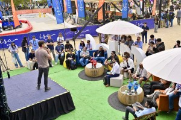
    
    <figcaption>
    
    ETM day 2025
    
    </figcaption>
    
    </figure>
    
- <figure>
    
    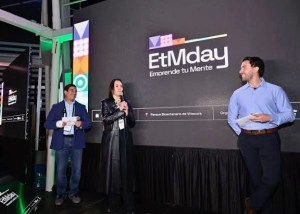
    
    <figcaption>
    
    ETM day 2025
    
    </figcaption>
    
    </figure>
    
- <figure>
    
    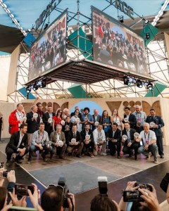
    
    <figcaption>
    
    ETM day 2025
    
    </figcaption>
    
    </figure>
    
- <figure>
    
    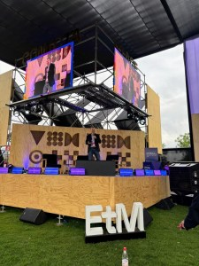
    
    <figcaption>
    
    ETM day 2025
    
    </figcaption>
    
    </figure>
    
- <figure>
    
    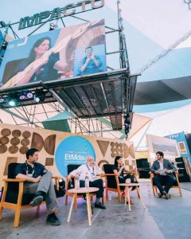
    
    <figcaption>
    
    ETM day 2025
    
    </figcaption>
    
    </figure>
    
- <figure>
    
    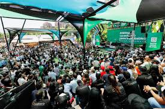
    
    <figcaption>
    
    ETM day 2025
    
    </figcaption>
    
    </figure>
    
- <figure>
    
    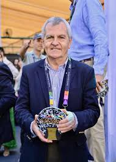
    
    <figcaption>
    
    ETM day 2025
    
    </figcaption>
    
    </figure>
    
- <figure>
    
    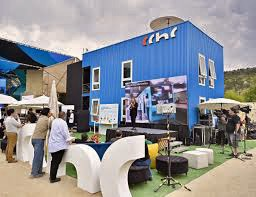
    
    <figcaption>
    
    ETM day 2025
    
    </figcaption>
    
    </figure>
    
- <figure>
    
    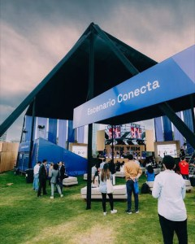
    
    <figcaption>
    
    ETM day 2025
    
    </figcaption>
    
    </figure>
    
- <figure>
    
    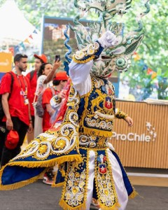
    
    <figcaption>
    
    ETM day 2025
    
    </figcaption>
    
    </figure>
    
- <figure>
    
    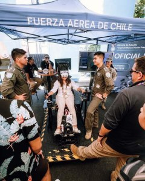
    
    <figcaption>
    
    ETM day 2025
    
    </figcaption>
    
    </figure>
    
- <figure>
    
    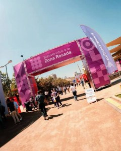
    
    <figcaption>
    
    ETM day 2025
    
    </figcaption>
    
    </figure>
    
- <figure>
    
    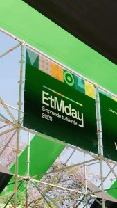
    
    <figcaption>
    
    ETM day 2025
    
    </figcaption>
    
    </figure>
    
- <figure>
    
    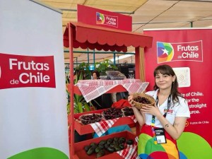
    
    <figcaption>
    
    ETM day 2025
    
    </figcaption>
    
    </figure>
    
- <figure>
    
    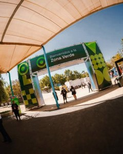
    
    <figcaption>
    
    ETM day 2025
    
    </figcaption>
    
    </figure>
    
- <figure>
    
    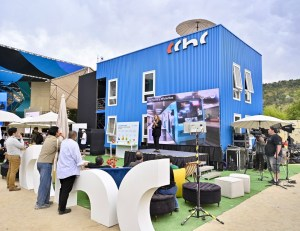
    
    <figcaption>
    
    ETM day 2025
    
    </figcaption>
    
    </figure>
    
- <figure>
    
    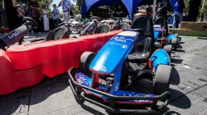
    
    <figcaption>
    
    ETM day 2025
    
    </figcaption>
    
    </figure>
    
- <figure>
    
    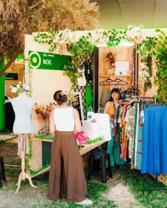
    
    <figcaption>
    
    ETM day 2025
    
    </figcaption>
    
    </figure>
    
- <figure>
    
    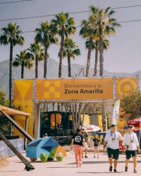
    
    <figcaption>
    
    ETM day 2025
    
    </figcaption>
    
    </figure>
    
- <figure>
    
    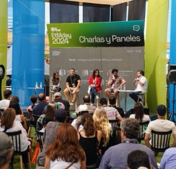
    
    <figcaption>
    
    ETM day 2025
    
    </figcaption>
    
    </figure>
    
- <figure>
    
    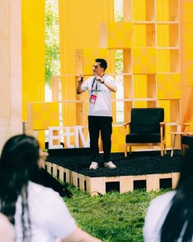
    
    <figcaption>
    
    ETM day 2025
    
    </figcaption>
    
    </figure>
    
- <figure>
    
    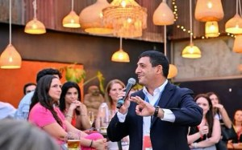
    
    <figcaption>
    
    ETM day 2025
    
    </figcaption>
    
    </figure>
    
- <figure>
    
    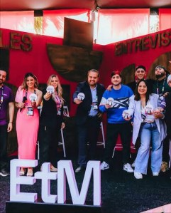
    
    <figcaption>
    
    ETM day 2025
    
    </figcaption>
    
    </figure>
    
- <figure>
    
    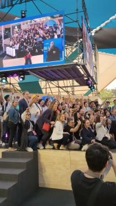
    
    <figcaption>
    
    ETM day 2025
    
    </figcaption>
    
    </figure>
    

**_Tiempos Sustentables. Informando sobre la economía que transforma el futuro._**
