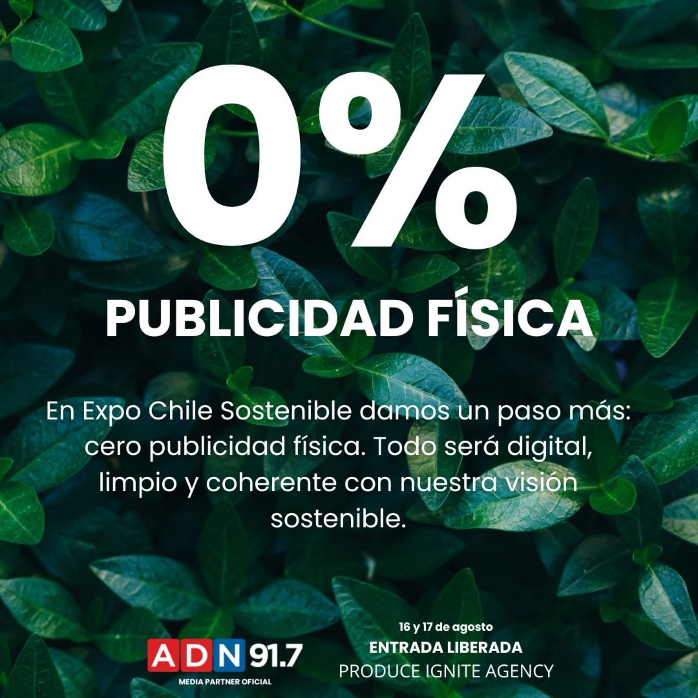

**Santiago, agosto de 2025.-** Este sábado 16 y domingo 17 de agosto, el Centro Cultural Gabriela Mistral (GAM) se convertirá en el epicentro de la **primera Expo Chile Sostenible**, un evento gratuito y abierto que promete inspirar cambios desde la conciencia individual hacia la acción colectiva.

Durante dos días, en un espacio de más de 1.000 m², la feria reunirá a **40 expositores** para mostrar lo último en innovación verde, economía circular y consumo responsable. Un dato clave es que el **98% de las expositoras son mujeres**, destacando el papel fundamental del liderazgo femenino en la sostenibilidad.

La jornada de apertura, el sábado a las 11:45 am, estará a cargo de la destacada periodista, escritora y conferencista internacional **Catalina Droguett**. Fundadora de la plataforma "Mujer Sustentable" y reconocida por su trabajo en acción climática, Catalina ofrecerá una charla que marcará el inicio de un fin de semana lleno de actividades. "La regeneración del planeta comienza con nuestras decisiones diarias", afirma Droguett, invitando a los asistentes a reconocer su poder de cambio.

* * *

### **Un evento con sello sostenible y entrada liberada**

Este evento no solo busca informar, sino también ser un ejemplo de prácticas sostenibles. La Expo Chile Sostenible se distingue por su política de **"cero publicidad física"**, utilizando únicamente medios digitales para su difusión, una decisión coherente con su visión de futuro.

Además de las charlas y exhibiciones, los asistentes podrán conocer proyectos innovadores en energías limpias y diseño consciente.

La cita es ambos días, de **10:00 a 18:30 horas**, con **entrada liberada**. Para más detalles, puedes visitar la cuenta de Instagram de la expo: **[@expochilesostenible](https://www.instagram.com/expochilesostenible/)**.

