Exponor 2026: la Unión Europea consolidó el norte de Chile como socio estratégico para la transición energética global. El acuerdo bilateral UE–Chile, en vigor desde 2025, facilita el flujo de materias primas críticas —litio, cobre e hidrógeno verde— bajo estándares ESG verificables y trazabilidad contractual. Esta relación ya no es comercio tradicional: es seguridad económica, diversificación de suministros y acceso al mercado único europeo.

El capítulo de energía y materias primas del acuerdo impulsa el procesamiento local, la transferencia tecnológica y el desarrollo de cadenas de valor en litio y cobre. Ese marco vincula directamente la producción del norte de Chile con las exigencias de cumplimiento europeo, asegurando que el hidrógeno verde y los minerales estratégicos puedan ingresar a cadenas industriales premium con certidumbre normativa y reputacional.

<figure>

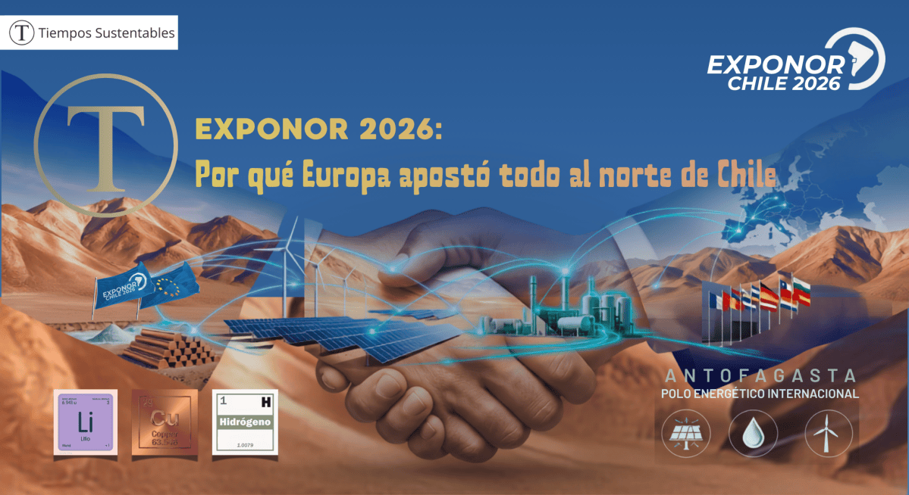

<figcaption>

EXPONOR2026

</figcaption>

</figure>

La señal enviada desde Antofagasta en **EXPONOR 2026** es difícil de subestimar: la Unión Europea no llegó como observadora, llegó como actor económico y estratégico. Por primera vez, el bloque instaló un pabellón propio con 13 Estados miembros reunidos en un mismo espacio, en una exhibición que confirmó la centralidad del norte de Chile en la transición energética global. No fue una postal diplomática. Fue una toma de posición sobre el futuro del cobre, el litio y el hidrógeno verde.

La lectura geopolítica es clara: **Europa está buscando asegurar acceso estable a recursos críticos, pero también a cadenas de suministro más confiables, sostenibles y compatibles con sus nuevas exigencias regulatorias**. El acuerdo interino UE–Chile, en vigor desde el 1 de febrero de 2025, explicita ese interés al incorporar un capítulo sobre energía y materias primas que busca facilitar un flujo "más efectivo y sostenible" de litio, cobre e hidrógeno. Chile no solo vende recursos; vende una promesa de transición industrial que Europa quiere convertir en ventaja competitiva.

## El nuevo trato

La relación bilateral ya no se explica solo como comercio exterior. Se parece más a una arquitectura de seguridad económica donde Europa ofrece acceso preferente, financiamiento, cooperación tecnológica y ampliación de mercados, mientras Chile debe demostrar capacidad de cumplimiento, trazabilidad y alineamiento normativo. Esa lógica es especialmente relevante para sectores donde la reputación se ha vuelto parte del precio, como minería, energía y manufactura asociada.

El acuerdo interino elimina aranceles sobre 99,9% de las exportaciones de la UE hacia Chile y mejora el marco de inversión, compras públicas y servicios, pero su valor real está en el capítulo de materias primas y energía. Ahí se juega el punto de fondo: Europa quiere minerales y moléculas, sí, pero bajo condiciones de sostenibilidad verificables. Dicho de otro modo, la competencia ya no es solo por tonelaje; es por legitimidad de origen.

## Cobre, poder y reputación

Chile sigue siendo el mayor productor mundial de cobre, con **5,3 millones de toneladas** en 2025 y cerca de una cuarta parte del suministro global, de acuerdo con referencias vinculadas al USGS y reportes sectoriales recientes. Esa posición convierte al país en un proveedor indispensable para electrificación, redes, vehículos eléctricos y renovables, pero también lo expone a una nueva forma de escrutinio: el mercado premium ya no compra solo metal, compra metal con historia verificable.

Europa está ajustando sus reglas en torno a materias primas críticas para reducir dependencia y mitigar riesgos de suministro. En ese contexto, el cobre chileno que no pueda demostrar desempeño ambiental, trazabilidad social y gobernanza robusta enfrentará costos reputacionales y comerciales crecientes. La ventaja geológica sigue siendo real, pero ya no basta por sí sola para ganar acceso a los segmentos más exigentes del mercado europeo.

## Hidrógeno: de promesa a disciplina

El hidrógeno verde sigue siendo uno de los grandes activos narrativos de Chile, pero 2026 marcó un giro hacia una lectura más sobria y operativa. La actualización de la estrategia nacional 2026–2030 prioriza demanda doméstica, gobernanza, valor local y despliegue en sectores difíciles de descarbonizar como minería, química y combustibles sintéticos. Eso confirma algo importante: el país ya no está vendiendo solo exportación futura, sino maduración industrial.

La nueva estrategia también reconoce implícitamente que las metas originales eran demasiado ambiciosas frente al costo real de producción, infraestructura y financiamiento. El mensaje para inversionistas es más maduro: Chile sigue apostando por hidrógeno, pero lo hará con una secuencia más gradual, menos dependiente de expectativas especulativas y más apoyada en uso local, certificación y logística. Para Europa, eso puede ser una buena noticia: menos promesas infladas, más probabilidad de proyectos bancables.

## Antofagasta como nodo

EXPONOR 2026 confirmó que Antofagasta ya no es solo una ciudad minera: es un nodo donde convergen minería, energía, tecnología, electrificación y servicios industriales de escala internacional. La exhibición reunió **1.382 empresas** de 36 países, 60 mil visitantes y 18 pabellones internacionales, consolidando su peso como plataforma de negocios para el norte de Chile. En ese mapa, el debut de la Unión Europea no fue accesorio; fue el símbolo más visible de una reconfiguración territorial del comercio estratégico.

La inversión europea en el norte chileno responde a una lógica práctica. Allí se cruzan recursos críticos, proyectos de descarbonización, potencial solar y una base industrial que puede escalar si logra integrar energía, agua, transporte y cumplimiento ESG. Para empresas y gobiernos locales, la oportunidad ya no es solo atraer capital: es construir una plataforma exportadora capaz de dialogar con exigencias regulatorias complejas y cadenas de suministro globales. En esta nueva fase, el territorio importa tanto como el recurso.

## Qué está comprando Europa

Europa no está comprando únicamente litio, cobre o hidrógeno. Está comprando resiliencia de suministro, diversificación geopolítica y capacidad de adaptación industrial. La mención explícita del acuerdo a cadenas de valor de materias primas críticas y al desarrollo de hidrógeno verde en Chile muestra que Bruselas ve al país como un socio funcional para su transición climática y su seguridad económica. Eso es más profundo que una relación comercial tradicional.

El requisito no escrito es todavía más exigente: las empresas chilenas deberán probar que pueden operar bajo estándares comparables a los del mercado europeo, desde impactos ambientales hasta prácticas laborales y trazabilidad contractual. Las que lo hagan temprano podrán capturar mejores precios, alianzas tecnológicas y acceso preferente a clientes institucionales. Las que no, quedarán atrapadas en la categoría de proveedor reemplazable.

## La tesis estratégica

La apuesta europea por el norte de Chile no se explica solo por abundancia de recursos. Se explica porque el territorio ofrece una rara combinación de escala minera, potencial energético y marco comercial modernizado con la UE. EXPONOR 2026 convirtió esa combinación en una escena visible para el mercado global, pero la tendencia viene de fondo: la transición energética exige territorios capaces de producir, certificar y sostener valor.

Lo que Exponor 2026 deja claro para los líderes corporativos es que Europa ya no busca solo proveedores, sino socios con gobernanza ESG verificable. Antofagasta se consolida como un polo energético internacional donde convergen renovables, almacenamiento y electromovilidad. Y la brecha entre la promesa del hidrógeno verde y la realidad operacional abre una ventana para las empresas que resuelvan antes el desafío del costo energético.

Europa ya dejó claro qué espera: materiales críticos, sí, pero con sostenibilidad verificable, seguridad de suministro y socios que entiendan la nueva gramática industrial del siglo XXI. En esa frontera, Antofagasta no está al margen; está en el centro.

## **Lo que Exponor 2026 revela para líderes corporativos:**

- **Las empresas europeas no buscan solo proveedores:** buscan socios con gobernanza ESG verificable.

- **Antofagasta emerge como polo energético internacional**, con inversión en renovables, almacenamiento y electromovilidad convergiendo.

- La brecha entre la promesa del hidrógeno verde y la realidad operacional es una o**portunidad para las empresas que resuelvan el problema de costo energético** antes que sus competidores.

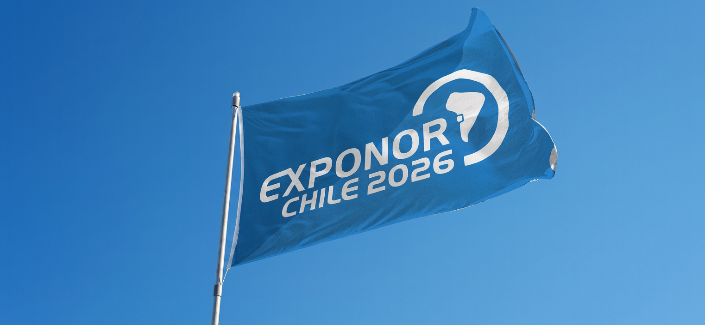

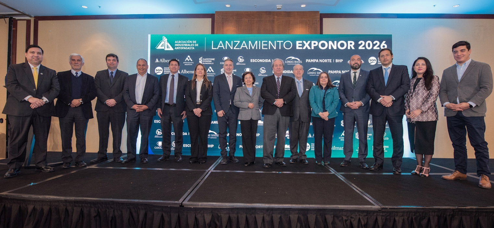

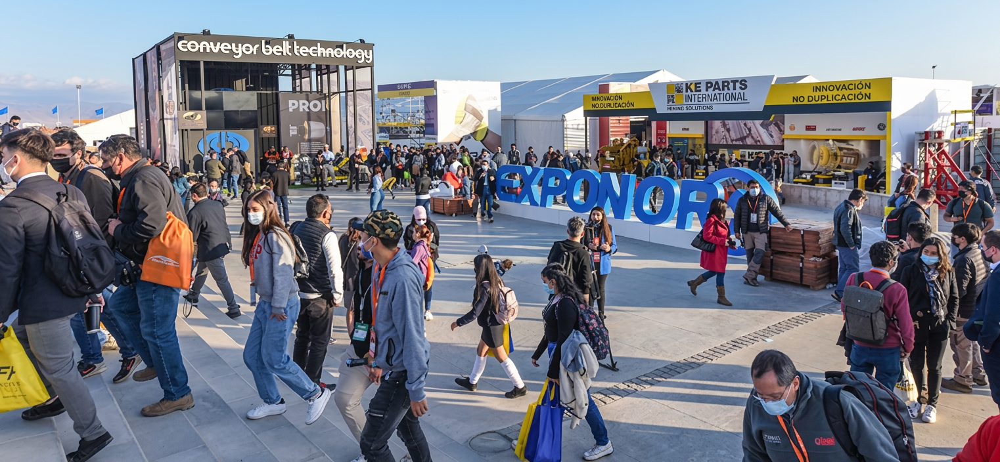

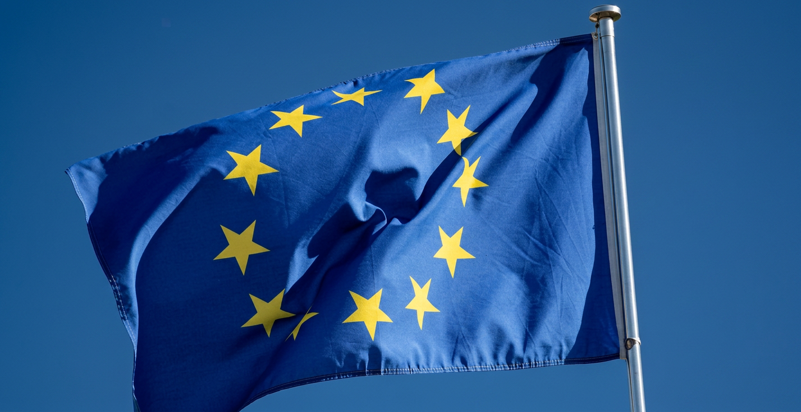

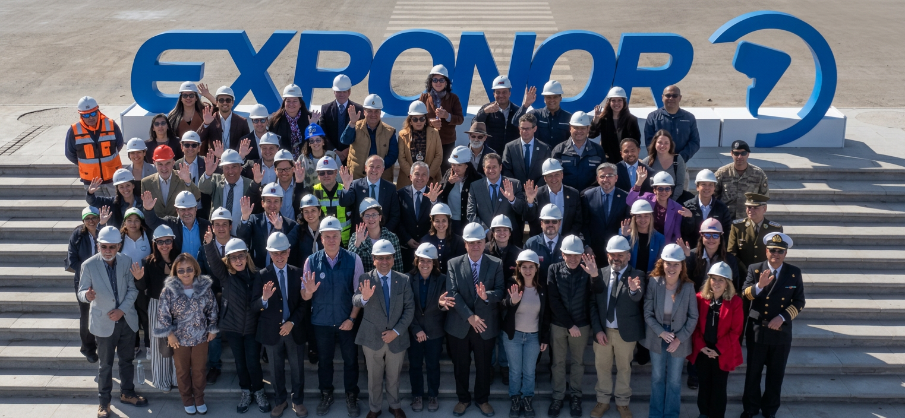

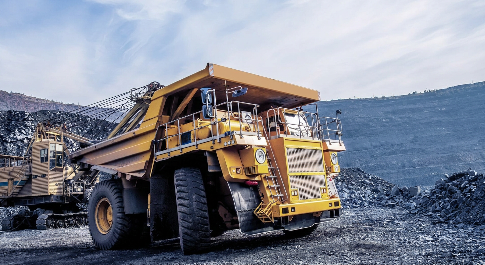

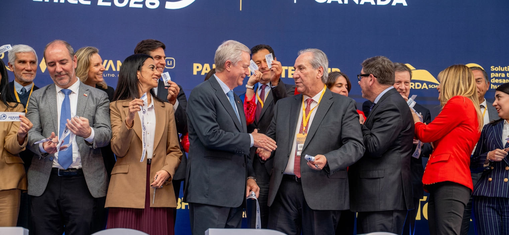

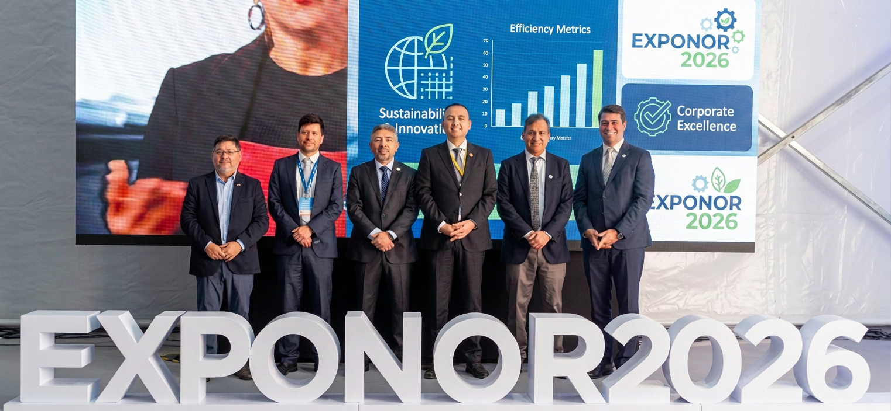

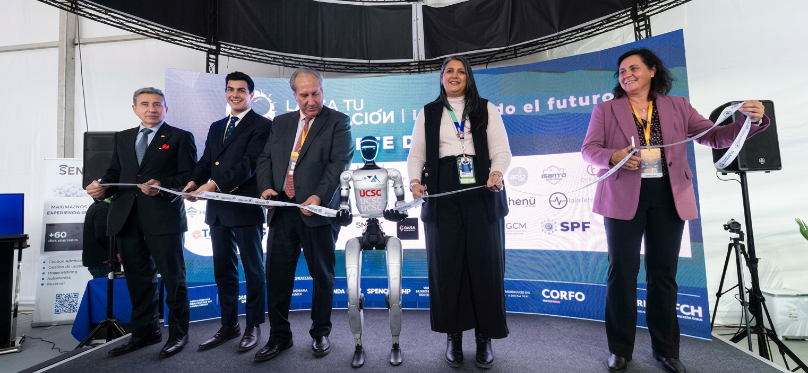

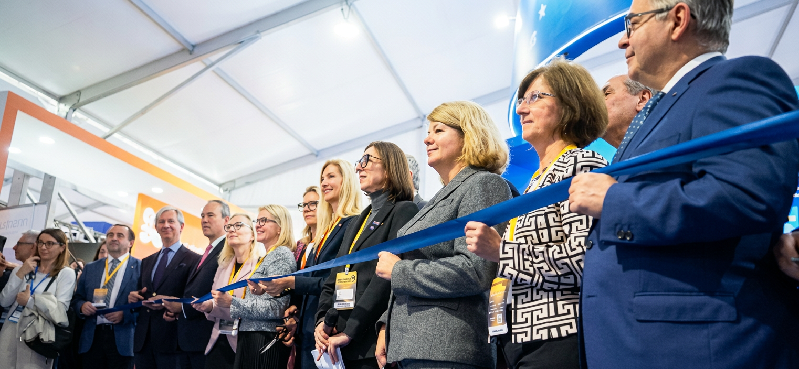

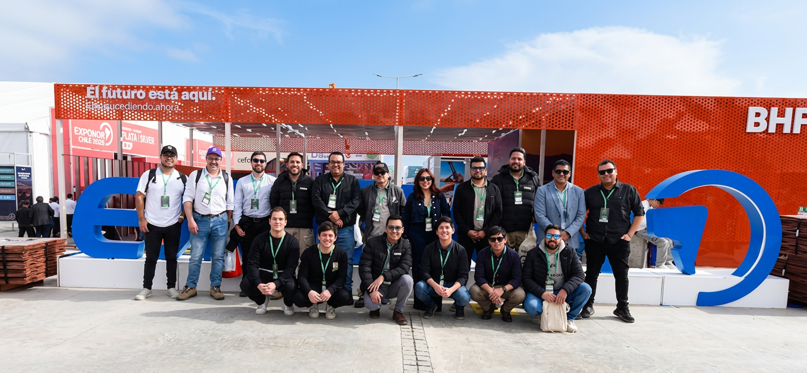

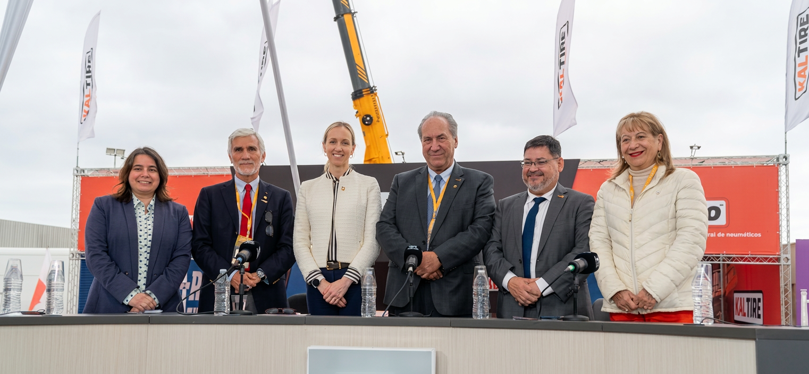

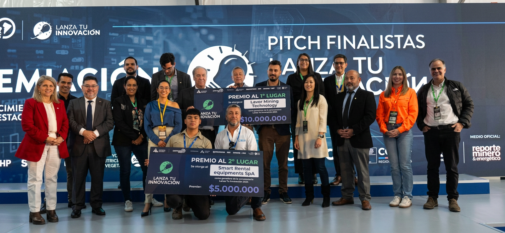

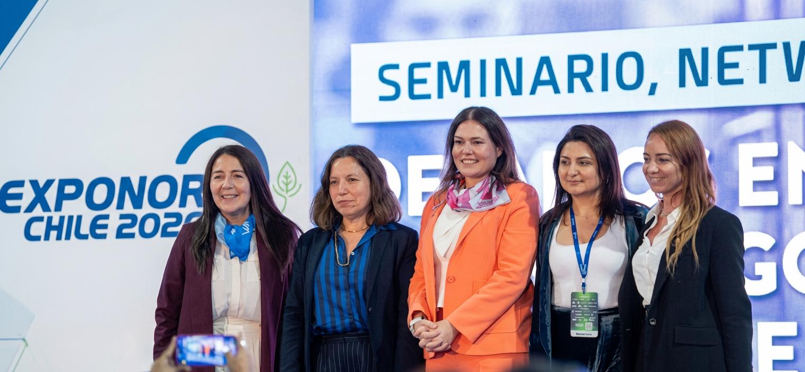

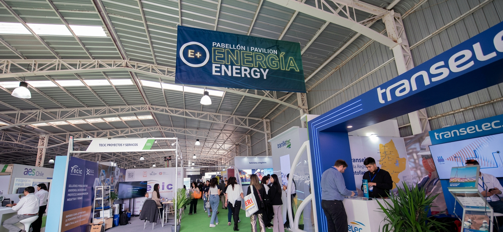

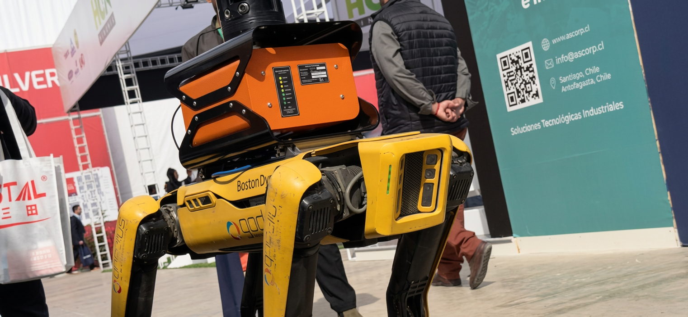

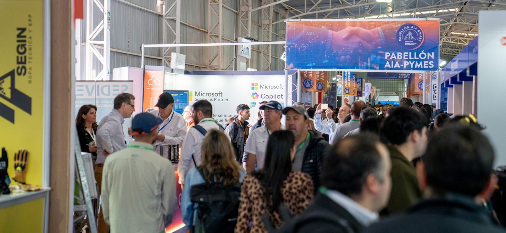

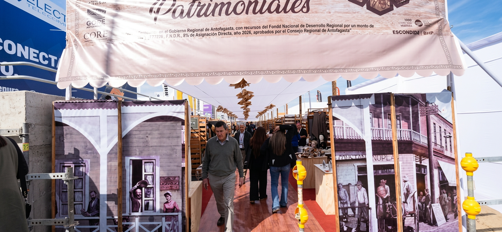

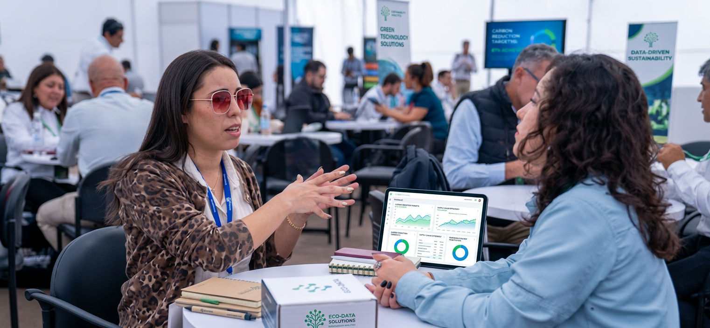

* * *

## 📩 **Lectura estratégica para líderes que anticipan el mercado**

  
Análisis geopolítico, negocios y sostenibilidad para quienes toman decisiones de alto impacto.  
Más de 5.000 ejecutivos ya reciben nuestro Briefing Directivo semanal directo en su correo. Sin ruido ni spam.

👉 Inscríbase aquí directamente

> 🔒 **Confidencialidad garantizada:** Sus datos son de uso exclusivo interno y jamás serán divulgados a terceros.

* * *
