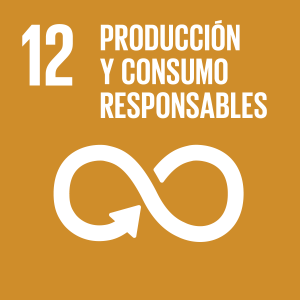
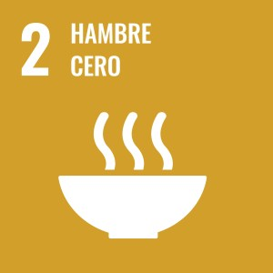
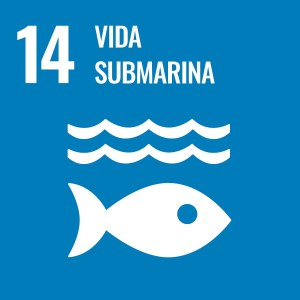
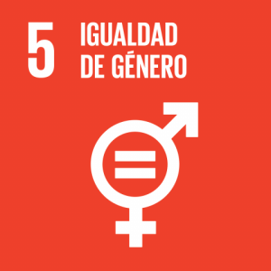

En un giro hacia la economía circular, un proyecto liderado por la Organización de las Naciones Unidas para la Alimentación y la Agricultura (**FAO**) busca transformar el futuro de las **carapacheras**, mujeres que trabajan en la pesca y el procesamiento de jaibas en la localidad de Punta Lavapié. La iniciativa, que se enmarca dentro del programa **ELEVATE** de la FAO, aborda simultáneamente dos problemáticas históricas: la acumulación de residuos de crustáceos y la falta de formalidad en el trabajo de estas mujeres.

<figure>

https://www.flickr.com/photos/faoalc/albums/72177720328046111/

<figcaption>

Carapacheras de Punta Lavapié: Innovación para reducir pérdidas de crustáceos en Chile

</figcaption>

</figure>

El proyecto, con el título “**Reducción de pérdidas de crustáceos aplicando circularidad para la obtención de productos ricos en quitina y desarrollo de negocio con enfoque de género para las carapacheras de la región del Biobío, Chile**”, se enfoca en el caparazón de la jaiba, un residuo que puede constituir hasta el 75% del peso del animal. Este material, comúnmente desechado, es una fuente rica en **quitina**, un compuesto con un alto valor potencial para la industria biotecnológica.

La idea central es utilizar la innovación para convertir este residuo en un nuevo insumo, generando así oportunidades de mercado con un enfoque de género. Durante una reciente visita de campo, se recogió información técnica y audiovisual para comprender a fondo el trabajo de las carapacheras, quienes han lidiado por años con la informalidad y la gestión de los desechos.

La iniciativa no solo se alinea con la meta de reducir la pérdida de alimentos, sino que también contribuye de manera directa a varios de los **Objetivos de Desarrollo Sostenible (ODS)** de la ONU:

- **ODS 2 (Hambre Cero):** promoviendo sistemas alimentarios más sostenibles.

- **ODS 12 (Producción y Consumo Responsables):** impulsando la economía circular.

- **ODS 14 (Vida Submarina):** minimizando el impacto ambiental en los ecosistemas marinos.

- **ODS 5 (Igualdad de Género):** empoderando económicamente a las mujeres y formalizando su rol en la cadena de valor pesquera.

Este proyecto piloto es un ejemplo de cómo la colaboración entre organismos internacionales y comunidades locales, como las carapacheras y pescadores de Punta Lavapié _—con el respaldo de la **Corporación Nacional de Mujeres en la Pesca Artesanal**—_, puede catalizar un desarrollo sostenible e inclusivo.

* * *

### **Referencia oficial**

FAO. (2025, 29 de julio). _Carapacheras de Punta Lavapié: Innovación para reducir pérdidas de crustáceos en Chile_. **FAO Oficina Regional para América Latina y el Caribe**. [https://www.flickr.com/photos/faoalc/54691856583/in/photostream/](https://www.flickr.com/photos/faoalc/54691856583/in/photostream/)
