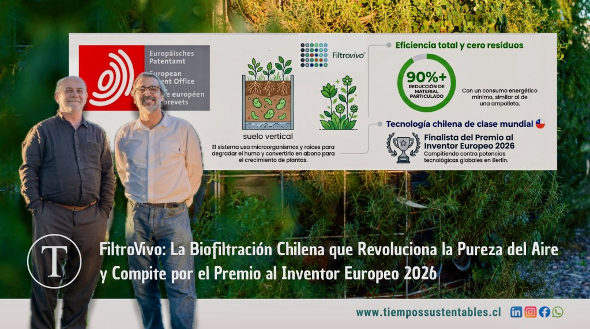
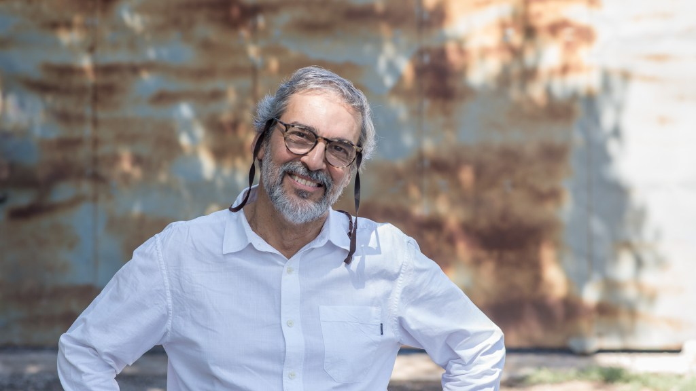
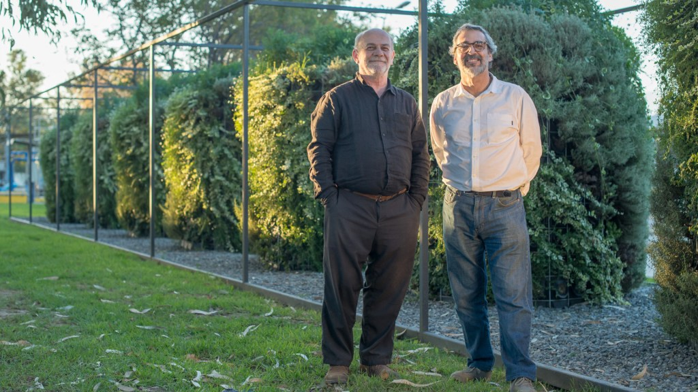
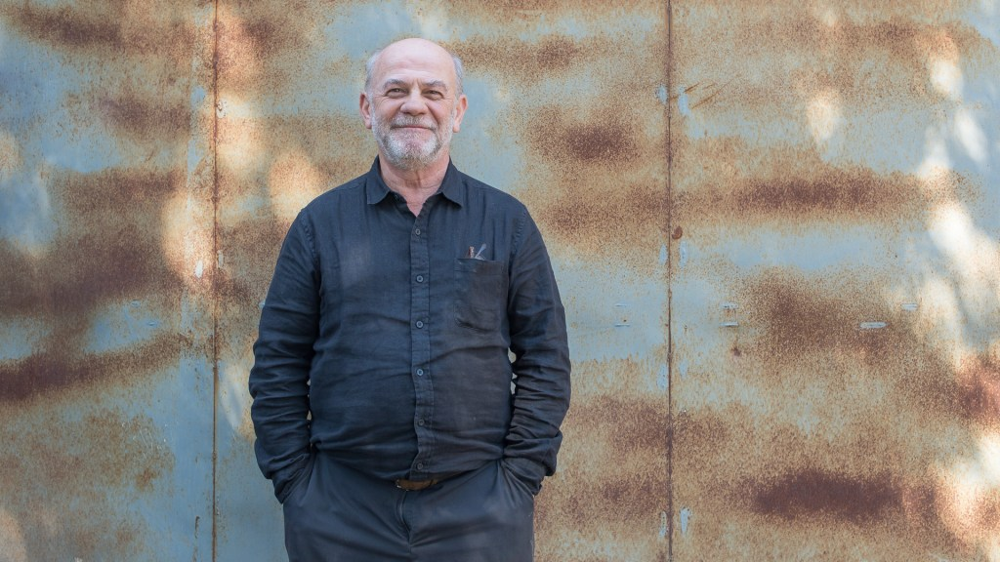
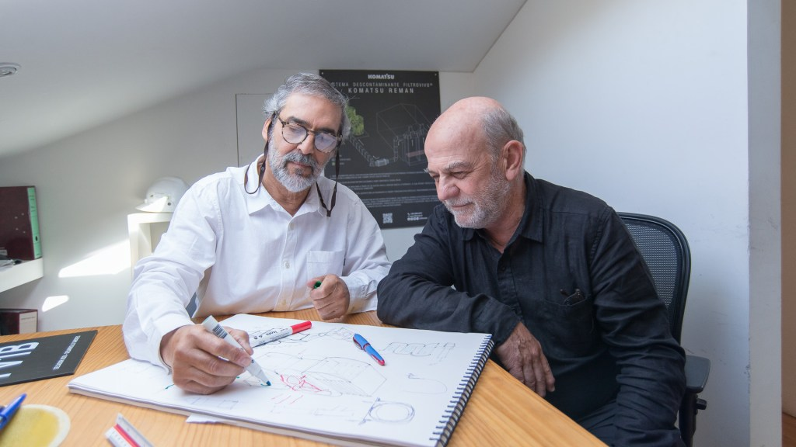
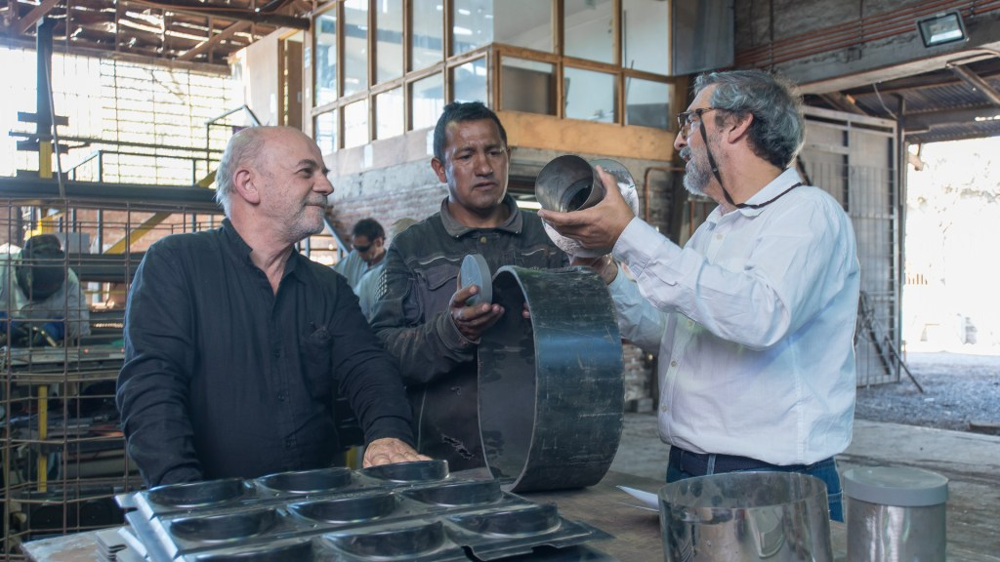
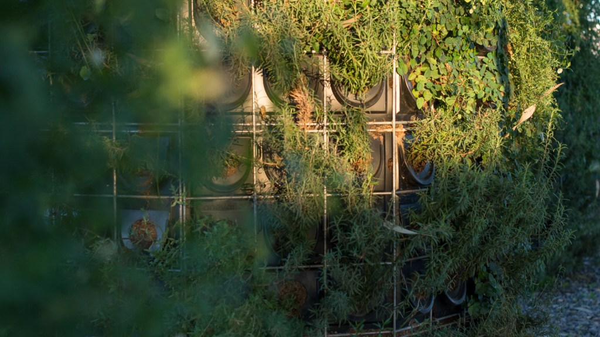
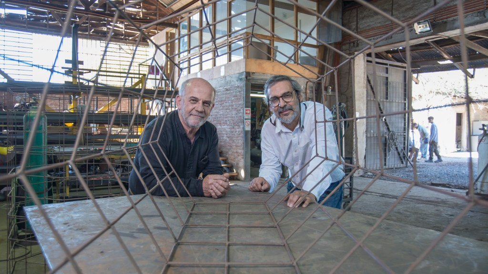

En medio de la urgencia climática global y la crisis de calidad del aire que afecta cada invierno a las ciudades chilenas, surge una solución que desafía los paradigmas de la tecnología tradicional: limpiar el humo contaminante usando el poder de la naturaleza.

Hablamos de **FiltroVivo**, el sistema de biofiltración creado por el técnico agrícola **Aníbal Montalva** y el arquitecto **Miguel Ángel Fernández**, quienes hoy posicionan a Chile en la élite mundial al ser finalistas del prestigioso **Premio al Inventor Europeo 2026**.

* * *

## La zona cero: El problema del humo en el centro-sur de Chile

Para entender la magnitud de esta innovación, es vital comprender el problema geográfico y social que enfrenta el país:

- **Dependencia de la leña:** Aproximadamente el **72% de los hogares** en el centro-sur de Chile dependen de la leña (Ministerio de Energía).

- **Impacto en salud:** Cerca de **10 millones de chilenos** están expuestos a niveles de material particulado fino (**PM2.5**) que superan hasta en ocho veces los límites de la OMS.

- **Geografía crítica:** Durante el invierno, el fenómeno de inversión térmica atrapa el humo a nivel de calle, convirtiendo las ciudades en zonas de sacrificio respiratorio.

Las alternativas tradicionales suelen ser costosas o intensivas en energía. Aquí es donde **FiltroVivo** marca la diferencia con un enfoque de ecodiseño.

* * *

## ¿Qué es FiltroVivo y cómo funciona?

FiltroVivo es un **biofiltro vivo** que, a diferencia de la filtración mecánica o química, utiliza procesos biológicos para purificar el aire. Esta tecnología patentada funciona como un ecosistema vertical que "digiere" la contaminación.

### El proceso de limpieza en 3 fases:

1. **Extracción y enfriamiento:** El sistema aspira el humo a través de una estructura vertical con vegetación y sustrato orgánico.

3. **Biodegradación:** Una densa población de microorganismos descompone los gases contaminantes.

5. **Nutrición circular:** Las raíces de las plantas absorben estos residuos como nutrientes, transformando el humo en abono para su propio crecimiento.

> "Cuando instalas el filtro y lo enciendes, el humo de la chimenea simplemente desaparece. Ver cómo se desvanece en tiempo real es impactante", afirma **Aníbal Montalva**.

El resultado es categórico: una **reducción de más del 90%** en material particulado y olores.

* * *

## Escalabilidad y Tecnología Sustentable

FiltroVivo no es solo para hogares. Su diseño permite una escalabilidad total, aplicándose en:

- **Viviendas residenciales.**

- **Espacios públicos:** Escuelas, hospitales y calles.

- **Industria:** Control de olores y captura de material particulado de diversos combustibles.

Actualmente, estos biofiltros ya operan con éxito en diversos climas de Chile, desde el árido norte hasta el lluvioso sur.

* * *

## El salto global: Finalistas del Premio al Inventor Europeo 2026

La **[Oficina Europea de Patentes (OEP)](https://www.epo.org)** ha seleccionado a la dupla chilena como finalistas en la categoría "Países no pertenecientes a la OEP". Este es uno de los galardones de innovación más importantes del mundo.

### Competidores de Clase Mundial (Edición 2026)

| **País** | **Inventores** | **Innovación** |
| --- | --- | --- |
| **Chile** | **Montalva y Fernández** | **Biofiltración natural (FiltroVivo)** |
| Canadá/Alemania | Emily Morris y Thorsten Stoesser | Generación hidroeléctrica de flujo libre |
| China | Xie Yinghao y equipo | Reciclaje de baterías de iones de litio |

_"En Chile estamos acostumbrados a importar tecnología, no a exportarla"_, reflexiona **Miguel Ángel Fernández**. _"Crecer con recursos limitados nos impulsó a buscar soluciones creativas que nadie más estaba ofreciendo"_.

* * *

- <figure>
    
    
    
    <figcaption>
    
    LIMPIAR EL AIRE CON LA NATURALEZA: INVENTORES CHILENOS SON FINALISTAS EN EL PREMIO AL INVENTOR EUROPEO 2026
    
    </figcaption>
    
    </figure>
    
- <figure>
    
    
    
    <figcaption>
    
    LIMPIAR EL AIRE CON LA NATURALEZA: INVENTORES CHILENOS SON FINALISTAS EN EL PREMIO AL INVENTOR EUROPEO 2026
    
    </figcaption>
    
    </figure>
    
- <figure>
    
    
    
    <figcaption>
    
    LIMPIAR EL AIRE CON LA NATURALEZA: INVENTORES CHILENOS SON FINALISTAS EN EL PREMIO AL INVENTOR EUROPEO 2026
    
    </figcaption>
    
    </figure>
    
- <figure>
    
    
    
    <figcaption>
    
    LIMPIAR EL AIRE CON LA NATURALEZA: INVENTORES CHILENOS SON FINALISTAS EN EL PREMIO AL INVENTOR EUROPEO 2026
    
    </figcaption>
    
    </figure>
    
- <figure>
    
    
    
    <figcaption>
    
    LIMPIAR EL AIRE CON LA NATURALEZA: INVENTORES CHILENOS SON FINALISTAS EN EL PREMIO AL INVENTOR EUROPEO 2026
    
    </figcaption>
    
    </figure>
    
- <figure>
    
    
    
    <figcaption>
    
    LIMPIAR EL AIRE CON LA NATURALEZA: INVENTORES CHILENOS SON FINALISTAS EN EL PREMIO AL INVENTOR EUROPEO 2026
    
    </figcaption>
    
    </figure>
    
- <figure>
    
    
    
    <figcaption>
    
    LIMPIAR EL AIRE CON LA NATURALEZA: INVENTORES CHILENOS SON FINALISTAS EN EL PREMIO AL INVENTOR EUROPEO 2026
    
    </figcaption>
    
    </figure>
    

* * *

## Cómo apoyar: Vota por el Talento Chileno

Los ganadores serán anunciados en **Berlín el 2 de julio de 2026**. Sin embargo, tú puedes ayudar hoy mismo. La votación para el **"Premio del Público" (Popular Prize)** ya está abierta (desde el 12 de mayo).

**¿Cómo participar?**

1. Ingresa al sitio oficial de la **Oficina Europea de Patentes**. [https://www.epo.org](https://www.epo.org)

3. Busca la categoría de votación popular.

5. Vota por **FiltroVivo (Chile)**.

FiltroVivo demuestra que la tecnología más eficiente del planeta ya fue inventada por la naturaleza; solo hacía falta el ingenio chileno para aplicarla.

[LIMPIAR EL AIRE CON LA NATURALEZA: INVENTORES CHILENOS SON FINALISTAS EN EL PREMIO AL INVENTOR EUROPEO 2026](https://tiempossustentables.cl/wp-content/uploads/2026/05/pr_eia2026_montalva_fernandez.pdf)[Descarga](https://tiempossustentables.cl/wp-content/uploads/2026/05/pr_eia2026_montalva_fernandez.pdf)

* * *

#### **¿Quieres profundizar en este tema?**

Descubre nuestra página pilar sobre Economía Circular, donde incluimos toda la información actualizada para la región.

[Leer la Guía Estratégica de Economía Circular en LATAM](https://tiempossustentables.cl/economia-circular-chile-latam/)
