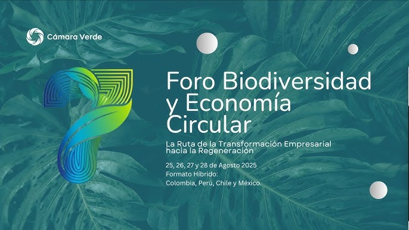
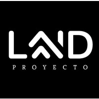
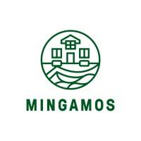
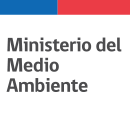

La revista _Tiempos Sustentables_, comprometida con la difusión de iniciativas que marcan un rumbo hacia la sostenibilidad en Chile y Latinoamérica, se complace en presentar un análisis profundo del 7º Foro Internacional de Biodiversidad y Economía Circular de la Cámara Verde. Este evento, que congregó a **más de 800 inscritos y cerca de 50 casos de éxito**, tuvo en su **tercera jornada, transmitida desde la Universidad Autónoma de Santiago, Chile**, un especial protagonismo, evidenciando el liderazgo y la visión regenerativa que impulsa el país en Iberoamérica.

[Verónica Prado](https://www.linkedin.com/in/veronicapradobiolegal72464), vicepresidenta de Cámara Verde Chile, dio la bienvenida a los asistentes y destacó que, en su **segundo aniversario**, la Cámara Verde Chile se consolida como un "punto de flecha" en la ruta hacia la regeneración. La misión de la organización es clara: **"conectar, fortalecer y acompañar a todo el ecosistema hacia una economía compatible con la vida, una economía que sea sostenible y ojalá avancemos rápidamente hacia la regeneración"**. Esta visión ha permitido un crecimiento notable, pasando de cuatro a 25 empresas fundadoras y extendiendo su presencia por siete u ocho regiones del país.

* * *

## **La Academia Cámara Verde: Semilla de Conciencia y Regeneración**

Un hito de la jornada fue el lanzamiento de la **Academia Cámara Verde**, presentada por Tamara López Burgos, su directora académica. López enfatizó que la educación es el **"pilar fundamental para poder crear un cambio de conciencia"** frente a la "policrisis" global. La academia busca desarrollar habilidades y competencias que impulsen una economía compatible con la vida, abandonando el modelo lineal de consumo y producción. Se hizo una especial mención a la **biomímesis y el diseño regenerativo** como fuentes de inspiración para soluciones innovadoras.

* * *

## **Biodiversidad como Motor de Desarrollo: El Primer Panel del Día**

El foro dedicó un panel a la biodiversidad como motor de desarrollo, explorando cómo la conservación puede ser financieramente viable y generar impacto.

**[César Guajardo](https://www.linkedin.com/in/cesar-guajardo-morell-54051422/) de Proyecto Land** compartió el modelo de creación de **áreas protegidas privadas financiadas por privados** a través del _crowdfunding_ y la economía colaborativa. Su propuesta busca satisfacer necesidades (como segundas viviendas) generando un impacto positivo, aunque reconoce que la **Ley SBAP** (Sistema Nacional de Áreas Protegidas) y su fiscalización estatal son clave para su éxito.

**[Isabel Herrera](https://www.linkedin.com/in/isabel-herrera-grillo/) de Inmobiliaria La Aldea** subrayó la importancia de reconectar a las personas con la naturaleza y comprender el valor que esta aporta a la calidad de vida. Sin embargo, advirtió sobre el **"tremendo daño" de la fragmentación ecosistémica** generada por la lógica urbana en territorios rurales.

**[Joaquín Undurraga](https://www.linkedin.com/in/joaqu%C3%ADn-undurraga-vicu%C3%B1a-05ba3318a/) de Mingamos**, desde Chiloé, ilustró cómo el conocimiento de la biodiversidad puede impulsar un valor económico. Destacó el caso de la **miel de Ulmo en Ancud, Chiloé**, que, más allá de un simple producto, representa una **economía circular completa** al involucrar la polinización, la protección del bosque nativo y el sustento de apicultores. Mencionó el **Derecho Real de Conservación** como un mecanismo legal para preservar el territorio y la fiscalización por pares a través de redes como ASI Conserva Chile. Undurraga también señaló la **escasez hídrica en Chiloé** y el rol fundamental del **pompón (humedales)** y los bosques en la retención de agua.

Un desafío transversal identificado en este panel fue la **lenta implementación de normativas y la dificultad de lograr la certificación formal de biodiversidad en Chile**, así como la necesidad de cambiar los hábitos de consumo de la población para frenar la fragmentación de ecosistemas.

* * *

## **Cuantificando el Impacto Circular: La Visión desde México con Pablo Astete**

Desde el norte de México, **[Pablo Astete Morales](https://www.linkedin.com/in/pabasmo), biólogo y cofundador de Conecta Recicla**, ofreció una perspectiva sobre la cuantificación del impacto en la economía circular. Su plataforma tecnológica **trazabiliza residuos**, integrando a recicladores, gestores, empresas y gobiernos, y proporcionando métricas de origen, movimiento y destino circular. Astete destacó que la **Ley REP (Responsabilidad Extendida del Productor) en Chile** ha sido un motor crucial para la gestión circular, algo que aún se encuentra en discusión en México. El objetivo de Chile es alcanzar el **70% de reciclaje para el año 2050**, partiendo de un 20% hace unos años.

* * *

## **Bioeconomía y Empresas Responsables: Casos de Éxito Chilenos**

El segundo panel del día presentó a empresas chilenas que ya están integrando la sostenibilidad en sus modelos de negocio.

**[Cristina Acuña](https://www.linkedin.com/in/cristinaacunarougier/) de Idea Tecnologies** compartió cómo transforman el **plumavit (poliestireno expandido)**, un residuo de difícil reciclaje, en una resina para pinturas, **reduciendo la huella de carbono** al reemplazar materias primas vírgenes. En 10 años, han reciclado el equivalente a **más de 200 toneladas de CO2**.

**[Hugo Muñoz](https://www.linkedin.com/in/hugo-munoz-eetb/) de Ecología en tu Barrio** se enfoca en la **gestión de residuos orgánicos a través del compostaje**. Destacó que cada kilo de residuo orgánico compostado evita la emisión de 1.43 kg de CO2 equivalente. Reconoció el desafío de superar la reticencia de las personas y la inercia burocrática de las municipalidades.

**[Jaime Piningnov](https://www.linkedin.com/in/jaime-pinninghoff-az%C3%B3car-93095734/) de Migran Chile** presentó una innovadora iniciativa: la creación de una **wallet digital con un token llamado "Terra"** que valoriza la basura reciclable de los hogares. Los usuarios pueden canjear sus Terras por productos culturales o descuentos, y la empresa colabora con organizaciones animalistas y comedores sociales. Con **más de 1.000 usuarios y 30 millones de Terras generados**, Migran Chile busca incentivar el reciclaje y promover un consumo consciente.

Los panelistas coincidieron en que, aunque la Ley REP es un avance positivo, su implementación ha sido lenta y requiere de mayor capacidad instalada y un cambio cultural en el consumo.

* * *

## **Economía Circular en el Textil y Finanzas Sostenibles**

**[Catherine Herrera](https://www.linkedin.com/in/catherinne-herrera-8792508/) de ISCATEx**, experta en moda sostenible, abordó la problemática de la **industria textil, una de las más contaminantes**, señalando que la ropa existente en el mundo podría vestir a seis generaciones más. Herrera hizo un llamado a la **responsabilidad del 100% de todos los actores** –consumidores, productores, comercializadores– para lograr un diseño consciente, consumo local y la reconciliación con la historia y cultura propias.

Durante el panel de finanzas sostenibles, [Jorge Muñoz](https://www.linkedin.com/in/jorge-mu%C3%B1oz-vivanco-9728322b/), de Banca Ética Latinoamericana (Belat), subrayó el **papel crucial del sistema financiero para canalizar capital hacia una sociedad más equitativa**. En lugar de seguir los modelos tradicionales que solo se centran en la rentabilidad, Belat busca integrar los costos sociales y ambientales. Muñoz destacó que la banca ética es una herramienta vital para dirigir inversiones que generen un impacto positivo real.

Por su parte, [Joaquín Gajardo Canales](https://www.linkedin.com/in/joaquingajardo) y [Marcela Rincón](https://www.linkedin.com/in/marcela-biophilica), de Biofílica, aportaron la perspectiva de su empresa. Gajardo Canales comentó sobre el **creciente interés de los inversionistas internacionales en generar impacto en Latinoamérica**, dada su abundancia en capital natural. Marcela Rincón se centró en la importancia del **diseño biofílico en entornos corporativos para mejorar el bienestar y ayudar a mitigar el cambio climático** a través de la reducción de la temperatura y la purificación del aire, aunque señaló que en Chile la medición de estos beneficios es un campo en desarrollo.

Se debatió la necesidad de transicionar de la filantropía a la **inversión de impacto**, y la urgencia de superar las barreras culturales y políticas que impiden un mayor flujo de capital hacia proyectos regenerativos, a pesar de la evidencia que demuestra que **las inversiones verdes son más rentables**.

* * *

## **Políticas Públicas y Gobernanza Ambiental: El Cierre del Día**

La jornada culminó con la presentación de **Rubén Darío Pastén del Ministerio del Medio Ambiente**, quien abordó los desafíos y avances legislativos para la economía circular en la **construcción**. Pastén destacó el proyecto **"Acelerando la transición hacia una construcción circular y baja en carbono"**, financiado por el GEF, que busca impulsar un marco normativo, adaptar las compras estatales, y desarrollar herramientas para la valorización de materiales como la madera, los residuos mineros y la detección de extracción ilegal.

El último panel, con **Teresita Alcántara Díaz, Gabriela Muñoz Figueroa y Diana Vega Enríquez**, se centró en políticas públicas y gobernanza. Alcántara Díaz resaltó la **"voluntad" de los líderes climáticos locales** en municipios como Valdivia, Ancud o Torres del Paine, y la importancia del **Acuerdo de Escazú** para fomentar la participación ciudadana y la acción local. Vega Enríquez posicionó a **Chile como pionero en legislación ambiental**, aunque con desafíos en la fiscalización. Reconoció que, si bien la Ley REP fue inicialmente un "tigre sin garra", ha evolucionado hacia un modelo más colaborativo con la comunidad y el apoyo de la tecnología para la transparencia. Gabriela Muñoz, en tanto, abogó por **observatorios ciudadanos y auditorías colaborativas** para combatir el _greenwashing_ y fortalecer la transparencia.

* * *

## **Un Llamado a la Acción Colectiva**

La jornada chilena del Foro de Biodiversidad y Economía Circular dejó claro que Chile está forjando un camino prometedor hacia un futuro regenerativo. Como enfatizó Verónica Prado, el evento demostró con hechos que **"el liderazgo innovador y valiente es parte esencial del ADN de nuestra comunidad"**. La invitación es a la **acción inmediata y colaborativa**, a **"centrémonos en lo que nos une más que en lo que nos divide"**, y a reconocer que la sostenibilidad y la regeneración "no es opcional, es el único camino que tenemos". El vaso está, sin duda, medio lleno, y la esperanza reside en la capacidad de seguir construyendo alianzas entre el sector público, privado, la academia y la sociedad civil para **"mostrar al mundo toda la cantidad de innovación, de creatividad y de enormes avances"** que se están gestando en el país.

* * *

## Te invitamos a revivir las 4 jornadas en los siguientes videos:

https://www.youtube.com/live/828pV6sTisA?si=8oPPIQV4Plv-PfmJ

https://www.youtube.com/live/PRzSZI7e3gw?si=TyWtIcEe2NFLha8b

https://www.youtube.com/live/alalRt2ROpE?si=acROz49w54gYeMq4

https://www.youtube.com/live/vQwW4UrR3R0?si=\_zSgxJyzvwUOc9Hf

* * *

https://www.instagram.com/reel/DN7CdXkjLyS/?utm\_source=ig\_web\_copy\_link&igsh=MzRlODBiNWFlZA==

https://www.instagram.com/reel/DN\_IjrijDB1/?utm\_source=ig\_web\_copy\_link&igsh=MzRlODBiNWFlZA==

* * *
