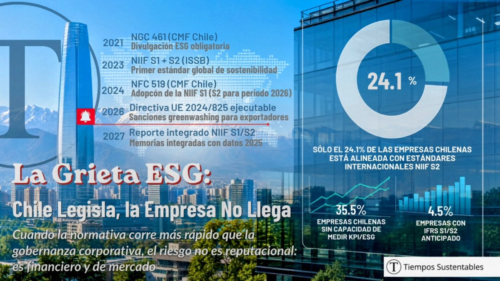

_**Actualización editorial:** Aproximadamente 3 de cada 4 empresas reguladas por la CMF están reportando su sostenibilidad sin los elementos que se exigirán en la Memoria Integrada del ejercicio 2027; esto se debe a que, ante esta "Grieta ESG", **el 27 de julio de 2026 la Comisión para el Mercado Financiero (CMF) otorgó un año más de plazo para reportar bajo los estándares internacionales NIIF S1 y S2**, actualizando la fecha límite obligatoria para el ejercicio anual de 2027 (que se presentará en 2028) y dejando el periodo 2026 como una etapa intermedia de adopción voluntaria y marcha blanca regulatoria._

En Chile, la brecha entre la acelerada evolución de las normativas de sostenibilidad y la gobernanza corporativa está exponiendo a las empresas reguladas a riesgos financieros y de mercado críticos que trascienden lo reputacional, ante la falta de alineación con los estándares internacionales.

El reporte ESG en Chile muestra un alto cumplimiento normativo formal, pero carece de alineación estratégica con los estándares internacionales NIIF S1 y S2. Según el Reporte ESG en Chile 2024 de GovernArt, menos del 26% de las empresas reguladas integra riesgos climáticos y de sostenibilidad en su gestión financiera, evidenciando una brecha crítica en la gobernanza corporativa.

La falta de datos trazables y medición de emisiones amenaza el acceso al mercado de capitales y expone a las firmas a sanciones legales. Ante nuevas regulaciones europeas contra el lavado de imagen verde, las empresas deben conectar la sostenibilidad con sus resultados financieros para asegurar competitividad y resiliencia.

El análisis de MINCORE, basado en datos de la CMF y publicado en mayo de 2026,,, muestra que solo el 24,1% de las empresas del mercado regulado chileno están efectivamente alineadas con los requisitos de la NIIF S2. A partir del 27 de septiembre de 2026, la Directiva UE 2024/825 exigirá que el sello "carbono neutral" cuente con verificación acreditada. A esto se suma la advertencia del Ministerio de Hacienda: cerca del 40% de la deuda soberana chilena está vinculada a criterios ESG, lo que condiciona el acceso al mercado de capitales a su cumplimiento. En este contexto, las empresas que descuiden la gobernanza y la trazabilidad de sus datos enfrentan mayores costos de financiamiento y potenciales riesgos legales, lo que hace imperativo que los directorios realicen diagnósticos y auditorías antes del 31 de julio de 2026.

## Estado de la reportabilidad ESG en el mercado chileno

El informe _"Cumplimiento en Reportabilidad de Sostenibilidad 2025"_ de MINCORE, elaborado a partir de datos oficiales de la Comisión para el Mercado Financiero (CMF) y publicado en mayo de 2026, entrega el diagnóstico más riguroso disponible sobre el estado real del reporte ESG en el mercado regulado chileno.

El universo analizado comprende **247 emisores** que reportan bajo la NCG 461, la norma que desde 2022 obliga a las empresas fiscalizadas por la CMF a divulgar información ESG estructurada.

El primer hallazgo es positivo y real: todas las empresas del universo completan los 35 ítems exigidos por la normativa, acumulando más de 80 mil registros en materias ambientales, sociales y de gobernanza. El **86,2% realiza doble reporte** —NCG 461 y SASB— y la completitud promedio en métricas sectoriales SASB alcanza el **99,6%**.

Chile tiene un sistema de reporte formalmente sólido. Eso es un logro documentado que el país debe reconocer. **El problema está en lo que ese sistema no está haciendo: convertir la información en herramienta real de decisión.**

* * *

## Panel de diagnóstico ESG Chile 2026: brechas de preparación y plazos regulatorios

⏱ Quedan 109 días — 27 de septiembre de 2026

La Directiva UE 2024/825 es plenamente ejecutable. El sello "carbono neutral" basado solo en compensaciones queda prohibido. Sanciones: hasta 9.000 UTM y exclusión de contratos públicos europeos.

Preparación ESG — Mercado Regulado Chile (2025–2026)

4,5%

Aplican NIIF S1/S2 de forma anticipada

KPMG Chile 2025 · 183 empresas

24,1%

Alineadas con requisitos NIIF S2

MINCORE–CMF mayo 2026 · 247 emisores

25,5%

Alineadas con requisitos NIIF S1

MINCORE–CMF mayo 2026

37,8%

Reportan GEI (Alcances 1, 2 o 3)

MINCORE–CMF mayo 2026

41,9%

Con preparación sólida para IFRS S1/S2

RSM Chile abril 2026

99,6%

Completitud métricas sectoriales SASB

MINCORE–CMF mayo 2026

* * *

Brechas de capacidad ESG

Sin alineación NIIF S2

75,9%

Sin alineación NIIF S1

74,5%

Sin reporte GEI completo

62,2%

Sin capacidad KPI ESG (RSM)

35,5%

Déficit talento ESG (LATAM)

67%

Sin incentivos variables ESG

56%

Hoja de ruta regulatoria

Nov 2021

NCG 461 — CMF Chile

Divulgación ESG obligatoria

Jun 2023

NIIF S1 + S2 — ISSB global

Primer estándar global sostenibilidad

Oct 2024

NCG 519 — CMF Chile

Adopción NIIF S1/S2 para ejercicio 2026

27 sep 2026 ← HOY + 109 días

Directiva UE 2024/825 ejecutable

Sanciones greenwashing para exportadores

31 dic 2026

Cierre ejercicio bajo NIIF S1/S2

Los datos de este año van al primer reporte

Q1 2027

Primer reporte integrado NIIF S1/S2

El mercado de capitales lee este reporte

* * *

Fuentes: KPMG Chile, Estudio Transparencia ESG 2025 · MINCORE–CMF, Cumplimiento Reportabilidad Sostenibilidad 2025 (mayo 2026) · RSM Chile, Escenario ESG Chile (abril 2026) · RSM Int., ESG Landscape LATAM 2025 · Comisión Europea, Directiva 2024/825

* * *

## El dato que cambia la conversación

De todos los hallazgos del informe MINCORE–CMF, dos cifras tienen implicancias directas para cualquier empresa que deba reportar bajo NIIF S1 y S2 en el ejercicio 2026:

- Solo el **25,5%** de las empresas evidencia alineación con los requisitos de NIIF S1 —riesgos y oportunidades de sostenibilidad integrados a la estrategia y gestión financiera.

- Solo el **24,1%** de las empresas evidencia alineación con los requisitos de NIIF S2 —riesgos climáticos cuantificados, escenarios, planes de transición y efectos financieros.

Esto significa que **aproximadamente 3 de cada 4 empresas del mercado regulado chileno** están reportando sostenibilidad sin los elementos que la CMF exigirá en la Memoria Integrada del ejercicio 2026.

El informe de RSM Chile, publicado en abril de 2026 sobre datos primarios del mercado local, corrobora este diagnóstico desde otro ángulo: solo el **41,9% de las empresas chilenas** declara preparación sólida para IFRS S1/S2, y el **35,5%** reporta dificultades concretas para medir KPIs ESG con trazabilidad confiable. A nivel LATAM, el Estudio ESG Landscape 2025 de RSM Internacional identifica un déficit de talento técnico para la medición ESG que alcanza el **67%** de las empresas de la región.

La convergencia de tres estudios independientes —KPMG Chile, RSM Chile y MINCORE–CMF— sobre el mismo diagnóstico no es coincidencia. Es el retrato sistémico de un mercado que avanzó muy rápido en regulación y muy lento en capacidad de ejecución.

* * *

### Las 3 zonas de fractura

Las brechas no son periféricas. El informe MINCORE identifica tres zonas de fractura específicas:

**① Estrategia sin impacto verificable en el modelo de negocio.** Las empresas declaran compromisos de sostenibilidad, pero no evidencian cómo esos compromisos modifican sus decisiones de inversión, producto o mercado. La sostenibilidad aparece en el reporte como un capítulo, no como una variable estratégica.

**② Gestión de riesgos sin integración a procesos formales.** Los riesgos ESG aparecen en el reporte pero no en los tableros de riesgo del directorio ni en los modelos de _stress-test_ financiero. La NIIF S2 exige exactamente lo contrario: que el riesgo climático esté integrado al estado de resultados y al balance.

**③ Datos ESG desconectados de resultados económicos.** La información ambiental y social existe en paralelo al P&L, sin vínculos cuantificados que permitan a inversores y clasificadoras evaluar el impacto en el valor de largo plazo.

Como lo sintetizó Juan Carlos Leyton, gerente de Sostenibilidad Estratégica de Proyecta Impacto, en declaraciones publicadas el 6 de junio de 2026:

> _"Las principales brechas hoy están más en gestión, gobernanza y cultura que en lo técnico."_

* * *

## El punto ciego más costoso: las emisiones

Si hay un indicador que resume la distancia entre el reporte formal y la gestión climática real, es este: **solo el 37,8% de los emisores reporta indicadores de gases de efecto invernadero (GEI) considerando los Alcances 1, 2 o 3.**

En términos prácticos: el 62,2% de las empresas reguladas por la CMF no tiene —o no reporta— su huella de carbono completa. Y la NIIF S2 no solo exige reportarla: exige proyectar su impacto financiero bajo escenarios climáticos de 1,5°C y 2°C.

El Alcance 3 —emisiones de la cadena de proveedores y del uso de los productos vendidos— es el punto ciego más crítico. Para sectores como retail, manufactura, alimentación y agroindustria, este alcance concentra entre el **65% y el 85%** de la huella climática total. Sin esa medición, cualquier compromiso de neutralidad o reducción de emisiones carece de base técnica verificable.

La consultora ORBE Ambiental & Legal lo advirtió en enero de 2026 con precisión:

> _"Muchos proyectos aún abordan la sostenibilidad de forma reactiva, sin integrar gobernanza, impacto social y transparencia climática de manera estratégica. Anticiparse a estos desafíos ya no es opcional: es una condición para acceder a financiamiento verde y mercados internacionales."_

* * *

## Lo anunciamos en marzo, y hoy el reloj europeo tiene solo 109 días para su ejecución.

El análisis de brechas NIIF S1/S2 ocurre en un contexto de presión externa que amplifica su urgencia. Como bien lo anunciamos en marzo en nuestro reportaje ["Fin al Greenwashing: Nueva Directiva Europea (UE) 2024/825"](https://tiempossustentables.cl/2026/03/16/directiva-ue-2024-825-fin-greenwashing-exportaciones/), en exactamente **109 días** —el 27 de septiembre de 2026— la directiva se vuelve plenamente ejecutable en todos los estados miembros.

¿Qué prohíbe? Con una precisión que debería figurar en la carpeta de todo directorio que exporta a Europa, la Directiva prohíbe:

- Usar el término **"carbono neutral"** basado únicamente en la compra de bonos de compensación de carbono, sin verificación de reducción real de emisiones.

- Exhibir **sellos de sostenibilidad** no respaldados por un sistema de certificación reconocido o establecido por autoridades públicas.

- Realizar **afirmaciones ambientales vagas** —_"producto sostenible"_, _"amigable con el planeta"_— sin evidencia verificable y específica.

Los infractores enfrentan exclusión de contratos públicos en la UE, retirada de productos del mercado y prohibición de hacer publicidad ambiental por **hasta cinco años**. Para una empresa chilena que exporta alimentos, madera, litio procesado o servicios a Europa, esto no es un asunto de imagen: es un riesgo de mercado activo.

* * *

## Lo que el mercado ya está exigiendo — con o sin Ley

La señal más clara de que el mercado superó al regulador en velocidad proviene del propio Estado: el Ministerio de Hacienda ha confirmado que la deuda ESG representa cerca del **40% del stock total de deuda soberana chilena**, con el objetivo de mantener esa proporción entre el 40% y el 50%.

Cuando el soberano ancla su estrategia de financiamiento al desempeño ESG verificable, está enviando una señal estructural al mercado de capitales: los emisores sin sistemas de datos ESG robustos enfrentarán mayor costo de financiamiento y menor acceso a inversores internacionales. S&P Global Ratings proyecta entre **US$25.000 millones y US$30.000 millones** en bonos sostenibles para América Latina en 2026, liderados por México, Brasil y Chile. Ese flujo irá prioritariamente hacia las empresas que puedan demostrar integración financiera de sus riesgos ESG.

Paola Piña, líder del Hub Regional ESG de RSM Chile, sintetizó el cambio de paradigma con una frase que debería estar en la carpeta de cada sesión de directorio:

> _"El verdadero avance reside en entender que un reporte de calidad es el resultado de una estrategia sólida, no el objetivo final."_

Con la Ley de Delitos Económicos plenamente operativa, el riesgo tiene una dimensión legal que pocos directorios han internalizado: la entrega de información ambiental falsa o sin respaldo técnico verificable ya no es un riesgo reputacional, sino **responsabilidad penal de la alta dirección**.

* * *

## Otras voces que anticiparon este momento

Cinco líderes de sostenibilidad de las principales corporaciones chilenas describieron con exactitud el escenario que hoy confirman los datos:

> _"Vemos una mayor presencia de exigencias ESG en clasificadoras de riesgos, bolsas e instituciones reguladoras. Persiste mucha dispersión normativa y una gran necesidad de confluencia entre estándares."_
> 
> — **Juan Carlos Corvalán**, Gerente de Sostenibilidad y Cumplimiento, Sodimac

> _"La sostenibilidad seguirá estando directamente conectada con el propósito del negocio. La economía circular no es una tendencia emergente — es una condición operativa."_
> 
> — **Valeria Andía**, Gerente de Sostenibilidad, WOM

> _"El enfoque nature positive debe volverse operativo y comparable. En 2026 la sostenibilidad estará ligada a cómo las empresas gestionan su crecimiento y su relación con el capital natural."_
> 
> — **Soledad Vial**, Subgerente de Sostenibilidad e Impacto, ARAUCO

La convergencia de estas voces señala el mismo vértice: la sostenibilidad dejó de ser responsabilidad de una gerencia para convertirse en variable estratégica integrada a la dirección ejecutiva. El informe MINCORE confirma que la mayoría del mercado aún no ha hecho esa transición.

* * *

## El referente que marca el estándar del ecosistema

Pacto Global Chile —del que _Tiempos Sustentables_ es Media Partner oficial— trazó en su Asamblea Anual de Socios del **21 de abril de 2026**, en Santiago, ante más de 200 representantes del sector público, privado y del sistema de Naciones Unidas, una hoja de ruta al 2030 con tres focos que operacionalizan exactamente lo que el informe MINCORE identifica como pendiente: equipar a las empresas para actuar, catalizar la acción colectiva y fortalecer el caso de negocio.

**Margarita Ducci**, directora ejecutiva de Pacto Global Chile, fue directa en la presentación de la Estrategia 2026–2030:

> _"Estamos entrando en una era decisiva, con mayor escrutinio y expectativas cambiantes. La sostenibilidad dejó de ser un aspecto paralelo y pasó a ser una condición de resiliencia y competitividad esencial."_

En paralelo, la Cámara de Comercio de Santiago, junto a GRI y Sistema B Chile, cerró en marzo de 2026 el programa Pymes con Impacto con más de 500 empresas, de las cuales 300 completaron su autodiagnóstico ESG bajo 38 criterios. La expansión del ecosistema hacia la mediana empresa amplía el universo de organizaciones que enfrentarán las exigencias de NIIF S1 y S2 en los próximos 24 meses.

* * *

## Las 5 decisiones que el mercado no puede postergar

Estas son las cinco decisiones que se deben tomar antes del 31 de diciembre de 2026:

1. **Implementar trazabilidad y consistencia del dato ESG.**  
    El KPI de emisiones del reporte anual debe ser el mismo que usa el CFO en su modelo de proyección financiera. Si son dos números distintos, hay un problema de gobierno de datos que ninguna consultora externa puede resolver en el corto plazo.

3. **Activar la medición de GEI en los tres alcances.**  
    Comenzando por Alcance 1 y 2, con una hoja de ruta concreta para Alcance 3 antes del cierre fiscal 2026. Sin Alcance 3, la empresa no puede comprometerse creíblemente con ningún objetivo de reducción que abarque su cadena de valor.

5. **Vincular riesgos climáticos con variables financieras.**  
    Cuantificar el impacto de riesgos físicos y de transición en EBITDA, activos y acceso a financiamiento bajo escenarios de 1,5°C y 2°C. La NIIF S2 no acepta narrativa cualitativa en este punto: exige cuantificación y análisis de escenarios.

7. **Asegurar externamente la información ESG material.**  
    La verificación de tercera parte independiente ya no es una opción reputacional. Es un requisito para la credibilidad ante clasificadoras de riesgo, inversores internacionales y la propia CMF bajo NCG 519.

9. **Integrar indicadores ESG en los incentivos variables de la gerencia.**  
    Sin este paso, la sostenibilidad permanecerá como área periférica sin capacidad real de transformar el modelo de negocio. Solo el **44% de las empresas** incorpora incentivos variables ligados a metas de sostenibilidad, según el Diagnóstico de Sostenibilidad Empresarial 2025.

* * *

## En conclusión

Chile tiene **247 empresas** que reportan bajo NCG 461 con 99,6% de completitud en métricas SASB. Es un logro técnico real que el país debe reconocer.

Solo el 24,1% de esas empresas tiene la arquitectura de gestión que NIIF S2 exige. Eso significa que aproximadamente **188 empresas del mercado regulado chileno** enfrentarán el cierre fiscal 2026 con un sistema de reporte que cumple la forma pero no el fondo del nuevo estándar internacional.

### **Tres preguntas claves que la empresa deberá responder este mes:**

**① ¿Cuál es el nivel de alineación real de nuestra empresa con NIIF S1 y S2 —no la intención de cumplir, sino el estado actual de los datos, sistemas y gobernanza— y quién es el responsable de cerrarlo antes del 31 de diciembre?**

Si la Gerencia General no puede responder esta pregunta con un diagnóstico de brechas actualizado y un plan con fechas, el directorio tiene un déficit de información sobre un riesgo material activo.

**② ¿Qué declaraciones ambientales —en etiquetas, contratos, licitaciones, memorias y campañas— están hoy en riesgo de incumplir la Directiva UE 2024/825 que es ejecutable en 111 días?**

La pregunta no es si la empresa hace greenwashing. La pregunta es si tiene, hoy, la evidencia verificable e independiente que respalda cada afirmación ambiental en uso. Si la respuesta no llega en diez días hábiles, hay un riesgo de mercado activo.

**③ ¿Están los riesgos climáticos —físicos y de transición— integrados en el modelo financiero y en el plan estratégico 2026–2028, o siguen siendo un capítulo del reporte de sostenibilidad sin efecto en el P&L?**

Reportar más nunca fue el desafío. Reportar mejor, con datos trazables conectados a decisiones reales de negocio, es la única métrica que importa en 2026.

* * *

Los datos confirman que existen brechas en la mayoría del mercado. La pregunta es qué tan cerca está su organización de ese 24,1% que ya tiene los sistemas, la gobernanza y la integración estratégica necesarias — y cuánto tiempo y recursos requiere cerrar esa distancia antes de que el mercado se lo exija por la fuerza.

* * *

#### **¿Quieres profundizar en este tema?**

Descubre nuestra página pilar sobre Economía Circular, donde incluimos toda la información actualizada para la región.

[Leer la Guía Estratégica de Economía Circular en LATAM](https://tiempossustentables.cl/economia-circular-chile-latam/)
