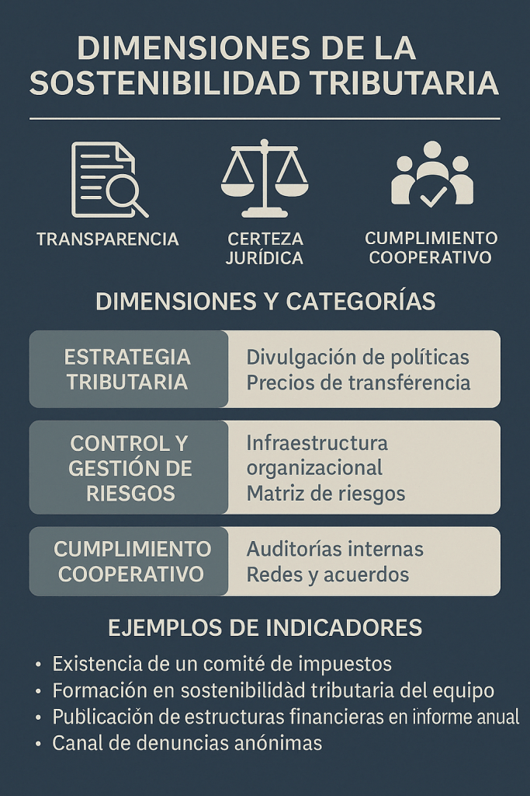

La **sostenibilidad tributaria**, incorporada en el artículo 8 nº 18 del Código Tributario por la Ley 21.713 (24 oct 2024), obliga a los contribuyentes a un “_conjunto de medidas_” para el cumplimiento fiscal responsable . Se sustenta en tres principios:

1. **Transparencia**  
    Divulgar la política y estrategias fiscales en reportes o Formulario RST, fortaleciendo la legitimidad social y la confianza mutua .

3. **Certeza jurídica**  
    Implementar un **Marco de Control Fiscal** (MCF) que identifique, evalúe y mitigue riesgos tributarios, siguiendo recomendaciones OCDE (GRI 207‑2, CINIIF 23) .

5. **Cumplimiento cooperativo**  
    Fomentar acuerdos y consultas con el SII, reduciendo litigios y agilizando procesos, sin vulnerar la igualdad de trato entre contribuyentes .

**Beneficios clave**:

- Menor probabilidad de fiscalizaciones y sanciones.

- Mejora de la reputación corporativa y social.

- Agilidad administrativa y reducción de costos.

- Acceso a programas de cumplimiento cooperativo con el SII.

## Indicadores de sostenibilidad tributaria

Según el estudio "_Indicadores de Sostenibilidad Tributaria para la Categorización de Contribuyentes_" de **_Antonio Faundez-Ugalde_**, se definieron **53 indicadores** organizados en **3 dimensiones** y **8 categorías** para evaluar prácticas fiscales de empresas y personas :

| Dimensión | Categorías principales |
| --- | --- |
| Estrategia tributaria | Divulgación de políticas, precios de transferencia, impacto |
| Control y gestión de riesgos | Infraestructura, equipos, matriz de riesgos, auditorías |
| Cumplimiento cooperativo | Redes, acuerdos y consultas |

Estos indicadores permiten medir de forma objetiva la calidad de la gobernanza fiscal y orientar mejoras concretas en la Declaración Anual.

[indicadores\_categoria\_contribuyentes](https://tiempossustentables.cl/wp-content/uploads/2025/04/indicadores_categoria_contribuyentes.pdf)[Descarga](https://tiempossustentables.cl/wp-content/uploads/2025/04/indicadores_categoria_contribuyentes.pdf)

## Recomendaciones para 2025

1. **Revisa y ajusta tu Formulario RST** con los 53 indicadores antes de presentar la F22.

3. **Publica tu política fiscal** en un reporte de sostenibilidad o en tu sitio web corporativo.

5. **Capacita a tu equipo** en sostenibilidad tributaria y gestión de riesgos.

7. **Planifica tu declaración**: envía la F22 temprano (1–8 abr) para acelerar la devolución.

9. **Mantén tu correo electrónico actualizado** en el SII para notificaciones oficiales.

* * *

## Plazos y calendario de la Declaración Anual de Impuestos

Con esta guía, empresas y personas naturales podrán enfrentar la Operación Renta 2025 de forma ética, eficiente y alineada con los estándares de sostenibilidad tributaria, aprovechando la Declaración Anual de Impuestos como una oportunidad de mejora continua.

### **¿Quiénes deben declarar?**

- Están obligados a presentar la Operación Renta 2025 quienes en 2024:

- Tuvieron ingresos anuales superiores a $10.402.992.

- Contaron con más de un empleador o pagador.

- Trabajaron a honorarios y buscan cobertura previsional.

- Solicitaron el Préstamo Solidario en 2020/21.

- Formalizaron un emprendimiento (emisión de boletas o facturas).

### **Plazo de presentación (Formulario 22)**

Tanto empresas como personas naturales deben enviar su Declaración de Renta (F22) **entre el 1 y el 30 de abril de 2025**.

### **Calendario de devoluciones (personas naturales, depósito electrónico)**

- Declaración **1–8 abr** → devolución 25 abr

- Declaración **9–21 abr** → devolución 14 may

- Declaración **22–28 abr** → devolución 23 may

- Declaración **29 abr–9 may** → devolución 30 may

### **Declaraciones Juradas adicionales (empresas)**

- DJ 1887 (remuneraciones): hasta 28 feb

- DJ 1947 (PPMs a socios): hasta 28 mar

- Otras DJ (balances, retiros, rentas presuntas): plazos entre marzo y junio según formulario

En la temporada de **Operación Renta 2025**, tanto empresas como personas naturales enfrentan un desafío que va más allá de la simple presentación de su Formulario 22: integrar la **sostenibilidad tributaria** como un elemento estratégico de gestión fiscal. A continuación, un análisis certero y actualizado de plazos, definiciones, herramientas y buenas prácticas para que tu declaración sea eficiente, transparente y alineada con los estándares que promueve el Servicio de Impuestos Internos (SII).

## Recomendaciones prácticas para empresas y personas naturales

1. **Revisa tu propuesta automática** en el sitio del SII antes de declarar, corrigiendo datos de ingresos, deducciones y cotizaciones.

3. **Planifica tu presentación**: adelanta tu F22 al primer período (1–8 abril) si esperas devolución, o dentro de 8–30 abril si debes pagar impuestos.

5. **Completa el Formulario RST** y documenta tus indicadores de sostenibilidad tributaria para fortalecer tu reputación y reducir riesgos de fiscalización.

7. **Capacita a tu equipo** en identificación y gestión de riesgos fiscales, asegurando un Marco de Control Fiscal robusto .

9. **Utiliza las herramientas del SII** (Asistente de Arriendos, Escritorio Contable) para agilizar la declaración y evitar errores.

* * *

Con una correcta planificación de plazos, la adopción de los indicadores de sostenibilidad tributaria y el uso de las herramientas del SII, la Declaración Anual de Impuestos se transforma en una oportunidad de mejora continua, transparencia y fortalecimiento de la relación entre contribuyentes y administración fiscal.
