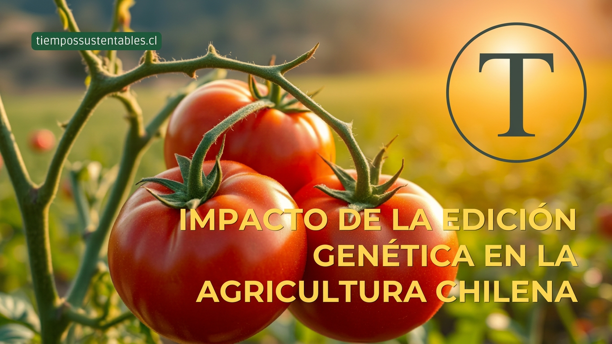
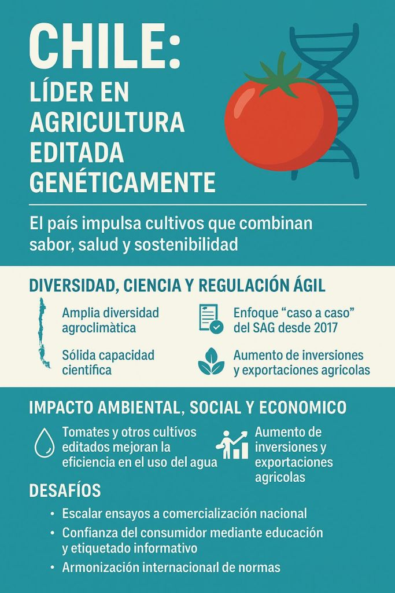
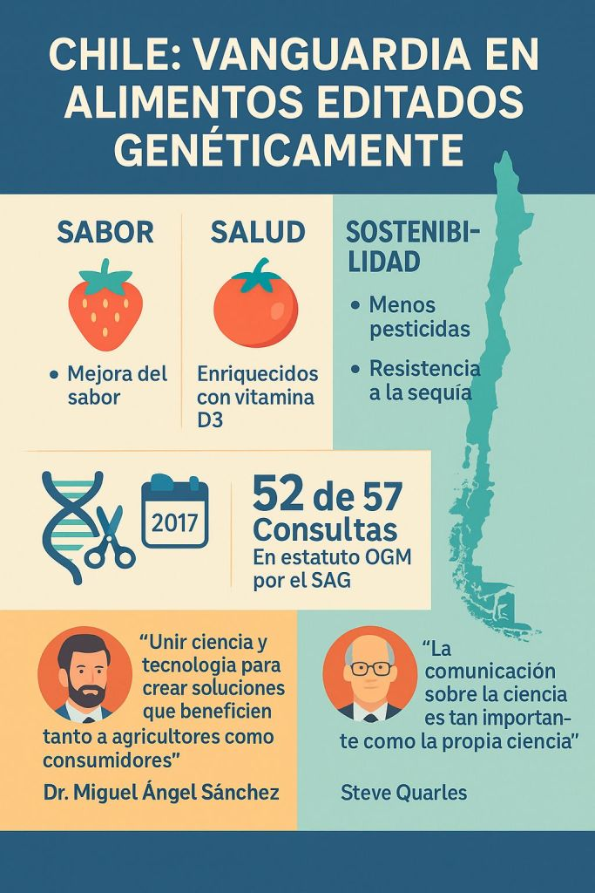

Tomates con más vitamina D, cultivos que usan menos agua y alimentos más saludables sin sacrificar sabor. Chile avanza con firmeza hacia el futuro de la agricultura gracias a la edición genética. Con cifras reales, testimonios del campo y el respaldo de la ciencia, el país se posiciona como referente regional en sostenibilidad alimentaria.

Chile está cambiando el juego en la industria agroalimentaria. Gracias al desarrollo y regulación de tecnologías de edición genética —[_como la técnica CRISPR/Cas9_](https://genotipia.com/crispr-cas/)— el país ha dado pasos concretos para transformar su matriz agrícola, haciéndola más saludable, resiliente y sostenible.

Los resultados no son promesas futuras, sino realidades medibles. Hoy, en los campos chilenos, se están ensayando cultivos con mejor sabor, mayor valor nutricional, resistencia al estrés hídrico y menos dependencia de agroquímicos. Todo esto, sin introducir ADN externo, lo que diferencia estos avances de los tradicionales transgénicos.

## Chile, territorio fértil para la innovación genética

Chile ofrece una combinación única de ventajas competitivas para el desarrollo de cultivos editados genéticamente:

- Diversidad agroclimática que permite probar distintas especies en escenarios naturales extremos.

- Capacidad científica consolidada en centros como INIA, universidades estatales y startups como NeoCrop Technologies.

- Regulación pionera: desde 2017, el Servicio Agrícola y Ganadero (SAG) aplica un enfoque caso a caso que ha aprobado 52 de 57 solicitudes sin catalogarlas como OGM, permitiendo ensayos y desarrollos en tiempo récord (menos de 20 días hábiles en promedio).

> “Esto es especialmente relevante para los pequeños agricultores que enfrentan desafíos de transporte y conservación. La edición genética permitirá variedades más resistentes y uniformes, reduciendo pérdidas postcosecha”, afirma el _**[Dr. Miguel Ángel Sánchez,](https://www.linkedin.com/in/miguel-angel-sanchez-biotech) Director Ejecutivo de ChileBio.**_

## Datos concretos: sostenibilidad con triple impacto

### 1\. Impacto ambiental: menos agua, menos insumos, menos emisiones

La agricultura chilena utiliza el 90,9 % del agua dulce disponible del país. En este contexto, cada avance en eficiencia hídrica cuenta.

[Estudios de **Tel Aviv University**](https://english.tau.ac.il/research/research/new-tomatoes) demostraron que tomates editados con CRISPR para eliminar el gen ROP9 logran una mejora significativa en eficiencia del uso del agua. Las plantas transpiran menos sin perder rendimiento ni calidad, lo que representa una oportunidad concreta para zonas afectadas por la sequía prolongada que vive Chile desde hace más de una década.

Además:

- Cultivos editados genéticamente pueden reducir el uso de pesticidas en hasta un 40 %.

- Estudios globales estiman que la adopción de mejoras genéticas podría reducir 1 Gt de CO₂e anuales para 2050, al evitar la expansión de la frontera agrícola.

### 2\. Impacto social: alimentos saludables y accesibles

Además del impacto productivo, estos avances mejoran la calidad de los alimentos. Ejemplo: tomates con vitamina D, hojas de mostaza sin sabor amargo y berries con más antioxidantes.

Y el impacto no es solo para grandes productores. El acceso a estas variedades más resistentes beneficia directamente a pequeños agricultores, quienes muchas veces pierden parte importante de su producción por condiciones climáticas extremas o plagas.

### 3\. Impacto económico: inversión y exportaciones

El primer semestre de 2024 marcó un récord en inversión en biotecnología agrícola:

- US $ 161 millones recaudados a nivel regional en solo seis rondas de capital.

- La startup chilena [NeoCrop Technologies](https://neocroptech.com/) levantó US $ 350.000 en capital privado local.

- Las exportaciones agropecuarias chilenas crecieron 10,1 % interanual en 2024, y las frutícolas un 25 %, lo que posiciona al país como exportador de alimentos de alto valor agregado.

## Regulación clara, aceptación ciudadana pendiente

Chile aplica desde 2017 un modelo regulatorio que es referente en América Latina. Al evaluar caso a caso, el SAG ha permitido la investigación sin las restricciones que afectan a los transgénicos, pero con total trazabilidad y control.

Sin embargo, la aceptación del consumidor aún requiere trabajo:

- Un estudio del Centro de Comunicación de la Ciencia (2024) muestra que el 68 % de los consumidores confía en alimentos editados genéticamente si se entrega información clara, voluntaria y basada en evidencia.

- El etiquetado informativo y campañas de educación científica son claves para ampliar la confianza social.

## ¿Qué viene ahora?

Chile tiene la oportunidad histórica de liderar una agricultura regenerativa, climáticamente inteligente y científicamente validada. Para lograrlo, se debe:

1. Escalar los ensayos a comercialización nacional.

3. Financiar más alianzas público-privadas y programas de capacitación.

5. Participar activamente en foros internacionales para armonizar normas.

7. Comunicar mejor, y más, sobre los beneficios de estas tecnologías.

* * *

**_En conclusión la edición genética no es una promesa futura: es una herramienta presente para abordar los mayores desafíos del siglo XXI en la alimentación. Y Chile, gracias a su ciencia, su entorno y su voluntad regulatoria, ya está liderando esta transformación._**
