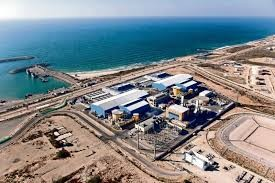
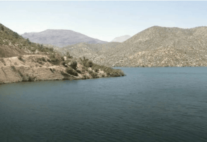
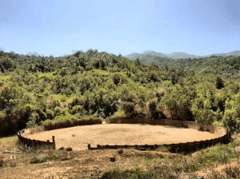

## **Resumen Ejecutivo**

La _Ley de Permisología_ busca agilizar inversiones en Chile, enfrentando resistencia oficialista que el TC desestimó. Persisten desafíos ambientales y demoras en permisos, aunque la SMA se fortalece. La implementación y regulación futura serán clave para el equilibrio inversión-protección.

## **Introducción**

El proyecto de Ley Marco de Autorizaciones Sectoriales (LMAS), también conocida como "Ley de Permisología" ([Boletín N. 16.566-03](https://www.camara.cl/legislacion/ProyectosDeLey/tramitacion.aspx?prmID=17134&prmBOLETIN=16566-03)), tiene como objetivo principal simplificar y agilizar los trámites para la aprobación de proyectos de inversión en Chile. Esta legislación, impulsada por el Gobierno, busca contrarrestar la creciente demora en la obtención de permisos, que ha impactado negativamente la inversión en el país.

La ley ha enfrentado resistencia, incluyendo una impugnación ante el [Tribunal Constitucional](https://www2.tribunalconstitucional.cl/) (TC) por parte de un grupo de diputados oficialistas. Sin embargo, el TC rechazó la impugnación al declarar el requerimiento inadmisible, argumentando que no formulaba una "cuestión de constitucionalidad" y que los diputados manifestaban su disconformidad con el modelo regulatorio aprobado, en lugar de alegar la inconstitucionalidad del texto.

## **Contexto y Justificación de la Ley de Permisología**

La problemática de la permisología en Chile es significativa. Un estudio de la [Sofofa](https://www.sofofa.cl/politicas-publicas/los-permisos-ambientales-en-chile-demoran-casi-cuatro-veces-mas-que-en-2008/) reveló que el tiempo promedio para la obtención de permisos en proyectos que requieren estudio de impacto ambiental aumentó un 231% en los últimos quince años, pasando de 355 a 1.135 días. Esta demora ha sido un factor clave en el desplome de la inversión, generando un "maraña regulatoria" llena de inconsistencias, ineficiencias y redundancias.

Para abordar esta situación, la LMAS incorpora nuevos instrumentos regulatorios ya utilizados en Europa. Entre estos se incluyen:

- **Técnicas habilitantes alternativas:** Permiten reemplazar ciertas autorizaciones por declaraciones juradas.

- **Declaraciones juradas:** Facilitan la simplificación de procesos.

- **Régimen de estabilidad regulatoria:** Ofrece protección a los titulares de permisos por hasta ocho años ante cambios normativos.

- **Plazos máximos:** Establecen límites para la emisión de pronunciamientos formales por parte de la administración.

- **Silencio administrativo:** Se amplía para definir las consecuencias de la falta de respuesta de la administración dentro de los plazos estipulados, pudiendo ser positivo (aprobación) o negativo (rechazo).

- **Sistema de Información Unificado de Permisos Sectoriales (SUPER):** Una plataforma centralizada para la gestión de autorizaciones.

- **Oficina de Autorizaciones Sectoriales e Inversión y Comité de Autorizaciones Sectoriales e Inversión:** Organismos encargados de coordinar y facilitar la aplicación de la ley, así como proponer mejoras.

- **Tramitación ágil para iniciativas de inversión:** Reduce los plazos para proyectos considerados estratégicos.

El ministro de Economía, Nicolás Grau, ha enfatizado que la ley permitirá reducir los tiempos de evaluación sectorial entre un 30% y un 70%, sin afectar los estándares regulatorios ni ambientales.

<figure>

<figcaption>

Fotografía: Gentileza de Renato Herrera P.

</figcaption>

</figure>

## **Impugnación y Críticas a la Ley**

Un grupo de 42 diputados oficialistas impugnó cinco artículos clave del proyecto ante el Tribunal Constitucional (TC). Argumentaron que la ley vulnera garantías constitucionales como el derecho a la salud y a vivir en un medio ambiente libre de contaminación, además de ir en contra de tratados internacionales como el [Convenio 169 de la OIT sobre Consulta Indígena](https://normlex.ilo.org/dyn/nrmlx_es/f?p=NORMLEXPUB:12100:0::NO::P12100_INSTRUMENT_ID:312314). Su principal objeción se centró en la posibilidad de reemplazar autorizaciones por declaraciones juradas, alegando que el Estado estaría supuestamente renunciando a su función de tutelar el interés público. También objetaron el régimen de estabilidad regulatoria, afirmando que impediría la aplicación de cambios normativos y que esto último vulneraría el mismo derecho de propiedad, porque nadie tiene propiedad sobre el régimen normativo.

Desde la perspectiva de los diputados impugnantes, modernizar el Estado no debería ser sinónimo de desregulación y la ley validaría un debilitamiento de la protección ambiental en un contexto de crisis climática. Esta "arremetida oficialista" tomó fuerza en la Cámara de Diputados, donde parte importante de parlamentarios del PS y Frente Amplio votaron en contra, mientras que la bancada del Partido Comunista, en su mayoría, se abstuvo. Esta respuesta es notable, considerando que el proyecto sobre "permisología" es uno de los más relevantes en la agenda del Gobierno para reimpulsar la economía, pero solo pudo salir del Congreso con apoyo de la oposición.

## **Análisis Crítico de la Resolución del Tribunal Constitucional**

El 22 de julio de 2025, el Tribunal Constitucional, en un fallo dividido (5 votos contra 4), decidió no acoger a trámite el requerimiento de inconstitucionalidad presentado por los diputados oficialistas.

- **Argumentos del Gobierno:** El Ejecutivo, a través del Presidente Gabriel Boric y el ministro de Economía Nicolás Grau, defendió el proyecto ante el TC. Argumentaron que el requerimiento no formulaba una "cuestión de constitucionalidad" y que los diputados manifestaban su disconformidad con el modelo regulatorio aprobado, en lugar de alegar la inconstitucionalidad del texto. Además, señalaron que no se suscitaron reservas de constitucionalidad durante la tramitación del proyecto por parte de los firmantes y que los fundamentos del recurso eran "imprecisos e inexactos".

- **Posición del TC:** Aunque el fallo no analizó los argumentos de fondo del requerimiento, la decisión de declararlo inadmisible se basó en el incumplimiento de los requisitos para su admisibilidad, según lo señala la Constitución y la Ley Orgánica que rige al TC.

- **Reacciones a la decisión:**
    - **Gobierno:** El ministro Grau calificó la decisión como una "buena noticia para el país".
    
    - **Diputados impugnantes:** Manifestaron su desacuerdo con la decisión, aunque la acataron, reiterando su preocupación por el debilitamiento de la protección ambiental en medio de la crisis climática.
    
    - **Oposición:** Desde Renovación Nacional, el diputado Miguel Mellado valoró la decisión del TC, señalando que ordena a los oficialistas y beneficia a las pymes, permitiéndoles tener técnicas habilitantes alternativas. El senador Rojo Edwards consideró la decisión como una derrota política para un sector del oficialismo y una muestra de "descoordinación y falta de capacidad de dar y entregar gobernabilidad".

## **Análisis Crítico:**

La resolución del TC, al declarar inadmisible el recurso, evitó un análisis profundo sobre el fondo de las objeciones presentadas. Esto implica que los argumentos sobre la supuesta vulneración de derechos fundamentales y tratados internacionales no fueron dirimidos por la máxima instancia constitucional. Si bien la defensa del Gobierno se centró en aspectos formales de la presentación del requerimiento, la decisión del TC deja abierta la discusión sobre el equilibrio entre la agilización de la inversión y la protección ambiental. La consistencia argumentativa de los diputados oficialistas también fue cuestionada por El Mercurio, ya que en el pasado defendieron ante el TC la soberanía democrática del legislador para modelar los derechos y las instituciones constitucionales, mientras que ahora invocan la Carta Fundamental como barrera a la autonomía del Congreso. Esta situación, calificada de "inconsistente" y "constitucionalmente errado", sugiere una posible contradicción entre posturas pasadas y actuales del mismo sector político.

La Ley de Permisología, al no ser frenada por el TC, avanza hacia su promulgación. Su efectividad y el impacto real en los tiempos de tramitación, así como en la protección ambiental, dependerán en gran medida de los futuros reglamentos emitidos por la propia administración y de la implementación de los nuevos instrumentos regulatorios.

## **Normativas Ambientales y Desafíos Actuales**

A pesar de la aprobación de la Ley de Permisología, los tiempos de tramitación en el [Sistema de Evaluación de Impacto Ambiental](https://www.sea.gob.cl/que-es-el-seia-0) (SEIA) han retomado su tendencia al alza, alcanzando un promedio de 21,1 meses en el segundo trimestre de 2025, el nivel más alto desde 2009. Esta demora preocupa a la industria por su impacto en la reactivación económica. Un ejemplo de esta situación es la decisión de [Freeport-McMoran](https://www.fcx.com/) de retrasar el ingreso del Estudio de Impacto Ambiental (EIA) para la expansión de su mina El Abra. Originalmente, se esperaba presentar el EIA a fines de 2025, pero ahora se planea para principios de 2026. Esta decisión se basa en las condiciones del mercado del cobre, los permisos necesarios y otros factores.

La [Superintendencia del Medio Ambiente](https://portal.sma.gob.cl/) (SMA) también ha realizado ajustes internos recientes para reforzar su relación con los usuarios y adaptarse a los desafíos actuales. Estos cambios incluyen la reestructuración de departamentos para mejorar la eficiencia y la accesibilidad de los servicios, con un enfoque centrado en las personas y en línea con el [Acuerdo de Escazú](https://escazu.mma.gob.cl/acuerdo-de-escazu/que-es-el-acuerdo-de-escazu/). Además, se está tramitando en el Senado un proyecto de ley que busca fortalecer la SMA, modernizando la institución y proporcionándole nuevas herramientas para robustecer la fiscalización y el cumplimiento ambiental.

## **Conclusión**

La Ley de Permisología representa un esfuerzo gubernamental por dinamizar la inversión mediante la simplificación de los procesos administrativos. La decisión del Tribunal Constitucional de no acoger el requerimiento de inconstitucionalidad de los diputados oficialistas despeja el camino para la promulgación de la ley. Sin embargo, persisten las preocupaciones sobre el **equilibrio entre la agilización de los permisos y la protección ambiental, así como la efectividad real de la ley para reducir los tiempos de tramitación**, especialmente en el contexto de las crecientes demoras en la aprobación ambiental. Los ajustes en la SMA y la ley de fortalecimiento de esta institución son pasos importantes para mejorar la gestión ambiental en Chile.

**Carlos Rubilar Camurri**

_Periodista y Executive MBA. Cuenta con 25 años de experiencia profesional en comunicación estratégica, educación superior y política, tanto en el sector privado como público. Se ha especializado Comunicación Estratégica, Asuntos Públicos y Sostenibilidad, con un enfoque en asuntos hídricos, medioambientales y criterios ESG._
