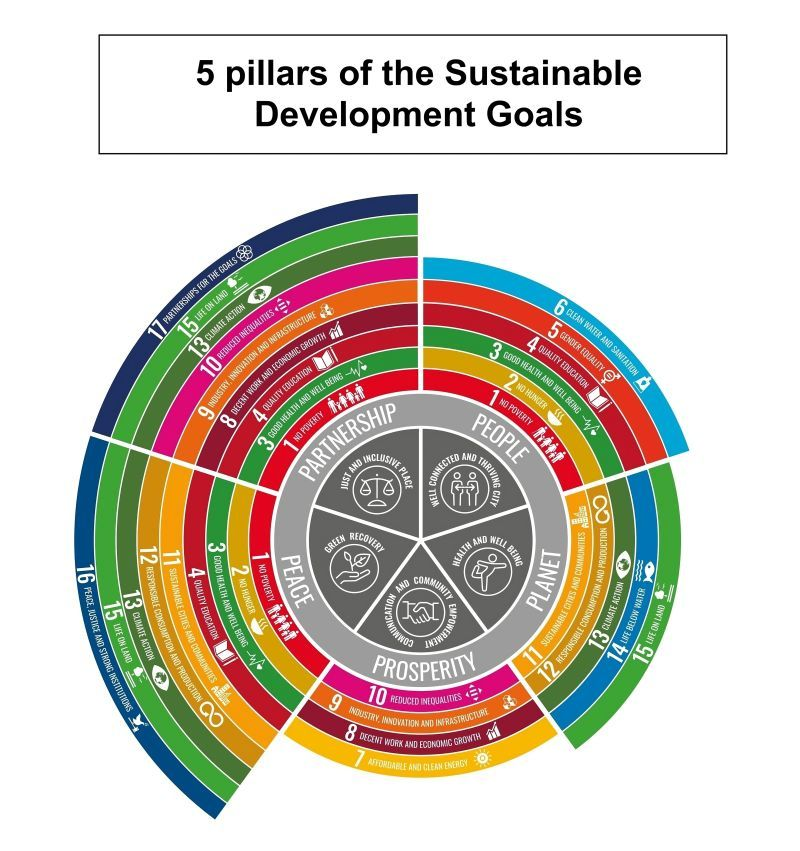

> “Hoy, más que nunca, la sostenibilidad no puede seguir siendo un anexo del negocio: debe ser el corazón del propósito empresarial.”  
> — Soledad Mella, Directora Ejecutiva, Fundación Basura

En el vertiginoso mundo actual, la sostenibilidad no es solo una tendencia, sino una responsabilidad ineludible. Las empresas, como motores de la economía global, tienen un papel crucial en la lucha contra el cambio climático y en la promoción del bienestar social. Este lunes, reflexionamos sobre la urgencia de integrar la sostenibilidad en el núcleo de la estrategia empresarial.

## El Marco de los ODS: Un Camino Claro

Los Objetivos de Desarrollo Sostenible (ODS) propuestos por la ONU no son solo una guía teórica, sino un marco práctico para alinear las operaciones empresariales con un futuro más resiliente.

> “Los ODS nos permiten trazar un mapa común para avanzar de manera coherente y colaborativa. El desafío está en convertirlos en acción concreta.”  
> — Gonzalo Muñoz, High Level Climate Action Champion COP25 y Cofundador de TriCiclos

En Chile, empresas como Entel, CMPC y BCI han comenzado a reportar sus avances alineados con estos objetivos, demostrando que la sostenibilidad ya es parte de la conversación estratégica.

## Sinergias Interconectadas

Cuando se aborda la sostenibilidad de forma sistémica, cada acción tiene múltiples beneficios. Ejemplo: la inversión en energías renovables (ODS 7) impacta positivamente en la acción climática (ODS 13) y en el empleo (ODS 8).

Colbún y su expansión en proyectos solares y eólicos son prueba de esta lógica de impacto cruzado.

> “No existe innovación empresarial sin innovación ambiental.”  
> — Marcela Angulo, Directora de Innovación, Universidad de Concepción

## Sostenibilidad como Estrategia Central

Según el estudio “Tendencias de Inversión ESG en Chile 2024” (EY), 7 de cada 10 empresas chilenas que integran criterios ESG han visto mejoras en su competitividad y reputación.

Viña Emiliana, BancoEstado, Mallplaza y Cencosud son solo algunas de las organizaciones que han convertido la sostenibilidad en un activo estratégico.

> “La sostenibilidad no es un gasto, es una inversión inteligente que genera valor y fidelidad.”  
> — Carolina Cuevas, presidenta del Comité de Sostenibilidad de SOFOFA

## Resiliencia, Confianza y Futuro

Abrazar la sostenibilidad es también prepararse para tiempos de incertidumbre. Las empresas resilientes son aquellas que ya están enfrentando las crisis sociales y ambientales del siglo XXI.

The Live Green Co, Algramo, y NotCo han demostrado que la sostenibilidad puede escalar y cruzar fronteras, generando soluciones desde Chile para el mundo.

## Un Llamado a la Acción

Hoy en día, más allá de buenas intenciones, necesitamos liderazgos valientes y decisiones estructurales. Que la sostenibilidad deje de ser parte de la estrategia… y sea la estrategia.

> “Chile tiene la oportunidad de liderar desde el sur global un modelo de desarrollo regenerativo. Pero debemos pasar del relato al rediseño.”  
> — Nicole Keller, Consultora en Economía Circular y ex Coordinadora ODS del Gobierno de Chile

## Conclusión

El compromiso auténtico con la sostenibilidad hará que las empresas no solo sean parte de la solución, sino también líderes en el cambio. Comencemos esta semana con determinación, propósito y colaboración. Porque el futuro es ahora. Y es sostenible.

