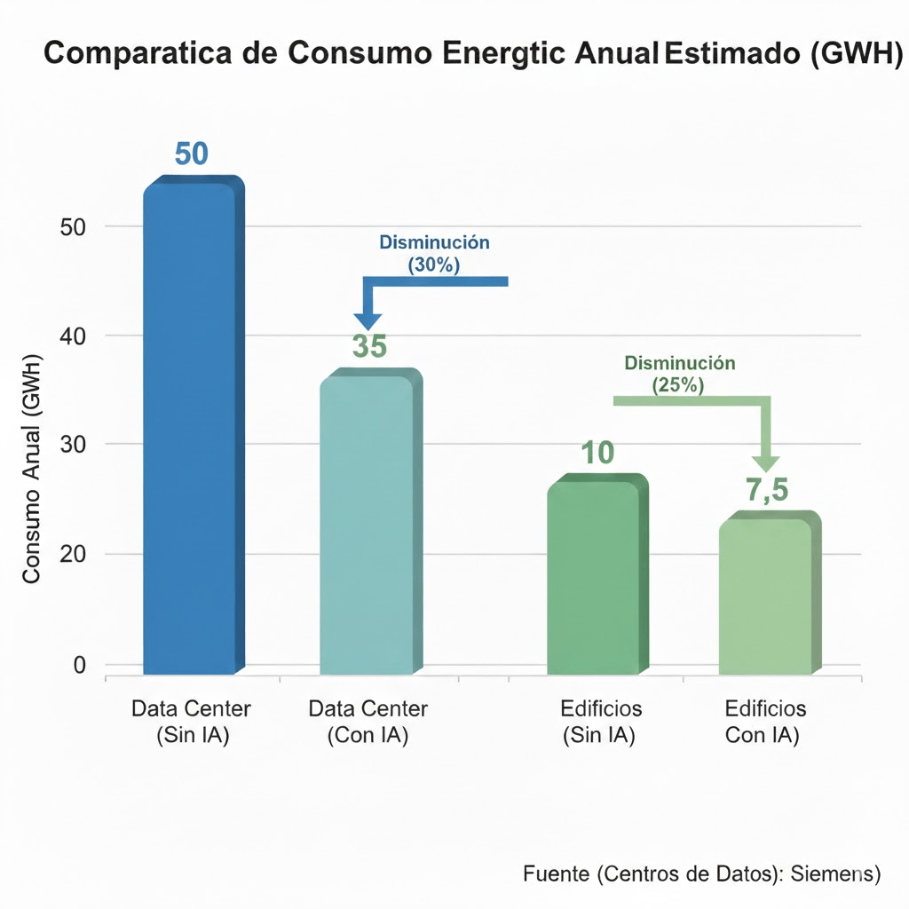
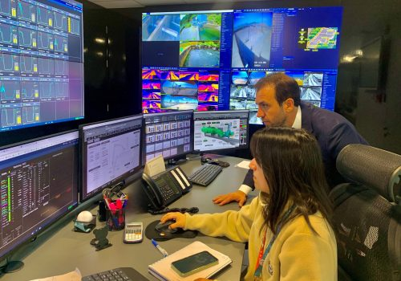
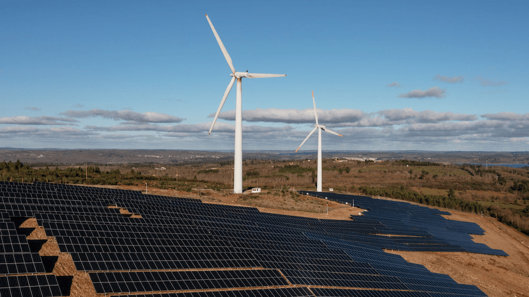
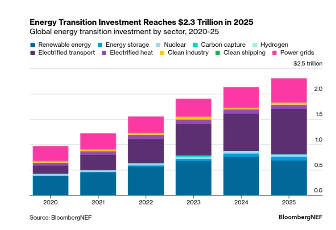
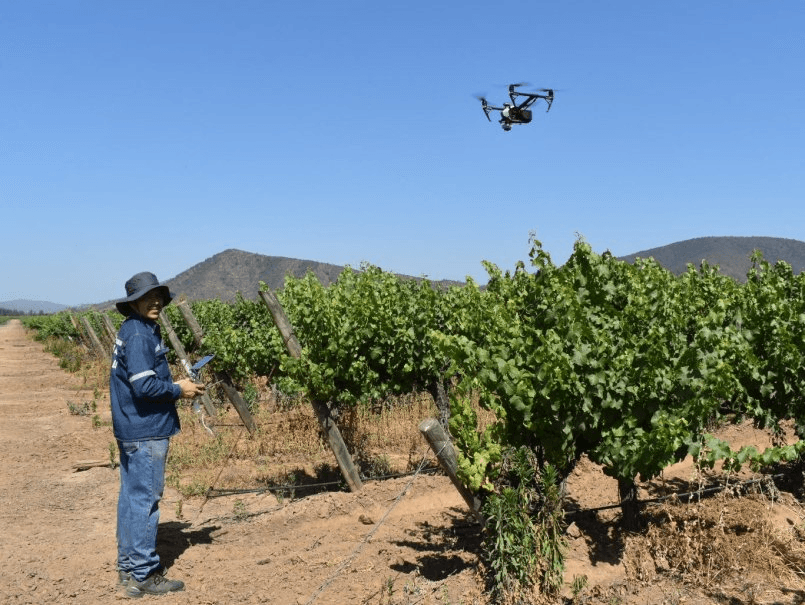
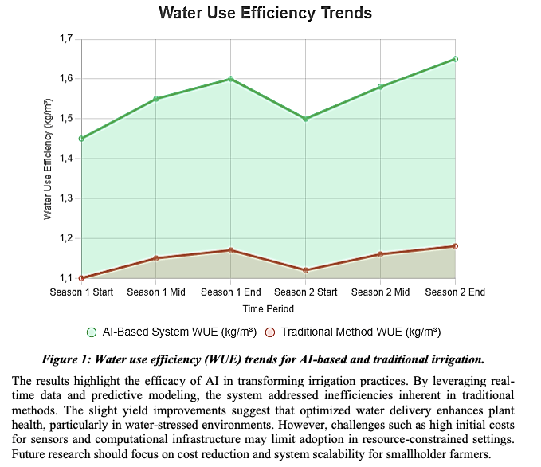

* * *

Chile y otros países latinoamericanos ya están usando inteligencia artificial para reducir entre 20 y 30% el consumo energético de edificios, optimizar redes eléctricas con alta penetración de renovables y disminuir en torno a 20–30% el uso de agua en agricultura, en un contexto de inversión global récord en transición energética.

* * *

## 1\. ¿Qué es la IA climática y por qué importa hoy en Chile?

En 2025, la inversión global en transición energética alcanzó un máximo histórico de 2,3 billones de dólares, alrededor de un 8% más que el año anterior, impulsada por energías renovables, redes, transporte eléctrico y almacenamiento. Pese al encarecimiento del capital y a las tensiones geopolíticas, las soluciones limpias se han consolidado como la opción más competitiva en gran parte del mundo.

América Latina se ha convertido en una de las regiones más dinámicas de esta transición: Brasil, Chile y México concentran la mayor parte de la nueva capacidad eólica y solar, con Chile como uno de los mercados más atractivos por su marco regulatorio estable, su recurso solar y una política energética consistente. Entre 2016 y 2022, la participación de combustibles fósiles en la matriz eléctrica chilena cayó del orden del 63% a cerca de 45%, gracias al despliegue acelerado de energía solar y eólica.

En este contexto, cuando hablamos de “IA climática” nos referimos al conjunto de aplicaciones de inteligencia artificial orientadas a reducir emisiones, mejorar la eficiencia en el uso de recursos y fortalecer la resiliencia frente al cambio climático. Para un comité ejecutivo, no es solo una tecnología emergente: es una decisión de asignación de capital que impacta directamente en el EBITDA, en el riesgo regulatorio y en la competitividad frente a clientes e inversionistas que valoran descarbonización y transparencia.

* * *

## 2\. ¿Cuánto puede ahorrar la IA en consumo energético de edificios?

Los edificios concentran en torno al 40% del consumo de energía y de las emisiones asociadas a nivel mundial, por lo que representan un frente prioritario para la descarbonización. Buena parte de ese potencial se pierde por la operación ineficiente de climatización, ventilación e iluminación, gestionadas con reglas fijas en entornos muy variables.

La evidencia científica apunta a que, cuando se integra la IA en el diseño, la operación y la gestión de edificios, junto con políticas de eficiencia y electrificación, es posible obtener reducciones significativas en consumo energético y emisiones a largo plazo.

A escala de proyecto, informes técnicos sobre IA y eficiencia energética muestran que los sistemas de gestión energética basados en IA pueden reducir el desperdicio de energía en edificios hasta en torno a un 30% cuando se integran en programas de gestión energética continua. En numerosos casos se observan ahorros típicos del orden de 20–30% al optimizar automáticamente los parámetros de HVAC, ventilación e iluminación a partir de datos en tiempo real de ocupación, clima y tarifas.

Para carteras de oficinas, retail o centros logísticos en Chile y la región, estos rangos de ahorro se traducen en reducciones relevantes del gasto operacional y de la huella de carbono, con periodos de retorno que, en muchos proyectos, se sitúan en horquillas de 12 a 24 meses. Además, los datos generados por estas plataformas —consumos horarios, emisiones asociadas, desempeño frente a línea base— se convierten en insumos directos para reportes climáticos, auditorías ESG y cumplimiento de exigencias de inversionistas y reguladores.

<figure>

<figure>

<figcaption>

Centro Despacho Nacional de Energía

</figcaption>

</figure>

<figure>

<figcaption>

Centro de Control EnfraGen Chile

</figcaption>

</figure>

</figure>

* * *

## 3\. ¿Por qué la red eléctrica chilena necesita IA para integrar más renovables?

La expansión acelerada de la generación solar y eólica ha desplazado el cuello de botella de la transición desde la generación hacia la red. Sin capacidades avanzadas de pronóstico, flexibilidad y almacenamiento, cada megavatio adicional de renovables obliga a mantener generación fósil de respaldo o a aceptar mayores niveles de congestión y vertimientos.

Revisiones técnicas sobre IA en gestión de energías renovables y redes inteligentes muestran que los algoritmos de aprendizaje automático mejoran de forma significativa la predicción de generación eólica y solar, así como la demanda, lo que permite operar sistemas eléctricos con alta penetración renovable sin comprometer la estabilidad. La IA también se utiliza para detectar fallas, optimizar el despacho en tiempo real, gestionar el estado de carga de baterías y coordinar recursos energéticos distribuidos, reduciendo pérdidas técnicas y posponiendo parte del CAPEX necesario en refuerzo de infraestructura.

<figure>

<figcaption>

EDP Renewables en Reserva Eólica de Taltal con una potencia instalada de más de 323 MW combinada entre la energía solar y eólica.

</figcaption>

</figure>

En Chile, la fuerte expansión de la generación solar en el norte ha generado episodios frecuentes de vertimiento de energía, evidenciando la necesidad de almacenamiento y de una gestión más inteligente de la red. Proyectos como grandes complejos híbridos solar‑eólicos con sistemas de baterías a escala de cientos de megavatios apuntan precisamente a reducir vertimientos y aumentar la flexibilidad del sistema. En este tipo de instalaciones, la IA desempeña un papel clave al decidir cuándo cargar o descargar baterías, cómo combinar la generación solar y eólica y cómo responder a señales de precio o restricciones de transmisión en tiempo real.

La propia IA, sin embargo, incrementa la demanda de energía a través de los centros de datos de alta potencia que soportan modelos de lenguaje y servicios digitales. Casos reales muestran que algoritmos de IA aplicados al control de sistemas de refrigeración y operación de centros de datos han permitido reducir de forma sustantiva la energía destinada a cooling, con reducciones cercanas al 40% en algunos proyectos piloto. Para utilities, telcos y grandes usuarios de nube en la región, esta doble cara de la IA —consumidora intensiva de energía y herramienta de eficiencia— exige estrategias integradas que combinen contratos renovables, almacenamiento y optimización avanzada.

<figure>

<figcaption>

Gráfico barras con la inversión global en transición energética 2020–2025. BloombergNEF (BNEF) y la Agencia Internacional de Energía (AIE).

</figcaption>

</figure>

* * *

## 4\. ¿Qué beneficios aporta la IA en la agricultura y el uso de agua?

La agricultura y la gestión del agua son puntos críticos de la agenda climática latinoamericana: la región es una gran exportadora de alimentos, pero también una de las más vulnerables a sequías, eventos extremos y degradación de suelos. La IA se está consolidando como una herramienta para desacoplar productividad y consumo de recursos.

Revisiones científicas sobre sistemas de riego inteligente basados en IA muestran que la combinación de sensores de humedad, imágenes satelitales y modelos de decisión puede reducir el uso de agua aproximadamente entre 20 y 30% respecto de prácticas tradicionales, manteniendo o incluso incrementando el rendimiento de los cultivos. Otros estudios técnicos documentan casos en los que la integración de IA, drones e imágenes satelitales permite disminuir de forma notable el uso de fertilizantes y agroquímicos, a la vez que mejora la rentabilidad por hectárea.

Para agroexportadores de uva, frutas y otros cultivos en Chile y países vecinos, estas soluciones reducen su huella hídrica y de nutrientes y refuerzan la resiliencia frente a la variabilidad climática. Al mismo tiempo, los datos generados por sensores y modelos de IA —aplicaciones de riego, volúmenes de agua realmente utilizados, rendimientos por lote— pueden integrarse a sistemas corporativos de reporte ESG y a las exigencias de trazabilidad de compradores internacionales, que cada vez demandan más información sobre emisiones de alcance 3 e impactos sobre ecosistemas.

<figure>

<figure>

<figcaption>

Viñedo chileno con sensores de suelo, estaciones meteorológicas y un dron en vuelo.

</figcaption>

</figure>

<figure>

<figcaption>

Esta es una comparativa visual de los cambios clave al pasar de un sistema tradicional (basado en calendarios fijos) a uno inteligente con Inteligencia Artificial (basado en datos en tiempo real de sensores e imágenes satelitales).

</figcaption>

</figure>

</figure>

* * *

## 5\. ¿Cómo se conecta la IA climática con las nuevas exigencias regulatorias?

La Directiva de Reporte de Sostenibilidad Corporativa de la Unión Europea y los estándares ESRS están fijando un nuevo estándar global de transparencia en clima y ESG. Esta normativa amplía de forma considerable el número de empresas obligadas a reportar y exige divulgar emisiones de alcance 1, 2 y 3, riesgos físicos y de transición, planes de descarbonización y su reflejo en estrategia y asignación de capital.

Su principio de “doble materialidad” obliga a analizar tanto el impacto de la empresa sobre el clima como la exposición de su modelo de negocio a los riesgos climáticos a lo largo de toda la cadena de valor. Evaluaciones independientes subrayan que reguladores y auditores se concentrarán cada vez más en la coherencia entre metas climáticas declaradas, inversión de capital y resultados medibles en reducción de emisiones y desempeño financiero.

En este escenario, la IA climática aporta algo más que eficiencia operativa: genera datos de alta resolución que permiten cuantificar ahorros de energía, reducciones de emisiones y retornos financieros por iniciativa. Organismos multilaterales como el PNUD destacan que, bien gobernada, la IA puede acelerar tanto la mitigación como la adaptación —por ejemplo, mediante sistemas de alerta temprana, planificación urbana resiliente y optimización agrícola—, pero advierten de riesgos de mayor consumo energético, sesgos y opacidad si no se acompañan de marcos sólidos de gobernanza.

Para el C‑suite chileno y latinoamericano, esto se traduce en tres prioridades: construir una arquitectura de datos que permita alimentar modelos de IA con información confiable; definir criterios y procesos para auditar y gobernar algoritmos; e integrar los resultados de la IA en la planificación financiera, la gestión de riesgos y la comunicación con inversionistas y reguladores.

* * *

## 6\. Hoja de ruta ejecutiva: cómo priorizar la “obra gruesa” de IA climática

La experiencia internacional sugiere que los casos de mayor valor se encuentran donde convergen tres atributos: alto gasto base en energía o agua, capacidad de medición robusta y relevancia directa para la estrategia climática y de negocio. A partir de aquí, una hoja de ruta realista para Chile y Latinoamérica podría seguir estos pasos:

1. **Diagnóstico de bolsones de ineficiencia**  
    Identificar activos y procesos con mayor consumo de energía y agua, y evaluar qué datos ya se registran (medidores inteligentes, sistemas de gestión de edificios, SCADA, sensores agrícolas).

3. **Definición de casos de uso prioritarios**
    - En edificios y plantas industriales, partir por proyectos de IA sobre sistemas de gestión de energía ya existentes, idealmente bajo contratos de desempeño vinculados a ahorros medidos.
    
    - En redes y grandes proyectos renovables, incorporar analítica avanzada en planificación, despacho, almacenamiento y gestión de congestión, especialmente en nodos con altos vertimientos.En agricultura y recursos hídricos, desplegar sensores e IA en cultivos de alto valor mediante alianzas entre productores, empresas tecnológicas y actores financieros.

5. **Gobernanza y narrativa de transición**  
    Establecer políticas de datos y ética de IA, asegurar trazabilidad de decisiones algorítmicas y vincular cada proyecto con metas de emisiones y KPIs financieros. Comunicar resultados de forma transparente a inversionistas, clientes y reguladores, mostrando cómo la IA climática es una pieza central de la estrategia de descarbonización.

En una región donde la transición energética convive con grandes brechas sociales e infraestructurales, la capacidad de usar IA para hacer “obra gruesa” —mejorar eficiencia, reducir vulnerabilidades y crear ventajas competitivas— será uno de los factores que definan qué empresas lideran la economía sostenible latinoamericana en la próxima década.

* * *

## Enlaces generales a fuentes y lecturas recomendadas

- BloombergNEF – Energy Transition Investment Trends 2026.

- Zero Carbon Analytics – Latin American Successes in the Energy Transition.

- Nature Communications – “Potential of artificial intelligence in reducing energy and carbon emissions of commercial buildings at scale”.

- KPMG – “AI’s Dual Promise: Enabling Positive Climate Outcomes and Efficiency”.

- Estudios y revisiones sobre riego inteligente con IA en plataformas científicas como ScienceDirect.

- Comisión Europea – Documentación oficial sobre la Corporate Sustainability Reporting Directive (CSRD) y estándares ESRS.

- EY y otros informes técnicos sobre el impacto de la CSRD en empresas.

- PNUD – “AI and the Climate Crisis” y documentos sobre IA para adaptación climática.
