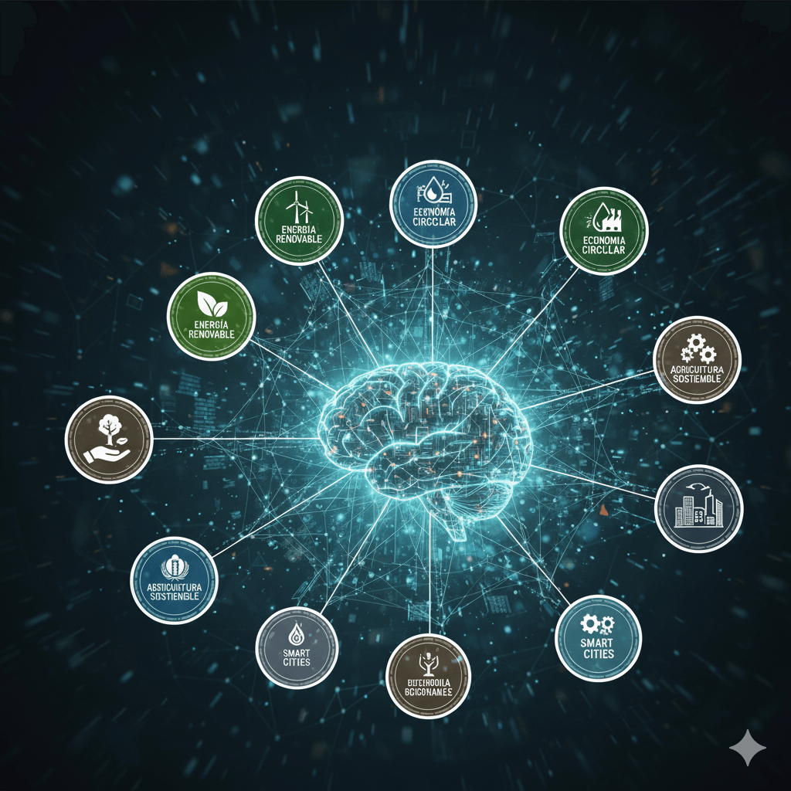
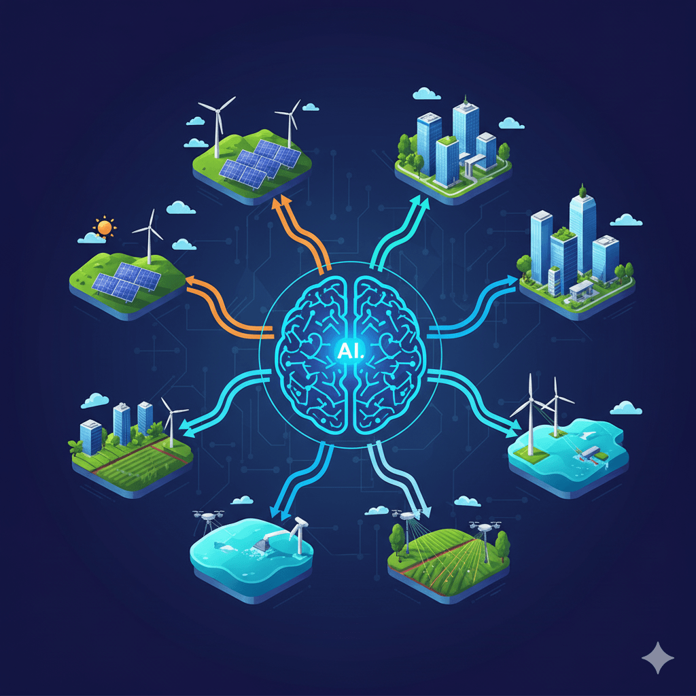
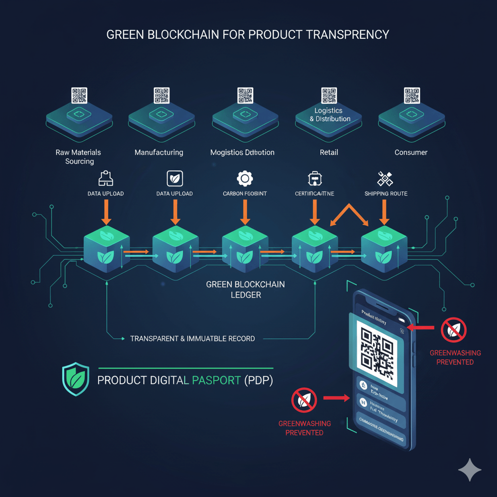
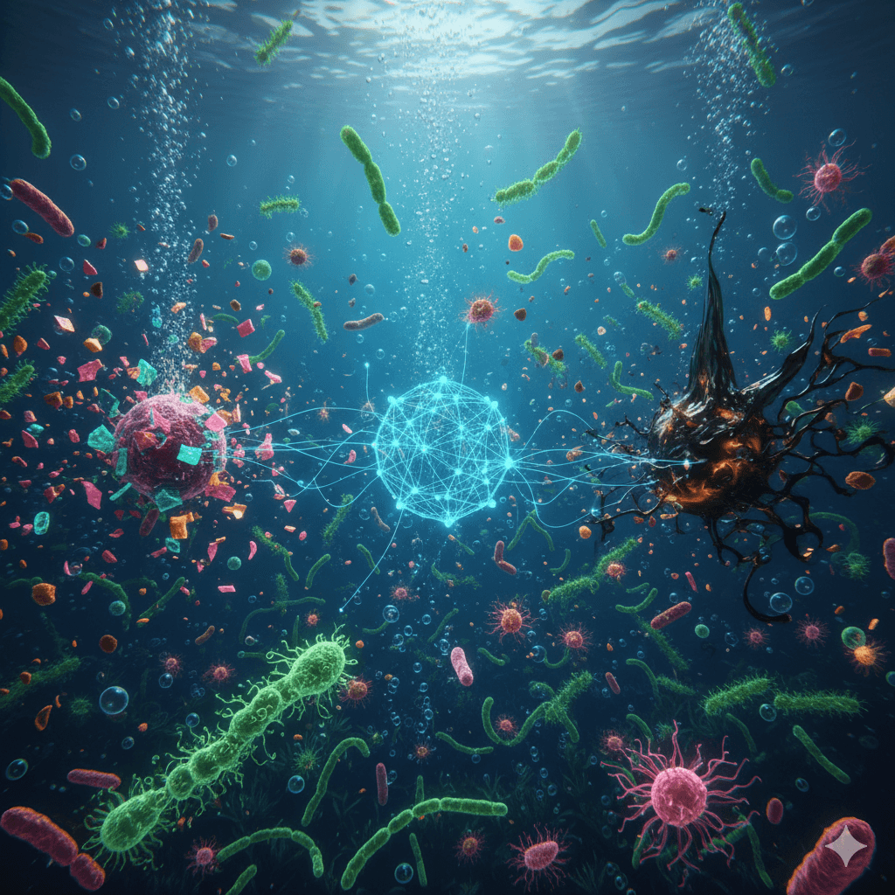

Para el **2025**, los modelos de IA son esenciales. Su capacidad predictiva no solo optimiza, sino que permite la **descarbonización** y la gestión de recursos a una escala que la humanidad nunca antes conoció.

## 🤖 ¿Por Qué la Inteligencia Artificial Impulsa el 79% de los ODS? (Sostenibilidad 4.0)

La **Sostenibilidad 4.0** es el nuevo paradigma. Se basa en la integración de la IA con tecnologías como **IoT** y **Cloud Computing** para alcanzar los Objetivos de Desarrollo Sostenible (ODS). Su impacto es sistémico y medible:

- **Mitigación de Riesgos Climáticos:** La IA refina los modelos de pronóstico hasta en un **40%**, ofreciendo semanas de antelación en la predicción de fenómenos extremos (según datos proyectados a 2025).

- **Eficiencia Industrial Global:** El ahorro energético en la industria pesada, asistido por IA mediante **Gemelos Digitales**, ya supera el **15%** de media en las empresas líderes.

<figure>



<figcaption>

**La IA como el Ecosistema Central de la Sostenibilidad 4.0**

</figcaption>

</figure>

## 🔬 Las 5 Soluciones **GreenTech** Más Disruptivas: Un Análisis de Vanguardia por **Tiempos Sustentables**

### 1\. Computación Cuántica: El Salto a los Materiales Súper-Sostenibles

La **Computación Cuántica** no es solo un concepto, es la **herramienta definitiva** para la ciencia de materiales de 2025. Su capacidad de simulación molecular está abriendo caminos inéditos para:

- El diseño **ex nihilo** de **catalizadores** que hacen la **Captura y Almacenamiento de Carbono (CCS)** económicamente viable a escala masiva.

- El desarrollo acelerado de **baterías de estado sólido**, eliminando la dependencia de minerales críticos y su impacto socioambiental.

<figure>



<figcaption>

**Fusión Cuántica y Sostenibilidad Material**

</figcaption>

</figure>

### 2\. **Blockchain Verde**: La Transparencia Inmutable contra el Greenwashing

En un mundo que exige rendición de cuentas, el **Blockchain Verde** (utilizando algoritmos de consenso eficientes) se erige como la columna vertebral de la **trazabilidad de carbono**. Para el 2025, es la tecnología clave para emitir un **Pasaporte Digital de Producto (PDP)**, verificando cada eslabón de la cadena de suministro y empoderando al consumidor y a los reguladores.

> Para comprender la urgencia de la transparencia, explore las [**últimas iniciativas del PNUMA (ONU Medio Ambiente)**](https://www.unep.org/) sobre tecnología y finanzas sostenibles.

<figure>



<figcaption>

**El Viaje del Pasaporte Digital de Producto (PDP) con Blockchain Verde**

</figcaption>

</figure>

### 3\. Fusión IA-Energía: La **Eficiencia Energética Predictiva** en la red

La IA es ahora el "cerebro" central de las **Smart Grids**. A través de algoritmos de **Reinforcement Learning**, la red no solo equilibra la oferta y demanda de energía renovable, sino que predice picos y valles con una precisión sin precedentes, eliminando la dependencia de centrales de respaldo contaminantes y garantizando un suministro 100% verde cuando sea posible.

> **Reinforcement Learning para Smart Grids**: es un área de aprendizaje automático donde un agente aprende a tomar decisiones óptimas para maximizar sus recompensas en un entorno determinado, en este caso, el sistema de energía de las redes inteligentes. Este enfoque permite optimizar la gestión de recursos, la distribución de energía y el mantenimiento predictivo, mejorando así la eficiencia y sostenibilidad de las Smart Grids.

> Si busca la base conceptual, le invitamos a repasar la [Edición Especial de Innovación y Tecnología Sustentable](http://tiempossustentables.cl/2025/10/20/especial-de-innovacion-y-tecnologia-sustentable/).

### 4\. Biorremediación Asistida por IA (**BioTech Sustentable**)

La biotecnología moderna utiliza el **Machine Learning** para acelerar la ingeniería de **enzimas y microorganismos** especializados en la **degradación de microplásticos, contaminantes industriales y vertidos de petróleo**. Esta 'limpieza biológica' masiva, antes un sueño, es hoy una realidad que protege nuestros océanos y suelos.

<figure>



<figcaption>

**La Batalla de la Biorremediación contra la Contaminación**

</figcaption>

</figure>

### 5\. El **IoTS** y la Lucha contra el Desperdicio Hídrico y el **E-Waste**

El **Internet de las Cosas Sostenible (IoTS)** no es solo eficiencia; es **conservación activa**. Sensores de ultra bajo consumo, integrados con IA, permiten la **detección inmediata de fugas de agua** en ciudades y explotaciones agrícolas, y optimizan la **Agricultura de Precisión**. Además, el IoTS facilita la trazabilidad del **e-waste** (desechos electrónicos), promoviendo su reciclaje y reuso eficiente en la economía circular.

> _Ponga a prueba sus conocimientos y afiance lo aprendido con nuestro [Cuestionario Didáctico sobre Especial de Innovación y Tecnología Sustentable](http://tiempossustentables.cl/2025/10/27/cuestionario-didactico-sobre-especial-de-innovacion-y-tecnologia-sustentable/)._

* * *

## ❓ Preguntas Frecuentes (FAQ): Exclusivo Tiempos Sustentables

### ¿De qué forma la Inteligencia Artificial combate la escasez de agua en 2025?

La IA combate la escasez de agua al integrar datos de **sensores IoT** para **detectar fugas en tuberías** en tiempo real y optimizar los sistemas de **riego de precisión** en la agricultura, **reduciendo el consumo hídrico hasta en un 40%** según las últimas proyecciones.

### ¿Cuál es la tecnología clave para crear baterías más sostenibles que reemplacen al Litio y Cobalto para 2025?

La **Computación Cuántica** es la tecnología clave que acelera el desarrollo de **baterías de estado sólido o de flujo**, eliminando la dependencia de minerales de alto impacto como el litio y el cobalto, marcando un hito en la **innovación sustentable**.

### ¿Cuál es el principal obstáculo para que la **GreenTech** se masifique globalmente en los próximos años?

El principal obstáculo no es la tecnología, sino el alto costo de **inversión inicial** y la **integración a gran escala** de sistemas complejos. Esto requiere **financiamiento climático** y **marcos regulatorios** específicos que incentiven fuertemente la inversión privada en **GreenTech** a nivel global.

* * *

```
La tecnología sustentable ya no es el futuro; es la herramienta del presente que nos permite alcanzar una sostenibilidad verificable.
```

* * *

#### **¿Quieres profundizar en este tema?**

Descubre nuestra página pilar sobre Economía Circular, donde incluimos toda la información actualizada para la región.

[Leer la Guía Estratégica de Economía Circular en LATAM](https://tiempossustentables.cl/economia-circular-chile-latam/)
