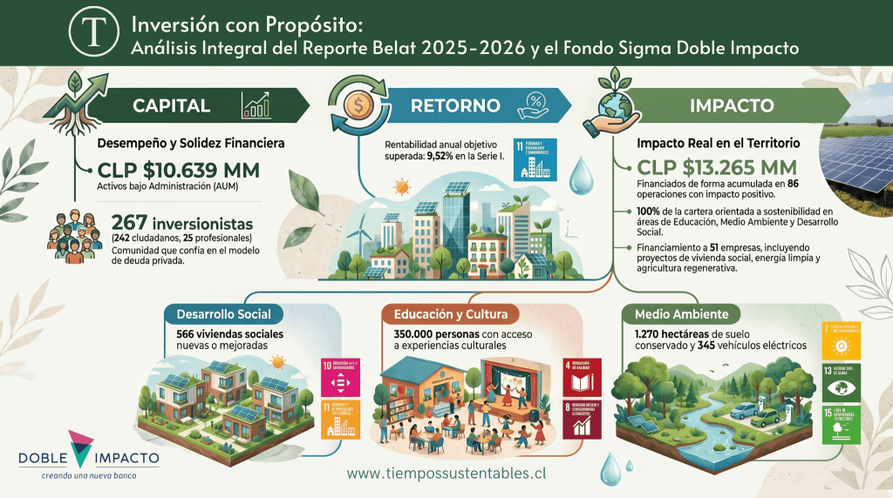

El Informe Macroeconómico 2026 del Banco Interamericano de Desarrollo (BID) concluye que América Latina y el Caribe ha demostrado resiliencia institucional ante las crisis globales recientes, pero enfrenta un riesgo mayor: caer en una «mediocridad estable», es decir, sobrevivir sin crecer. Para evitarlo, la región tiene cuatro palancas de transformación identificadas y cuantificadas por el organismo.

Las cuatro palancas son: (1) procesar localmente minerales críticos como litio y cobre en lugar de exportarlos en bruto, multiplicando su valor agregado hasta 10 veces; (2) integrar a las mujeres al mercado laboral formal antes del fin del bono demográfico proyectado para 2030; (3) adoptar inteligencia artificial en los sectores productivos con mayor rezago tecnológico; y (4) gestionar estratégicamente la deuda pública para liberar espacio fiscal para inversión verde.

Este análisis exclusivo de Tiempos Sustentables explica qué significa cada una de estas cinco revelaciones del BID para los directorios, CFOs y líderes de sostenibilidad de Chile y LAC, con implicancias concretas para la estrategia corporativa 2026-2028.

* * *

## 1\. La Nueva Era de la Inversión en Chile: Capital, Retorno e Impacto

En el actual ecosistema financiero chileno, la gestión de activos ha trascendido la búsqueda simplista de dividendos. El **Fondo Sigma Doble Impacto**, bajo la gestión estratégica de ****BELAT****, se posiciona como el referente de una nueva arquitectura de capital: la "trilogía" del valor. Esta convergencia entre capital, retorno financiero y un impacto social/ambiental medible no es solo un imperativo ético, sino un **diferenciador competitivo crítico**. En un entorno de volatilidad, esta estructura redefine el éxito de una cartera al integrar la resiliencia de la economía real con métricas de desempeño que superan los estándares tradicionales del mercado.

La propuesta de valor del fondo radica en su capacidad para canalizar liquidez hacia sectores dinámicos que operan como motores de transformación sistémica. Al financiar empresas con modelos de negocio sostenibles, el fondo no solo genera rentabilidad atractiva para sus aportantes, sino que actúa como un catalizador de soluciones estructurales en infraestructura social y mitigación climática. Este análisis examina los fundamentos técnicos y los resultados de impacto que sustentan la robustez de esta visión al cierre del primer trimestre de 2026.

## 2\. Desempeño Financiero y Crecimiento Exponencial al 2026

Desde la perspectiva de un estratega senior, la estabilidad de los retornos y el crecimiento sostenido de los **Activos bajo Administración (AUM)** constituyen la prueba de concepto necesaria para garantizar la viabilidad del impacto a largo plazo. La salud financiera no es un fin, sino el cimiento de la sostenibilidad. Al 31 de marzo de 2026, el fondo ha consolidado una trayectoria de crecimiento excepcional, validando un modelo de deuda privada que prioriza la calidad crediticia y la mitigación de riesgos no financieros.

### Indicadores Clave de Desempeño (Cierre Marzo 2026)

| Indicador | Serie A (Público General) | Serie I (Desde $200 MM) |
| --- | --- | --- |
| **AUM (Assets Under Management)** | $10.639.000.000 | $10.639.000.000 |
| **Patrimonio del Fondo** | $9.628.000.000 | $9.628.000.000 |
| **Rentabilidad Anual (Últ. 12 meses)** | 8,74% | 9,52% |
| **Rentabilidad Histórica Acumulada** | 19,46% | 21,70% |
| **Estado de Cartera (Mora > 30 días)** | 0,19% | 0,19% |
| **Estado de Cartera (Mora > 90 días)** | 0% | 0% |

**Hito de Crecimiento:** Desde diciembre de 2023, el fondo ha experimentado una expansión exponencial, multiplicando sus activos bajo administración por 10 en un periodo de 27 meses (de ~$1.000 MM a más de $10.600 MM).

Esta solidez se explica por una política de riesgos rigurosa: **más del 80% de la cartera cuenta con garantías reales**. En el contexto del _middle market_ chileno, esta cobertura representa un "flight to quality", protegiendo al inversionista frente a ciclos de liquidez restrictiva y manteniendo una volatilidad mínima. Con una tasa de mora mayor a 90 días del 0%, el fondo demuestra que la selección de activos con "doble impacto" no sacrifica la disciplina de pago, sino que la refuerza al financiar empresas con flujos operativos resilientes.

## 3\. El Mapa del Impacto: Distribución Estratégica del Capital

La diversificación sectorial del Fondo Sigma Doble Impacto trasciende la gestión tradicional de riesgos; es un motor de desarrollo multidimensional. Al cierre de este reporte, el capital insoluto total de las operaciones financiadas asciende a **$9.783.827.687**, distribuido estratégicamente para maximizar la resiliencia del portafolio y su contribución a los Objetivos de Desarrollo Sostenible (ODS).

### Composición de la Cartera por Áreas de Impacto

- **Medio Ambiente ($5.147.862.685 - 38,81% del capital acumulado):**
    - **Sistemas Alimentarios (18,99%):** Fomento a la seguridad alimentaria y agroecología.
    
    - **Consumo y Producción Sostenible (10,11%):** Inversión en economía circular.
    
    - **Energía Renovable (9,71%):** Descarbonización de la matriz energética nacional.

- **Educación y Cultura ($4.917.386.424 - 37,08% del capital acumulado):**
    - **Educación de Calidad (28,04%):** El pilar de estabilidad a largo plazo del portafolio.
    
    - **Industrias Creativas (6,14%):** Apoyo a la exportación de talento y cultura.
    
    - **Turismo Sostenible (2,9%):** Integración de conservación y desarrollo económico.

- **Desarrollo Social ($3.200.123.307 - 24,13% del capital acumulado):**
    - **Hábitat Inclusivo y Sostenible (14,58%):** Reducción del déficit habitacional y sanitario.
    
    - **Salud y Calidad de Vida (4,80%):** Infraestructura crítica y acceso a fármacos.
    
    - **Inclusión (4,75%):** Programas para poblaciones vulnerables y personas con discapacidad.

**Impacto Agregado en Números (ODS 4, 11, 8, 13, 6, 9):** Más allá de las métricas financieras, el capital desplegado ha catalizado resultados tangibles:

- **Social:** 350.000 personas con acceso a cultura, 14.000 beneficiarios de salud y 3.652 personas con mayor inclusión social.

- **Infraestructura:** 566 viviendas sociales nuevas o mejoradas y 250 hogares con nuevo acceso a agua potable.

- **Ambiental:** 345 vehículos eléctricos integrados, 27 proyectos de riego eficiente y **1.270 hectáreas de suelo conservado**.

## 4\. Casos de Éxito: De la Tasa de Interés al Beneficio Social

La eficacia del fondo se manifiesta en su capacidad para transformar una estructura de deuda privada en progreso comunitario. A continuación, se detallan casos donde la estructuración financiera habilita soluciones de alto impacto:

### Fichas de Impacto Estratégico

| Empresa / Proyecto | Sector | Detalle de Operación Financiera | Impacto Específico |
| --- | --- | --- | --- |
| **Colegio Oscar Salinas** | Educación | $200.000.000 | Plazo: 60 meses |
| **Revaloriza** | Medio Ambiente | $1.014.132.776 (Acumulado 5 Ops) | Plazo: 60 meses |
| **Urbanizaciones del Sur** | Desarrollo Social | $172.491.287 (Acumulado 2 Ops) | Plazo: 6 a 33 meses |
| **Smart Cargo** | Medio Ambiente | $32.000.000 | Plazo: 9 meses |

## 5\. Perfil del Inversionista y Condiciones del Fondo

La democratización de la inversión de impacto requiere transparencia y estructuras diversificadas. El Fondo Sigma Doble Impacto cuenta hoy con **267 aportantes** (242 ciudadanos y 25 profesionales), evidenciando un creciente apetito por activos que combinen baja volatilidad con propósito.

### Condiciones y Atributos Técnicos

1. **Series de Cuotas y Remuneración Administrativa:**
    - **Serie A:** Público General (1,42% IVA incl.).
    
    - **Serie I:** Inversionistas institucionales/grandes patrimonios desde $200 MM (0,78% IVA incl.).
    
    - **Serie E:** Inversionistas Extranjeros (1,19% exenta de IVA).
    
    - **Serie B:** **Exclusiva para filiales y fondos estatales** (0,3% IVA incl.).

3. **Horizonte y Liquidez:** Fondo no rescatable con duración hasta diciembre de 2031. Ofrece **ventanas de liquidez mensuales de hasta el 3% del patrimonio del fondo**, una flexibilidad superior en el mercado de deuda privada.

5. **Gestión de Flujos:** El equipo experto gestiona la reinversión automática de las cuotas de capital e intereses de los créditos, optimizando la utilización del capital y asegurando retornos estables en torno al **9% - 10% anual**.

## 6\. Conclusión: Hacia una Economía de Triple Impacto en Chile

El Reporte 2025-2026 del Fondo Sigma Doble Impacto representa una prueba de concepto irrefutable para el mercado de capitales: la rentabilidad y el impacto son fuerzas sinérgicas. Con un **AUM que ya supera los $10.639 millones**, el fondo no solo ha sobrepasado sus metas iniciales de crecimiento, sino que ha establecido un nuevo estándar de rigor en la medición de resultados extrafinancieros.

La consolidación de la **inversión de impacto en Chile** a través de la **deuda privada sostenible** es el camino hacia una economía más equitativa y resiliente. El **Fondo Sigma **BELAT**** demuestra que el capital privado puede, y debe, ser el motor principal para cerrar las brechas sociales y ambientales del país. Invitamos a los inversionistas con visión de futuro a ser parte de esta transformación, donde cada peso invertido se traduce en progreso real y retorno sostenible.

## Descarga el Reporte completo aquí

[Reporte-Condiciones-y-Resultados-Fondo-Sigma-Doble-Impacto 2025](https://tiempossustentables.cl/wp-content/uploads/2026/05/Reporte-Condiciones-y-Resultados-Fondo-Sigma-Doble-Impacto-2025.pdf)[Descarga](https://tiempossustentables.cl/wp-content/uploads/2026/05/Reporte-Condiciones-y-Resultados-Fondo-Sigma-Doble-Impacto-2025.pdf)

