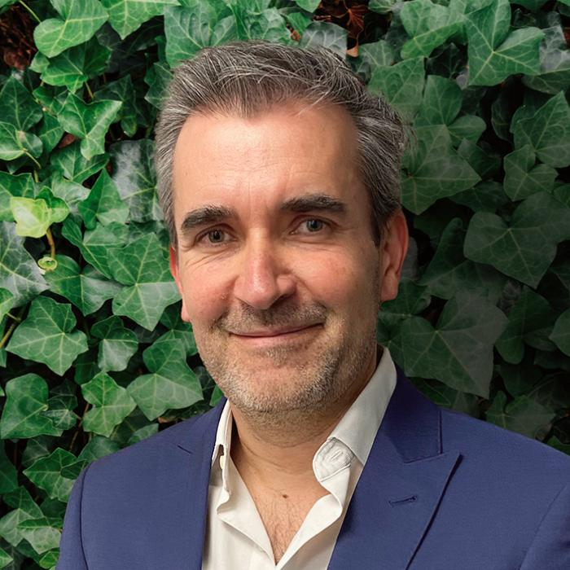

### La inversión de impacto ha dejado de ser una tendencia para convertirse en una estrategia madura.

En América Latina, los family offices y fondos especializados ya movilizan más de US$ 1.400 millones hacia proyectos con propósito social o ambiental, y se proyecta un aumento de otros US$ 700 millones en el corto plazo, según la Saïd Business School de la Universidad de Oxford.

Con estas cifras, es más que evidente que el debate ya no pasa por si el modelo funciona, sino por cómo hacerlo más riguroso, coherente y transparente.

### En Chile, esta transición hacia un capitalismo más consciente también comienza a tomar forma.

La Taxonomía de **Actividades Económicamente Sostenibles (T-MAS),** impulsada por el Ministerio de Hacienda, es un paso importante para orientar el capital hacia actividades sostenibles bajo criterios técnicos y verificables. Pero aún falta dar el salto desde las definiciones hacia la implementación efectiva: incentivos tributarios, métricas públicas comparables y políticas que premien a quienes integran impacto real en sus decisiones de inversión.

A medida que el país se aproxima a un nuevo ciclo presidencial, es urgente que la conversación económica se amplíe. El debate sobre desarrollo no puede continuar circunscrito al crecimiento del PIB, la inflación, el déficit fiscal o los impuestos. Chile necesita una mirada más profunda y de largo plazo: diversificar su matriz productiva, impulsar la innovación regional y promover una producción sostenible y responsable con el medioambiente, basada en energías limpias y en la gestión eficiente de los recursos. Educación, cultura, salud y vivienda deben asumirse como inversiones estratégicas para el bienestar y la productividad. No se trata de reemplazar la rentabilidad, sino de alinearla con un propósito social y ambiental más amplio, donde el crecimiento económico se traduzca en equidad, sostenibilidad y cohesión social.

### El verdadero punto de inflexión no está solo en medir resultados, sino en definir qué entendemos por impacto.

**El impacto no comienza en el reporte final, sino en la evaluación previa:** cuando se identifica el problema a resolver, el contexto donde se actúa y la calidad de la solución que se propone.

### En ese sentido, BELAT ha buscado aportar un modelo latinoamericano de evaluación impacto-riesgo, que combina análisis financiero con visión sectorial y territorial.

En los últimos años ha movilizado más de US$ 160 millones hacia sectores que abordan desafíos sociales y ambientales, demostrando que rentabilidad e impacto no son polos opuestos, sino condiciones complementarias para la sostenibilidad del modelo. No se trata de filantropía, sino de una manera distinta de entender el crédito y la inversión: una que integra propósito, gestión de riesgo y desarrollo.

**La inversión de impacto, sustentada en criterios ESG (ambientales, sociales y de gobernanza), busca justamente ese equilibrio.** Evalúa cómo las empresas gestionan sus recursos naturales, cómo se relacionan con las comunidades y qué estándares de transparencia aplican. En un contexto global cada vez más exigente, avanzar hacia modelos de inversión que integren estos criterios no es solo una opción ética, sino una ventaja competitiva: quienes incorporan la sostenibilidad y el impacto positivo como parte del negocio, serán los más resilientes frente a los cambios regulatorios, sociales y ambientales que vienen.

### **En ese camino, cada actor, ya sea público o privado, tiene un papel que cumplir.**

El Estado puede crear las condiciones; las empresas, innovar con propósito; y los inversionistas, asumir que la rentabilidad más duradera es aquella que genera valor compartido. Así, paso a paso, podremos construir un modelo económico más equilibrado, capaz de sostener crecimiento, confianza y sentido.

**Rodrigo Bustos Olavarría**

CEO de BELAT
