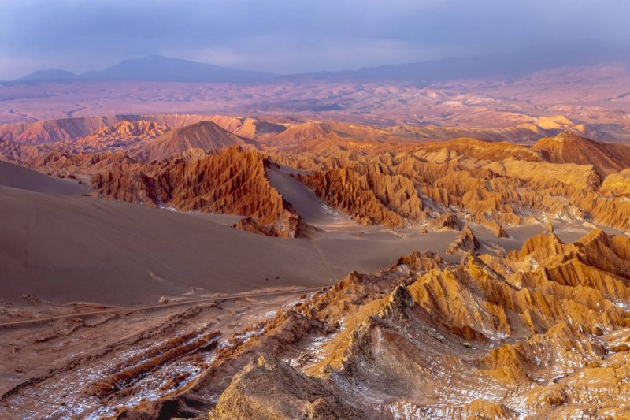
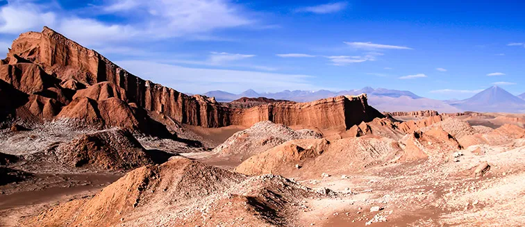

Chile, líder mundial en la producción de cobre, enfrenta una paradoja existencial. Mientras la minería es el motor de su economía, su intensa demanda de agua _—especialmente en las áridas regiones del norte—_ está en el centro de un conflicto socioambiental que ya no puede ser ignorado. Este reportaje se sumerge en las profundidades de esta crisis, examinando cómo la industria extrae un recurso vital y si las soluciones tecnológicas son suficientes para sanar una herida de décadas.

* * *

### El Corazón de la Sequía y un Conflicto Olvidado

En el Desierto de Atacama, el más árido del planeta, la minería es responsable de casi el 70% de la demanda de agua. Los valles y quebradas que antaño sostenían la vida de comunidades agrícolas y ganaderas, hoy luchan por subsistir. El modelo actual, basado en la extracción de agua continental, ha provocado un descenso dramático de los acuíferos, afectando a la flora y fauna locales, y poniendo en jaque el futuro de pueblos originarios como los **Lickanantay** o **Colla**.

> “Nosotros hemos visto cómo los pozos de nuestros abuelos se han secado. El río tiene menos caudal cada año. La minería se lleva el agua que le da vida a nuestro territorio. Esto no es solo una crisis hídrica, es una crisis cultural y de derechos humanos.”
> 
> — Cita de líder Lickanantay comunitario andino.

<figure>

<figcaption>

Valle de La Luna, Desierto de Atacama, Chile

</figcaption>

</figure>

<figure>

<figcaption>

Desierto de Atacama

</figcaption>

</figure>

Este conflicto se agrava por el **Código de Aguas de 1981**, que permitió la privatización y especulación con los derechos de aprovechamiento. Mientras las comunidades locales han de pelear por cada litro, las grandes mineras poseen vastos derechos de agua, muchas veces adquiridos a precios de mercado que dejan sin opción a los pequeños agricultores.

* * *

### La Apuesta por la Desalación: ¿Solución o Parche?

Ante la presión pública y el agotamiento de las fuentes continentales, la industria minera ha virado su estrategia hacia el mar. La construcción de **plantas desaladoras** se ha convertido en la principal bandera de sostenibilidad del sector. Empresas como Codelco y Escondida han invertido miles de millones de dólares en estas infraestructuras, prometiendo reducir su huella hídrica continental.

Según el Consejo Minero, para el año 2030, el agua de mar representará más del 60% del consumo de la industria. Sin embargo, la desalación no está exenta de desafíos:

- **Alto consumo energético:** El proceso de ósmosis inversa requiere enormes cantidades de energía, lo que aumenta la huella de carbono del sector.

- **Impacto ambiental:** La descarga de salmuera (el residuo del proceso) en el océano puede afectar los ecosistemas marinos.

- **Costo de operación:** La infraestructura y el mantenimiento de las plantas desaladoras son extremadamente caros, lo que, en la práctica, hace inviable su uso para comunidades de menor escala.

* * *

### Un Futuro de Recirculación y Gobernanza

Más allá de la desalación, el sector minero está mejorando en la **recirculación de agua**, un proceso que permite reutilizar el líquido en sus operaciones. Actualmente, el 77% del agua utilizada es recirculada, un avance significativo que muestra la conciencia sobre el problema.

Sin embargo, para los especialistas, las soluciones tecnológicas no son suficientes. La verdadera respuesta radica en un cambio de gobernanza. El debate sobre el nuevo Código de Aguas, estancado por años, busca priorizar el consumo humano y el uso ecosistémico. Esto obligaría a la minería a renegociar sus derechos y a contribuir a una gestión más justa y equitativa del recurso.

> “La minería chilena ha hecho avances notables en eficiencia, pero el problema es sistémico. Necesitamos una nueva gobernanza del agua que garantice que este recurso vital no sea un bien de mercado, sino un derecho humano. No se trata solo de tecnología, sino de ética y de justicia social.”
> 
> — Entrevista de académico especialista en recursos hídricos

* * *

### Conclusión y Llamado a la Acción

La crisis hídrica en la minería chilena es un espejo de la encrucijada que enfrenta todo el país. La solución no es dejar de ser un país minero, sino redefinir la relación entre la economía y la sostenibilidad. Un **posicionamiento estratégico** exige que la industria adopte una agenda de responsabilidad hídrica integral, invirtiendo no solo en tecnología, sino también en el bienestar de las comunidades y la preservación de ecosistemas.

El debate está sobre la mesa, y el futuro de Chile, su economía y sus recursos, dependen de la capacidad de todos los actores para pasar de la retórica a la acción.
