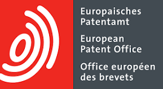

**Múnich/Chile, septiembre de 2025** – Con la población mundial proyectada a superar los 10 mil millones de personas en 2050, el desafío de producir suficiente alimento nunca ha sido tan grande. Un nuevo **informe del Observatorio de Patentes y Tecnología de la Oficina Europea de Patentes (OEP)** destaca cómo las tecnologías digitales están ayudando a responder de manera sostenible a esta demanda, con solicitudes de patentes en **agricultura digital creciendo un 9,4% anual**, tres veces el promedio de crecimiento de todas las tecnologías.

“_La agricultura digital avanza a un ritmo sin precedentes, transformando la forma en que producimos alimentos frente a desafíos globales cada vez más urgentes_”, **afirmó el presidente de la OEP, António Campinos.** “_Alineando la investigación y las tecnologías con las necesidades reales y reforzando la cooperación global -con el apoyo de un sistema sólido de patentes y plataformas de conocimiento de acceso abierto- podemos construir sistemas alimentarios más resilientes y equitativos_”, agregó.

* * *

## Chile a la vanguardia de la agroindustria digital y sostenible:

- Las tendencias globales en agricultura incluyen tecnologías de imagen y sensores, herramientas de automatización, drones e inteligencia artificial (IA)

- Chile es uno de los países destacados en el informe por su liderazgo en la región con proyectos que combinan tecnología, sostenibilidad y adaptación al cambio climático en la agroindustria.

### **AGRICULTURA DIGITAL EN EL MUNDO**

**Europa sigue liderando la actividad de patentes en tecnologías de agricultura digital,** respaldada por un ecosistema dinámico de 194 startups y 125 universidades activas en este ámbito. El informe también revela un crecimiento acelerado en Asia y **América Latina,** registrando, esta última, una tasa de crecimiento anual del 11% entre 2000 y 2022.

Basado en el desempeño histórico de producción y exportaciones entre 2010 y 2020, se proyecta que para 2050 América Latina podría abastecer **dos a tres** de cada **cinco** frutas y verduras a nivel global (Foro Económico Mundial, 2024). El informe muestra avances en tecnologías agrícolas sostenibles en Brasil, Chile, Colombia, Perú y México, a partir de información otorgada por las oficinas nacionales de patentes de estos cinco países -INAPI en el caso de Chile- contribuyendo con su análisis al informe. El documento destaca cómo los sistemas de innovación de cada nación están aprovechando las tecnologías digitales en agricultura para fortalecer la seguridad alimentaria, el desarrollo rural y la competitividad económica.

Tecnologías transversales como las de imagen y sensores están moldeando el panorama de la agricultura digital, junto con innovaciones que permiten a los agricultores automatizar tareas como la fumigación y la cosecha con mayor precisión y eficiencia. Desde 2018, el uso de drones e Inteligencia Artificial (IA) se ha disparado, facilitando el monitoreo en tiempo real y el análisis predictivo en las operaciones agrícolas.

La innovación global en este campo está cada vez más impulsada por la industria, con las **empresas representando el 88% de las solicitudes de patentes en agricultura digital en 2022.** 

### **CHILE A LA VANGUARDIA DE LA AGROINDUSTRIA DIGITAL Y SOSTENIBLE**

El informe presenta a Chile como un caso de éxito latinoamericano en **agricultura digital y sostenible**, con startups de alcance global, innovaciones para enfrentar el cambio climático en cultivos estratégicos -como las cerezas-, y políticas públicas que impulsan la transferencia de conocimiento y la equidad de género en innovación. 

"_La agricultura y la seguridad alimentaria son desafíos globales que requieren soluciones innovadoras. La colaboración en este proyecto de la Oficina Europea de Patentes refleja el compromiso de INAPI con impulsar el uso estratégico de la información tecnológica y las herramientas digitales en beneficio de nuestros países_”, **afirmó Esteban Figueroa, Director Nacional de Instituto Nacional de Propiedad Industrial (INAPI).** “_Tecnologías como la inteligencia artificial y el internet de las cosas no solo aceleran la innovación en el sector agrícola, sino que también fortalecen la capacidad de nuestras economías para aportar al cumplimiento de los Objetivos de Desarrollo Sostenible, en particular el de poner fin al hambre. Desde INAPI creemos que el acceso y la correcta gestión de este conocimiento son claves para abrir nuevas oportunidades en la producción sostenible, la competitividad y el comercio internacional_".

Chile es un territorio altamente vulnerable al calentamiento global, cumpliendo con siete de los nueve criterios de la Convención Marco de las Naciones Unidas para el Cambio Climático (CMNUCC). Además, enfrenta desde 2010 una “megasequía” -como lo ha denominado el Centro de Ciencia del Clima y la Resiliencia (CR2)-, caracterizada por un déficit prolongado de precipitaciones, cercano al 30% entre Coquimbo y La Araucanía, que altera profundamente la disponibilidad de agua para riego, impactando la productividad agrícola, la planificación estacional y la sustentabilidad de los cultivos. En este contexto, la digitalización de los procesos, promoviendo una industria más sostenible e inclusiva toma especial relevancia.

Un ejemplo destacado es **DropControl**, una tecnología pionera para la gestión eficiente del agua en la agricultura, con un sistema autónomo de control local, que ajusta dinámicamente los parámetros de riego según las condiciones ambientales. Este caso emblemático de la innovación agrícola chilena, desarrollado por Wiseconn, opera actualmente en América del Norte y del Sur con más de 20.000 instalaciones que monitorean y controlan 300.000 hectáreas.Para seguir avanzando en esta senda, es fundamental la transferencia de conocimiento en este sector y, reconociendo el papel fundamental de la innovación agrícola sostenible para el futuro de Chile, **INAPI, desde el año 2020,** ha publicado **42 informes de vigilancia tecnológica**, incluyendo materias clave como _“Agricultura 4.0 y robotización para la agroindustria”_, _“Tecnologías para el riego agrícola”_ y _“Tecnologías para la producción de vino”_, que ofrecen un análisis esencial del panorama de patentes para la innovación agrícola en el país.

**_A continuación te presentamos un Resumen Ejecutivo del estudio._**

## **Estudio sobre Agricultura Digital**Elaborado por la **Oficina Europea de Patentes (EPO, en inglés)**

- **_EPO Technology Insight Report (TIR) sobre Agricultura Digital_**_, elaborado por la_ **_Oficina Europea de Patentes (OEP)_** _con apoyo de las oficinas nacionales de propiedad industrial de América Latina, como_ **_INPI Brasil_** _e_ **_INAPI Chile_**_. Es una edición reciente que analiza datos de_ **_270.000 familias de patentes y 400.000 solicitudes_** _en el mundo._

La agricultura digital (AD) utiliza tecnologías de la información y comunicación (TIC) y sistemas de datos para desarrollar y entregar información y servicios específicos que hacen que la agricultura sea más rentable y sostenible, al tiempo que suministra alimentos seguros, nutritivos y asequibles. La disponibilidad de datos es un factor clave para la agricultura de precisión, en la que las plantas o los animales reciben un tratamiento dirigido con gran exactitud gracias a las tecnologías más recientes. **La agricultura digital permite así una producción optimizada y mayores rendimientos, a la vez que posibilita prácticas agrícolas y ganaderas más sostenibles gracias a la menor necesidad de agua, fertilizantes y pesticidas.**

**Las estadísticas de solicitudes de patentes proporcionan indicadores valiosos para medir y examinar tendencias de innovación, comercialización y transferencia de conocimiento en los mercados internacionales.** También ofrecen información significativa sobre cambios en las tendencias tecnológicas y facilitan la identificación de nuevos actores y de procesos de consolidación. En definitiva, **este informe busca arrojar información sobre cómo los desafíos tecnológicos están siendo abordados mediante la innovación documentada en las solicitudes de patentes.** 

Utilizando una metodología de análisis de datos probada por la OEP (Oficina Europea de Patentes), los hallazgos de este informe consideran información de aproximadamente 270.000 familias de patentes que abarcan 400.000 solicitudes de patentes diferentes. Estas solicitudes cubren invenciones relacionadas con la agricultura inteligente en torno a los siguientes grupos de conceptos tecnológicos clave: **laboreo de suelos, siembra y fertilización, cosecha, reducción de desperdicios, silvicultura, invernaderos, medios de cultivo, ganadería, ordeño, riego inteligente, modificación de condiciones climáticas y control de plagas.**

### **OBJETIVO DEL ESTUDIO**

El informe busca mostrar cómo la **digitalización en la agricultura** –a través de sensores, drones, inteligencia artificial, robótica e IoT– está transformando el sector para enfrentar los grandes desafíos del siglo XXI:

- Seguridad alimentaria.

- Cambio climático.

- Sostenibilidad y eficiencia en el uso de agua, suelos y energía.

### **PRINCIPALES RESULTADOS GLOBALES**

- **La innovación en agricultura digital ha entrado en una fase de aceleración desde 2012.** Tras un período inicial, en el que la agricultura digital no lograba avanzar a un ritmo acelerado, a partir de 2012 la innovación en este ámbito comenzó a caminar más rápido. Desde ese año, la agricultura digital crece a un **ritmo anual del 9,4% (CAGR)**, **tres veces más rápido que otros campos tecnológicos.**

- **Se mantiene el liderazgo de Europa, con Asia y América Latina destacando por un crecimiento acelerado.** Las regiones líderes en innovación son Europa, Norteamérica y Asia. Los estados miembros de la OEP han tenido tradicionalmente una fuerte presencia en agricultura digital y han permanecido como la mayor área de origen de familias internacionales de patentes (IPF) en este sector durante el período 2000-2022.
    - El mayor crecimiento proviene de Asia, con una CAGR del 13,1%, superando a Norteamérica desde 2020, seguida por los países latinoamericanos (10,8%).

- **La industria impulsa el crecimiento reciente.** El crecimiento extensivo que comenzó en 2012 se debe enteramente a la actividad de las empresas. Para 2022, la proporción de familias de patentes procedentes de compañías había aumentado al 88%. Este hallazgo es coherente con los datos disponibles, que indican que el gasto en I+D por parte de empresas en tecnologías agrícolas creció de forma significativa después de 2010, llegando a superar el gasto público, que hasta entonces había sido dominante. Mientras que la CAGR de las empresas era del 5% hasta 2012, en la última década se ha duplicado hasta alcanzar el 10%.

- **La maquinaria agrícola es un área clave de innovación en la agricultura digital**. Los principales solicitantes en agricultura digital son los grandes productores de maquinaria agrícola, como John Deere, CNH International, Claas, Kubota y Amazonen Werke. Entre los solicitantes destacados también se incluyen empresas de ganadería como Lely y Delaval, innovadores en invernaderos inteligentes como las firmas electrónicas LG y Panasonic, y compañías de tecnologías de apoyo (por ejemplo, control de plagas) como BASF y Bayer.

- **Mayor tasa de innovación en agricultura vegetal**. El clúster de áreas que muestra más innovación en agricultura digital ha sido la agricultura vegetal a campo abierto, con un aumento de siete veces en las IPF desde 2000. Este clúster ha sido la fuente principal del fuerte aumento en el crecimiento general de patentes de agricultura digital desde 2012, registrando una CAGR del 13% entre 2012 y 2022.

### **América Latina**

- La región produce el **10% de las exportaciones agrícolas globales** y posee ventajas únicas: **40% del agua dulce del planeta** y la mayor disponibilidad de tierra agrícola per cápita.

- En los últimos 20 años, las patentes en agricultura digital en América Latina han crecido a una tasa del **10,8% CAGR**, confirmando su papel creciente en innovación.

- **Brasil** es el líder regional: Embrapa (empresa pública) impulsa apps como **ZARC**, que ayuda a agricultores a gestionar riesgos climáticos. Brasil concentra el 15,7% de las invenciones en agricultura digital del mundo y tiene políticas de priorización en patentes sostenibles.

- **Colombia, México y Perú** también muestran avances con drones, IoT, robótica en arándanos y sistemas de riego inteligente.

### **Chile – Innovación a la vanguardia en Agricultura Digital**

Chile se posiciona como **referente en innovación aplicada a la sostenibilidad y la adaptación climática**.

#### **Casos destacados:**

- **Wiseconn – DropControl**: startup chilena (2006) que desarrolló un sistema de riego inteligente con sensores, controladores y gestión en la nube. Opera en toda América con **20.000 instalaciones en 300.000 hectáreas** y patentes en EE. UU., Australia y Europa.

- **Protección climática para cerezas**: alianza entre Prosecor SPA (Chile) y Voen (Alemania) para instalar **cubiertas autoventiladas resistentes al viento** que protegen cultivos frente a lluvias, granizo y vientos extremos, clave para mantener la competitividad exportadora.

- **INAPI – Transferencia de conocimiento**: más de 42 informes de vigilancia tecnológica desde 2020 en áreas como riego, robotización agrícola y viticultura.

- **Diversidad e inclusión**: premio _Mujeres Líderes en Innovación Tecnológica_ (con Red GT), que en 2025 celebra su 3ª edición. Ejemplo: **Permacultura Tech SPA**, liderada por Camila Beltrán, que combina IoT e IA para monitoreo ambiental y forestal sostenible.

**_A continuación te presentamos un el Estudio completo._**

[TIR on digital agriculture for CL\_for sending](https://tiempossustentables.cl/wp-content/uploads/2025/09/tir-on-digital-agriculture-for-cl_for-sending.pdf)[Descarga](https://tiempossustentables.cl/wp-content/uploads/2025/09/tir-on-digital-agriculture-for-cl_for-sending.pdf)

**Oficina Europea de Patentes (OEP)**

Principal autoridad mundial en información y búsqueda de patentes.
