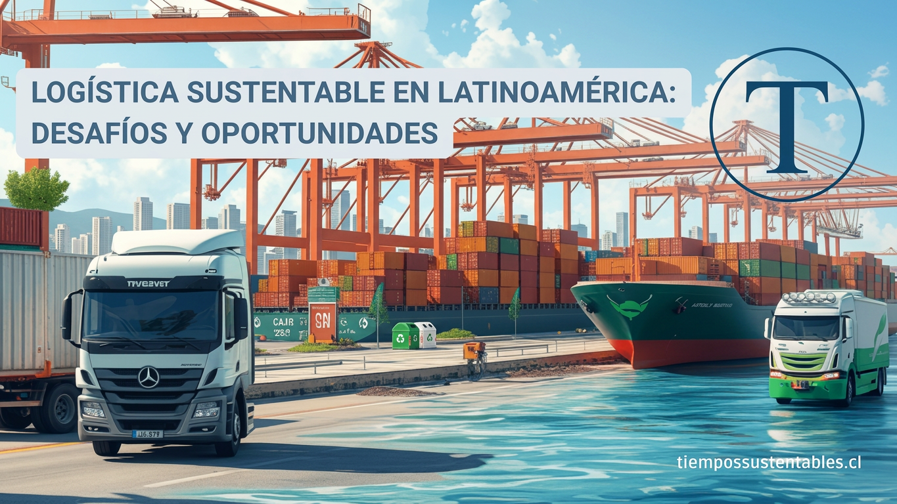

La logística sustentable ha dejado de ser una opción para convertirse en una necesidad imperante en Latinoamérica. En un contexto de creciente conciencia ambiental, las empresas y los gobiernos de la región se enfrentan al desafío de transformar sus operaciones para reducir su impacto ambiental y contribuir a la lucha contra el cambio climático.

## **Desafíos Clave en la Logística Sustentable Latinoamericana**

- El transporte de carga es un importante emisor de gases de efecto invernadero. La transición hacia flotas eléctricas, el uso de combustibles alternativos y la optimización de rutas son esenciales.

- Según un informe de la Comisión Económica para América Latina y el Caribe (CEPAL), "_la adopción de tecnologías y prácticas sostenibles en el sector logístico puede reducir significativamente las emisiones de CO2 y mejorar la eficiencia energética_".

## **Economía Circular y Gestión de Residuos**

- La implementación de modelos de economía circular, que promuevan la reutilización, reparación y reciclaje de productos, es fundamental para reducir la generación de residuos.

- "_La logística inversa juega un papel crucial en la economía circular, facilitando la recuperación de productos y materiales al final de su vida útil_", afirma la Fundación Ellen MacArthur.

## Bonos Verdes e Inversión Sostenible

- Los bonos verdes se han convertido en una herramienta clave para financiar proyectos logísticos sostenibles en la región.

- "_La inversión en infraestructura logística sostenible no solo reduce el impacto ambiental, sino que también genera beneficios económicos y sociales a largo plazo_", señala el Banco Interamericano de Desarrollo (BID).

## Eficiencia en los Envíos

- Optimizar las rutas de entrega y utilizar tecnologías de seguimiento en tiempo real puede reducir el consumo de combustible y las emisiones.

- "_La digitalización y la automatización de procesos son fundamentales para mejorar la eficiencia de la cadena de suministro y reducir su impacto ambiental_", explica Jaime Dacaret, country manager de DHL Express Chile.

## **Oportunidades y el Futuro de la Logística Sustentable**

A pesar de los desafíos, Latinoamérica tiene un gran potencial para liderar la logística sustentable. La creciente demanda de los consumidores por productos y servicios ecológicos, junto con el avance de las tecnologías limpias, están impulsando la transformación del sector.

**_En definitiva, la logística sustentable es un camino inevitable para Latinoamérica. Al adoptar prácticas más eficientes y responsables, la región puede construir un futuro más próspero y sostenible para todos._**
