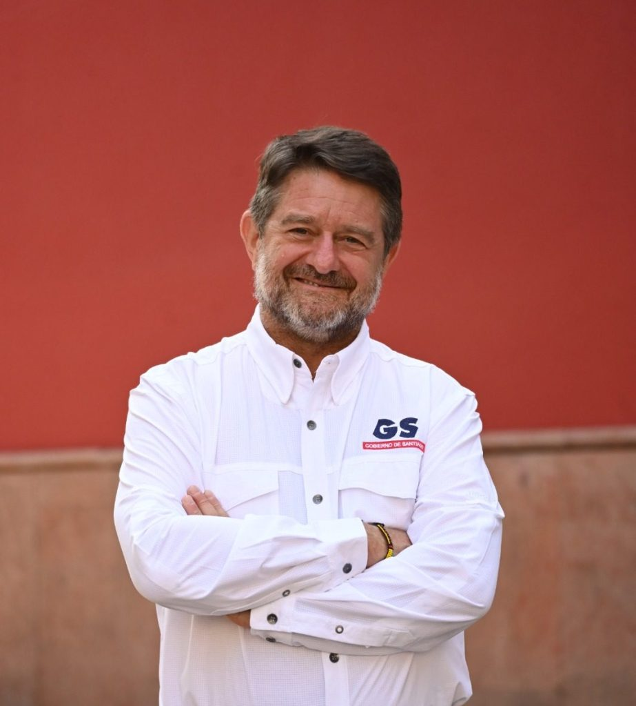
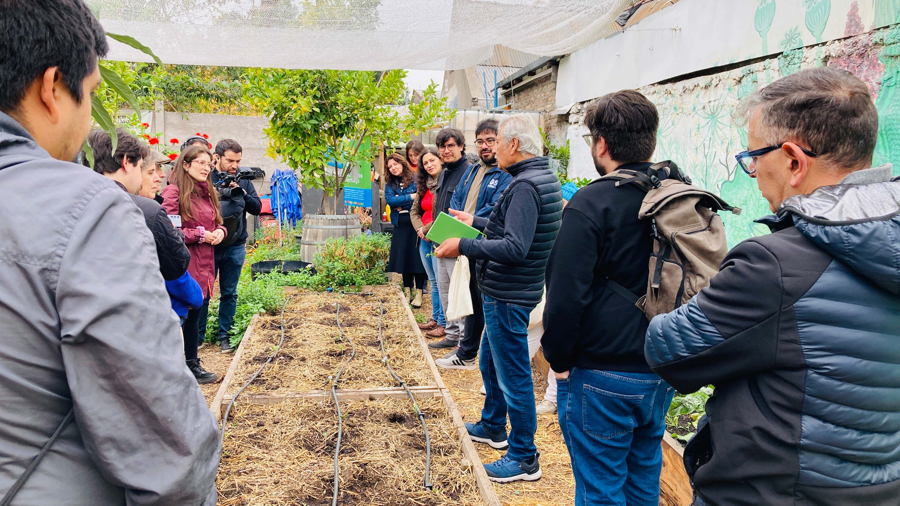
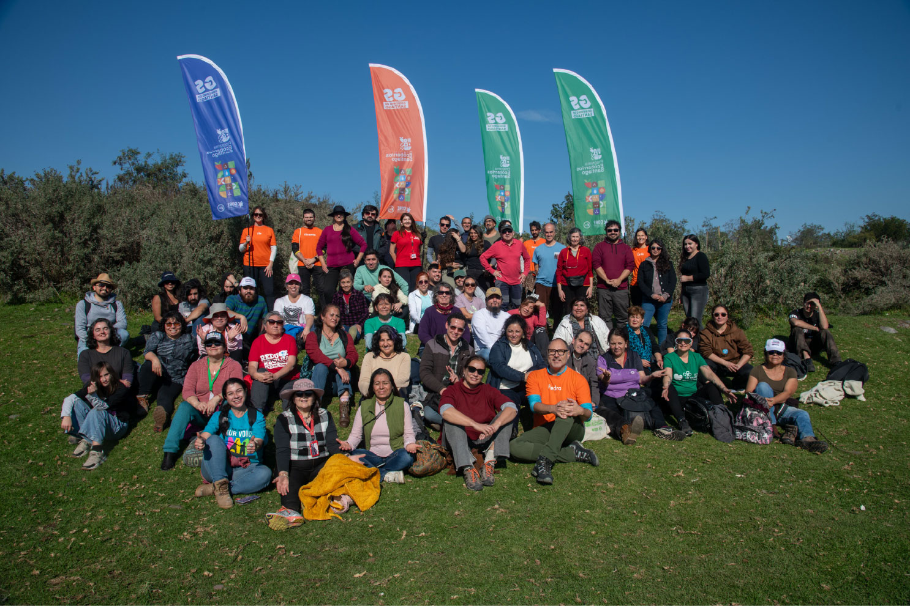
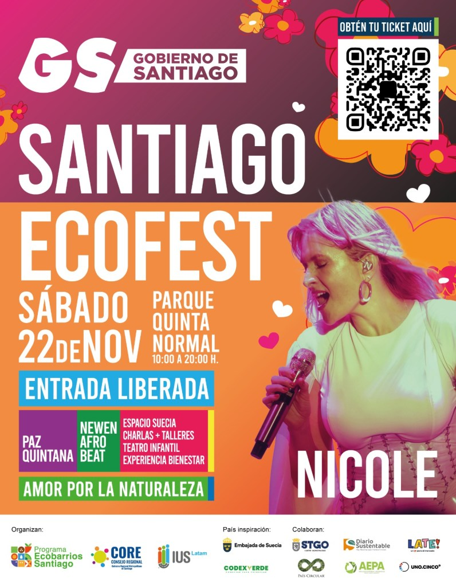

**●**    _El Programa Ecobarrios Santiago, impulsado por el Gobierno de Santiago y ejecutado por la Agencia de Sustentabilidad IUS Latam, motiva a las comunidades regenerativas a transformar sus territorios a través del liderazgo colaborativo, la educación ambiental y la acción climática._ 

En el corazón de las ciudades que buscan ser sostenibles y humanas, los Ecobarrios se consolidan como verdaderas células vivas de transformación social, ambiental y cultural. 

Y eso es justamente lo que hace el Programa Ecobarrios Santiago -liderado por el Gobierno de Santiago, el apoyo del Consejo Regional Metropolitano y ejecutado por la Agencia de Sustentabilidad IUS Latam, para promover una visión regenerativa basada en el liderazgo comunitario, la colaboración multisectorial y la formación ciudadana.

_“El Programa Ecobarrios Santiago ha fortalecido las capacidades de más de 100 organizaciones urbanas y rurales, formando líderes y comunidades preparadas para gestionar proyectos ambientales con impacto territorial. Necesitamos dirigentes y comunidades con visión y capacidad para ejecutar proyectos que mejoren la vida en sus barrios”_, señala **Claudio Orrego, Gobernador de la Región Metropolitana de Santiago**.

Inspirados en el Objetivo de Desarrollo Sostenible 17 de la Agenda 2030, el Gobierno de Santiago impulsa alianzas entre gobiernos locales, empresas, organizaciones sociales y comunidades. 

“La regeneración urbana requiere comunidades vivas y líderes conscientes de los ciclos naturales de cambio. Por ello, hemos acompañado a las organizaciones barriales en la comprensión del ciclo del liderazgo —florecimiento, desarrollo, madurez y relevo— fomentando el traspaso de saberes, la gestión emocional de las relaciones y la apertura a nuevas voces. La renovación constante del liderazgo mantiene a los barrios vivos, conectados y fecundos”, señala Pedro Mancilla, director de IUS Latam.

La experiencia del Programa Ecobarrios Santiago demuestra que la cooperación estratégica permite abordar desafíos como la gestión de residuos, el cambio climático y la cohesión social desde múltiples dimensiones que se potencian entre sí, generando innovación, ampliando el impacto y fortaleciendo la confianza entre los distintos sectores.

Para celebrar el compromiso de las más de 100 comunidades de Ecobarrios que durante este año han emprendido un camino de aprendizaje y acción climática para enfrentar los desafíos del cambio climático desde sus propios territorios, es que el próximo 22 de noviembre, se realizará el Santiago Ecofest 2025, evento gratuito y abierto a todo público que marcará un hito para la red de organizaciones ciudadanas ambientales del país.

El Parque Quinta Normal será escenario de este encuentro ciudadano que combinará música, arte, talleres, zonas de experiencias y emprendimientos verdes en un espacio dedicado al amor por la naturaleza y la acción climática. Participarán Nicole, Paz Quintana y Newen Afrobeat, junto a instituciones como la Embajada de Suecia, INACAP, organizaciones sociales y emprendedores sustentables.

Santiago Ecofest 2025 no es solo un evento: es una invitación a imaginar y construir juntos un futuro más verde, justo y humano. 

La entrada es gratuita, previa inscripción en [https://ecobarriosantiago.cl/festival](https://ecobarriosantiago.cl/festival)  

