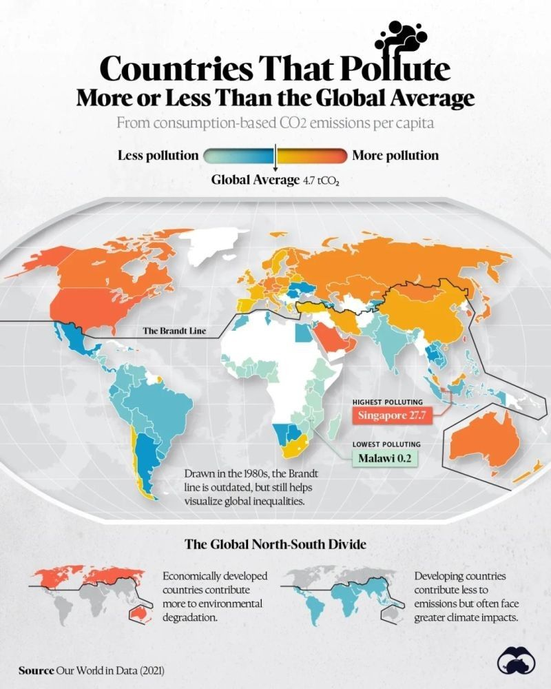

El impacto ambiental de la actividad humana se distribuye de manera desigual en el mundo. Mientras algunos países han avanzado en la reducción de emisiones y el desarrollo de energías limpias, otros continúan siendo responsables de una proporción desmesurada de la contaminación global. Un reciente análisis visualizado por [Visual Capitalist](https://www.linkedin.com/company/visual-capitalist/) muestra cómo ciertos países superan con creces el promedio mundial de emisiones de CO₂ per cápita, lo que plantea serios desafíos para la sostenibilidad global.

## **Los Mayores Contaminantes del Planeta**

El mapa de emisiones de CO₂ destaca a países como Estados Unidos, Canadá, Rusia, China y Australia, cuyas emisiones per cápita están significativamente por encima del promedio mundial. En términos absolutos, China lidera la lista debido a su enorme población y modelo de desarrollo basado en la industria pesada y el uso intensivo de combustibles fósiles.

Otros países como Arabia Saudita, Emiratos Árabes Unidos y Qatar también figuran entre los mayores emisores, en gran parte debido a su economía basada en la extracción y exportación de combustibles fósiles.

## Factores que Contribuyen a las Emisiones Elevadas

Las razones detrás de estas cifras varían según el país, pero entre los principales factores se encuentran:

- Dependencia de combustibles fósiles: A pesar de los avances en energías renovables, el carbón, el petróleo y el gas natural siguen siendo la base del suministro energético en muchas economías.

- Crecimiento industrial acelerado: Países como China e India han experimentado un rápido desarrollo industrial, lo que ha aumentado significativamente su huella de carbono.

- Altos niveles de consumo: En economías avanzadas como Estados Unidos y Australia, el consumo per cápita de energía y recursos naturales es considerablemente mayor que en otras partes del mundo.

- Exportación de carbono: Algunos países producen bienes para el mercado global, pero las emisiones derivadas de esa producción se contabilizan en sus territorios en lugar de en los países consumidores.

## Desafíos y Oportunidades para la Descarbonización

La lucha contra el cambio climático requiere que los países con mayores emisiones tomen medidas más agresivas para reducir su impacto. Algunas estrategias clave incluyen:

- Transición energética: Acelerar la adopción de energías renovables como la solar, eólica e hidrógeno verde.

- Eficiencia industrial y tecnológica: Invertir en procesos de producción más eficientes y tecnologías de captura y almacenamiento de carbono.

- Cambios en el modelo de consumo: Promover la economía circular, reducir el desperdicio y fomentar hábitos de consumo más sostenibles.

- Políticas internacionales de cooperación: Los acuerdos climáticos deben exigir mayores compromisos a los países con más emisiones y garantizar mecanismos de compensación para las economías en desarrollo.

## Reflexión

Si bien todos los países tienen la responsabilidad de reducir su huella ambiental, los mayores emisores de CO₂ juegan un papel clave en la sostenibilidad del planeta. Sin una acción decidida por parte de estas naciones, los esfuerzos globales por frenar el cambio climático podrían verse comprometidos.

* * *

Desde **Tiempos Sustentables**, seguiremos promoviendo la conciencia y la acción para que gobiernos, empresas y ciudadanos asuman el desafío de la descarbonización con la urgencia que el planeta demanda.

[Ver reflección en Linkedin](https://www.linkedin.com/posts/jesusblasco_red-countries-pollute-more-than-the-global-activity-7297011747431854082-IBJo?utm_source=share&utm_medium=member_desktop&rcm=ACoAAASjn7gBjVilK0IQuBndCJvRSAVjJCvQH34)
