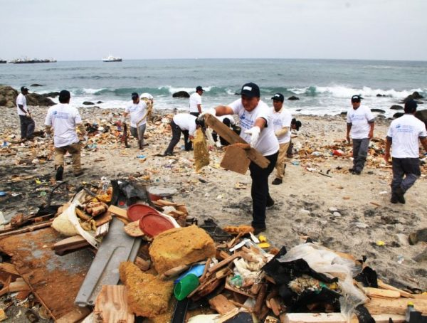
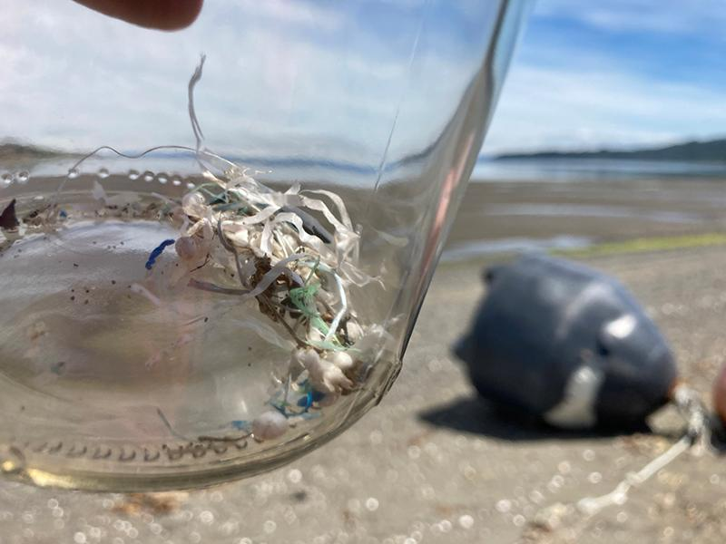
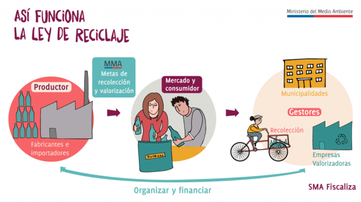

Cada 21 de mayo, Chile se viste de gala. Conmemoran las Glorias Navales, recordando el heroísmo y el sacrificio en el combate de Iquique. Sin embargo, en este mismo escenario de valentía histórica, hoy se libra una batalla silenciosa e igualmente trascendental, la lucha contra la creciente contaminación que amenaza las aguas que una vez defendieron Prat y sus hombres."

El mar que baña las costas de Iquique es rico en biodiversidad. Es fuente de sustento para innumerables familias. Sin embargo, se enfrenta a un enemigo moderno y persistente. La basura, los vertidos, y de manera especialmente insidiosa, los **microplásticos**, que son una gran amenaza.

La realidad es que la contaminación marina en Chile es un problema serio. Afecta mucho más que la estética de playas sucias. Incluye una amplia gama de contaminantes. Entre ellos, están las macrobasuras que asfixian a la fauna marina y degradan los ecosistemas costeros. También están los vertidos industriales y las aguas residuales sin tratar que alteran la química del océano. La **pesca fantasma** es provocada por redes y aparejos abandonados. Estas redes siguen atrapando y matando innecesariamente a miles de animales marinos cada año.

<figure>

<figcaption>

Programa de limpieza en playa de Iquique

</figcaption>

</figure>

Pero son los microplásticos los que han encendido las alarmas de la comunidad científica y ambiental. Su pequeño tamaño facilita su ingestión por una vasta gama de organismos. Esto incluye desde el plancton hasta los peces más grandes. De este modo, entran en la cadena alimentaria. Potencialmente, pueden llegar hasta nosotros a través del consumo de productos del mar.

Como ya exploramos en **Tiempos Sustentables**, la crisis de los microplásticos en los océanos es una amenaza global y Chile no evade este problema. _Te invito a profundizar en el impacto y las soluciones leyendo nuestro reportaje anterior. Este reportaje se titula: [Crisis de Microplásticos en los Océanos: Impacto y Soluciones](https://tiempossustentables.cl/2025/04/08/crisis-de-microplasticos-en-los-oceanos-impacto-y-soluciones/)._

El **Dr. Alejandro Buschmann** es un destacado ecólogo marino de la Universidad de Los Lagos. Ha hablado sobre la gravedad de la contaminación por plásticos muchas veces. En relación a los microplásticos, ha señalado que: _'La fragmentación de los plásticos es una amenaza silenciosa. La liberación de micropartículas es omnipresente para nuestros ecosistemas marinos. Su capacidad para ser ingeridos por una amplia gama de organismos y su potencial para transferir toxinas a través de la cadena trófica exigen una atención urgente y medidas preventivas robustas a nivel nacional.'"_

Iquique nos recuerda la capacidad de los chilenos para enfrentar desafíos con valentía. Además, muestra su determinación. Sin embargo, la batalla actual por la salud de nuestro mar exige una estrategia diferente. Necesitamos una estrategia de conciencia, prevención y acción colectiva.

Los efectos de esta contaminación se observan a lo largo de la extensa costa chilena. Estos efectos se presentan desde el norte hasta el sur. En el norte grande, la acumulación de residuos en playas es una problemática creciente. Esto incluye la región de Tarapacá. La presencia de microplásticos en sedimentos costeros es otro problema creciente. No existen estudios exhaustivos y recientes enfocados específicamente en Iquique. Sin embargo, la tendencia general del país muestra que la zona también enfrenta esta crisis. La actividad portuaria, el turismo y la disposición inadecuada de residuos son fuentes potenciales de contaminación. Estas fuentes impactan directamente en el ecosistema marino local.

Sin embargo, no todo está perdido. En Chile, se han comenzado a implementar medidas para mitigar la contaminación marina. La **Ley de Responsabilidad Extendida del Productor (REP)** tiene un objetivo claro. Busca que los fabricantes se hagan cargo del ciclo de vida de sus productos. Esta ley fomenta la reutilización y el reciclaje. La **prohibición de bolsas plásticas** a nivel nacional ha sido un paso crucial. Ha contribuido a reducir la cantidad de este residuo en el ambiente. Además, hay iniciativas de limpieza de playas. Existen proyectos de economía circular. Una creciente conciencia ciudadana también juega un papel. Estas son luces de esperanza en este oscuro panorama.

<figure>

<figcaption>

infografia\_rep

</figcaption>

</figure>

La lucha contra la contaminación marina en Iquique y en todo Chile es una tarea que nos compete a todos. Requiere un compromiso firme de las autoridades para fortalecer la fiscalización y la implementación de políticas efectivas. Necesita la colaboración de la industria para adoptar prácticas más sostenibles y reducir su impacto en el medio ambiente. Y demanda un cambio en los hábitos de consumo de cada ciudadano. Este cambio fomenta la reducción, la reutilización y el reciclaje de residuos.

En este 21 de mayo, honremos la memoria de quienes defendieron nuestra patria en el mar. Recordemos que la verdadera gloria de hoy radica en proteger ese mismo mar para las futuras generaciones. La batalla contra la contaminación es una contienda por la vida. Es una lucha por la salud de nuestros ecosistemas. También es por el futuro sostenible de nuestras costas. Es una batalla que debemos ganar con la misma determinación. Debemos luchar con la misma valentía que demostraron nuestros héroes navales en las aguas de Iquique.
