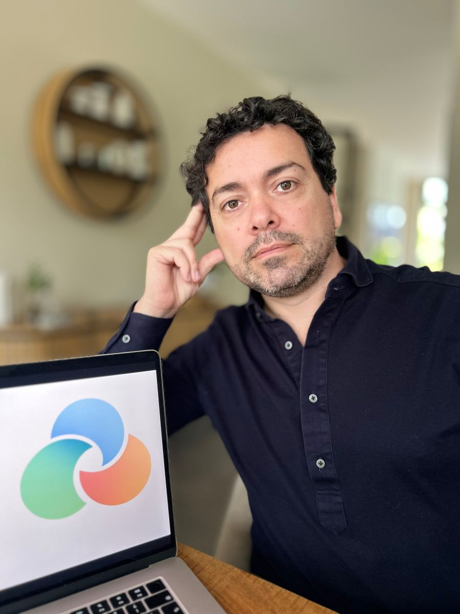
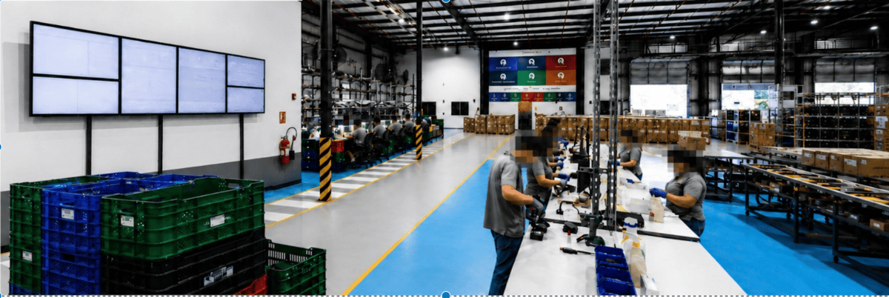
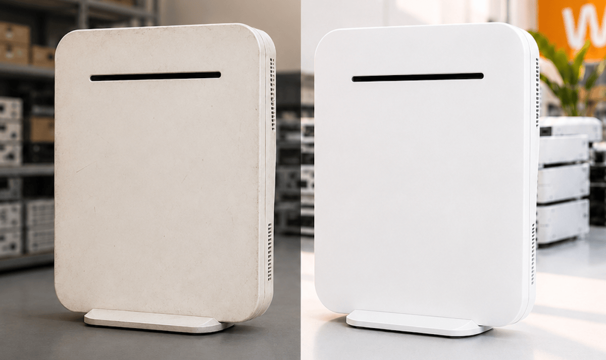
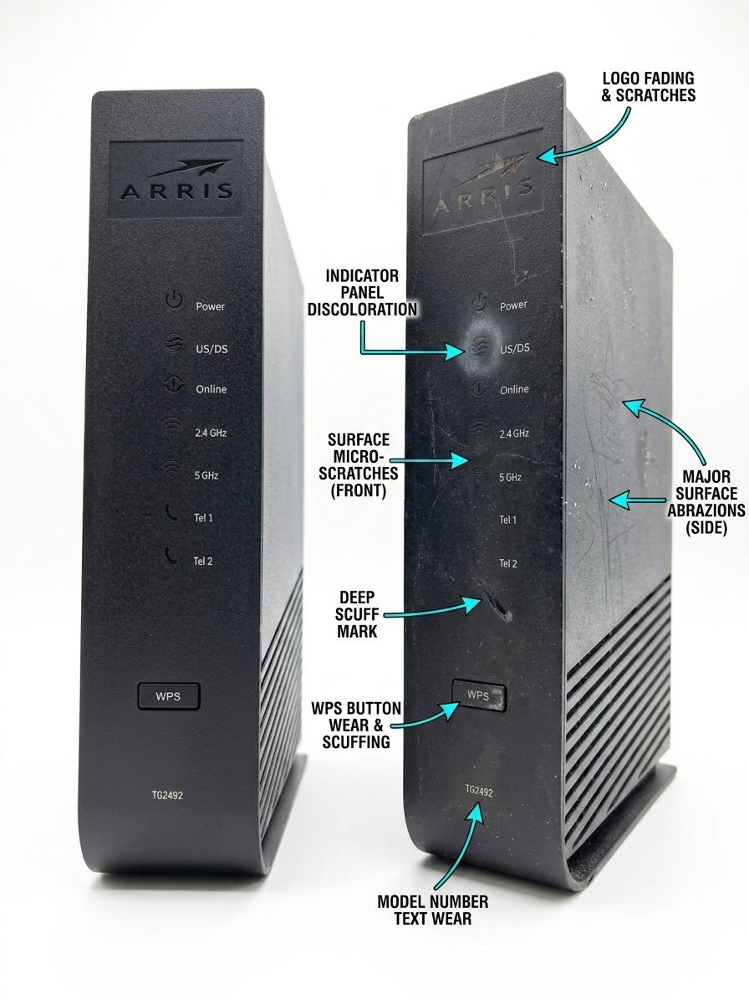

Triciclo Tech propone un cambio de paradigma: recuperar, reacondicionar y reinsertar activos funcionales antes de que se conviertan prematuramente en residuos electrónicos.

## **La economía circular comienza antes del reciclaje**

El problema real de la basura electrónica no inicia en la planta de reciclaje, sino mucho antes: en el momento en que tecnología plenamente funcional es dada de baja por decisiones corporativas, renovación de infraestructura o cambios estratégicos. En ese preciso instante, se destruye valor económico, se acelera la demanda de nuevos equipos y se amplifica una presión ambiental que ya es crítica a escala global.

Los datos subrayan la magnitud del desafío: en 2022, el mundo generó 62 millones de toneladas de residuos electrónicos, un incremento del 82% respecto a 2010. De este volumen, apenas el 22,3% fue debidamente documentado como recolectado y reciclado. En Chile, la brecha es aún más profunda: solo el 3,4% de los residuos de aparatos eléctricos y electrónicos (RAEE) se trata adecuadamente.

## **Triciclo Tech: Gestión inteligente de activos**

Liderada por Manuel Alomar, Triciclo Tech surge como una respuesta innovadora, centrada en prolongar la vida útil de la infraestructura tecnológica. Su modelo desafía la tendencia de "reemplazo precoz" mediante un proceso integral:

- **Diagnóstico y recuperación:** Identificación de activos funcionales dados de baja por modernizaciones o giros estratégicos.

- **Reacondicionamiento y validación:** Restauración técnica que garantiza la operatividad de los equipos.

- **Reinserción:** Reintroducción de los activos en nuevos ciclos de uso, con especial foco en el sector de las telecomunicaciones y grandes firmas tecnológicas.

A nivel de resultados, la firma reporta una sólida tracción comercial, operando entre Europa y Latinoamérica con 670.000 unidades gestionadas y un EBITDA positivo desde su primer mes.

## **El salto hacia la evidencia científica**

Si bien Triciclo Tech ya ha demostrado la viabilidad económica de su modelo y se encuentra consolidando sus primeras operaciones comerciales, la empresa se encuentra en una etapa de maduración estratégica. Actualmente, su narrativa se sostiene en el volumen de activos y la valorización económica; sin embargo, la firma reconoce que aún debe robustecer sus métricas de impacto ambiental, sin contar todavía con mediciones externas de ciclo de vida ni datos certificados de CO₂e.

Como paso decisivo hacia la transparencia y el rigor técnico, la compañía implementará un proyecto piloto junto a una plataforma especializada. Este proceso permitirá calcular el impacto ambiental de sus operaciones mediante el análisis de 10 categorías de productos (SKUs), moviendo el foco desde la retórica sustentable hacia una trazabilidad sistemática y verificable.

## **La oportunidad para el mercado B2B**

La reutilización profesional de activos no es solo una estrategia ecológica; es una herramienta de competitividad. Para las empresas en Chile y la región, adoptar este modelo ofrece ventajas tácticas clave:

| **Ventaja** | **Impacto** |
| --- | --- |
| **Preservación de CAPEX** | Ahorros significativos en presupuesto CAPEX, al invertir en tecnología circular sin comprometer la calidad. |
| **Mitigación de pérdidas** | Triciclo Tech invierte en activos que muchas empresas dan por depreciados, a consecuencia del acelerado recambio tecnológico y competencia. |
| **Liderazgo ESG** | Posiciona a la empresa a la vanguardia de la circularidad y la eficiencia. Creando una nueva categoría en la industria para beneficio de los clientes. |

"La industria tecnológica se ha acostumbrado a reemplazar equipos mucho antes del final de su vida útil. En Triciclo Tech creemos que el verdadero desafío no es reciclar más tecnología, sino aprovechar mejor la que ya existe"

**Manuel Alomar**

CEO and Founder of Triciclo Tech

* * *

## **Conclusión**

Triciclo Tech tiene el reto de demostrar que puede escalar su modelo desde operaciones tempranas hacia una trazabilidad sistemática y responsable. Si logra consolidar sus mediciones de impacto ambiental, su propuesta dejará de ser una práctica periférica para convertirse en un estándar esencial de eficiencia empresarial. En un mercado que proyecta 82 millones de toneladas de residuos electrónicos para 2030, gestionar inteligentemente los activos subutilizados dejó de ser una opción y pasó a ser una necesidad estratégica.

* * *

* * *

#### **¿Quieres profundizar en este tema?**

Descubre nuestra página pilar sobre Economía Circular, donde incluimos toda la información actualizada para la región.

[Leer la Guía Estratégica de Economía Circular en LATAM](https://tiempossustentables.cl/economia-circular-chile-latam/)
