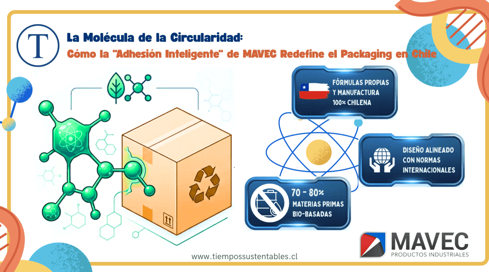
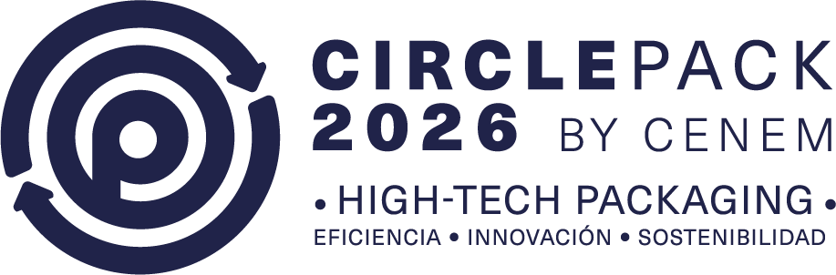

La industria del packaging en Chile y Latinoamérica atraviesa una transformación estructural impulsada por un marco regulatorio estricto, con la **Ley de Responsabilidad Extendida del Productor (Ley REP)** como principal catalizador. En este nuevo orden industrial, la sostenibilidad ha dejado de ser una simple ventaja competitiva para convertirse en un imperativo legal y operativo. Sin embargo, en la búsqueda de la circularidad, ha emergido un "punto ciego" técnico: de nada sirve un sustrato de cartón virgen o 100% reciclable si el adhesivo utilizado impide su repulpabilidad o genera contaminación química.

Es aquí donde la ciencia de materiales local está marcando un punto de inflexión a través de lo que hoy conocemos como **"Adhesión Inteligente"**.

## **El Alma Detrás de la Fórmula: Entrevista con María Verónica Cuevas**

En el centro de esta revolución silenciosa se encuentra **MAVEC Productos Industriales**, empresa chilena fundada en julio de 2012 por **María Verónica Cuevas Vergara**. Con una formación dual como Profesional Química y un MBA, Cuevas posee una capacidad analítica única: entender la cinética de un polímero y, simultáneamente, su impacto en la rentabilidad de sus clientes.

En entrevista exclusiva para nuestro medio, la fundadora revela qué la apasiona de esta intersección entre ciencia y negocios:

_"Donde siento que más valor aporto —y donde más me apasiono— es en terreno, entre las máquinas y los operarios. Ahí es donde la teoría se convierte en resultado: cuando una formulación deja de ser prometedora y pasa a ser robusta, reproducible y realmente aporta valor"._

Bajo su liderazgo, MAVEC acuñó el concepto de **"Adhesión Inteligente"**, una metodología que evalúa la compatibilidad química entre el adhesivo y el ciclo de vida del envase para evitar que este pierda su valor al reciclarse.

_"Cuando observas el sistema completo, te das cuenta de que un cartón perfectamente diseñado puede perder su valor justamente por un detalle que parecía secundario. Y eso no es un problema de un actor en particular, sino de cómo se han definido las prioridades en la industria", explica Cuevas._

## **I+D Chileno: Rompiendo la Dependencia del Petróleo**

Un hallazgo crítico de este reporte es la clarificación del origen tecnológico de estas innovaciones. Es fundamental establecer una distinción técnica que posiciona a MAVEC como un desarrollador local de vanguardia:

1. **Soberanía en Innovación Vegetal:** Las fórmulas de los **adhesivos vegetales (biodegradables y compostables)** son desarrollos propios de MAVEC y son manufacturados íntegramente en Chile. Esta línea de innovación local es completamente independiente de sus alianzas extranjeras.

3. **Manufactura Sintética Local:** Al igual que la línea orgánica, los adhesivos sintéticos también son manufacturados en Chile bajo fórmulas propias de la compañía.

5. **Alianza Internacional de Alto Rendimiento:** Para soluciones de alta rotación, MAVEC mantiene una representación exclusiva con el gigante europeo **Grupodesa-SIMES**. Estos adhesivos _Hot Melt_, si bien cumplen con normas **FDA** para contacto indirecto y cuentan con certificación **ISO 9001**, son de origen sintético y no son compostables.

### **Anatomía del Salto hacia lo Bio-basado**

La nueva generación de adhesivos MAVEC no es solo una alternativa "idealista", sino una solución técnica viable para sectores de packaging donde la pureza es innegociable, como la industria alimentaria y también la farmacéutica.

| **Atributo Técnico** | **Especificación MAVEC** | **Impacto en Economía Circular** |
| --- | --- | --- |
| **Composición** | 70-80% materias primas bio-basadas. | Reducción drástica de dependencia del petróleo. |
| **Certificación** | FDA (Contacto indirecto). | Garantiza inocuidad y cumplimiento sanitario global. |
| **Diseño** | Alineado con EN 13432 y ASTM D6400. | Permite que el envase se degrade como una unidad técnica coherente. |
| **Origen** | Manufactura 100% Chilena. | Fomenta el I+D nacional y la respuesta logística ágil. |

## **El Desafío de la Escala Industrial y el Legado**

El salto hacia formulaciones vegetales no ha estado exento de retos. La industria exige tiempos de pegado y secado rápidos, razón por las cual el mercado ha dependido históricamente de soluciones sintéticas.

"El foco siempre estuvo en que no fuera solo una buena formulación en laboratorio, sino una solución viable a escala industrial. Es decir, que pudiera operar de forma consistente en condiciones reales de producción", detalla Cuevas. Para la fundadora, su rol es educar mediante evidencia técnica: "Cuando la industria ve que una solución sustentable también funciona en productividad, la conversación cambia".

### **Blindaje Estratégico y Futuro: Circlepack 2026**

La consolidación de MAVEC no es solo química, sino institucional. Entre finales de 2024 y mayo de 2025, María Verónica Cuevas gestionó el registro de su marca ante el **INAPI (Clase 1)**. "Registrar la marca refleja la necesidad de proteger no sólo un desarrollo técnico, sino una forma de hacer las cosas; la innovación también requiere estructura, continuidad y resguardo", afirma.

La presencia de MAVEC en la feria **Circlepack 2026 (Stand E10)** consolidó su posición como el único fabricante nacional de adhesivos presente en liderar la conversación sobre packaging 100% reciclable en Chile.

Para María Verónica Cuevas, el horizonte trasciende el éxito comercial. Su legado se asienta en cómo se entiende la innovación desde Chile: "Atreviéndose a perseguir la pasión y a convertir sus ideas en trabajo concreto, entendiendo que cada persona, desde su propio lugar, tiene la posibilidad de aportar a un mundo mejor".

* * *

## **Preguntas Frecuentes sobre Adhesión Sostenible**

- **¿Qué es la Adhesión Inteligente?**
    - Es una metodología desarrollada por MAVEC que evalúa la compatibilidad química entre el adhesivo y el envase para asegurar que este último mantenga su valor de reciclaje o compostaje.

- **¿Son biodegradables todos los adhesivos de MAVEC?**
    - No. MAVEC fabrica una línea específica de adhesivos vegetales compostables en Chile. Sus adhesivos _Hot Melt_ (Grupodesa) son sintéticos de alto rendimiento, cumplen con la FDA pero no son compostables.

- **¿Dónde se fabrican los adhesivos orgánicos de MAVEC?**
    - Son desarrollos propios y fórmulas exclusivas de MAVEC, manufacturados íntegramente en Chile.

* * *

_**Para asesoría técnica sobre cumplimiento de la Ley REP y soluciones de pegado inteligente, visite [www.mavec.cl](https://MAVEC.CL) o contacte directamente a [mvcuevas@mavec.cl](mailto:mvcuevas@mavec.cl)**_

* * *

#### **¿Quieres profundizar en este tema?**

Descubre nuestra página pilar sobre Economía Circular, donde incluimos toda la información actualizada para la región.

[Leer la Guía Estratégica de Economía Circular en LATAM](https://tiempossustentables.cl/economia-circular-chile-latam/)
