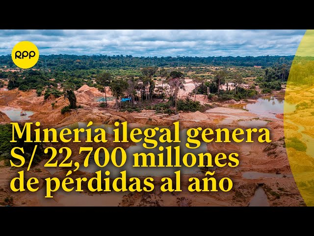
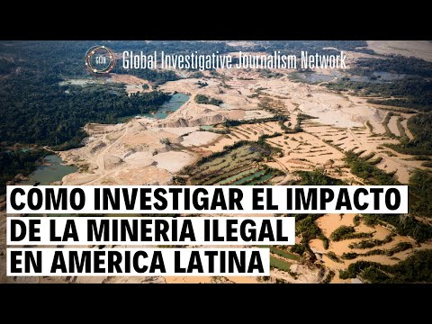
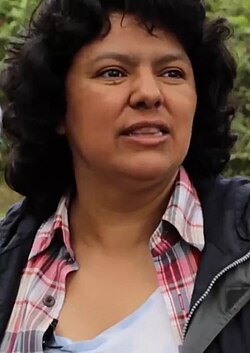

Mientras la conversación global se centra en la **crisis climática**, la **pérdida de biodiversidad** avanza en América Latina. El flagelo de la **minería ilegal** continúa sin tregua. Esta actividad ilícita amenaza ecosistemas vitales y, lamentablemente, cobra vidas. La reciente **COP16 de Biodiversidad** en Colombia ha puesto en evidencia la urgencia de actuar. Sin embargo, la realidad en el terreno es brutal. En Tiempos Sustentables, examinamos de cerca el impacto devastador de esta actividad. Observamos la valiente lucha de quienes defienden nuestro patrimonio natural.

La **minería ilegal** es una de las mayores amenazas para la **biodiversidad en la región**. A menudo, se vincula al crimen organizado. En la Amazonía, vastas extensiones de selva son deforestadas. Los ríos se contaminan con mercurio. Desde aquí hasta zonas andinas y costeras, la actividad sin control deja un rastro de destrucción. Especies endémicas están en peligro, fuentes de agua dulce se vuelven tóxicas y los suelos se degradan irreparablemente.

_"La minería ilegal es un cáncer que carcome nuestros bosques y ríos, especialmente en la Amazonía. No solo destruye el medio ambiente. También despoja a las comunidades de sus tierras y recursos. Esto genera violencia. También causa desesperanza"_, afirmó **Sandra Vilardy** en una reciente declaración. Ella es directora de la Fundación para la Conservación y el Desarrollo Sostenible (FCDS) en Colombia. Su organización desempeña un papel clave en la denuncia de la deforestación amazónica.

* * *

### El Costo Humano: La Lucha de los Defensores Ambientales

Pero el impacto no es solo ambiental; es profundamente humano. **América Latina es, lamentablemente, la región más peligrosa para los defensores ambientales**. Cada año, decenas de líderes comunitarios, indígenas y activistas son asesinados por oponerse a proyectos extractivos ilegales. Sus voces, que denuncian la destrucción y defienden el derecho a un medio ambiente sano, son silenciadas. La impunidad, lamentablemente, es una constante en muchos de estos crímenes.

Un informe de Global Witness de 2023 reveló datos alarmantes. Solo en 2022, asesinaron a 177 defensores ambientales en todo el mundo. Más de un tercio de estos crímenes ocurrieron en América Latina. Colombia, Brasil y México son consistentemente algunos de los países con las cifras más altas. _"Los gobiernos deben hacer mucho más para proteger a quienes arriesgan sus vidas por nuestro planeta. No podemos permitir que la violencia continúe. No podemos permitir que la impunidad siga siendo la norma."_ declaró **Laura Cáceres**, hija de la reconocida defensora ambiental hondureña Berta Cáceres, durante un evento sobre derechos humanos.

**Berta Cáceres**

Berta Isabel Cáceres Flores (1971-2016) fue una destacada **líder indígena lenca**, **feminista** y **activista medioambiental** hondureña. Cofundadora del **COPINH**, luchó incansablemente por los derechos de los Lencas, lo que le valió el **Premio Medioambiental Goldman**, el máximo reconocimiento mundial para activistas del medio ambiente.

Cáceres fue **asesinada** el 2 de marzo de 2016, tras años de amenazas, por su oposición al proyecto hidroeléctrico Agua Zarca de la empresa Desarrollos Energéticos S.A. (DESA), que amenazaba el Río Gualcarque y el sustento de su comunidad. Su asesinato generó una condena internacional generalizada.

La situación en la Amazonía de Brasil, Perú o Colombia es desgarradora. En estos lugares, la minería ilegal de oro avanza sobre territorios indígenas. En Chile, aunque en menor escala, se han documentado casos de extracción no regulada. Esto afecta glaciares o zonas protegidas. Se evidencia que el problema es global. Sin embargo, tiene manifestaciones locales específicas.

* * *

### Trazabilidad y Justicia Ambiental: Claves para el Futuro

La cadena de suministro global es cómplice, a veces inconscientemente, de esta destrucción. La falta de **trazabilidad** en minerales como el oro permite que el metal de origen ilegal entre en mercados internacionales. Informar al consumidor sobre el origen de los productos es un paso fundamental para presionar por prácticas más éticas. _"Es fundamental que los consumidores exijan saber de dónde vienen los productos que compran, especialmente aquellos que contienen minerales. Cada compra puede ser un acto de apoyo a la sostenibilidad. O puede apoyar la destrucción"_, dijo un representante de la Alianza por la Minería Responsable (ARM) en una conferencia reciente.

Combatir la minería ilegal requiere un enfoque multifacético. Es necesario fortalecer la fiscalización. También se deben implementar leyes más estrictas. Es vital combatir las redes criminales. Crucialmente, se debe garantizar la **justicia ambiental** para las comunidades afectadas. Esto implica no solo castigar a los responsables. También es importante reparar los daños. Debemos reconocer y proteger los derechos territoriales de los pueblos indígenas. Ellos son a menudo los guardianes de los ecosistemas más vulnerables.

La **biodiversidad** de América Latina es un tesoro global, pero está bajo asedio. El llamado de la **COP16** es claro: necesitamos más financiamiento y una acción decidida para protegerla. La batalla por la **justicia ambiental** es una lucha por el futuro. Es una lucha por nuestros ecosistemas y por las comunidades que dependen de ellos. En Tiempos Sustentables, seguiremos visibilizando esta lucha crucial.
