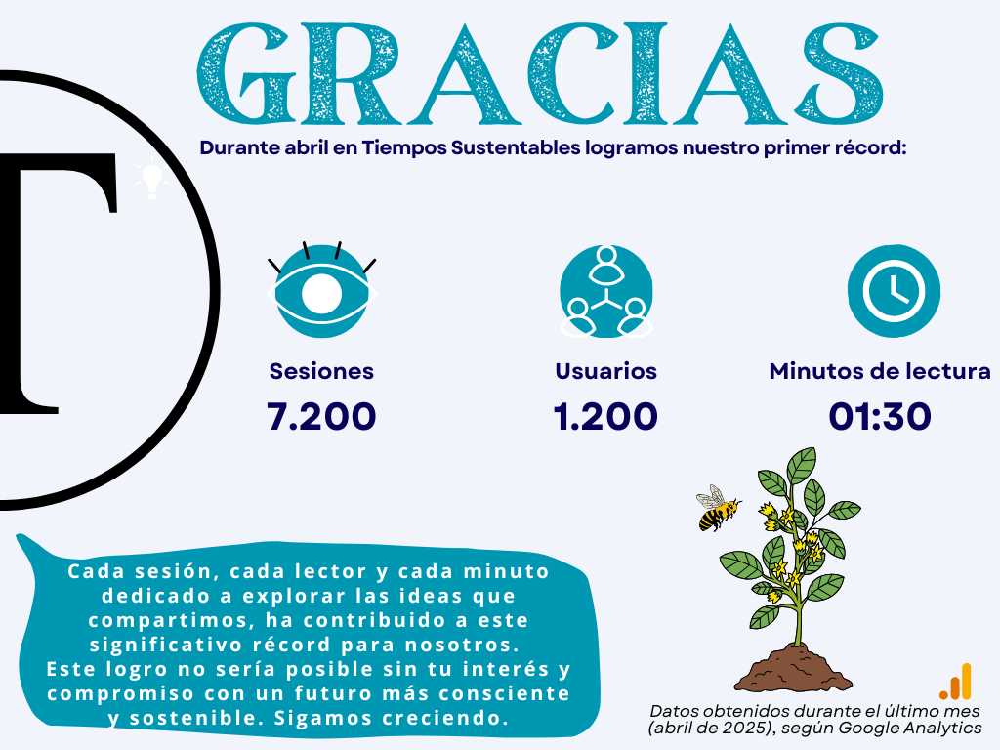

**_Queridas lectoras y lectores,_**

_En este newsletter, encontrarás un resumen _de abril 2025__, _que no solo recopila lo más relevante del mes, sino que también reafirma el propósito que nos dio origen:_ "_ser un espacio de encuentro, reflexión y acción en torno al marketing sustentable, el consumo consciente y la producción responsable en Chile y Latinoamérica"._

**_Tiempos Sustentables_** _nace de la convicción de que la responsabilidad de las marcas debe demostrarse con hechos, pero también debe comunicarse._ _Esta revista digital busca destacar a quienes actúan de forma sostenible, conectar a personas y organizaciones, y ofrecer contenido útil para entender los desafíos y oportunidades de un futuro donde la sostenibilidad es fundamental._ _Gracias por ser parte de esta comunidad._

_Espero que disfruten esta edición resumen de abril, y que sigamos avanzando juntos hacia tiempos cada vez más sustentables._

_Con convicción y entusiasmo,_

**_Jesús Blasco Valencia_**

_Director – Tiempos Sustentables_

* * *

## Cifras Sustentables

* * *

## Columnas de Opinión

Este mes, 2 grandes referentes nos aportaron con potentes columnas de opinión de acuerdo a su experiencia. Conócelas a continuación:

* * *

## Colaboraciones

Durante abril destacamos importantes colaboraciones de aliados a nuestra comunidad, que con entusiasmo han entregado su tiempo y experiencia para compartirla con nosotros.

<figure>

<figure>

<figcaption>

Ivonne Yupanqui

</figcaption>

</figure>

<figure>

<figcaption>

Alejandro Silva

</figcaption>

</figure>

<figure>

<figcaption>

Erika Alvarez

</figcaption>

</figure>

</figure>

* * *

## Lo más leído del mes

* * *

## **Mirando hacia el futuro**

Estamos trabajando arduamente en nuevo contenido para el mes de mayo, con más ideas, consejos y análisis para seguir explorando juntos el camino hacia la sostenibilidad.

**¡Mantente atento a nuestras próximas publicaciones!**

<figure>

<figcaption>

**Se parte de nuestra comunidad en Whatsapp**

</figcaption>

</figure>

<figure>

<figcaption>

**Mantente al tanto mediante correo electrónico**

</figcaption>

</figure>

* * *
