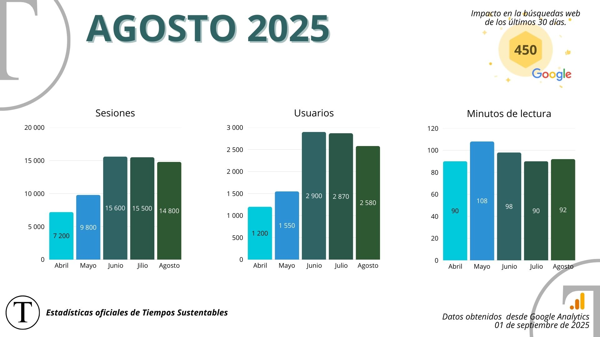

* * *

https://youtu.be/IJaDyJU-wkQ

* * *

## Cifras Sustentables

* * *

## Columnas de Opinión

Este mes, nuestros columnistas profundizan en temas clave como la crisis hídrica, el cambio climático y el papel crucial de la educación y el sector privado en la construcción de un futuro más justo y equitativo.

* * *

## Colaboraciones

Este mes destacamos las valiosas contribuciones de nuestros colaboradores, quienes con su experiencia y visión nos ofrecen perspectivas clave sobre los desafíos y oportunidades en el camino hacia un futuro más sostenible para Chile y Latinoamérica. Sus análisis nos invitan a reflexionar sobre la crisis hídrica, el papel de la educación superior y la responsabilidad de las empresas en la construcción de una sociedad más justa.

<figure>

<figcaption>

Alejandro Silva

</figcaption>

</figure>

<figure>

<figcaption>

Erika Alvarez

</figcaption>

</figure>

<figure>

<figcaption>

Matías Chaparro

</figcaption>

</figure>

<figure>

<figcaption>

Elisa Giesen

</figcaption>

</figure>

<figure>

<figcaption>

Carlos Rubilar

</figcaption>

</figure>

<figure>

<figcaption>

Erika Alvarez

</figcaption>

</figure>

* * *

## Lo más leído

Nuestros reportajes destacaron por su exhaustivo análisis, abarcando desde lo más técnico, con innovaciones y nuevas normativas, hasta la contingencia y eventos del sector, pasando por las tendencias financieras más conscientes. Exploramos la gestión de residuos sanitarios, la importancia vital de los humedales, y la transformación del sector minero y pesquero hacia prácticas más sostenibles. Además, investigamos cómo la inteligencia artificial y el liderazgo femenino están redefiniendo el futuro de la sostenibilidad.

* * *

## Haciendo comunidad mirando hacia el futuro

Queremos que seas parte activa de la conversación sobre sostenibilidad! Te invitamos a unirte a nuestra creciente comunidad escaneando el código QR. Conéctate con profesionales, líderes y entusiastas que, como tú, están comprometidos con la construcción de un futuro más sustentable.

* * *
