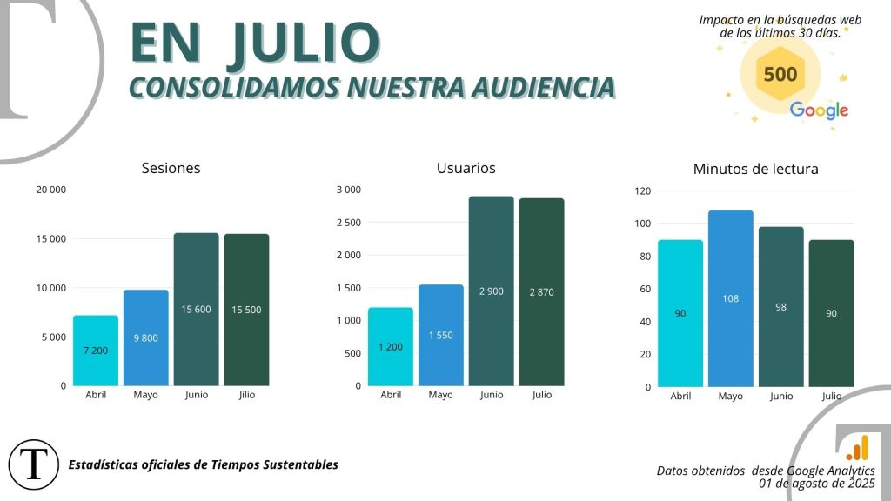
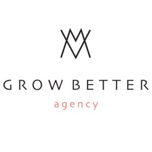
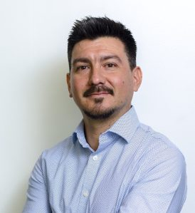

## ¡A nuestra comunidad de Tiempos Sustentables!

Al comenzar agosto, nos detenemos a reflexionar sobre el maravilloso camino que hemos recorrido juntos. Queremos expresar nuestra sincera gratitud por su constante interés y por ser parte activa de esta conversación tan vital sobre el futuro de la sostenibilidad.

En esta edición resumen mensual de julio 2025, encontrarán una profunda mirada a los desafíos y logros que han definido este periodo. El contenido abarca desde un detallado análisis del nuevo ciclo climático de Chile hasta reflexiones esenciales sobre comunicación y economía circular.

Un especial reconocimiento merece el invaluable aporte de nuestros columnistas y colaboradores. Cada mes, ellos enriquecen nuestra visión y nos inspiran a seguir adelante.

Aprovecho esta oportunidad para compartirles un documento que encapsula nuestra esencia y propósito. En él, encontrarán un panorama detallado de quiénes somos, qué hacemos y cómo, junto a ustedes, construimos un futuro más verde y justo. No pierdan la oportunidad de revisarlo.

[Tiempos Sustentables](https://tiempossustentables.cl/wp-content/uploads/2025/08/tiempos-sustentables-julio2025.pdf)

**_¡Gracias por ser parte de esta comunidad! Juntos construimos Tiempos más Sustentables._**

Atentamente,

**Jesús Blasco V.**

Director - Tiempos Sustentables

* * *

## Cifras Sustentables

<figure>

<figcaption>

Cifras Julio 2025 Tiempos Sustentables

</figcaption>

</figure>

* * *

## Columnas de Opinión

Durante este mes, hemos tenido el privilegio de contar con la visión de 5 destacados expertos y líderes en sus respectivos campos, quienes abordan cómo la innovación, la estrategia y el compromiso transversal son pilares para construir un futuro más justo y habitable. Estas contribuciones ofrecen una hoja de ruta esencial para comprender y participar activamente en el camino hacia un desarrollo verdaderamente sostenible, destacando la importancia de la coherencia, la colaboración y la visión a largo plazo.

* * *

## Colaboraciones

Este mes destacamos las valiosas contribuciones de nuestros colaboradores, quienes con su experiencia y visión nos ofrecen perspectivas clave sobre los desafíos y oportunidades en el camino hacia un futuro más sostenible para Chile y Latinoamérica. A continuación, presentamos los artículos de las 7 colaboraciones de este mes.

<figure>

<figcaption>

Karen Cossio

</figcaption>

</figure>

<figure>

<figcaption>

Carlos Rubilar

</figcaption>

</figure>

<figure>

<figcaption>

Erika Alvarez

</figcaption>

</figure>

<figure>

<figcaption>

GrwBetter Agency

</figcaption>

</figure>

<figure>

<figcaption>

José Manuel Bellalta

</figcaption>

</figure>

<figure>

<figcaption>

Martín Araneda

</figcaption>

</figure>

* * *

## Lo más leído

Este julio en Tiempos Sustentables se reflexionó sobre los retos y oportunidades de la sostenibilidad en la región, centrándose en la inversión sostenible y los criterios ESG en Chile y Latinoamérica, donde la región lidera en bonos temáticos. Además, la crisis hídrica en Santiago destacó la vulnerabilidad de las ciudades y la necesidad de soluciones adaptativas. Se abordaron los papeles del CMO como motor de cambio y la reciente opinión de la Corte Internacional de Justicia sobre las obligaciones climáticas de los Estados. La revolución de la economía circular y el desafío del _greenwashing_, junto con la importancia de una comunicación sostenible auténtica, concluyeron un mes crucial para entender el futuro sustentable.

* * *

## Haciendo comunidad mirando hacia el futuro

Queremos que seas parte activa de la conversación sobre sostenibilidad! Te invitamos a unirte a nuestra creciente comunidad escaneando el código QR. Conéctate con profesionales, líderes y entusiastas que, como tú, están comprometidos con la construcción de un futuro más sustentable.

* * *
