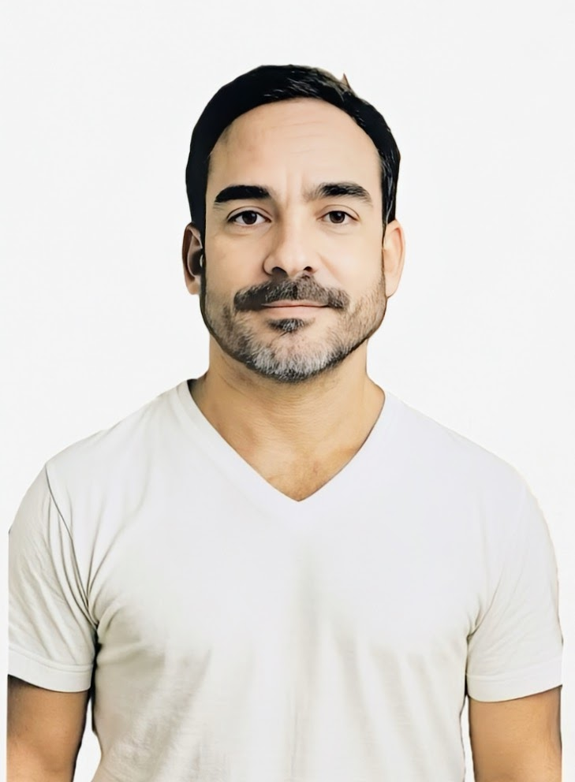
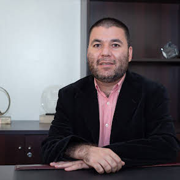
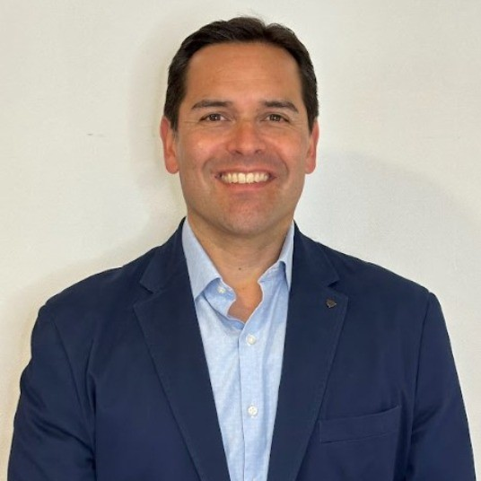
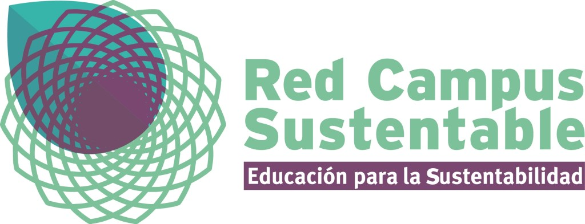

### **_¡Hola amigas y amigos de Tiempos Sustentables!_**

_¡Ya se nos fue otro mes y con él llega nuestro resumen de junio! Estoy súper emocionado y quiero compartir con ustedes un vistazo a todas esas **innovaciones, desafíos y avances** que están marcando el ritmo en el increíble mundo de la sostenibilidad._

_En Tiempos Sustentables, nos encanta conectarles con las últimas noticias de un **futuro más verde y justo**, ¡y este mes no ha sido la excepción! Hemos estado explorando de todo: desde las **últimas tendencias en tecnología sustentable** hasta esa importantísima unión entre el **medioambiente y el cambio climático**, sin olvidar las transformaciones en **negocios y finanzas sostenibles** que están cambiando el juego económico._

_Cada artículo, columna de opinión y noticia ha sido seleccionada con mucho cariño para darles **contenido de calidad** que no solo les informe, ¡sino que también les inspire a la acción!_

#### _¡Ustedes son el motor de Tiempos Sustentables!_

_Honestamente, esta aventura no sería posible sin ustedes. Su **compromiso, curiosidad y apoyo constante** son la energía que nos impulsa. Cada visita, cada lectura y cada interacción nos demuestran lo importante que es seguir adelante, construyendo una **comunidad dedicada a impulsar el desarrollo sostenible** tanto en Chile como en toda América Latina._

_Quiero agradecerles de corazón por su **lealtad** y por ser parte activa de esta conversación global tan vital. Les invito a seguir explorando, aprendiendo y compartiendo todo lo que hacemos, ¡porque juntos estamos sentando las bases de un **mañana más resiliente y consciente**!_

**_¡Juntos creamos Tiempos más Sustentables!_**

**Jesús Blasco V.**

Director - Tiempos Sustentables

* * *

## Cifras Sustentables

![Texto alternativo para la imagen:

Gráfico de estadísticas de Tiempos Sustentables mostrando el crecimiento de audiencia en junio de 2025. Se observan tres gráficos de barras que comparan abril, mayo y junio:

Sesiones: Aumenta de 7,200 en abril a 9,800 en mayo y 15,600 en junio.

Usuarios: Crece de 1,200 en abril a 1,550 en mayo y 2,900 en junio.

Minutos de lectura: 90 en abril, 108 en mayo y 98 en junio.
Además, se indica un "Impacto en las búsquedas web de los últimos 30 días" con 500 búsquedas desde Google. 

El título general es "EN JUNIO CONSOLIDAMOS NUESTRA AUDIENCIA". Los datos son oficiales de Tiempos Sustentables, obtenidos de Google Analytics al 1 de julio de 2025.](images/seguimos-creciendo-2.png)

* * *

## Columnas de Opinión

**En nuestra sección de opinión de este mes, profundizamos en cómo las empresas están redefiniendo su impacto. Exploramos la relevancia de la Certificación de Empresa B como respuesta efectiva a los desafíos de sostenibilidad en la gobernanza corporativa, y analizamos cómo los Negocios Regenerativos están forjando un futuro empresarial verdaderamente sostenible.**

* * *

## Colaboraciones

**Este mes destacamos las valiosas contribuciones de nuestros colaboradores, profesionales y líderes de opinión que comparten su conocimiento y experiencia. Sus artículos enriquecen la conversación sobre el desarrollo sostenible, ofreciendo diversas perspectivas y análisis profundos que son esenciales para entender y actuar en los desafíos y oportunidades de nuestro tiempo.**

<figure>

<figcaption>

Carlos Rubilar

</figcaption>

</figure>

* * *

<figure>

<figcaption>

Erika Alvarez

</figcaption>

</figure>

* * *

<figure>

<figcaption>

J. Pablo Vivanco Lovazzano

</figcaption>

</figure>

* * *

<figure>

<figcaption>

Alejandro Silva

</figcaption>

</figure>

* * *

## Lo más leído

* * *

## Alianza Estratégica

En nuestro compromiso por fortalecer el ecosistema de la sostenibilidad, destacamos la reciente **alianza estratégica sellada con Red Campus Sustentable**. Este acuerdo clave busca potenciar la educación y la acción climática, uniendo fuerzas para formar a los líderes del mañana y acelerar el desarrollo sostenible desde las instituciones de enseñanza superior.

<figure>

<figcaption>

Red Campus Sustentable

</figcaption>

</figure>

[_Infórmate más aquí_](https://tiempossustentables.cl/2025/06/25/red-campus-sustentable-y-tiempos-sustentables-sellan-alianza-estrategica-para-potenciar-la-sostenibilidad-desde-la-educacion-superior/)

* * *

## Haciendo comunidad mirando hacia el futuro

**¡Queremos que seas parte activa de la conversación sobre sostenibilidad! Te invitamos a unirte a nuestra creciente comunidad escaneando el código QR. Conéctate con profesionales, líderes y entusiastas que, como tú, están comprometidos con la construcción de un futuro más sustentable.**

<figure>

<figcaption>

Se parte de nuestra comunidad en Whatsapp

</figcaption>

</figure>

* * *

https://youtu.be/fqHMOj-dAvc?si=zo-kXbBXwb95aHi4
