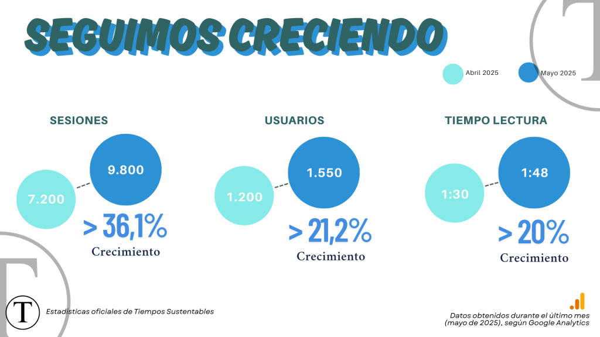
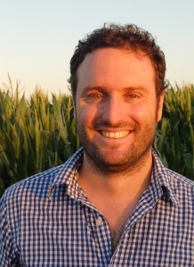

**_Queridas y queridos lectores de Tiempos Sustentables,_**

_Es un verdadero placer y motivo de gran alegría presentarles esta segunda edición mensual. Siento una profunda satisfacción al observar cómo nuestra revista no solo continúa. Además, se consolida y gana un espacio relevante en el panorama chileno y latinoamericano. Este crecimiento es un reflejo directo del compromiso de ustedes: **nuestra comunidad activa y en expansión.**_

_Por ello, en esta ocasión, más que nunca, mis palabras se centran en un profundo agradecimiento. Su lealtad no es solo un número o una estadística. Es la energía que nos mueve. Es la validación de que estamos en el camino correcto. También es la inspiración para seguir adelante con este proyecto que tanto nos apasiona. **Gracias por creer en Tiempos Sustentables**._

_Espero que disfruten esta **edición de Mayo**. Que encuentren en ella nuevas perspectivas y herramientas para su día a día. Que siga alimentando esa semilla de conciencia ambiental que todos llevamos dentro._

_Sigamos avanzando, con convicción y entusiasmo._

**_Jesús Blasco Valencia_**

_Director – Tiempos Sustentables_

* * *

## Cifras Sustentables

* * *

## Columnas de opinión

* * *

## Colaboraciones

<figure>

<figcaption>

Sergio Fuentealba

</figcaption>

</figure>

* * *

<figure>

<figcaption>

Erika Alvarez

</figcaption>

</figure>

* * *

<figure>

<figcaption>

Pablo Silva

</figcaption>

</figure>

* * *

<figure>

<figcaption>

Ivonne Yupanqui

</figcaption>

</figure>

* * *

## Lo más leído

* * *

## Haciendo comunidad mirando hacia el futuro

¿Quieres ser parte activa de la conversación y no perderte ninguna novedad? ¡Nuestra comunidad de WhatsApp te espera!

Escanea el código QR y únete. Comparte ideas, recibe alertas exclusivas y conecta con otros apasionados por un futuro más sustentable. ¡Nos vemos!

* * *
