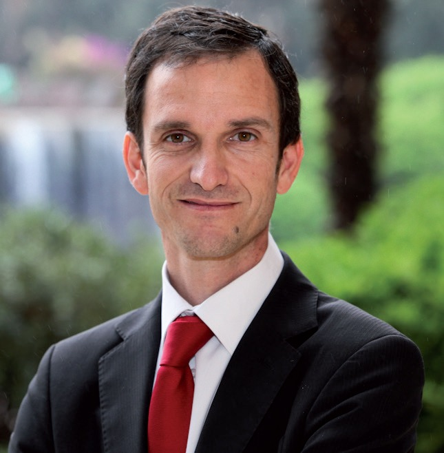
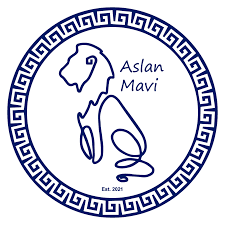
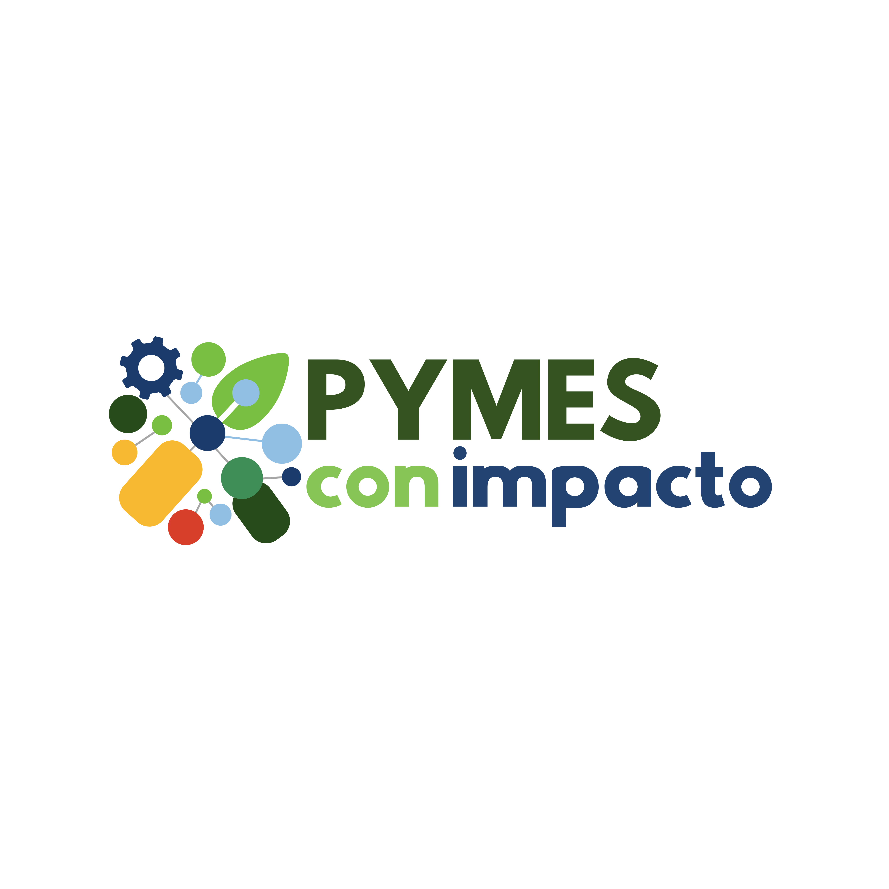

Qué orgullo ver cómo este espacio que construimos juntos sigue creciendo y consolidando nuestro diálogo. Este octubre, más que nunca, hemos sentido el pulso de la urgencia. El mensaje de nuestros expertos es claro: el tiempo de las intenciones se agotó y la sostenibilidad ha pasado de "ser" a "hacer" y "demostrar". En esta edición, navegamos precisamente esa transición. Abordamos con realismo los desafíos críticos que enfrenta nuestro desarrollo, como la "permisología" y la crisis hídrica, pero lo equilibramos con el optimismo y la visión estratégica que nos entregan la innovación en GreenTech, el enfoque "One Health" y las nuevas alianzas que ya están transformando la industria. Gracias por acompañarnos en la misión de convertir el discurso en acción. Bienvenidos a su resumen mensual.

* * *

## CIFRAS SUSTENTABLES

Este octubre, las cifras de tráfico web de Tiempos Sustentables deslumbran al reflejar una **comunidad vibrante y un alcance imparable**. Tras un asombroso crecimiento en sesiones y usuarios entre abril y junio, los datos de este mes celebran la consolidación de nuestra audiencia en un nivel extraordinario. Cerramos octubre con una base contundente de **14.500 sesiones** y **2.450 usuarios**. Más importante aún, el **tiempo de permanencia** brilla con fuerza y se mantiene firme en **90** segundos, evidenciando un compromiso apasionado (engagement) y un interés ardiente de la comunidad en nuestro contenido.

![Alcance tráfico web hasta octubre 2025 en Tiempos Sustentables.
Este octubre, las cifras de tráfico web de Tiempos Sustentables deslumbran al reflejar una comunidad vibrante y un alcance imparable. Tras un asombroso crecimiento en sesiones y usuarios entre abril y junio, los datos de este mes celebran la consolidación de nuestra audiencia en un nivel extraordinario. Cerramos octubre con una base contundente de 14.500 sesiones y 2.450 usuarios. Más importante aún, el tiempo de permanencia brilla con fuerza y se mantiene firme en 90 segundos, evidenciando un compromiso apasionado (engagement) y un interés ardiente de la comunidad en nuestro contenido.](images/captura-de-pantalla-2025-11-08-a-las-16.41.40-edited-1.png)

* * *

## Columnas de Opinión: Expertos en Sostenibilidad

Este octubre, nuestra sección de opinión se adentró con fervor en la **imperiosa necesidad de transformar el discurso en acción tangible**. Las columnas destacadas clamaron que **no podemos darnos el lujo de limitarnos a "ser sostenibles"; es un deber ineludible gestionarlo y reportarlo con la máxima transparencia**. Este sentido de urgencia se intensificó con la crítica labor del liderazgo empresarial comprometido, haciendo **un llamado vibrante a la acción en el marco del Día Internacional contra el Cambio Climático,** donde se entrelaza la estrategia corporativa con la crisis global que nos afecta a todos.

* * *

## Colaboraciones de Nuestra Red de Expertos en Sostenibilidad

Durante octubre, nuestros apasionados columnistas y expertos se sumergieron en el análisis de los temas más trascendentales de la agenda. **Desde el profundo impacto de la "permisología"** en nuestro desarrollo nacional, desmenuzado por Carlos Rubilar, **hasta el urgente e inquebrantable llamado a la equidad y justicia climática** en América Latina, impulsado con fervor por Erika Alvarez. Asimismo, Felipe Martín, Pablo Silva y José Manuel Bellalta nos brindaron una visión rica y detallada sobre cómo **Chile puede leer el futuro a través de soluciones sostenibles** ante la apremiante crisis habitacional e hídrica. Sus voces no solo son fundamentales, sino que son la chispa que enciende el diálogo en Tiempos Sustentables.

<figure>

<figcaption>

Carlos Rubilar

</figcaption>

</figure>

<figure>

<figcaption>

Erika Alvarez

</figcaption>

</figure>

<figure>

<figcaption>

Felipe Martín

</figcaption>

</figure>

<figure>

<figcaption>

Pablo Silva

</figcaption>

</figure>

<figure>

<figcaption>

José Manuel Bellalta

</figcaption>

</figure>

* * *

## Noticias de Impacto Sostenible

Octubre fue un mes vibrante y lleno de iniciativas inspiradoras que evidencian la sostenibilidad en acción. Este mes, celebramos con entusiasmo tres noticias clave que nos motivan a seguir luchando por un futuro más sustentable:

<figure>

<figcaption>

UNK Latam

</figcaption>

</figure>

<figure>

<figcaption>

The Owl Solutions

</figcaption>

</figure>

<figure>

<figcaption>

Aslan Mavi

</figcaption>

</figure>

<figure>

<figcaption>

www.pymesconimpacto.cl

</figcaption>

</figure>

## ESPECIALES SOSTENIBLES: Un Resumen Apasionante y ¡Desafíate para Ti Mismo!

Este octubre, nuestra sección de **Especiales** te ofrece dos compilados indispensables para entender el presente y futuro de la sostenibilidad.

Profundiza en los 10 puntos de inflexión de la crisis en nuestro especial de **Medioambiente y Cambio Climático**, y descubre el liderazgo de Chile en el especial de **Innovación y Tecnología Sustentable**. Cada edición compila nuestros mejores reportajes sobre el tema y cierra con un didáctico cuestionario para que pongas a prueba todo lo que aprendiste.

* * *

## LO QUE NO TE PUEDES PERDER

Este mes, profundizamos en tres pilares que están definiendo el futuro sostenible. Desde el ámbito corporativo, analizamos cómo los **Reportes de Sostenibilidad** han evolucionado de ser una obligación legal a un componente de valor estratégico esencial para las empresas. Pasamos a una visión integral con el enfoque **‘One Health’**, el eje invisible que conecta la salud humana, animal y ambiental en América Latina. Finalmente, cerramos con una mirada a la vanguardia, detallando cómo la **Inteligencia Artificial y el GreenTech** se perfilan como las innovaciones clave para acelerar la sostenibilidad a nivel global. Tres lecturas fundamentales para entender las fuerzas que moldean nuestro presente.

* * *

### La Comunidad nos Llevará al Éxito.

¡Queremos que te conviertas en un actor fundamental en la emocionante conversación sobre sostenibilidad! **Te invitamos a ser parte de nuestra vibrante comunidad escaneando el código QR**. Conéctate con profesionales, líderes y apasionados como tú, comprometidos en la noble misión de construir un futuro verdaderamente sustentable.

* * *
