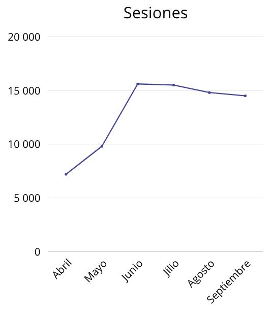
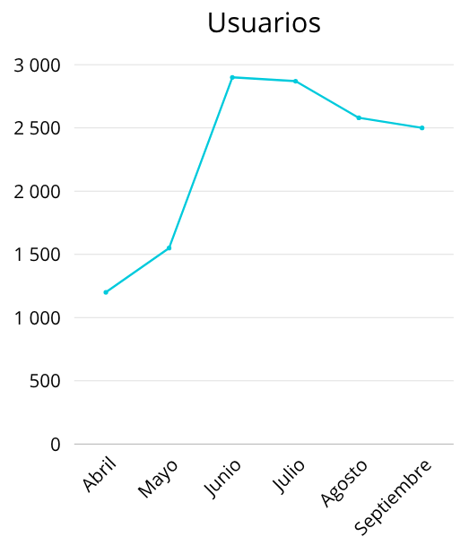
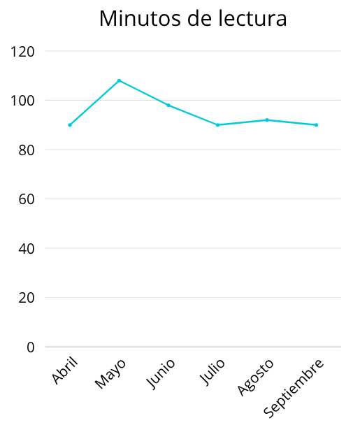
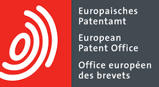

* * *

* * *

## CIFRAS SUSTENTABLES

En el mundo digital, la atención es nuestra moneda más valiosa. Por eso, nos complace compartir los resultados de septiembre, que demuestran el compromiso continuo de nuestra audiencia. Los datos, obtenidos de Google Analytics al 1 de octubre de 2025, no solo confirman el valor de nuestro contenido, sino que también nos impulsan a seguir creando experiencias que nuestros usuarios adoran.

A continuación, los gráficos detallan nuestro desempeño.

- 14.500 sesiones

- 2.500 usuarios

- 90 minutos en promedio de lectura.

* * *

## OPINIÓN DE EXPERTOS

Este mes, nuestra sección de opinión se adentra en las dinámicas que moldean nuestra sociedad y economía. Nuestros columnistas invitados analizan temas de gran relevancia, ofreciendo perspectivas que invitan a la reflexión y el debate. Nos comentan sobre la evolución del capital consciente y el rol de la academia y gobierno en tiempos de crisis.

* * *

## COLABORACIONES

Agradecemos a Carlos Rubilar por su valiosa columna sobre la transparencia en las operaciones de Nueva Anglo Teck. También extendemos nuestro reconocimiento a la OEA por su aporte sobre la sostenibilidad alimentaria, ambos contribuyendo a un diálogo esencial con su experiencia y visión.

<figure>

<figcaption>

Carlos Rubilar

</figcaption>

</figure>

<figure>

<figcaption>

OEP

</figcaption>

</figure>

* * *

## ESPECIALES SOSTENIBLES

Este mes, nuestra sección de reportajes especiales se sumergió en dos temas de gran relevancia: el primero abordó la confluencia entre las Fiestas Patrias chilenas y el actual panorama de las elecciones presidenciales en el país, analizando cómo la identidad nacional se entrelaza con el futuro político. El segundo reportaje se centró en la filantropía y la inversión de impacto, explorando cómo las finanzas y los valores se fusionan para generar cambios sociales significativos y construyendo un futuro más equitativo.

* * *

## LO QUE NO TE PUEDES PERDER

Nuestros reportajes de septiembre se destacaron por su exhaustiva cobertura, abarcando desde las **tendencias tecnológicas, financieras y medioambientales** hasta las **innovaciones y nuevas normativas** del sector. Exploramos a fondo temas cruciales como el funcionamiento de los **mercados de carbono**, la visión de la **economía verde** a través del análisis del libro _The Spirit of Green_ de Nordhaus, y el gran desafío de la **sequía en capitales latinoamericanas**, ofreciendo una comprensión completa y técnica de la actualidad.

* * *

### Haciendo comunidad mirando hacia el futuro

Queremos que seas parte activa de la conversación sobre sostenibilidad! Te invitamos a unirte a nuestra creciente comunidad escaneando el código QR. Conéctate con profesionales, líderes y entusiastas que, como tú, están comprometidos con la construcción de un futuro más sustentable.

* * *
