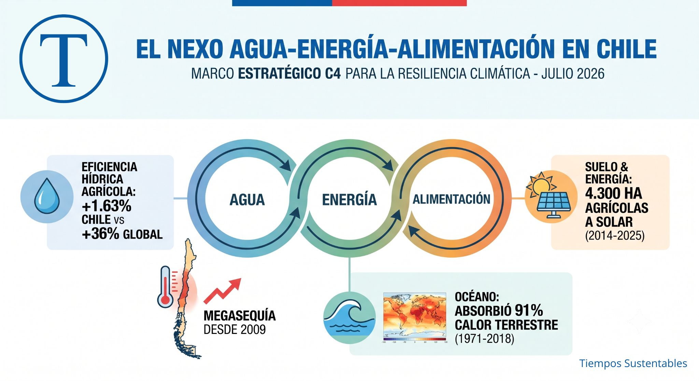

**En síntesis:** El Comité Científico C4 de Chile presentó las bases técnicas para actualizar la Estrategia Climática de Largo Plazo (ECLP) del país. El informe, liderado en su sección técnica por el Dr. Alex Godoy, propone transitar hacia una gobernanza vinculante basada en el nexo agua, energía y alimentación para superar la gestión fragmentada entre los ministerios y sectores productivos. Esta propuesta busca solucionar desafíos críticos como la conversión de suelos agrícolas para uso solar y el estancamiento de la eficiencia hídrica, mediante un ordenamiento territorial vinculante, la toma de decisiones por cuencas y la unificación de datos estatales.

<figure>



<figcaption>

Nexo agua-energía-alimentación en Chile: datos de eficiencia hídrica, megasequía, calor oceánico y uso de suelo solar

</figcaption>

</figure>

El diseño de políticas públicas en América Latina padece de un mal crónico: la gestión fragmentada. Históricamente, las carteras de agricultura, energía y medio ambiente han operado como compartimentos estancos, ignorando una premisa ecológica básica: las decisiones tomadas en un sector reverberan, con consecuencias a menudo irreversibles, en el resto del sistema.

![El Comité Científico Asesor de Cambio Climático tiene el rol de brindar asesoramiento al Ministerio del Medio Ambiente en los aspectos científicos que se requieran, entre otros, para la elaboración, diseño, implementación y actualización de los instrumentos de gestión del cambio climático establecidos en la Ley Marco de Cambio Climático. Para ello, ha abordado diferentes aspectos críticos del cambio climático, con una mirada global y local, tales como Adaptación, Mitigación, Energía, Agua, Biodiversidad, Ciudades, Criósfera, Antártica y Océanos.](images/Comite-cientifico-asesor-1200x966.jpg)

Chile, actuando como un verdadero laboratorio natural de la crisis climática global, busca desarmar esta inercia. El 9 de julio de 2026, el **Comité Científico Asesor de Cambio Climático (C4)** —hoy liderado por su nueva presidenta, la **Dra. Camila Fernández** (investigadora del Centro COPAS de la Universidad de Concepción)— presentó la base técnica clave para la actualización de la **Estrategia Climática de Largo Plazo (ECLP)** del país.

Este esfuerzo titánico, que movilizó a más de 500 investigadores con el respaldo de _NDC Partnership_ y el _PNUMA_, se encuentra disponible en el [Repositorio de Informes Temáticos C4 2025-2026](https://www.minciencia.gob.cl/areas/comite-cientifico-asesor-cambio-climatico/documentos-comite/informes-tematicos/).

Para comprender la profundidad de esta transformación, en _Tiempos Sustentables_ conversamos en exclusiva con el **Dr. Alex Godoy Faúndez**, director del Centro de Investigación en Sustentabilidad (CISGER) y líder del informe temático sobre el **Nexo Agua-Energía-Alimentación (AEA)**. Sus definiciones y respuestas directas no solo diagnostican la crisis, sino que proponen una hoja de ruta de gobernanza disruptiva para la región.

* * *

> ### 💡 Glosario Técnico para Líderes Regionales
> 
> - **Nexo Agua-Energía-Alimentación (AEA):** Enfoque estratégico de gobernanza que reconoce que estos tres sectores están intrínsecamente conectados. Un cambio en uno afecta directamente a los demás, por lo que gestionarlos de forma aislada genera fallas y riesgos sistémicos.
> 
> - **Economía Circular (EC):** Estrategia transversal que busca desacoplar el crecimiento económico del consumo de recursos finitos y la degradación ambiental, minimizando los residuos y reintroduciendo materiales en el ciclo productivo.

* * *

## Una radiografía cuádruple de la vulnerabilidad nacional

Antes de profundizar en la gestión integrada, es vital entender el contexto de la evidencia científica entregada por el C4, articulada sobre cuatro pilares inseparables:

- **Salud como urgencia presente:** Las temperaturas extremas por sobre los 30°C están disparando la mortalidad cardiovascular y respiratoria. Asimismo, se proyecta una expansión hacia el sur de vectores de enfermedades infecciosas; el mosquito transmisor del dengue (_Aedes aegypti_) arriesga exponer a más de 1,3 millones de habitantes en la zona centro-sur.

- **El imperativo de la Economía Circular:** Implementar estrategias de circularidad proyecta reducir en un 37% las emisiones de gases de efecto invernadero (GEI) de Chile para el año 2030, incrementando el PIB un 1,54% y creando 33.000 empleos verdes. La medida más eficiente es prevenir la pérdida de alimentos, con una rentabilidad social de 14 a 1.

- **El colapso silencioso del océano:** El mar chileno absorbió el 91% del calor acumulado en el sistema terrestre entre 1971 y 2018. Esto ha generado hipoxia (bajo oxígeno) y acidificación acelerada, desplazando especies comerciales clave (como el jurel y la anchoveta) hacia el sur e intensificando las crisis por Floraciones Algales Nocivas (marea roja).

```
+------------------------------------------------------------+
|        EL CALENTAMIENTO GLOBAL SE REFUGIA EN EL MAR        |
+------------------------------------------------------------+
| Distribucion del calor acumulado en el sistema terrestre   |
| (Periodo 1971-2018):                                       |
|                                                            |
| Oceanos | ####################################### 91.00%   |
| Tierra  | #### 9.00%                                       |
|                                                            |
| Consecuencia en Chile: Zonas de hipoxia (bajo oxigeno) y   |
| acidificacion acelerada en las costas nacionales.          |
+------------------------------------------------------------+

```

- **El Nexo Agua-Energía-Alimentación (AEA):** La piedra angular indispensable para construir verdadera **resiliencia climática** en los territorios.

* * *

## 1\. Romper los silos: De la coordinación informal a la arquitectura vinculante

El diagnóstico del informe nexo AEA es categórico al señalar que la gestión por "compartimentos estancos" es el gran enemigo de la resiliencia climática en Chile. Al preguntarle al Dr. Alex Godoy sobre cómo forzar a que ministerios tradicionalmente independientes cooperen, su respuesta es tajante:

> "El punto central es que no basta con pedirles voluntariamente a los ministerios que 'se coordinen mejor'. Cada cartera responde a mandatos legales, presupuestos, indicadores y grupos de interés sectoriales. Mientras esos incentivos permanezcan separados, Energía seguirá optimizando la descarbonización y precios, Agricultura la productividad y Obras Públicas la infraestructura hídrica, aunque el resultado agregado sea subóptimo. Por eso, los informes proponen pasar de la coordinación informal a una arquitectura institucional vinculante."

Para lograr esta transición, el Dr. Godoy y el informe proponen dos pilares fundamentales:

- **Instancia interministerial permanente:** Un órgano con mandato normativo, presupuesto propio y capacidad técnica estable que alinee instrumentos y métricas, evitando que la planificación climática dependa del gobierno de turno.

- **Evaluación de coherencia del nexo:** Las grandes políticas e inversiones (como plantas de hidrógeno verde, obras de desalinización o subsidios de riego) no deben aprobarse evaluando solo su desempeño sectorial. Deben someterse a una evaluación obligatoria que mida sus efectos cruzados sobre la disponibilidad de agua, consumo energético, suelo, biodiversidad y seguridad alimentaria.

En este nuevo esquema, **la cuenca debe convertirse en la unidad operativa de decisión**, bajo arreglos policéntricos donde confluyan ministerios, gobiernos regionales, municipios, regantes, comunidades y la academia.

* * *

## 2\. El suelo: El "actor invisible" frente a la presión de la transición energética

El suelo sostiene la producción de alimentos y almacena agua y carbono, pero continúa ausente en la Ley Marco de Cambio Climático (LMCC). Esta omisión legal genera complejos _trade-offs_ (concesiones forzosas) territoriales.

El informe del C4 documenta que, entre 2014 y 2025, la capacidad fotovoltaica en Chile pasó de 7 MW a más de 11.000 MW. Sin embargo, esta expansión significó que **más de 4.300 hectáreas de vocación agrícola fueran convertidas a uso solar**, concentrándose más del 50% de las nuevas plantas entre las regiones de Valparaíso y Maule, zonas con alto estrés hídrico y suelos de alta relevancia productiva.

```
+------------------------------------------------------------+
|     EXPANSION SOLAR EN CHILE & USO DE SUELO (2014-2025)    |
+------------------------------------------------------------+
| Capacidad Fotovoltaica Instalada:                          |
|                                                            |
| 2014 | 7 MW                                                |
| 2025 [XXXXXXXXXXXXXXXXXXXXXXXXXXXXXXXXXXXXXXXX] 11.000+ MW |
|                                                            |
| Impacto Territorial:                                       |
| - 4.300 Hectareas de suelo agricola reconvertidas a solar  |
| - Concentrado principalmente entre Valparaiso y Maule      |
+------------------------------------------------------------+

```

(Datos respaldados por el informe de Nexo AEA del Comité C4, liderado por el Dr. Alex Godoy).

Al respecto, el Dr. Godoy advierte sobre los peligros de postergar un ordenamiento territorial vinculante:

> "El problema no es optar entre energía solar y agricultura. Chile necesita descarbonizarse. El problema es decidir dónde y bajo qué condiciones se despliega esa infraestructura. Una transición energética que ignora el suelo puede resolver parcialmente el problema del carbono y, simultáneamente, profundizar la inseguridad alimentaria, la degradación ecológica y los conflictos territoriales. Los contratos energéticos de largo plazo pueden hacer económicamente irreversible una conversión que biofísicamente también puede ser difícil de revertir."

Entre los impactos físicos inmediatos, Godoy detalla la compactación, la erosión, la pérdida de carbono orgánico y la menor capacidad del territorio para regular el agua ante sequías o lluvias extremas. ¿La alternativa? **Priorizar techumbres, zonas industriales, terrenos degradados y el desarrollo de proyectos agrovoltaicos** que permitan la coexistencia de la generación solar y la actividad agrícola.

* * *

## 3\. Ciencia con anclaje y diálogos territoriales

El informe evitó los sesgos teóricos centralistas mediante la ejecución de los _"Diálogos Científicos por la Acción Climática"_. Esta metodología capturó las profundas asimetrías del país, visibilizando la "condición de isla" logística y alimentaria de Antofagasta, y la extrema fragilidad de los Sistemas de Agua Potable Rural (APR) en Valparaíso ante el estrés hídrico.

### Participación territorial en los Diálogos C4 (Julio - Octubre 2025):

| **Región / Modalidad** | **Comunidad Científica (F/M)** | **Comunidad Escolar (F/M)** | **Comunidad Divulgación (F/M)** |
| --- | --- | --- | --- |
| **Concepción** | 33 / 29 | 11 / 11 | 17 / 3 |
| **Valdivia** | 10 / 15 | 5 / 7 | 5 / 21 |
| **Valparaíso** | 15 / 19 | 5 / 4 | 11 / 3 |
| **Antofagasta** | 11 / 6 | 1 / 4 | 3 / 7 |
| **Punta Arenas** | 14 / 8 | 15 / 2 | 12 / 8 |
| **Formato Virtual** | 71 / 53 | \- | \- |
| **TOTALES** | **154 / 130** | **23 / 42** | **54 / 36** |

* * *

## 4\. La paradoja de la eficiencia hídrica en el agro

Uno de los datos más duros del informe es el rezago en eficiencia hídrica agrícola en Chile, con un aumento de apenas 1,63% frente al 36% del promedio global. Al consultarle sobre este rezago, el Dr. Alex Godoy aporta una importante precisión biofísica:

> "Entre 2015 y 2021, la eficiencia agregada del uso del agua aumentó un 12% en Chile, pero ello se explica casi enteramente por un incremento del 47% en el sector industrial. En el sector agropecuario, el aumento fue apenas de 1,63%, frente a un 36% global y un 10% regional. Además, las mediciones biofísicas muestran disminuciones simultáneas de eficiencia, productividad vegetal y evapotranspiración en varias cuencas entre Vallenar y Curicó. Es decir, una parte importante de la agricultura central no enfrenta solamente un problema de tecnología, sino una restricción hídrica estructural."

```
+------------------------------------------------------------+
|        PARADOJA DE LA EFICIENCIA HIDRICA EN EL AGRO        |
+------------------------------------------------------------+
| Aumento acumulado en eficiencia (2015-2021):               |
|                                                            |
| Global | ######################################## 36.00%   |
| Chile  | # 1.63%                                           |
|                                                            |
| Diagnostico C4: La tecnificacion predial llego a su limite |
| biofisico por el alza de la demanda evaporativa.           |
+------------------------------------------------------------+

```

La tecnificación predial (como el riego por goteo) es necesaria pero insuficiente; si el agua aparentemente "ahorrada" se utiliza para expandir la superficie de riego o intensificar la producción, la presión total sobre la cuenca aumenta.

La propuesta del C4 no es detener la producción de forma abrupta, sino pactar una **adaptación transformacional** y planificada con el sector agroexportador. Esto implica definir indicadores claros por cuenca (caudales ecológicos, productividad vegetal, acuíferos) para activar planes de reconversión de cultivos de menor demanda hídrica, lo cual puede ahorrar entre un 10% y más de un 30% de agua manteniendo o incluso aumentando los ingresos agrícolas.

* * *

## 5\. Superar la "ceguera de datos" del Estado

La planificación hídrica y climática requiere de datos que dialoguen entre sí; sin embargo, el informe acusa una total fragmentación entre las plataformas de la DGA, la CNE y el CIREN. Al preguntarle al Dr. Godoy si existe un bloqueo intencionado de información, el científico descarta la mala fe, apuntando a un problema de diseño sistémico:

> "Sería científicamente impropio afirmar, sin evidencia directa, que existe una decisión deliberada de ocultar información o proteger 'feudos'. El informe no demuestra intencionalidad. Sí muestra algo más estructural: instituciones diseñadas para cumplir mandatos sectoriales, con plataformas, clasificaciones, unidades de medida, ciclos presupuestarios y criterios de calidad diferentes. Esa fragmentación institucional produce, en la práctica, un resultado similar a un apagón de información."

La solución propuesta no consiste en construir otra gran base de datos centralizada, sino en crear una **gobernanza nacional de datos para el nexo**. Esto obligaría a cada organismo a utilizar taxonomías compartidas, identificadores únicos y APIs (interfaces de comunicación automatizada) abiertas. Para el Dr. Godoy, una excelente forma de empezar sería implementar programas piloto en cuencas críticas para integrar en tiempo real la demanda eléctrica, los derechos de agua, la superficie cultivada y los escenarios climáticos de la zona.

* * *

## 🌎 Casos de Éxito Internacional en Políticas Integradas

Mientras Chile traza su propia estrategia, otras regiones del mundo ofrecen valiosas lecciones sobre el camino a seguir:

- **Gobernanza por Cuencas en Francia:** El modelo de agencias de agua francesas cobra impuestos a los usuarios según su impacto en el nexo, redistribuyendo estos fondos de manera transversal para financiar proyectos agrícolas y energéticos que garanticen la salud de las cuencas.

- **El Enfoque Integrado de Costa Rica:** A través de sus planes de descarbonización y su matriz eléctrica casi 100% renovable, el país utiliza el mecanismo de Pago por Servicios Ambientales (PSA) para incentivar simultáneamente la conservación del suelo agrícola, la recarga de acuíferos y el resguardo de las cuencas que alimentan sus centrales hidroeléctricas.

* * *

## Decálogo para un Estado Resiliente y Adaptativo

La gestión integrada del nexo AEA no es un debate académico; es una condición de supervivencia para la prosperidad del país. A partir de la evidencia científica del comité, emergen diez recomendaciones estratégicas ineludibles para el Estado chileno:

1. **Institucionalizar el Nexo AEA** como marco rector vinculante en la ECLP y las metas de la NDC.

3. **Legislar sobre el suelo**, codificando formalmente sus funciones ecosistémicas en la normativa climática.

5. **Gobernar por cuencas**, otorgando atribuciones reales y vinculantes a los nuevos Consejos de Cuenca.

7. **Aplicar arbitraje científico obligatorio** al evaluar la localización de grandes obras de infraestructura (desalinizadoras, hidrógeno verde y parques solares).

9. **Forzar la interoperabilidad de datos** mediante APIs abiertas y estándares comunes entre la DGA, la CNE y el CIREN.

11. **Crear un Fondo Basal Municipal** que financie la ejecución técnica local de los Planes de Acción Comunal (PACCC).

13. **Incentivar la reconversión agrícola profunda**, abandonando la ilusión de las mejoras prediales únicamente incrementales.

15. **Adoptar el modelo de "Capital Natural"**, integrando el valor económico del agua y del suelo en la planificación presupuestaria de la DIPRES.

17. **Priorizar el reúso de aguas tratadas** por sobre la desalinización de agua de mar, debido a su menor exigencia y costo energético (1-2,5 kWh/m³ frente a 3-10 kWh/m³).

19. **Garantizar una Transición Justa**, enfocada en las zonas aisladas del norte y los rezagados sistemas sanitarios rurales (APR).

El mandato de la ciencia es claro. Depende ahora del coraje político traducir esta sólida evidencia en la nueva arquitectura del Estado.

* * *

## Preguntas Frecuentes (FAQ)

### ¿Qué es el enfoque del Nexo Agua-Energía-Alimentación (AEA)?

Es un marco de gobernanza que reconoce que estos tres sectores están íntimamente conectados. Entiende que la producción energética requiere agua, la distribución e infraestructura hídrica consume energía, y la agricultura depende de ambas de manera intensiva. Gestionarlos de manera aislada genera fallas y riesgos sistémicos en todo el territorio.

### ¿Por qué el C4 destaca al suelo como una prioridad urgente en la legislación climática?

El suelo es el sustrato biofísico donde se equilibra la recarga hídrica, la biodiversidad y la producción de alimentos. Al no estar explícitamente protegido ni regulado en la Ley Marco de Cambio Climático (LMCC), se facilitan la degradación de ecosistemas y los conflictos de uso del suelo, como la pérdida irreversible de miles de hectáreas agrícolas fértiles reemplazadas por proyectos energéticos en la zona central de Chile.

### ¿Qué plantea la ciencia sobre la desalinización frente al reúso de agua?

El informe del C4 aconseja no considerar la desalinización como la única respuesta automática a la escasez hídrica, debido a su alto consumo energético (3-10 kWh/m³). Recomienda priorizar, siempre que sea técnica y territorialmente viable, el tratamiento y reúso de aguas servidas y grises, proceso que requiere de 1 a 2,5 kWh/m³ y devuelve nutrientes clave al sistema hídrico de la cuenca.

### ¿En qué consiste la paradoja de la eficiencia hídrica agrícola?

Consiste en que, a pesar de que los campos cuenten con alta tecnología de riego (como goteo), esto no se traduce necesariamente en un ahorro de agua a nivel de cuenca. La tecnificación predial suele incentivar la expansión de cultivos o el aumento de la densidad productiva, lo que, sumado a la creciente demanda evaporativa de la atmósfera, incrementa el consumo real y la presión sobre los acuíferos.

* * *

### 💬 ¡Participa y comparte tu opinión!

La sólida evidencia científica del Comité C4 confirma que las lógicas tradicionales de planificación sectorial en Chile han caducado. El verdadero desafío se encuentra en la voluntad política para su ejecución.

- **¿Cómo evalúas la competencia territorial entre la agricultura y la transición de energía solar en tu región?**

- **¿Qué barreras institucionales consideras que frenan la unificación de datos del agua y el suelo en tu localidad?**

**Déjanos tu comentario abajo y comparte este análisis con tu red para abrir el debate sobre la gobernanza climática del futuro.**
