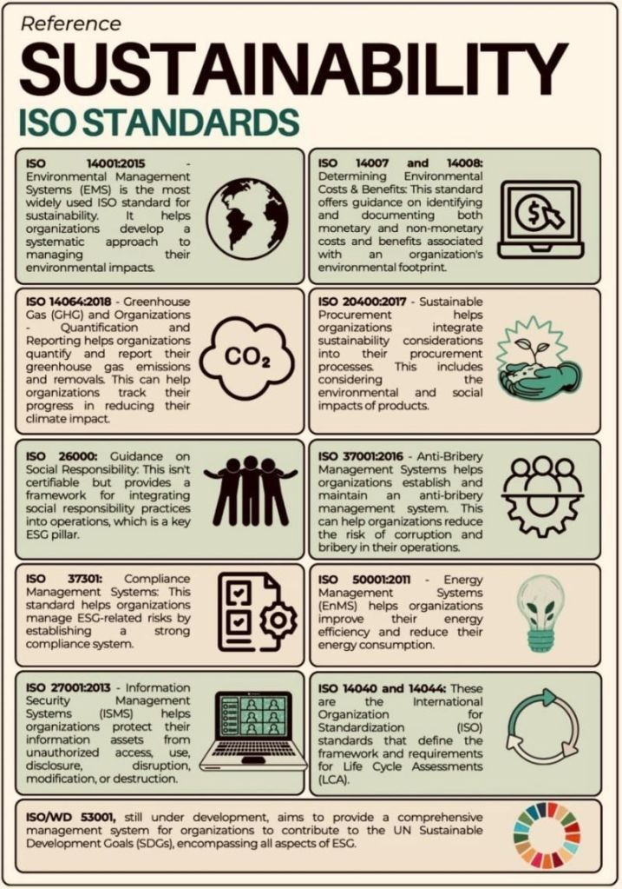

En el camino hacia un desarrollo sostenible y resiliente, las organizaciones de todo el mundo enfrentan el desafío de integrar prácticas responsables que equilibren la rentabilidad, el cuidado ambiental y el bienestar social. En este escenario, las normas ISO han dejado de ser simples certificaciones para convertirse en marcos estratégicos que ayudan a las empresas a responder de manera concreta a las demandas de inversionistas, consumidores y reguladores.

## A continuación, revisamos las principales normas ISO vinculadas a la sostenibilidad y cómo Chile se compara frente a estos estándares internacionales:

### ISO 14001:2015 – Sistemas de Gestión Ambiental

_Permite a las organizaciones identificar, gestionar y reducir sus impactos ambientales._

En **Chile**, esta norma es ampliamente utilizada, especialmente en sectores clave como la minería, la agroindustria y la energía, alineándose con la **Ley REP** (Responsabilidad Extendida del Productor) y el Sistema Nacional de Certificación Ambiental.

* * *

### ISO 14064:2018 – Gestión de Gases de Efecto Invernadero

_Proporciona metodologías para la cuantificación y verificación de emisiones de GEI._

**Chile** ha avanzado con su Registro Nacional de Emisiones y Remociones de Gases de Efecto Invernadero (**REMI**) y su compromiso de carbono neutralidad al 2050, pero aún pocas PYMEs adoptan ISO 14064 formalmente.

* * *

### ISO 26000 – Guía de Responsabilidad Social

_No certificable, pero establece principios para la responsabilidad social y sostenibilidad organizacional._

En el país, muchas empresas se alinean con esta norma a través de sus reportes de sostenibilidad, especialmente aquellas adheridas al **Pacto Global Chile** y sus principios de **ESG**.

* * *

### ISO 37301:2021 – Sistemas de Gestión de Cumplimiento

_En un contexto de alta fiscalización ambiental y social, este estándar guía la creación de sistemas efectivos de cumplimiento normativo._

**Chile** ha visto crecer su adopción tras la nueva **Ley de Delitos Económicos** (2023) que obliga a las empresas a robustecer sus modelos de prevención y cumplimiento.

* * *

### ISO 27001:2013 – Seguridad de la Información

_Aunque no directamente ambiental, la gestión segura de la información es crítica para la sostenibilidad, especialmente ante amenazas cibernéticas y la creciente digitalización._

En **Chile**, las industrias financiera, telecomunicaciones y energética lideran su implementación.

* * *

### ISO 14007 & 14008 – Valoración y Evaluación Financiera de Impactos Ambientales

_Permiten cuantificar y reportar los impactos ambientales en términos económicos._

A nivel local, son poco conocidas, pero clave para avanzar en la medición del costo real de la huella ambiental, especialmente en sectores exportadores.

* * *

### ISO 20400:2017 – Compras Sostenibles

_Fomenta cadenas de suministro responsables, eficientes y sostenibles._

En **Chile**, esta norma es fundamental para sectores exportadores que deben cumplir **estándares de sostenibilidad** en mercados como la Unión Europea y EE.UU. Sin embargo, aún falta masificarla en proveedores locales.

* * *

### ISO 37001:2016 – Gestión Antisoborno

_Aborda la prevención, detección y tratamiento de sobornos, fortaleciendo la ética corporativa._

La aplicación en **Chile** es relevante dado el marco regulatorio y el aumento de exigencias de gobernanza (ESG) de inversionistas internacionales.

* * *

### ISO 50001:2011 – Gestión de la Energía

_Permite optimizar el consumo energético y reducir las emisiones asociadas._

Aunque **Chile** ha avanzado en energías renovables (27% de la matriz eléctrica en 2024), aún es baja la cantidad de empresas certificadas bajo esta norma, especialmente fuera del sector industrial.

* * *

### ISO 14040 & 14044 – Evaluación del Ciclo de Vida (LCA)

_Instrumentos clave para evaluar el impacto de productos y servicios a lo largo de su ciclo de vida._

En **Chile**, aún son poco utilizadas, aunque se integran progresivamente en sectores como envases y embalajes, en línea con la Ley REP y la demanda de trazabilidad de impacto de consumidores y retailers.

## ¿Cómo está Chile frente a los estándares ISO de sostenibilidad?

- Minería, agroindustria y energía son los sectores con mayor adopción.

- Pymes y empresas locales aún muestran rezago, principalmente por desconocimiento o falta de recursos.

**Tendencia**: el aumento de regulaciones ambientales y sociales, tanto nacionales como internacionales, acelerará la adopción de estas normas en los próximos años.

**Desafío**: no basta con certificarse, sino integrar estos marcos de manera estratégica y vinculante con los objetivos de sostenibilidad y rentabilidad de cada organización.

_La sostenibilidad es más que una narrativa, es una gestión basada en evidencia, ética y resultados._

 

 

