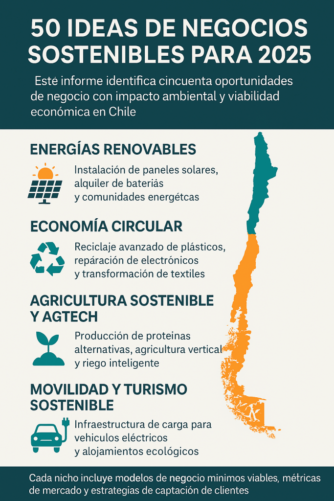

La sostenibilidad es una poderosa vía para emprender con propósito, innovación y rentabilidad. Así lo demuestra el informe **_“50 Nichos Sostenibles y Rentables en 2025”_** elaborado por **_[Enviroo](https://www.enviroo.com/)_**, que identifica medio centenar de oportunidades de negocio verde que combinan impacto ambiental, retorno económico y escalabilidad.

Desde soluciones de energía renovable hasta movilidad eléctrica, pasando por agricultura regenerativa, upcycling, consultoría ESG, educación ambiental, turismo regenerativo y tecnología verde, este documento detalla modelos de negocio viables, potencial de facturación, clientes ideales y canales de captación para cada nicho.

### Entre los sectores destacados:

- **Energías Renovables**: Instalación de paneles solares, comunidades energéticas y alquiler de baterías se consolidan como modelos con alta demanda, márgenes atractivos y apoyo gubernamental.

- **Economía Circular**: Iniciativas como el reciclaje avanzado de plásticos, reparación de electrónicos y transformación de textiles en nuevos productos responden a una cultura que valora el consumo responsable.

- **Consultoría ESG**: La necesidad de reportar y actuar bajo criterios ambientales, sociales y de gobernanza abre oportunidades en informes de sostenibilidad, estrategias para pymes, inclusión y medición de huella de carbono.

- **Agricultura Sostenible y AgTech**: Agricultura vertical, proteínas alternativas, riego inteligente y producción orgánica se alinean con la crisis climática y la creciente demanda por alimentos saludables y responsables.

- **Green Tech**: La integración de blockchain, inteligencia artificial e IoT en la gestión energética, hídrica y de residuos está revolucionando industrias completas.

- **Turismo y Movilidad Sostenible**: Alojamientos ecológicos, rutas regenerativas, carsharing eléctrico y logística urbana con vehículos limpios son propuestas que responden a una nueva forma de moverse y viajar.

Cada uno de los 50 nichos se presenta con claridad, incluyendo modelos mínimos viables (MVP), métricas de mercado, márgenes de rentabilidad y estrategias de captación de clientes, lo que convierte al documento en una hoja de ruta práctica para quienes buscan emprender con sentido.

**_Si estás pensando en crear un negocio con impacto positivo, este informe es una brújula para orientar tus pasos. Puedes descargarlo desde Enviroo  y comenzar hoy a diseñar el cambio que el mundo necesita._**

[50 Nichos Sostenibles y Rentables 2025\_compressed](https://tiempossustentables.cl/wp-content/uploads/2025/04/50-nichos-sostenibles-y-rentables-2025_compressed.pdf)[Descarga](https://tiempossustentables.cl/wp-content/uploads/2025/04/50-nichos-sostenibles-y-rentables-2025_compressed.pdf)

### 🇨🇱 Chile:

### Un Laboratorio Verde para Emprendimientos Sostenibles

En el contexto chileno, los nichos sostenibles presentan oportunidades concretas y alineadas con políticas públicas y desafíos ambientales locales. Algunos ejemplos son:

- Gracias al potencial solar del norte y la expansión de comunidades energéticas, negocios como instalación de paneles solares y baterías tienen alta rentabilidad y apoyo estatal.

- La Ley REP y la Estrategia Nacional de Economía Circular impulsan modelos de reciclaje textil, reparación de electrónicos y upcycling, con incentivos fiscales y creciente demanda B2B.

- Frente a la crisis hídrica, se fortalecen soluciones como riego inteligente, huertos urbanos y proteínas alternativas, especialmente en zonas rurales y periurbanas.

- El crecimiento del ecoturismo y la electromovilidad abre espacio a negocios como alojamientos eco-certificados, rutas regenerativas y logística de última milla limpia.

Chile cuenta con una base normativa, acceso a capital verde y ecosistemas regionales de innovación que hacen de estos nichos una verdadera hoja de ruta para emprender con impacto desde lo local hacia lo global.
