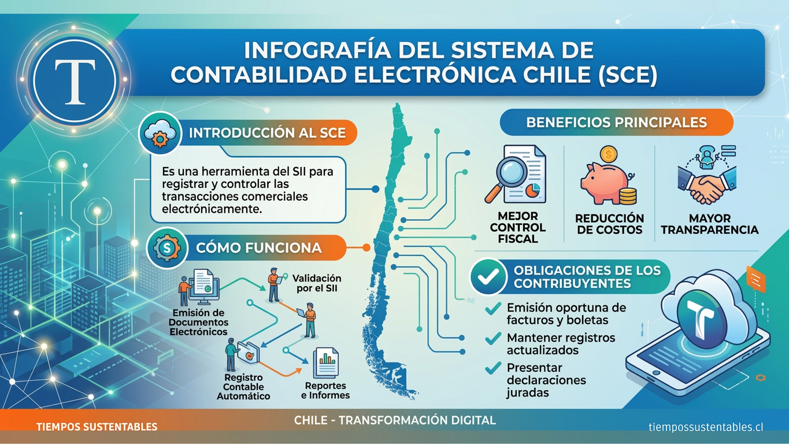
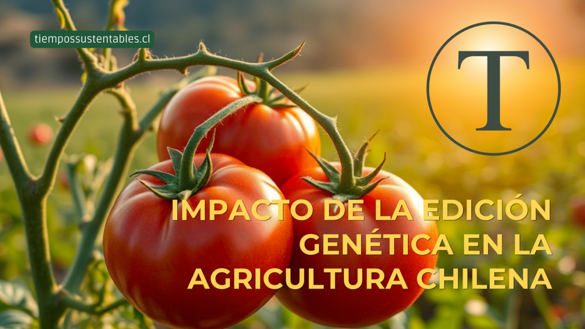
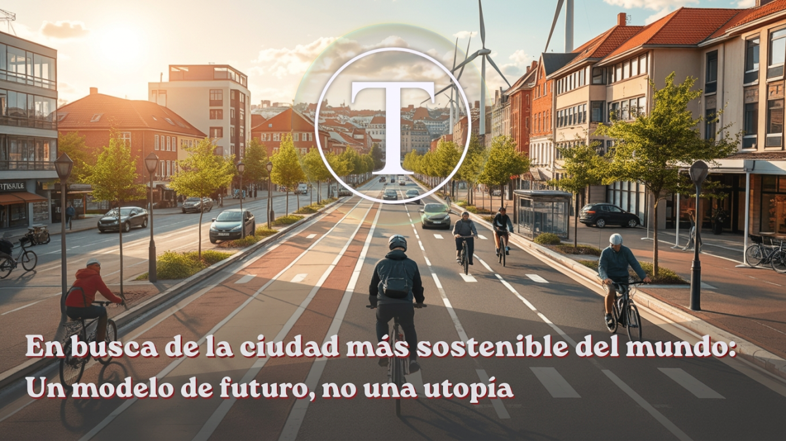
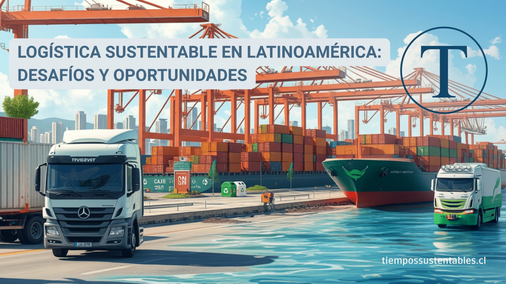
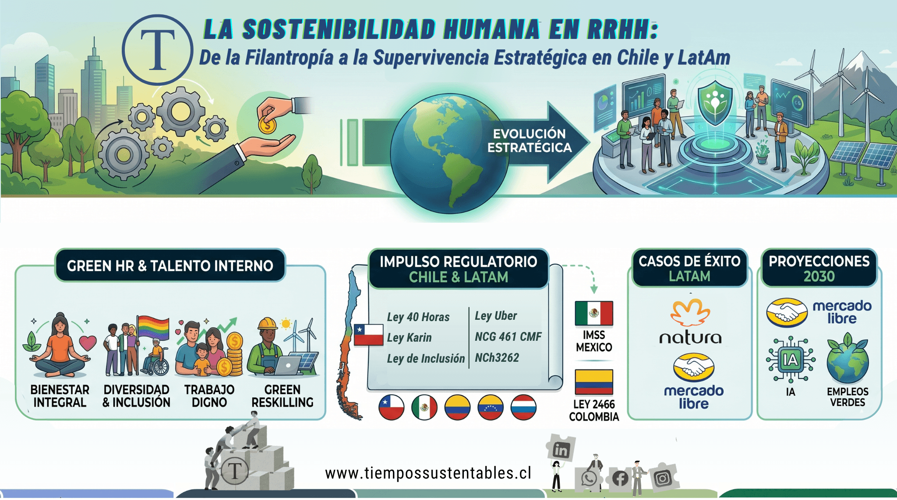

[ESG Trends Radar](https://tiempossustentables.cl/centro-de-recursos/#esg-trends-radar)

Trend:🇨🇱 Economía Circular & Ley REP · +240% Trend:🇨🇱 Huella de Carbono · +195% Trend:🇨🇱 Taxonomía CMF · +160% Trend:🇲🇽 ESG & Nearshoring · +310% Trend:🇲🇽 Descarbonización · +205% Trend:🇵🇪 Huella Hídrica · +285% Trend:🇵🇪 Justicia Climática · +190% Trend:🇨🇴 ODS 2030 · +220% Trend:🇨🇴 Sumideros de Carbono · +150% Trend:🇦🇷 Agro Sostenible · +230% Trend:🇦🇷 Energías Renovables · +170% Trend:🌎 Reportes de Sostenibilidad · +295% Trend:🌎 Directiva CS3D UE · +410%

Trend:🇨🇱 Economía Circular & Ley REP · +240% Trend:🇨🇱 Huella de Carbono · +195% Trend:🇨🇱 Taxonomía CMF · +160% Trend:🇲🇽 ESG & Nearshoring · +310% Trend:🇲🇽 Descarbonización · +205% Trend:🇵🇪 Huella Hídrica · +285% Trend:🇵🇪 Justicia Climática · +190% Trend:🇨🇴 ODS 2030 · +220% Trend:🇨🇴 Sumideros de Carbono · +150% Trend:🇦🇷 Agro Sostenible · +230% Trend:🇦🇷 Energías Renovables · +170% Trend:🌎 Reportes de Sostenibilidad · +295% Trend:🌎 Directiva CS3D UE · +410%

Investigación

Nuevo Destacado

# El Nuevo Paradigma de la Sostenibilidad: De la Narrativa de Cumplimiento a la Arquitectura de Valor Financiero.

La sostenibilidad corporativa en América Latina atraviesa una inflexión decisiva: la desaparición del **"sobreprecio verde"** (_green premium_), la exigencia de transparencia auditable y la presión regulatoria de la **CMF bajo NIIF S2** (aún cuando el organismo otorgo la extensión del plazo límite en un año), fuerzan al C-suite a integrar las métricas climáticas directamente en el estado de resultados (**P&L**). Presentamos la síntesis estratégica de la investigación que redefine el modelo de gestión para 2026.

[Leer Artículo Completo](https://tiempossustentables.cl/el-nuevo-paradigma-de-la-sostenibilidad/)

[Informe Técnico (PDF)](https://tiempossustentables.cl/wp-content/uploads/2026/09/EL-NUEVO-PARADIGMA-DE-LA-SOSTENIBILIDAD-Y-SU-RECEPCION-ESTRATEGICA.pdf)

Ver Video Oficial

Video Oficial • Tiempos Sustentables (Estreno Lunes 8:00 AM)

Cerrar ✕

<iframe id="ts-youtube-embed" src="" data-src="https://www.youtube-nocookie.com/embed/SEle6L7PWOs?autoplay=1" title="El Nuevo Paradigma de la Sostenibilidad - Tiempos Sustentables" allow="accelerometer; autoplay; clipboard-write; encrypted-media; gyroscope; picture-in-picture" allowfullscreen></iframe>

Fin Green Premium

43%

Rechaza compras sostenibles por ser "demasiado caras".

Brecha CMF Chile

24.1%

De 247 emisores cuantifica riesgo en EBITDA (NIIF S2).

Huella IA en RM

1.8 L/kWh

Consumo hídrico de data centers imputable al Alcance 3.

Incentivos C-Level

44%

Único porcentaje de firmas con bonos atados a metas ESG.

3 Tensiones Clave del Nuevo Paradigma Corporativo

Trampa de Asequibilidad

El 56% prioriza la economía personal. Las marcas deben competir en paridad de costo y anclarse en beneficios de salud tangible (70%).

La Grieta NIIF S2

100% de cumplimiento formal en NCG 461, pero 3 de cada 4 firmas informan sin modelos de estrés financiero climático para la banca.

Alcance 3 Digital & IA

18 data centers en la RM elevan el gasto hídrico y eléctrico. El uso de nube e IA ya es auditable como emisión indirecta de los clientes.

Material de referencia para Directorios, CFOs y Comités de Auditoría. [Explorar las 5 decisiones de comando](https://tiempossustentables.cl/el-nuevo-paradigma-de-la-sostenibilidad/)

Guía Estratégica 2026

## Economía Circular en Chile y LATAM

Una compilación editorial de publicaciones independientes de Tiempos Sustentables para comprender la circularidad desde la regulación, los flujos materiales, la innovación, los modelos de negocio y la creación de valor verificable.

Descubre si tu empresa está lista para la Ley REP y la Hoja de Ruta 2040

♻️

#### Ecodiseño y Trazabilidad

Sustitución de insumos vírgenes por materia prima secundaria con auditoría de origen.

⚖️

#### Compliance Ley REP

Integración con Sistemas de Gestión (SGI) y metas progresivas de valorización.

📈

#### Retorno de Inversión (ROI)

Transformación de residuos de proceso en nuevas líneas de ingresos o ahorro operativo.

[Continuar leyendo](https://tiempossustentables.cl/economia-circular-chile-latam/)

Casos prácticos, metas 2035/2040 y normativa chilena

Evergreen

## Contenido siempre vigente

Selección de análisis y reportajes que siguen siendo relevantes para la toma de decisiones ESG en 2026.

- 
    
    Actualizado Medioambiente y Clima
    
    ### [Sostenibilidad en Chile: cómo aprovechar el Sistema de Compensación de Emisiones (SCE)](https://tiempossustentables.cl/sostenibilidad-en-chile/)
    
    Guía práctica para líderes empresariales: cómo usar el SCE como palanca de sostenibilidad, competitividad y reporte ESG.
    
    [Leer investigación](https://tiempossustentables.cl/sostenibilidad-en-chile/)
    

- 
    
    Actualizado Innovación & Tecnología
    
    ### [Construcción circular en Chile: la hoja de ruta para la transformación del sector](https://tiempossustentables.cl/construccion-circular-en-chile/)
    
    Claves del Primer Comité Estratégico para avanzar hacia una construcción descarbonizada, con metas 2035 y casos de reutilización.
    
    [Leer investigación](https://tiempossustentables.cl/construccion-circular-en-chile/)
    

- 
    
    Actualizado Innovación & Tecnología
    
    ### [Impacto de la edición genética en la agricultura chilena](https://tiempossustentables.cl/impacto-genetico-agricultura/)
    
    Tomates con más vitamina D, cultivos que usan menos agua y alimentos más saludables: el futuro del agro con biotecnología.
    
    [Leer investigación](https://tiempossustentables.cl/impacto-genetico-agricultura/)
    

- 
    
    Actualizado Estilo de Vida
    
    ### [En busca de la ciudad más sostenible: modelo de futuro, no una utopía](https://tiempossustentables.cl/en-busca-de-la-ciudad-mas-sostenible-del-mundo-un-modelo-de-futuro-no-una-utopia/)
    
    De Copenhague a Singapur: qué hace que una urbe sea realmente sostenible y cómo aplicar esos aprendizajes en Latinoamérica.
    
    [Leer investigación](https://tiempossustentables.cl/en-busca-de-la-ciudad-mas-sostenible-del-mundo-un-modelo-de-futuro-no-una-utopia/)
    

- 
    
    Actualizado Negocios & Finanzas
    
    ### [Logística sustentable en Latinoamérica: desafíos y oportunidades](https://tiempossustentables.cl/logistica-sustentable-en-latinoamerica-desafios-y-oportunidades/)
    
    Cómo empresas y gobiernos regionales transforman el transporte y la cadena de suministro hacia modelos bajos en carbono.
    
    [Leer investigación](https://tiempossustentables.cl/logistica-sustentable-en-latinoamerica-desafios-y-oportunidades/)
    

- 
    
    Actualizado Sostenibilidad Humana
    
    ### [La Sostenibilidad Humana en RRHH: de filantropía a supervivencia](https://tiempossustentables.cl/la-sostenibilidad-humana-en-rrhh-de-la-filantropia-a-la-estrategia-esg-en-latam/)
    
    El cuidado genuino del ecosistema laboral directo e indirecto como condición indispensable para la viabilidad corporativa.
    
    [Leer investigación](https://tiempossustentables.cl/la-sostenibilidad-humana-en-rrhh-de-la-filantropia-a-la-estrategia-esg-en-latam/)
    

Panel de Expertos

## Columnas de opinión

Líderes, académicos y especialistas en sostenibilidad, ESG y políticas públicas en LATAM.

- 
    
    #### Antonia Biggs Fuenzalida
    
    Gerenta General, ANIR
    
    ### [Del residuo al recurso: el cambio de mirada que necesita Chile](https://tiempossustentables.cl/del-residuo-al-recurso-el-cambio-de-mirada-que-necesita-chile/)
    
    Un llamado a dejar de ver los materiales como “residuos” y valorarlos como recursos clave para la economía circular y la Ley REP.
    
    [Leer columna](https://tiempossustentables.cl/del-residuo-al-recurso-el-cambio-de-mirada-que-necesita-chile/)
    

- 
    
    #### Gerardo Wijnant
    
    Consultor Nuevas Economías | Promotor Ecosistema BELAT
    
    ### [El renacer de nuestros territorios: la urgencia de una economía regenerativa y del bien común](https://tiempossustentables.cl/renacer-territorios-economia-regenerativa-bien-comun/)
    
    Cómo transitar de la sostenibilidad a la regeneración, recuperando el tejido social y el patrimonio biocultural de los territorios.
    
    [Leer columna](https://tiempossustentables.cl/renacer-territorios-economia-regenerativa-bien-comun/)
    

- 
    
    #### Margarita Ducci
    
    Directora Ejecutiva, Pacto Global Chile
    
    ### [Educación ambiental: un aprendizaje que definirá el futuro de nuestro entorno](https://tiempossustentables.cl/educacion-ambiental-un-aprendizaje-que-definira-el-futuro-de-nuestro-entorno/)
    
    Por qué la educación ambiental debe ser una política pública prioritaria para formar ciudadanos capaces de regenerar ecosistemas.
    
    [Leer columna](https://tiempossustentables.cl/educacion-ambiental-un-aprendizaje-que-definira-el-futuro-de-nuestro-entorno/)
    

- 
    
    #### Rosa Madera Núñez
    
    Fundadora de Empatthy | Impact Advisor
    
    ### [Filantropía de desastres: de la reacción a la resiliencia estructural](https://tiempossustentables.cl/filantropia-de-desastres-de-la-reaccion-a-la-resiliencia-estructural/)
    
    Cómo evolucionar de la solidaridad espontánea a sistemas permanentes de resiliencia y reconstrucción territorial.
    
    [Leer columna](https://tiempossustentables.cl/filantropia-de-desastres-de-la-reaccion-a-la-resiliencia-estructural/)
    

[

## METODOLOGÍA PROPIA

](https://tiempossustentables.cl/arquitectura-valor/)

La **Arquitectura de Valor** conecta reportes ESG con los resultados de tu negocio en menos de 90 días. Ayuda a directorios y gerencias a evitar el greenwashing y a crear ventajas competitivas reales.

### REGISTRO INTERNACIONAL

DOI [10.5281/zenodo.20443605](https://doi.org/10.5281/zenodo.20443605)

ISSN [3087-3096](https://portal.issn.org/resource/ISSN/3087-3096)

LICENCIA [CC BY 4.0](https://creativecommons.org/licenses/by/4.0/)

© 2026 Tiempos Sustentables

## Centro de Recursos y Transparencia

Accede en un clic a nuestro panel de datos interactivos, documentos oficiales de compliance, repositorio de informes y archivo histórico de publicaciones.

[Dashboard transparencia Métricas auditadas GA4 / WordPress.com](https://tiempossustentables.cl/centro-de-recursos/#panel-datos)

[Regulaciones y estándares ESG Principales marcos globales y coberturas regulatorias regionales](https://tiempossustentables.cl/centro-de-recursos/#regulaciones-marcos-esg)

[Repositorio Informes, estudios y documentos técnicos](https://tiempossustentables.cl/centro-de-recursos/#repositorio-informes)

[ESG Trends Radar Índice diario de tendencias y búsquedas corporativas en LATAM](https://tiempossustentables.cl/centro-de-recursos/#esg-trends-radar)

### Únete a nuestra Comunidad

Recibe análisis exclusivos, alertas regulatorias y las últimas tendencias ESG directamente en tu correo y WhatsApp.

Nombre completo \* 

Correo electrónico corporativo \* 

Teléfono / WhatsApp \* 

 Acepto recibir artículos, alertas y análisis exclusivos. Entiendo y acepto las [Condiciones del servicio y la Política de privacidad](https://tiempossustentables.cl/wp-content/uploads/2026/07/Politicas-de-Compliance-y-Marcos-Normativos-Tiempos-Sustentables-2_7_26-2_36-p.m.pdf) de Tiempos Sustentables.

Suscribirme a la Comunidad

🎉

¡Gracias por unirte a nuestra comunidad!

Pronto nos estaremos contactando contigo.

Notas y Fuentes Metodológicas:

1. **Metodología Arquitectura de Valor:** Registro DOI de propiedad intelectual en Zenodo/OSF: [10.5281/zenodo.20443605](https://doi.org/10.5281/zenodo.20443605).
2. **Estándar de Publicación:** Medio digital registrado bajo el código internacional ISSN 3087-3096.
3. **Métricas Auditadas:** Los datos presentados en el Centro de Recursos corresponden a métricas consolidadas vía Google Analytics 4 (GA4) y WordPress.com Stats.
