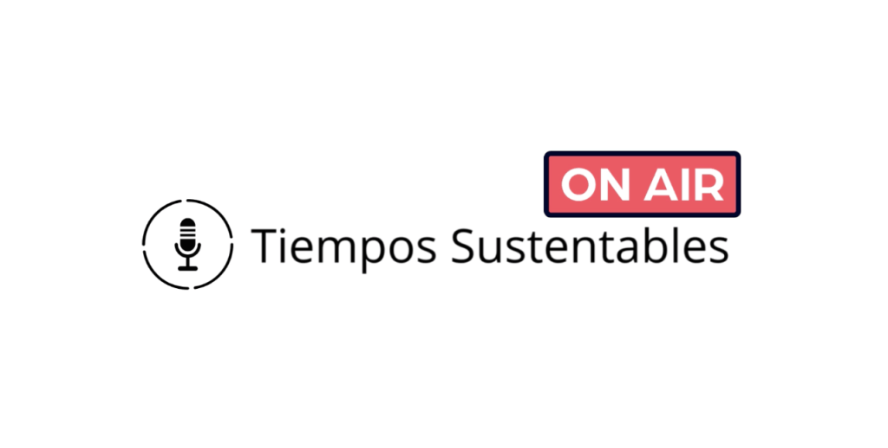

<figure>

https://youtu.be/XYrvgXs5BTo

<figcaption>

[Residuos Sanitarios: Un Desafío Sostenible para la Salud en Chile](https://tiempossustentables.cl/2025/08/05/residuos-sanitarios-un-desafio-sostenible-para-la-salud-en-chile/)

</figcaption>

</figure>

<figure>

https://youtu.be/IDQnueqEEHk?si=pFtEBTbEZxm-\_zYP

<figcaption>

[Normativas ASG en Chile, México y Brasil: Un Nuevo Enfoque](https://tiempossustentables.cl/2025/07/31/normativas-asg-en-chile-mexico-y-brasil-un-nuevo-enfoque/↗)

</figcaption>

</figure>

<figure>

https://youtu.be/q5Bz38u-Nu8

<figcaption>

[La Confianza se Gana (y se Pierde): El Verdadero Desafío de la Comunicación Sostenible](https://tiempossustentables.cl/2025/07/21/la-confianza-se-gana-y-se-pierde-el-verdadero-desafio-de-la-comunicacion-sostenible/)

</figcaption>

</figure>

<figure>

https://youtu.be/P4zxUrUePGM?si=VBYjx5Fai6Xj7f7j

<figcaption>

[Estilo de Vida Sostenible: Transformando Nuestro Futuro](https://tiempossustentables.cl/2025/07/17/estilo-de-vida-sostenible-transformando-nuestro-futuro/)

</figcaption>

</figure>

<figure>

https://youtu.be/v0GH4tbxRh8

<figcaption>

[Escasez de Agua en Santiago: Impacto en Agricultura y Abastecimiento](https://tiempossustentables.cl/2025/07/15/escasez-de-agua-en-santiago-impacto-en-agricultura-y-abastecimiento/)

</figcaption>

</figure>

<figure>

https://youtu.be/qMrTF\_Vo-iA

<figcaption>

[El Asfixiante Invierno de Santiago: Un Desafío Urgente para la Sostenibilidad](https://tiempossustentables.cl/2025/07/14/el-asfixiante-invierno-de-santiago-un-desafio-urgente-para-la-sostenibilidad/)

</figcaption>

</figure>

<figure>

https://youtu.be/Gwq13IqWq58

<figcaption>

[El Derecho a Un Medio Ambiente Limpio Una Necesidad que Inhala Esperanza](https://tiempossustentables.cl/2025/07/14/el-derecho-a-un-medio-ambiente-limpio-una-necesidad-que-inhala-esperanza/)

</figcaption>

</figure>

<figure>

https://youtu.be/qdTKfkvBfks

<figcaption>

[Chile y LatAm Liderando la Inversión Sostenible y ESG en 2025](https://tiempossustentables.cl/2025/07/16/chile-y-latam-liderando-la-inversion-sostenible-y-esg-en-2025/)

</figcaption>

</figure>

<figure>

<figcaption>

Tiempos Sustentables OnAir

</figcaption>

</figure>
