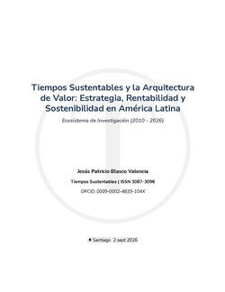

**Tiempos Sustentables y la Arquitectura de Valor:** un modelo editorial y estratégico para la creación de valor sostenible en Chile y América Latina.

## Detalles:

- **Identificador DOI:** [10.13140/RG.2.2.19546.50880](https://doi.org/10.13140/RG.2.2.19546.50880)
- **Autor:** [Jesús Patricio Blasco Valencia](https://tiempossustentables.cl/jesus-blasco/)
- **ORCID:** [https://orcid.org/0009-0002-4839-104X](https://orcid.org/0009-0002-4839-104X)
- **Publisher:** Tiempos Sustentables **ISSN:** 3087-3096
- **Página editorial:** [https://tiempossustentables.cl/arquitectura-valor/](https://tiempossustentables.cl/arquitectura-valor/)
- **PDF:** [https://commons.wikimedia.org/wiki/File:Tiempos\_Sustentables\_y\_la\_Arquitectura\_de\_Valor.pdf](https://commons.wikimedia.org/wiki/File:Tiempos_Sustentables_y_la_Arquitectura_de_Valor.pdf)
- **Fecha de publicación:** 02/09/2026
- **Repositorio:** [https://www.researchgate.net/publication/413879666\_Tiempos\_Sustentables\_y\_la\_Arquitectura\_de\_Valor/](https://www.researchgate.net/publication/413879666_Tiempos_Sustentables_y_la_Arquitectura_de_Valor/)

\[ts\_citacion\]

## Ver y Descargar PDF:

https://upload.wikimedia.org/wikipedia/commons/2/29/Tiempos\_Sustentables\_y\_la\_Arquitectura\_de\_Valor.pdf

