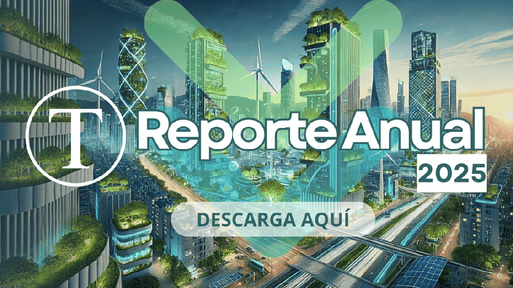

   

# Acerca de Tiempos Sustentables

ISSN 3087-3096

Somos una revista digital técnica y un ecosistema editorial especializado en sostenibilidad, ESG, finanzas sostenibles, gobernanza y transformación empresarial para Chile y Latinoamérica.

## **Nuestra Visión**

Ser una referencia digital líder en sostenibilidad e innovación en Chile y Latinoamérica, impulsando conocimiento, conciencia y acción con impacto positivo en la sociedad, la economía y el medioambiente.

## **Nuestra Misión**

Informar, educar e inspirar a profesionales y líderes empresariales a través de contenido de alta materialidad sobre marcos normativos, criterios ESG, negocios sostenibles y buenas prácticas de gobernanza.

## **Qué temas analizamos regularmente**

Nuestro rigor editorial se concentra en los pilares clave del ecosistema sostenible en Chile y LAC.

🌎

### Medioambiente y clima

Mitigación, huella de carbono, economía circular y Ley REP.

💼

### Negocios y finanzas sostenibles

Inversión ESG, materialidad financiera y rentabilidad con propósito.

🧠

### Innovación y tecnología

IA aplicada, electromovilidad y soluciones de gestión hídrica.

🌱

### Estilo de vida sustentable

Guías, herramientas y acciones cotidianas de consumo responsable.

* * *

## **Metodología de análisis: la Arquitectura de Valor**

Operamos bajo un enfoque científico-aplicado que equilibra viabilidad económica e impacto socioambiental para editorial, consultoría y servicios corporativos.

- ⚡**Cabeza Fría:** rigor estratégico y financiero, riesgos climáticos, regulación e IFRS.
- ❤️**Corazón Activo:** propósito de triple impacto conectado al núcleo del negocio.
- 🛠️**Manos Firmes:** gobernanza, control e indicadores comprobables, libres de greenwashing.

📘

Publicación destacada

### [Guía Estratégica de Negocios y Finanzas Sostenibles para el Liderazgo Comercial Latinoamericano](https://tiempossustentables.cl/arquitectura-valor/)

Obra de referencia que define conceptualmente la Arquitectura de Valor como metodología para crecimiento sostenible en Latinoamérica, integrando finanzas climáticas, rentabilidad ética y gobernanza.

## **Servicios corporativos B2B**

Traducimos sostenibilidad en oportunidades concretas de posicionamiento, inteligencia y negocio.

1️⃣

### Suscripción Corporativa B2B

Acceso continuo a reportes, cobertura y análisis normativo de finanzas sostenibles.

2️⃣

### Herramienta de Diagnóstico

Autoevaluación técnica para contrastar brechas e indicadores de sostenibilidad.

3️⃣

### Consultorías Especializadas

Aplicamos Arquitectura de Valor a nivel corporativo para impulsar rentabilidad libre de greenwashing.

[Revisa nuestro portafolio de Servicios B2B](https://tiempossustentables.cl/servicios-b2b/)

* * *

## **Sello técnico y combate al greenwashing**

**Tiempos Sustentables** posee la validación jurídica y técnica del **ISSN 3087-3096**, certificando una estructura editorial regulada y trazable.

- **Trazabilidad internacional:** cada publicación queda indexable formalmente.
- **Mitigación del greenwashing:** contenido basado en evidencia y responsabilidad de autoría.
- **Indexación corporativa y académica:** útil para decisiones, medios, universidades y compliance.

* * *

## **Ecosistema de colaboración multisectorial**

La solidez de nuestra línea editorial se potencia por vínculos y conversación continua con actores clave de sostenibilidad y gobernanza en la región.

- **Lazos estatales:** difusión técnica de políticas y normativa ambiental vigente en Chile.
- **Amplificación institucional:** colaboración con organizaciones y redes sectoriales de sostenibilidad.
- **Consejo de opinión:** participación de líderes sectoriales y autores especializados.

* * *

## **Compromiso medible con la Agenda 2030 ODS**

Articulamos contenidos y cobertura editorial con los Objetivos de Desarrollo Sostenible prioritarios para el mundo corporativo.

- **ODS 4:** educación de calidad y pensamiento sistémico.
- **ODS 8 y 9:** trabajo decente, innovación y eficiencia industrial.
- **ODS 11 y 12:** comunidades, consumo responsable y producción circular.
- **ODS 13 y 17:** acción climática y alianzas.

## **Autoridad digital en cifras**

Nuestro alcance se valida con analítica web auditada y señales de autoridad en búsqueda y motores de IA.

| Métrica clave | Impacto corporativo |
| --- | --- |
| **Visualizaciones** | Más de 15.000 impresiones mensuales. |
| **Audiencia profesional** | Más de 2.500 tomadores de decisión alcanzados al mes. |
| **Retención** | 95 segundos de tiempo medio de permanencia por sesión. |
| **Tráfico orgánico** | 30,4% del volumen total accede por buscadores. |
| **Indexación GEO/AEO** | 4,15% de la audiencia proviene de IA como Perplexity y ChatGPT. |
| **Comunidad y redes** | 2.000 suscriptores en newsletter y 6.200 profesionales en ecosistema multicanal. |

### **Transparencia activa y repositorio**

Abrimos al ecosistema corporativo nuestros indicadores y repositorio documental auditable.

[Ver Centro de Recursos](https://tiempossustentables.cl/centro-de-recursos/)

## Contactos integrados con dirección y redacción

Canales directos, verificados y transparentes para audiencias, reguladores y aliados corporativos.

[✉️ Redacción y soporte](mailto:contacto@tiempossustentables.cl) [💬 WhatsApp corporativo](https://wa.me/56962160192) [in LinkedIn institucional](https://www.linkedin.com/company/tiempos-sustentables)

## **Preguntas frecuentes FAQ**

¿Qué es Tiempos Sustentables y a qué se dedica el medio?

Tiempos Sustentables es una revista digital técnica especializada en sostenibilidad, ESG, finanzas sostenibles, gobernanza y transformación empresarial para Chile y Latinoamérica.

¿Qué valor técnico aporta contar con el Registro Internacional ISSN?

El ISSN 3087-3096 certifica una identidad única y trazable, facilitando indexación formal y reforzando responsabilidad editorial frente al greenwashing.

¿En qué consiste la metodología de la Arquitectura de Valor?

Es un enfoque que integra Cabeza Fría, Corazón Activo y Manos Firmes para balancear estrategia financiera, propósito de impacto y gobernanza verificable.

¿Cuál es el alcance digital auditado de sus publicaciones?

Registramos más de 15.000 visualizaciones mensuales, más de 2.500 usuarios profesionales al mes y 30,4% de tráfico orgánico.

¿Cómo pueden las organizaciones acceder o pautar sus servicios B2B?

Pueden acceder a suscripciones corporativas, diagnóstico o consultorías especializadas en la sección de Servicios B2B.

¿Cómo garantiza Tiempos Sustentables la credibilidad de sus métricas?

Con transparencia activa, GA4, Search Console y un repositorio documental auditable accesible al ecosistema corporativo.

¿Cuál es el foco territorial de cobertura y alcance de la revista?

Nuestra base operativa está en Santiago de Chile y la cobertura abarca Latinoamérica y el Caribe.

