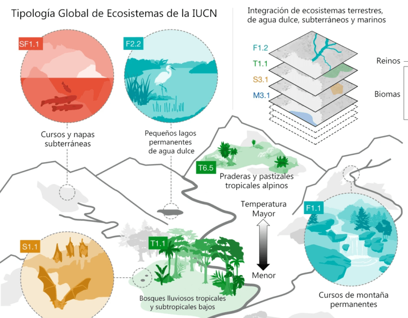

> “Las acciones cambian nuestras creencias; la regeneración exige que actuemos ahora para redefinir lo que es posible para la vida en la Tierra.”
> 
> — Paul Hawken, 2025

En un planeta afectado por la degradación ecológica, la pérdida de biodiversidad y el cambio climático, la regeneración emerge como el enfoque más completo y transformador para restaurar sistemas naturales y sociales. A diferencia de la sostenibilidad, que busca mantener el statu quo, la regeneración propone ir más allá: sanar, revitalizar y crear condiciones para que la vida prospere.

Hoy, desde proyectos locales en la Patagonia chilena hasta iniciativas globales lideradas por la FAO (Food and Agriculture Organization of the United Nations), el mundo está comenzando a transitar desde modelos extractivos hacia modelos regenerativos. Este artículo explora las bases técnicas, beneficios y desafíos de la regeneración, con testimonios y aportes de voces líderes a nivel internacional y nacional.

## ¿Qué entendemos por regeneración?

La regeneración ecológica implica restaurar la salud funcional, estructural y biológica de los ecosistemas mediante prácticas como la reforestación activa, el manejo holístico del suelo y el rediseño de paisajes humanos. Esta visión incluye, pero no se limita a:

_Mínima perturbación del suelo y el entorno. Diversidad biológica e integración de especies nativas. Cobertura vegetal permanente, que protege y regenera los suelos. Tecnología aplicada, como sensores, drones e inteligencia artificial para monitoreo de impacto._

En términos socioeconómicos, la regeneración se traduce en una **economía regenerativa**, donde los sistemas humanos producen resultados positivos para la naturaleza y la sociedad, en vez de simplemente mitigar daños.

> “Diseñar para la regeneración significa crear productos y sistemas que devuelven más de lo que consumen.”
> 
> — Janine Benyus, bióloga y fundadora del biomimetismo

## ¿Por qué es importante para el planeta?

### 1. Captura de carbono y cambio climático

La regeneración es hoy una de las estrategias más efectivas para mitigar el calentamiento global. Según la FAO, la restauración de paisajes degradados podría capturar entre 1,7 y 26 gigatoneladas de CO₂ al año, posicionándola como una solución clave para cumplir con los objetivos del Acuerdo de París.

**En Chile**, prácticas de agricultura regenerativa ya están mostrando resultados: aumentos de hasta 40 % en retención de agua y 30 % en diversidad del suelo en campos agrícolas del Maule y la Araucanía.

### 2. Recuperación de la biodiversidad

La regeneración de corredores biológicos, humedales y bosques nativos impulsa la conservación de especies, mejora la polinización y restablece servicios ecosistémicos críticos para la vida humana y silvestre.

La Plataforma Intergubernamental sobre Biodiversidad (IPBES) advirtió que la pérdida de polinizadores ha reducido la productividad agrícola global en un 23 %. Restaurar estos ecosistemas es una urgencia.

### 3. Resiliencia del suelo y seguridad alimentaria

Los suelos regenerados retienen más agua, son más fértiles y menos vulnerables a la erosión. Esto permite aumentar el rendimiento agrícola y reducir la dependencia de agroquímicos. Además, contribuyen a la soberanía alimentaria de comunidades rurales.

## Casos y tecnologías aplicadas

En 2025, la regeneración no es solo un ideal, sino una realidad apoyada por ciencia y tecnología:

[AIM4NatuRe](https://www.fao.org/newsroom/detail/fao-UK-aim4nature-to-ecosystem-restoration/es), iniciativa de la FAO lanzada este año, utiliza sensores satelitales e inteligencia artificial para monitorear la restauración de ecosistemas en más de 30 países. En Chile, el **_Dr. Alejandro Miranda_**, de la **_Universidad Austral_**, lidera investigaciones sobre restauración ecológica mediante imágenes satelitales y drones. El **_Dr. Patricio Pliscoff_**, de la **_Universidad Católica de Chile_**, desarrolló una tipología funcional de ecosistemas usada por el Estado para priorizar zonas de restauración y asignar recursos con mayor precisión.

<figure>

<figcaption>

La infografía diseñada por el Dr Pliscoff muestra la nueva tipología clasifica los ecosistemas en 10 reinos, 25 biomas y 110 grupos funcionales

</figcaption>

</figure>

> “La ecología del paisaje y el monitoreo con sensores remotos son claves para restaurar bosques nativos y ecosistemas fragmentados en Chile.”
> 
> — Dr. Alejandro Miranda, ecólogo chileno

## La economía regenerativa es posible (y rentable)

Para muchos, hablar de regeneración económica sonaba utópico hace unos años. Hoy, no. Inversionistas, gobiernos y emprendedores están comprobando su viabilidad.

> “Una economía regenerativa no es utopía; es el siguiente paso lógico. Las inversiones en 2025 están demostrando que el modelo funciona.”
> 
> — Hunter Lovins, economista ambiental

## Modelos de negocio regenerativos incluyen:

Reutilización de residuos como insumo productivo. Certificación de carbono regenerativo. Financiamiento climático basado en resultados. Gobernanza local participativa en restauración de territorios.

## Desafíos pendientes

Pese a sus avances, la regeneración enfrenta barreras importantes:

Incentivos financieros limitados para quienes adoptan prácticas regenerativas. Falta de formación técnica en sectores rurales. Fragmentación institucional en políticas públicas. Escasa integración entre ciencia, comunidades y empresas.

Sin embargo, la oportunidad es gigantesca. Proyectos como los de Patagonia Sur, en Aysén, ya están restaurando miles de hectáreas con participación comunitaria y apoyo científico.

## Conclusión: Regenerar es un acto de liderazgo

La regeneración nos desafía a repensar nuestra relación con la Tierra: no como dueños, sino como co-creadores. Es una invitación a construir economías que reparen, a cultivar suelos que nutran y a diseñar ciudades que respiren.

Como dijo el pionero industrial:

> “Tenemos una opción en este planeta hermoso: dañarlo o ayudarlo. La regeneración es nuestra responsabilidad.”
> 
> — Ray Anderson

* * *

**_En Tiempos Sustentables, creemos que regenerar es más que una estrategia: es un imperativo ético, técnico y humano. Porque sin regeneración, no hay futuro. Y sin futuro, no hay sostenibilidad._**
