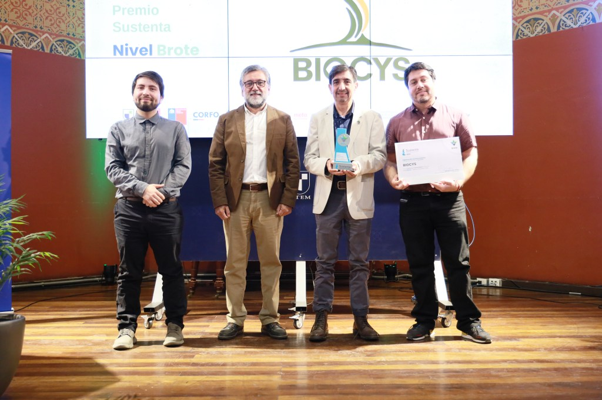
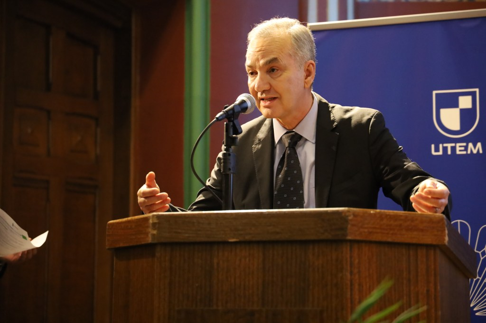
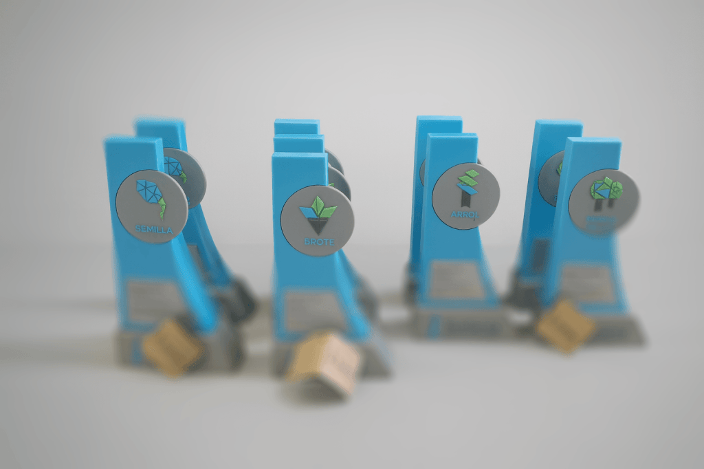
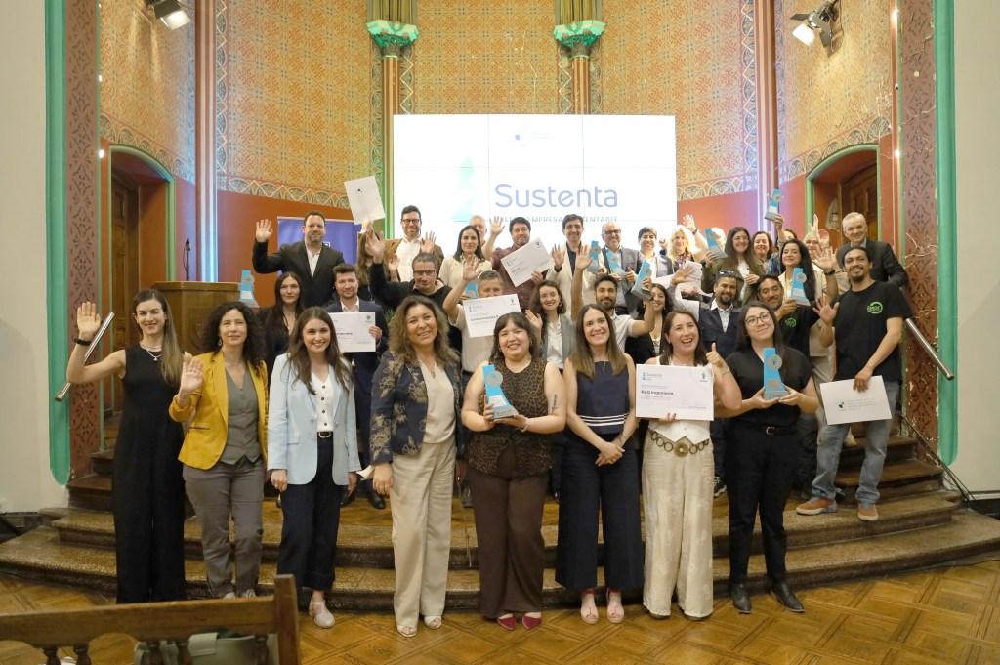

## Más que un Premio, el Barómetro del Futuro Sostenible de Chile

La octava versión del **Premio Sustenta 2025**, celebrada el pasado 27 de noviembre, ha reafirmado su rol como un evento estratégico y fundamental en el calendario corporativo chileno. Más que una ceremonia, esta iniciativa, organizada por la Universidad Tecnológica Metropolitana (**UTEM**), se consolida como el barómetro que mide, visibiliza y cataliza la transición del país hacia un nuevo paradigma empresarial.

En este nuevo ecosistema, la resiliencia y la responsabilidad social son los verdaderos vectores de competitividad. Este reportaje desglosa el significado del galardón, su notable trayectoria y, fundamentalmente, presenta a las **empresas sostenibles en Chile** que, al ser reconocidas con el **Premio Sustenta 2025**, están marcando el rumbo hacia un futuro más próspero y equitativo.

* * *

### 1\. Definiendo el Impacto: La Relevancia del Liderazgo ESG en Chile

En un ecosistema donde la **sostenibilidad empresarial** es un imperativo estratégico, se necesitan mecanismos de validación que permitan diferenciar el **liderazgo ESG** material del _greenwashing_. El **Premio Sustenta** surge como una respuesta académica y multisectorial a esta necesidad, posicionándose como una plataforma rigurosa para distinguir el compromiso genuino.

Formalmente, el **Premio Sustenta 2025** es un reconocimiento que visibiliza a **empresas sostenibles en Chile** que han integrado la sostenibilidad como pilar de su gestión. Su objetivo es identificar a organizaciones que generan impacto positivo medible basándose en el Modelo de Triple Impacto (precursor del enfoque **ESG** – Ambiental, Social y de Gobernanza), evaluando su desempeño en las dimensiones económica, social y ambiental.

_"Nuestra respuesta es clara: queremos acompañar, reconocer y visibilizar a quienes están dando pasos reales, sin importar cuán grandes o pequeños sean. Lo importante es el compromiso y la coherencia con el propósito"._

**Javiera Rocha Cortés, Directora del Programa de Sustentabilidad de la UTEM**.

Para las **empresas sostenibles en Chile** participantes, los beneficios son ventajas estratégicas tangibles, incluyendo **Visibilidad y Reconocimiento Nacional**, acceso a redes de **innovación y sostenibilidad**, y un valioso **Respaldo académico e institucional**.

* * *

### 2\. De Iniciativa Académica a Referente Nacional en Sostenibilidad

La evolución del **Premio Sustenta** es un reflejo directo de cómo ha madurado el concepto de **sostenibilidad empresarial en Chile**. Lo que nació en 2017 como una herramienta pedagógica de la **UTEM** ha crecido hasta convertirse en un referente nacional.

- **2017: Origen Pedagógico de la UTEM** Se funda el premio vinculado a la asignatura "Gestión de Calidad", enfocado inicialmente en la Región Metropolitana.

- **2018: Expansión Nacional y Alianzas** El galardón amplía su convocatoria a nivel nacional, creando una red académica con universidades como la Pontificia Universidad Católica de Valparaíso y la Universidad de Talca.

- **Consolidación del Modelo de Madurez:** La metodología evolucionó hacia el sistema de cuatro niveles: Semilla, Brote, Árbol y Bosque Nativo. Esta estructura escalonada es uno de sus mayores aciertos, ya que reconoce a la **sostenibilidad** como un camino de mejora continua, incentivando desde _startups_ hasta grandes corporaciones.

Bajo este consolidado modelo, la edición **Premio Sustenta 2025** ha distinguido a un grupo de empresas que demuestran la transversalidad y el potencial del **liderazgo sostenible**.

* * *

### 3\. Los Galardonados del Premio Sustenta 2025: Vanguardia en Economía Circular y Triple Impacto

Más allá de la metodología, el verdadero pulso del **Premio Sustenta 2025** se mide en las innovaciones de sus galardonados. Estas diez organizaciones son la vanguardia que está rediseñando la matriz productiva de Chile, demostrando que la **sostenibilidad** es el nuevo núcleo de la competitividad.

| **Nivel de Madurez** | **Empresa Galardonada** | **Impacto Clave** |
| --- | --- | --- |
| **Bosque Nativo** | **Verde Impacto** | Modelo de **economía circular** a escala local, recuperando más de 600 toneladas de residuos. |
| **Bosque Nativo** | **CCAF La Araucana** | Integra criterios **ESG** en la seguridad social, influyendo en el bienestar del 18% de la población. |
| **Árbol** | **R&Q Ingeniería** | Reducción medible de la huella de carbono y **liderazgo en equidad de género** en ingeniería. |
| **Árbol** | **Centro Inclusivo R** | Innovador modelo de triple impacto que une **inclusión laboral** con **valorización de residuos**. |
| **Brote** | **Virutex Ilko SpA** | Empresa B líder en **circularidad del plástico**, trabajando con recicladores de base. |
| **Semilla** | **Hera Materials** | Desarrolla **biomateriales compostables** que atacan el problema del plástico de un solo uso. |
| **Semilla** | **o2 Company** | Tecnología hídrica crítica que reduce la evaporación del agua hasta en 80%, clave para la **seguridad hídrica**. |

La impresionante diversidad sectorial de los ganadores es validada por un riguroso proceso de evaluación, el cual constituye el verdadero sello de confianza del **Premio Sustenta 2025**.

* * *

### 4\. El Sello de Confianza: Rigor Metodológico y Auditoría ESG de Alto Nivel

La credibilidad del **Premio Sustenta** reside en su robusta arquitectura institucional y su método de verificación, que conecta a la academia (**UTEM**) con la realidad empresarial.

La iniciativa se apoya en una red de colaboración multisectorial que incluye el **Patrocinio Gubernamental** del Ministerio de Economía, el Ministerio del Medio Ambiente, CORFO y la Agencia de Sustentabilidad y Cambio Climático.

Su elemento más distintivo es el modelo de **auditoría realizado por estudiantes**. Alumnos de la **UTEM** son capacitados y certificados por la consultora global **EY (Ernst & Young)** para auditar a las empresas, inyectando estándares de verificación comercial de alto nivel en un proceso académico. Este mecanismo de doble dividendo forma capital humano avanzado en **auditoría ESG** y provee a las PYMEs de una evaluación de materialidad sin costo.

* * *

## El Premio Sustenta, Sembrando el Liderazgo Sostenible

El **Premio Sustenta 2025** trasciende su rol como un reconocimiento anual para consolidarse como un motor de transformación que impulsa a las **empresas sostenibles en Chile** a ser más competitivas, resilientes y responsables. Al validar a quienes lideran el cambio, establece un estándar de excelencia que inspira a todo el ecosistema.

El mensaje de los galardonados es inequívoco: la **sostenibilidad empresarial** ha dejado de ser un nicho para convertirse en el núcleo de la estrategia de negocio del siglo XXI. Es aplicable y rentable en todos los sectores, y accesible para organizaciones de todos los tamaños.

Iniciativas como el **Premio Sustenta UTEM** son cruciales para acelerar la transición de Chile hacia un desarrollo verdaderamente sostenible.

* * *

## NOTA DE PRESNSA EXCLUSIVA ENVIADA POR NUESTRO ALIADO GROWBETTER.AGENCY

[Premio Sustenta UTEM\_ Historia y Ganadores](https://tiempossustentables.cl/wp-content/uploads/2025/11/premio-sustenta-utem_-historia-y-ganadores.pdf)[Descarga](https://tiempossustentables.cl/wp-content/uploads/2025/11/premio-sustenta-utem_-historia-y-ganadores.pdf)

### **Premio Sustenta 2025 reconoce a 10 empresas que impulsan la transición hacia un Chile más sustentable**

La Universidad Tecnológica Metropolitana (UTEM) realizó, durante la mañana del jueves 27 de noviembre, una nueva edición del Premio Sustenta, instancia que destaca a empresas y organizaciones que han incorporado la sustentabilidad como parte central de su gestión y de su relación con los territorios. En esta octava versión, fueron reconocidas 10 compañías de distintas regiones, agrupadas en los niveles Semilla, Brote, Árbol y Bosque Nativo, según su grado de avance y madurez en prácticas de sustentabilidad.

El premio evalúa a las organizaciones en aspectos ambientales, sociales, económicos y de gobernanza, con énfasis en cómo sus procesos, productos y decisiones impactan en comunidades, ecosistemas y cadenas de valor.

### **Nivel Bosque Nativo**

Empresas con mayor desarrollo en estrategias de sustentabilidad y un impacto territorial consolidado.

#### **Verde Impacto**

Empresa nacida en La Araucanía que hoy opera entre Santiago y Valdivia, dedicada al manejo de residuos orgánicos e inorgánicos. Ha recuperado más de 600 toneladas y acompaña a más de 500 hogares y empresas en procesos de reciclaje y compostaje. Su trabajo comunitario y educativo ha permitido instalar prácticas circulares en diversos territorios. Su meta es alcanzar la carbono neutralidad en 2030.

#### **CCAF La Araucana**

Caja de compensación con presencia nacional que integra criterios de sustentabilidad en su propósito institucional. Su estrategia al 2030 incorpora bienestar social, reducción de desigualdades, gestión eficiente y estándares ESG en sus procesos. Su alcance sobre el 18% de la población afiliada la posiciona como un actor relevante en el sistema de seguridad social.

### **Nivel Árbol**

Organizaciones con estrategias claras de sustentabilidad y resultados demostrables.

#### **R&Q Ingeniería**

Consultora con casi cinco décadas de trayectoria, presente en minería, energía, infraestructura y transporte. Ha reducido en un 10% su huella de carbono al 2024, implementando medidas de eficiencia hídrica, electrificación y tecnologías de menor impacto. Además, ha sido reconocida por su avance en equidad de género y liderazgo femenino en cargos de alta responsabilidad.

#### **Centro Inclusivo R**

Modelo que une economía circular con inclusión laboral, incorporando a personas con discapacidad cognitiva en procesos de recolección, segregación y valorización de residuos. Opera en más de 80 organizaciones y ha generado empleo protegido para más de 40 personas. Su expansión a Antofagasta en 2024 fortaleció su impacto regional y su contribución al triple impacto: ambiental, social y económico.

### **Nivel Brote**

Empresas que avanzan sostenidamente hacia modelos de gestión más sustentables, integrando innovación y mejoras continuas.

#### **Biocys**

Consultora ambiental con más de una década de trayectoria en restauración ecológica. Diseña e implementa planes de rehabilitación de ecosistemas degradados y conserva suelos y recursos hídricos, combinando ciencia y soluciones basadas en la naturaleza. Ha sido reconocida internacionalmente en los Premios Latinoamérica Verde.

#### **Inchalam S.A.**

Empresa líder en la producción de alambres y derivados del acero. Ha incorporado criterios de sustentabilidad en su cadena de producción, con mejoras en eficiencia energética, procesos más limpios y un enfoque territorial en los sectores donde opera, como minería, construcción y acuicultura.

#### **Virutex Ilko SpA**

Compañía multilatina certificada como Empresa B. Ha impulsado la economía circular del plástico mediante productos fabricados con materiales reciclados, reciclables, vegetales o compostables. Trabaja junto a recicladores de base y redes locales en iniciativas de circularidad y reducción de residuos.

### **Nivel Semilla**

Empresas emergentes que desarrollan soluciones innovadoras para desafíos urgentes del país.

#### **Hera Materials**

Startup con presencia en Chile y EE.UU. que desarrolla biomateriales compostables para reemplazar el plástico de un solo uso. Su film biobasado WoodPack utiliza manufactura distribuida con emisiones netas cero, impulsando cadenas productivas más limpias y responsables.

#### **o2 Company**

Empresa de tecnología hídrica que creó un aditivo biodegradable capaz de reducir la evaporación del agua hasta en 80% mensual. Su solución tiene aplicaciones directas en agricultura, minería y sistemas de almacenamiento, aportando eficiencia en un contexto de creciente escasez hídrica.

#### **Trotter Industrial**

Empresa centenaria que está transformando su oferta hacia productos de menor impacto ambiental. Su línea de sistemas de calentamiento y almacenamiento de agua está siendo rediseñada para mejorar durabilidad, reparabilidad y eficiencia bajo criterios de economía circular.

### **Una articulación que conecta educación, empresas y territorio**

El Premio Sustenta cuenta con el respaldo del Ministerio de Economía, Ministerio del Medio Ambiente, Corfo, la Agencia de Sustentabilidad y Cambio Climático, la Agencia de Sostenibilidad Energética y MetaRed Universia, además de la colaboración de la Universidad de Los Lagos, la Universidad Católica de Temuco, la Consultora Kellun y Diario Sustentable.

La UTEM destacó el rol de sus estudiantes auditores, quienes aplican la metodología de evaluación en terreno y fortalecen su formación profesional vinculándose directamente con empresas y comunidades.  
Más información sobre el Premio Sustenta y las empresas reconocidas en la edición 2025 está disponible en: **sustenta.utem.cl**

* * *

- <figure>
    
    
    
    <figcaption>
    
    Premio Sustenta UTEM
    
    </figcaption>
    
    </figure>
    
- <figure>
    
    
    
    <figcaption>
    
    Premio Sustenta UTEM
    
    </figcaption>
    
    </figure>
    
- <figure>
    
    
    
    <figcaption>
    
    Premio Sustenta UTEM
    
    </figcaption>
    
    </figure>
    
- <figure>
    
    
    
    <figcaption>
    
    Premio Sustenta UTEM
    
    </figcaption>
    
    </figure>
    
- <figure>
    
    
    
    <figcaption>
    
    Premio Sustenta UTEM
    
    </figcaption>
    
    </figure>
    

* * *

