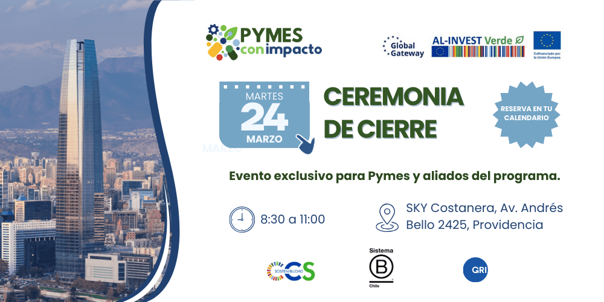
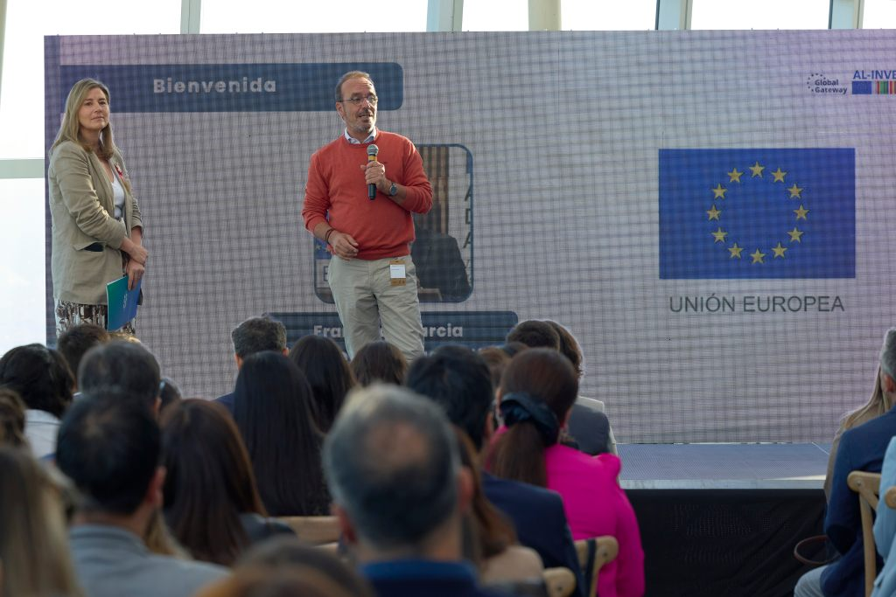
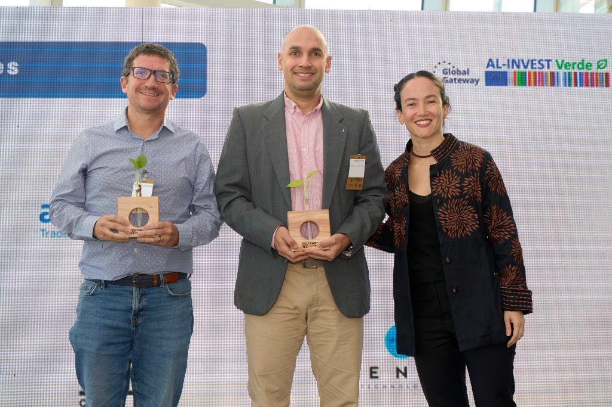
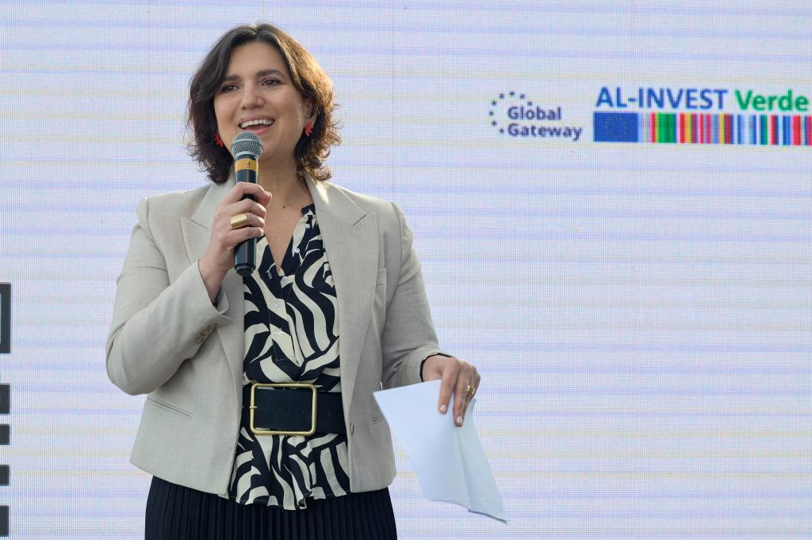
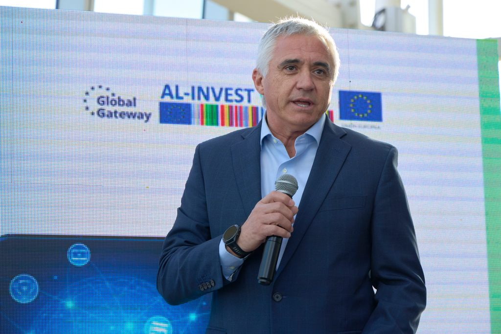
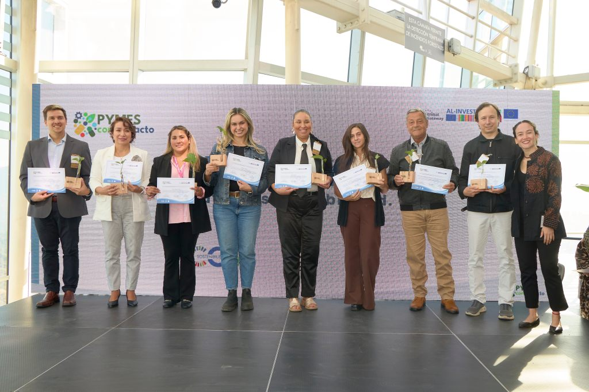
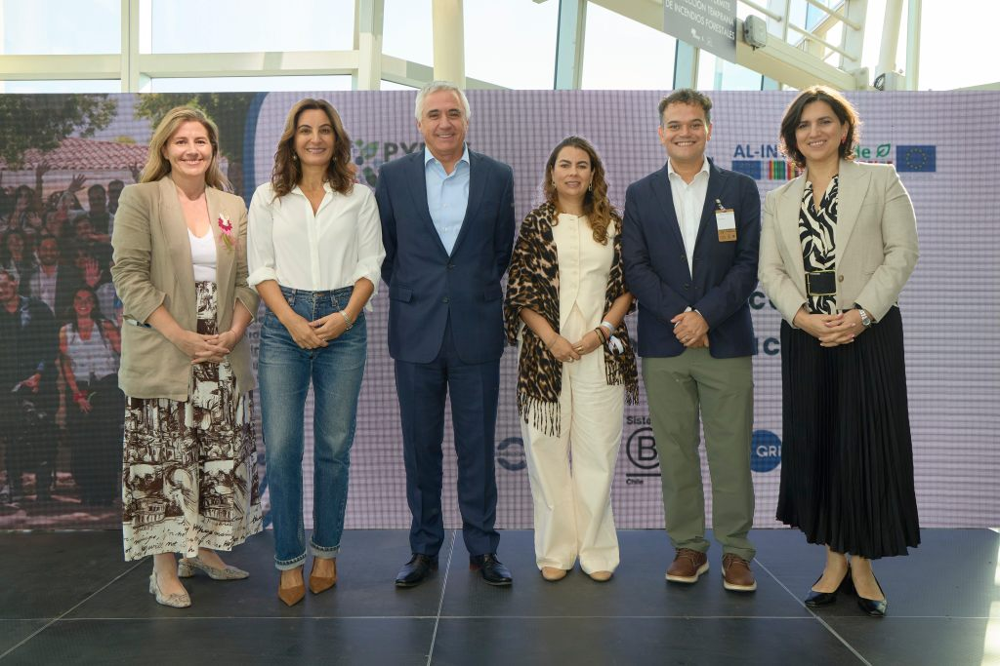
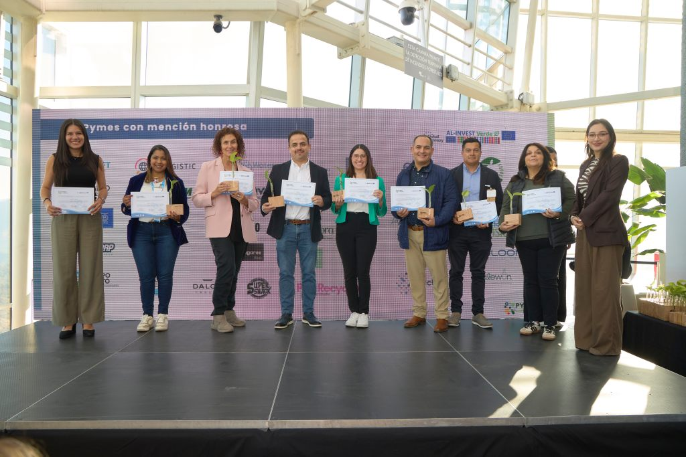
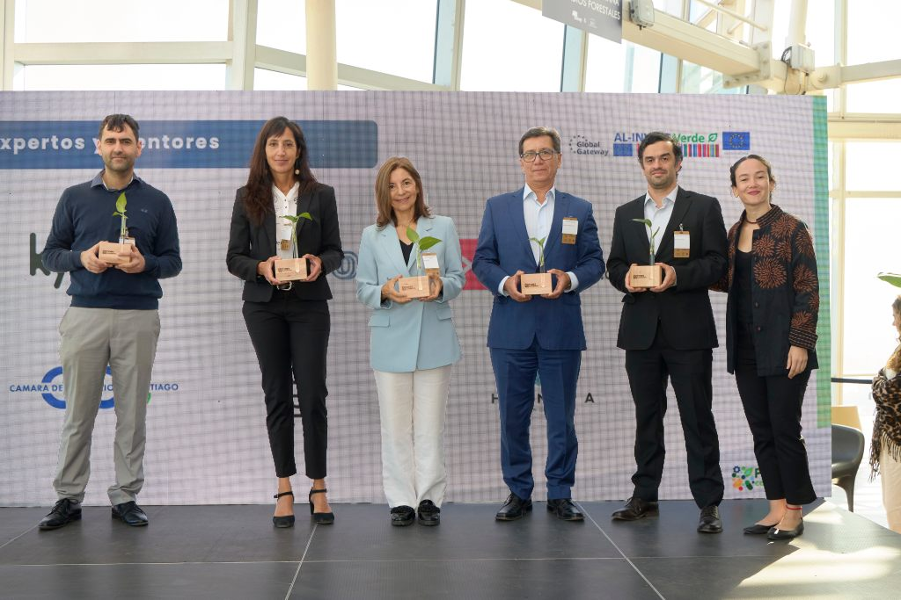
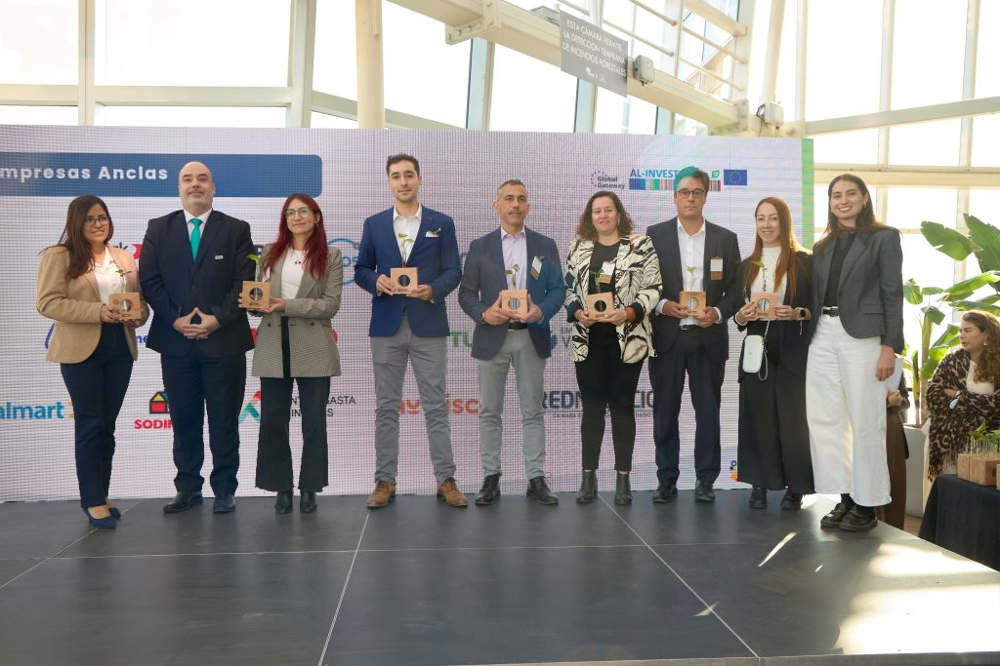

```
Noticia actualizada el 28 de marzo, incluyendo el Comunicado oficial y las Fotografías del evento de cierre.
```

El programa **Pymes con Impacto**, impulsado por la **Cámara de Comercio de Santiago (CCS)**, **Sistema B** y **GRI**, llega a su fin este _martes 24 de marzo_ con un evento exclusivo de cierre en el _SKY Costanera_. La iniciativa, apoyada por la Unión Europea a través de **AL-INVEST** **Verde** y la iniciativa **Global Gateway**, entregó una ruta práctica para que cientos de empresas chilenas de menor tamaño adopten **criterios ASG** (Ambientales, Sociales y de Gobernanza) y se conviertan en proveedores sostenibles altamente competitivos en el mercado actual.

## **Logros y Resultados: De proveedor tradicional a aliado estratégico**

La transformación de las pequeñas y medianas empresas chilenas ha dejado resultados transaccionales tangibles. Los espacios de _networking_ y ruedas de negocio permitieron conexiones directas con grandes empresas compradoras.

Esta evolución valida la tendencia estructural para proveer a las grandes marcas de la industria; demostrar transparencia y gestión ética mediante criterios ASG (Ambientales, Sociales y de Gobernanza) es ahora una obligación ineludible.

* * *

**Verónica Torres, Gerente de Sostenibilidad de la Cámara de Comercio de Santiago (CCS)**, explica que el éxito de la metodología radica en _"bajar la teoría a la práctica, entregando atributos concretos que permiten a las Pymes chilenas no solo cumplir con una exigencia, sino descubrir nuevas oportunidades de crecimiento y eficiencia en mercados que requieren cada vez más trazabilidad de su cadena de valor"_.


* * *

## **El gran hito desde las alturas de Santiago**

Para celebrar a quienes navegaron con éxito este proceso de formación y reporte de indicadores, se realizará una ceremonia oficial de cierre. De acuerdo con la convocatoria oficial del programa, los detalles del encuentro son los siguientes:

- **Fecha:** Martes 24 de marzo.

- **Horario:** 08:30 a 11:00 horas.

- **Lugar:** SKY Costanera (Av. Andrés Bello 2425, Providencia).

- **Asistencia:** Evento exclusivo para Pymes y aliados del programa.

Este espacio en las alturas está diseñado para fomentar el _networking_ y otorgar una distinción pública a los negocios que demostraron que su operación busca un impacto positivo tanto en sus comunidades como en el medio ambiente.

* * *

## **Hacia una nueva comunidad de impacto empresarial**

Las organizaciones articuladoras detrás del programa _**—CCS Sostenibilidad, Sistema B Chile y GRI—**_ coinciden en el enorme valor a largo plazo de este hito.

**Lina Camargo, Senior Manager Latin America Network del GRI,** destaca: _"Estamos muy felices de cerrar este ciclo viendo cómo las Pymes han respondido con tanto compromiso. Lograr que se familiaricen con estándares internacionales de manera positiva es un paso gigante, ya que les da la confianza necesaria para demostrar que su operación es responsable"_.


* * *

En la misma línea, **Zdenka Astudillo, Directora Ejecutiva de Sistema B Chile**, reflexiona sobre el legado estructural de la iniciativa: _"Este ciclo marca un hito en la creación de una comunidad donde el propósito es el motor de la innovación. Celebramos que hoy existan más empresas capaces de liderar una transformación económica que ponga el bienestar de las personas y el planeta en el centro"_.


* * *

## Invitación - Cierre Programa Pymes con Impacto

[Comunicado cierre del programa](https://tiempossustentables.cl/wp-content/uploads/2026/03/Comunicado-cierre-del-programa-.pdf)[Descarga](https://tiempossustentables.cl/wp-content/uploads/2026/03/Comunicado-cierre-del-programa-.pdf)

<figure>



<figcaption>

Invitación cierre Pymes con Impacto

</figcaption>

</figure>

**Desde el equipo editorial de _Tiempos Sustentables_, reconocemos que Pymes con Impacto deja a Chile con una sólida base instalada de capacidades técnicas, abriendo paso a un pujante ecosistema de proveedores conscientes y preparados para liderar los desafíos regulatorios de los próximos años.**

* * *

## Comunicado oficial de cierre - Pymes con Impacto

[Comunicado de prensa cierre de Pymes con Impacto (1) (1)](https://tiempossustentables.cl/wp-content/uploads/2026/03/Comunicado-de-prensa-cierre-de-Pymes-con-Impacto-1-1.pdf)[Descarga](https://tiempossustentables.cl/wp-content/uploads/2026/03/Comunicado-de-prensa-cierre-de-Pymes-con-Impacto-1-1.pdf)

## Fotografías del evento de cierre - Pymes con Impacto




















* * *
