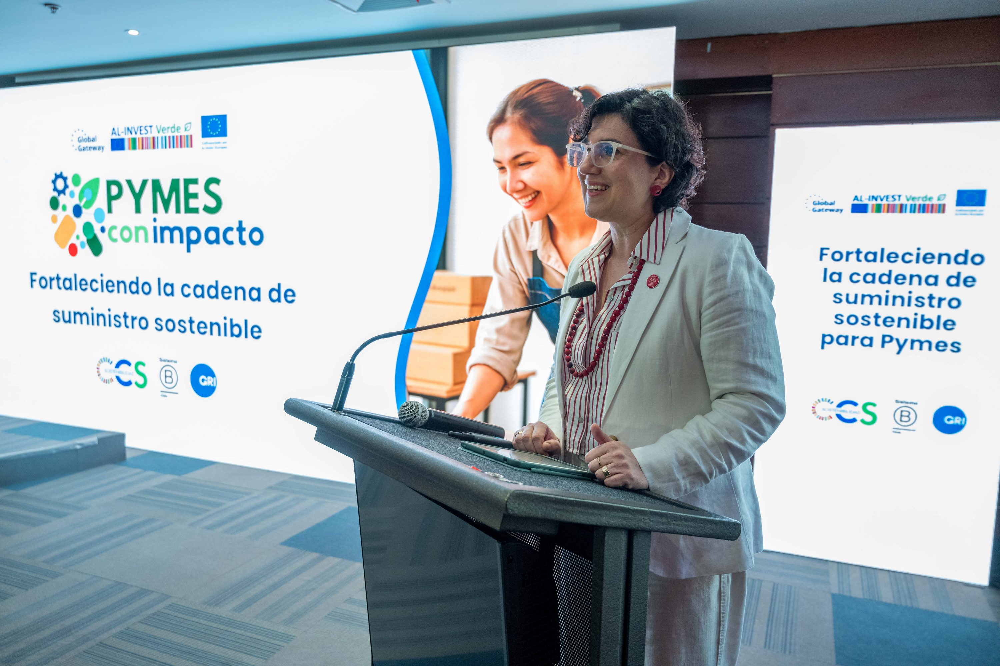
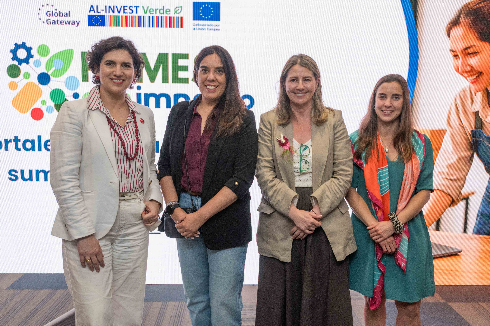
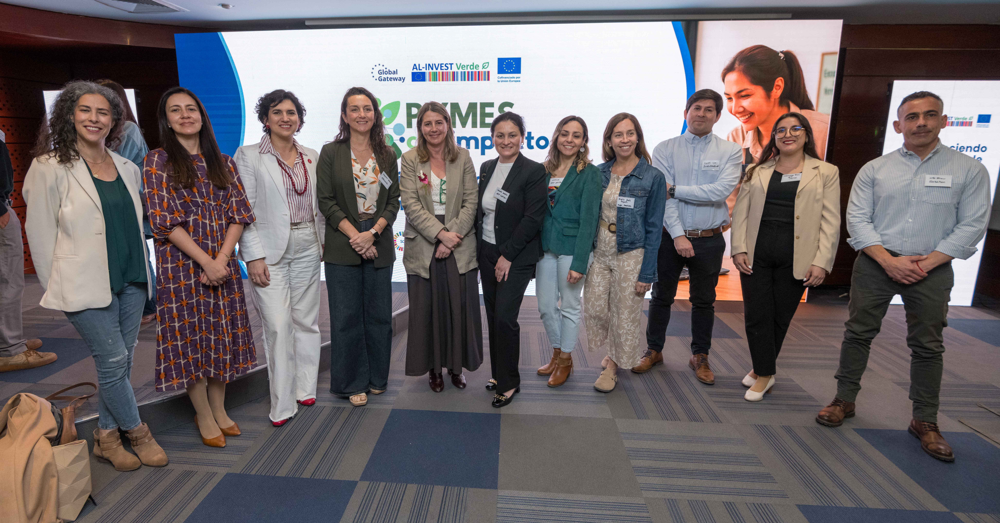
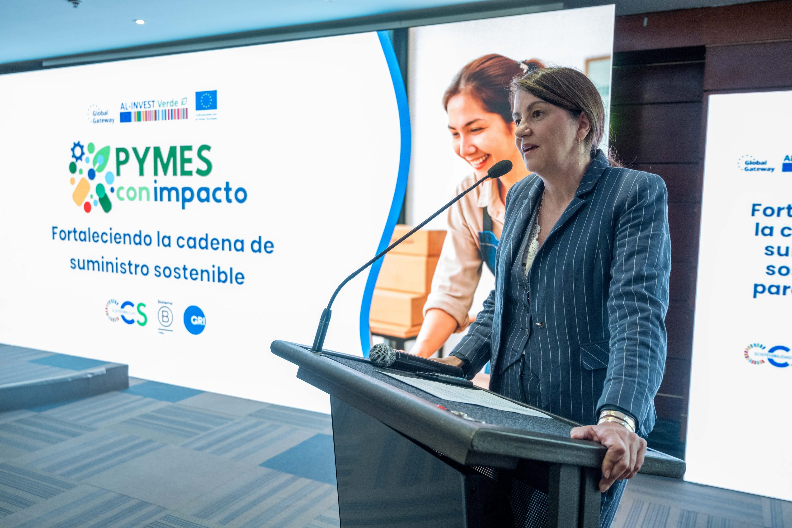
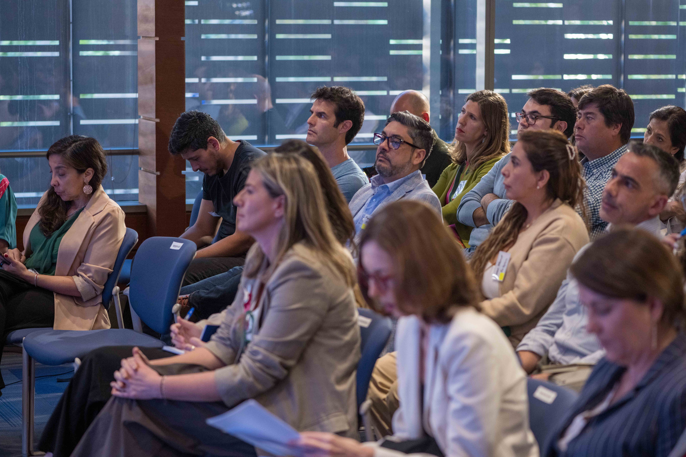
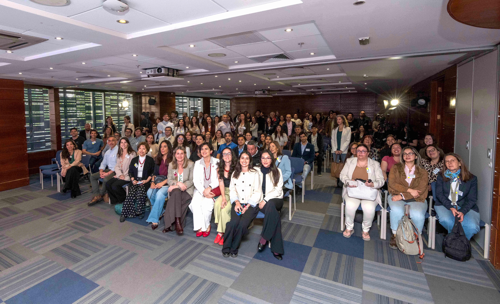
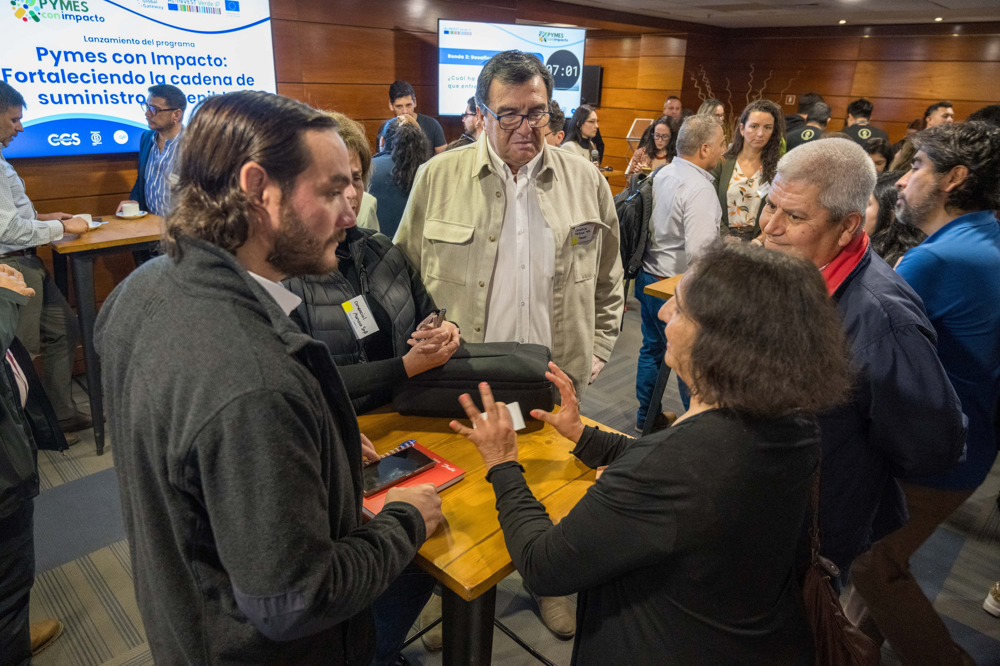
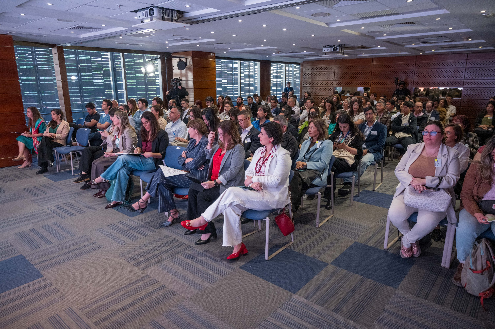
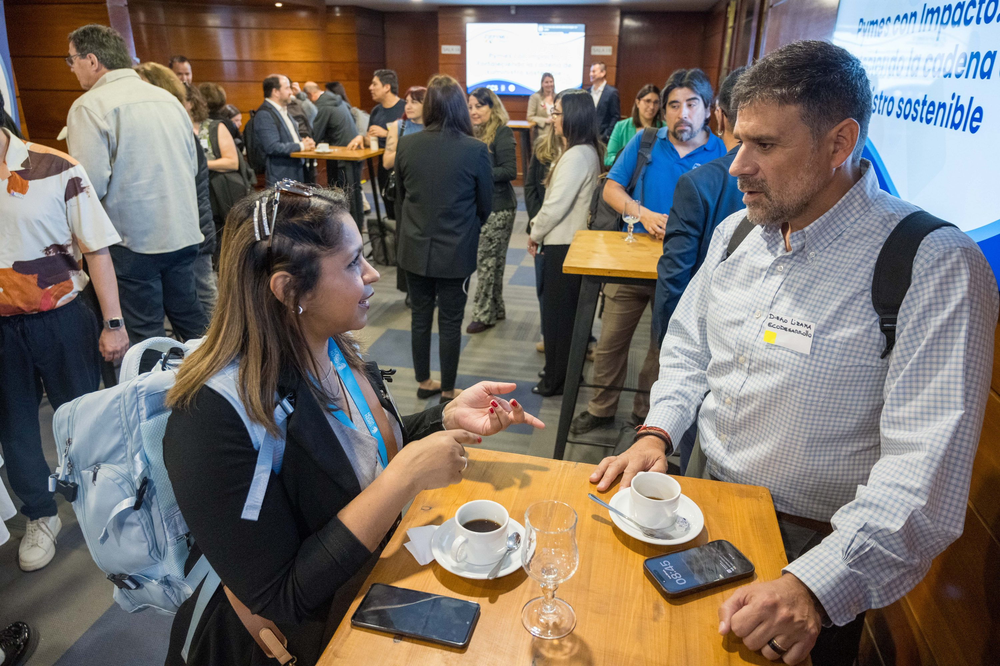
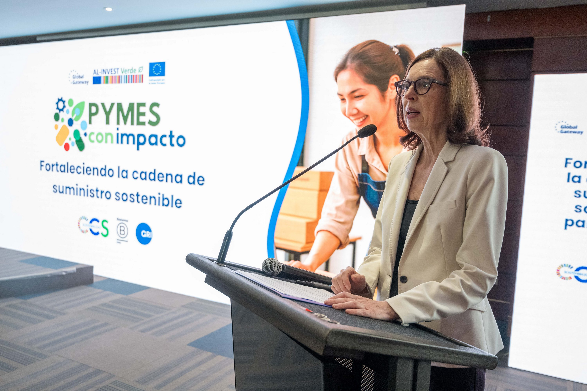

**El programa busca integrar a las Pymes chilenas en cadenas de suministro más responsables y competitivas.**

Este 20 de octubre se realizó el lanzamiento oficial de **Pymes con Impacto**, un programa que apunta a fortalecer las capacidades **Ambientales**, **Sociales** y de **Gobernanza** (ASG) de las pequeñas y medianas empresas en Chile, promoviendo su integración a cadenas de suministro sostenibles y alineadas con estándares internacionales.

La iniciativa es ejecutada por la **Cámara de Comercio de Santiago (CCS)**, **Global Reporting Initiative (GRI)** y **Sistema B Chile**, con el financiamiento de la **Unión Europea** a través del programa **AL-INVEST Verde**.

El evento, realizado en la sede de la CCS, reunió a más de 100 asistentes presenciales y 80 participantes en línea, entre representantes de Pymes, grandes empresas mandantes, autoridades y aliados estratégicos. La jornada comenzó con un espacio de **networking**, donde las empresas pudieron conectar, compartir experiencias e identificar oportunidades de colaboración en sostenibilidad.

Durante la apertura, **Claudia Gintersdorfer**, Embajadora de la Unión Europea en Chile, destacó el compromiso del bloque europeo con el desarrollo sostenible y señaló: “Estoy convencida de que el programa de formación Pymes con Impacto, que hoy inauguramos, tendrá un papel clave en el fortalecimiento de las Pymes y en el impulso a la transición verde”.

Por su parte, **Zdenka Astudillo**, Directora Ejecutiva de Sistema B Chile, enfatizó que esta iniciativa “representa una oportunidad para que más empresas descubran el valor de la economía con impacto y se inspiren en el modelo del Movimiento B, que demuestra que cuando las empresas actúan con propósito y de manera colectiva, generan cambios reales en sus comunidades y en el planeta”.

La jornada también incluyó la presentación **“Tendencias globales en cadenas de suministro”**, a cargo de **Jimena Sánchez**, Network Representative Latin America de Amfori, quien abordó los desafíos y nuevas exigencias de sostenibilidad que las grandes empresas están aplicando a sus proveedores.

Finalmente, **Verónica Torres**, Gerente de Sostenibilidad de la CCS, presentó la plataforma del programa, que permitirá a las Pymes **evaluar su desempeño** en sostenibilidad y acceder a un ciclo de **formación práctica** para fortalecer sus capacidades ASG. Durante su intervención, subrayó que “la fortaleza de una cadena depende muchas veces del eslabón más débil. Por eso, es fundamental que las Pymes puedan adoptar herramientas que les permitan avanzar hacia una gestión más sostenible, competitiva y con mayores oportunidades de participación”.

A la fecha, **más de 250 Pymes de todo Chile** ya se han sumado al desafío de fortalecer su sostenibilidad y competitividad a través del programa. Si tu empresa también quiere ser parte de esta red de **Pymes con Impacto**, regístrate en [www.pymesconimpacto.cl](http://www.pymesconimpacto.cl).

- <figure>
    
    
    
    <figcaption>
    
    Pymes con Impacto
    
    </figcaption>
    
    </figure>
    
- <figure>
    
    
    
    <figcaption>
    
    Pymes con Impacto
    
    </figcaption>
    
    </figure>
    
- <figure>
    
    
    
    <figcaption>
    
    Pymes con Impacto
    
    </figcaption>
    
    </figure>
    
- <figure>
    
    
    
    <figcaption>
    
    Pymes con Impacto
    
    </figcaption>
    
    </figure>
    
- <figure>
    
    
    
    <figcaption>
    
    Pymes con Impacto
    
    </figcaption>
    
    </figure>
    
- <figure>
    
    
    
    <figcaption>
    
    Pymes con Impacto
    
    </figcaption>
    
    </figure>
    
- <figure>
    
    
    
    <figcaption>
    
    Pymes con Impacto
    
    </figcaption>
    
    </figure>
    
- <figure>
    
    
    
    <figcaption>
    
    Pymes con Impacto
    
    </figcaption>
    
    </figure>
    
- <figure>
    
    
    
    <figcaption>
    
    Pymes con Impacto
    
    </figcaption>
    
    </figure>
    
- <figure>
    
    
    
    <figcaption>
    
    Pymes con Impacto
    
    </figcaption>
    
    </figure>
    

[Minuta Ejecutiva Pymes con Impacto (1)](https://tiempossustentables.cl/wp-content/uploads/2025/10/minuta-ejecutiva-pymes-con-impacto-1.pdf)[Descarga](https://tiempossustentables.cl/wp-content/uploads/2025/10/minuta-ejecutiva-pymes-con-impacto-1.pdf)
