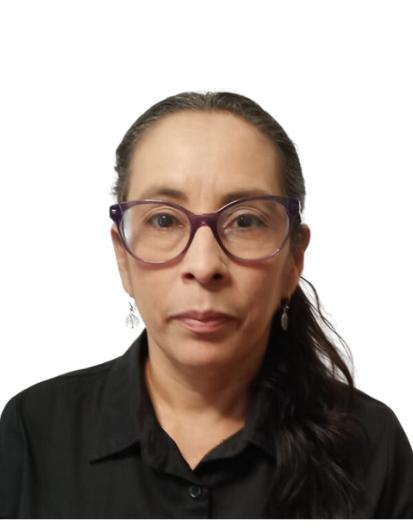

El trabajo doméstico y de cuidados no remunerado constituye una columna vertebral invisible para el funcionamiento de nuestras sociedades. Abarca una amplia gama de actividades que van desde el cuidado de niños, personas mayores y personas con discapacidad, hasta tareas como cocinar, limpiar y mantener el hogar. A pesar de ser indispensable para sostener la vida y el bienestar colectivo, este trabajo ha sido tradicionalmente desvalorizado y relegado a un espacio privado, considerado “responsabilidad natural” de las mujeres. Según datos de ONU Mujeres (s.f.), las mujeres dedican al menos tres veces más tiempo que los hombres a estas labores, lo que limita sus oportunidades económicas, educativas y políticas.

Esta desigualdad en la distribución del trabajo de cuidados no remunerado contribuye directamente a la persistencia de brechas de género en diversos ámbitos, desde la participación laboral hasta la acumulación de ingresos y patrimonio. La ausencia de reconocimiento y apoyo social a estas tareas invisibiliza la contribución fundamental que realizan millones de mujeres y personas cuidadoras en todo el mundo. En respuesta a esta realidad, el 22 de julio se conmemora el Día Internacional del Reconocimiento del Trabajo Doméstico y de Cuidados No Remunerado. Esta fecha tiene sus orígenes en los movimientos feministas y de trabajadoras del hogar de América Latina desde los años 80, que exigieron visibilizar y dignificar esta labor para lograr condiciones laborales justas y un reconocimiento social efectivo.

El papel de las empresas es crucial para avanzar en la construcción de sociedades más equitativas que reconozcan y apoyen el trabajo de cuidados. En un contexto donde las mujeres continúan enfrentando una doble jornada laboral, la participación responsable del sector privado en la creación de políticas y entornos de trabajo flexibles puede marcar una diferencia significativa. Por ejemplo, la implementación de horarios flexibles o la opción de teletrabajo permiten a las personas cuidadoras organizar mejor sus tiempos y atender sus responsabilidades familiares sin sacrificar su desarrollo profesional. Además, licencias parentales extendidas y permisos para el cuidado de familiares enfermos promueven una cultura de corresponsabilidad en la que tanto hombres como mujeres participan activamente en las tareas de cuidado, desafiando así los roles tradicionales de género.

Un informe conjunto de la Organización Internacional del Trabajo (OIT) y ONU Mujeres (s.f.) destaca que las empresas que incorporan políticas de apoyo al trabajo de cuidados no solo promueven la igualdad de género, sino que también experimentan mejoras en la productividad, el compromiso y la retención del talento. Estos beneficios se traducen en un ambiente laboral más saludable y sostenible, que favorece la innovación y el bienestar general de las personas colaboradoras. De esta manera, apoyar el trabajo de cuidados no es solo una cuestión de justicia social, sino una estrategia inteligente para el éxito organizacional.

No obstante, los retos siguen siendo grandes. La falta de servicios públicos de cuidado accesibles y asequibles, sumada a las persistentes normas sociales que asignan estas labores a las mujeres, perpetúan la desigualdad y dificultan la participación plena de las mujeres en la vida económica y pública. La creación de sistemas nacionales de cuidados, que involucren a gobiernos, empresas y comunidades, se convierte en una prioridad para enfrentar estos desafíos estructurales. En este sentido, el sector privado puede ser un aliado fundamental no solo adoptando buenas prácticas internas, sino también promoviendo políticas públicas y alianzas que fortalezcan la red de apoyos para las personas cuidadoras.

Además, la pandemia de COVID-19 evidenció aún más la carga invisible del trabajo de cuidados, aumentando significativamente el tiempo dedicado a estas tareas y afectando de manera desproporcionada a las mujeres. Este contexto puso de manifiesto la urgencia de implementar medidas que reconozcan y valoren el trabajo de cuidados, así como de fortalecer los sistemas de protección social y las redes comunitarias que apoyan esta labor.

En conclusión, el reconocimiento y la valorización del trabajo doméstico y de cuidados no remunerado es una responsabilidad compartida que debe involucrar a todos los sectores de la sociedad. Las empresas, como actores clave en la economía y la cultura laboral, tienen la oportunidad y el deber de contribuir activamente a la redistribución y reconocimiento del trabajo de cuidados. Adoptar políticas inclusivas y corresponsables no solo favorece la igualdad de género y la justicia social, sino que también fortalece la sostenibilidad y competitividad organizacional. Solo así avanzaremos hacia sociedades más justas, saludables y resilientes, donde el cuidado sea un compromiso colectivo y valorado en igualdad de condiciones.

## Referencias

- ONU Mujeres. (s.f.). Trabajo no remunerado y cuidados. Recuperado de [https://www.unwomen.org/es/what-we-do/economic-empowerment/facts-and-figures](https://www.unwomen.org/es/what-we-do/economic-empowerment/facts-and-figures)

- Organización Internacional del Trabajo. (s.f.). La igualdad de género en el trabajo de cuidados. Recuperado de [https://www.ilo.org/es/temas-y-sectores/economia-del-cuidado](https://www.ilo.org/es/temas-y-sectores/economia-del-cuidado)

**Erika Alvarez Velásquez**

Máster en derechos humanos y educación para la paz y especialista en género y desarrollo  sostenible.
