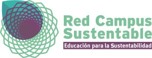
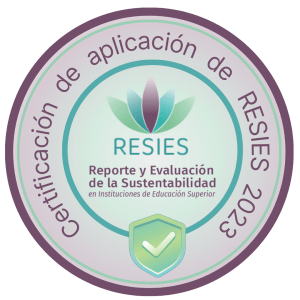

En un movimiento clave para acelerar la transición hacia un futuro más sostenible, la **Red Campus Sustentable**, principal consorcio de instituciones de educación superior comprometidas con la sostenibilidad en Latinoamérica, y **Tiempos Sustentables**, plataforma líder en comunicación sobre innovación y sostenibilidad, anuncian hoy una alianza comunicacional estratégica.

Este acuerdo busca unir la experiencia y el conocimiento académico de la Red con la capacidad de difusión y el alcance de Tiempos Sustentables, creando una poderosa sinergia para visibilizar, inspirar y multiplicar las iniciativas de sostenibilidad que están transformando los campus de educación superior y formando a los líderes que el planeta necesita.

### **Red Campus Sustentable: Una Década Transformando la Educación Superior**

Desde su fundación en 2012, la Red Campus Sustentable ha sido un actor fundamental en la integración de la sostenibilidad en el ADN de la educación superior chilena. Compuesta por **43 instituciones socias**, entre universidades, institutos profesionales y centros de formación técnica que representan a más del 60% de las matrículas de Chile, la Red ha trabajado incansablemente para crear una cultura de sostenibilidad a través de la formación, la colaboración y el desarrollo de herramientas innovadoras.

Su labor se materializa en programas pioneros como el **Reporte y Evaluación de la Sustentabilidad en Instituciones de Educación Superior (RESIES)**, un sistema de evaluación que permite a las instituciones medir y avanzar en su desempeño en áreas como gobernanza, cultura, docencia, investigación y gestión de campus. Asimismo, la Red ha impulsado los **Acuerdos de Producción Limpia (APL) "Campus Sustentable"**, junto a la Agencia de Sustentabilidad y Cambio Climático a las instituciones que alcanzan altos estándares de gestión ambiental y social.

### **Oportunidades de la Alianza: Sinergia para un Futuro Sostenible**

La colaboración entre Red Campus Sustentable y Tiempos Sustentables abre un abanico de oportunidades para potenciar el impacto de la sostenibilidad en la sociedad.

#### **1\. Amplificando el Conocimiento y la Acción Climática**

Tiempos Sustentables se convertirá en un altavoz estratégico para las iniciativas, estudios y logros de la Red y sus instituciones miembros. Esto permitirá que el valioso conocimiento generado en la academia, como los resultados agregados del reporte RESIES, llegue a una audiencia más amplia de profesionales, tomadores de decisión y ciudadanos comprometidos, fomentando una mayor comprensión sobre el rol crucial de las instituciones de educación superior en la acción climática.

#### **2\. Contenido de Vanguardia para una Audiencia Comprometida**

Para los lectores de Tiempos Sustentables, esta alianza significa acceso privilegiado a contenido de vanguardia y de alta credibilidad. Se visibilizarán casos de éxito, innovaciones en campus sustentables, investigaciones de frontera y perfiles de los profesionales y académicos que están liderando la transformación. Desde la gestión hídrica en un campus hasta la integración de los Objetivos de Desarrollo Sostenible (ODS) en las mallas curriculares, las historias de la Red enriquecerán la oferta informativa de la plataforma.

#### **3\. Formando a los Líderes del Mañana**

El objetivo final de esta sinergia es inspirar y empoderar. Al dar a conocer las mejores prácticas y el compromiso del mundo académico, se busca no solo motivar a más instituciones a sumarse al camino de la sostenibilidad, sino también fortalecer la formación de los estudiantes, quienes serán los futuros profesionales y líderes encargados de implementar los cambios que nuestra sociedad y economía requieren.

### **Un Futuro Colaborativo por la Sostenibilidad**

Esta alianza es más que un acuerdo de difusión; es un compromiso compartido por un objetivo común: acelerar la transición de Chile hacia un modelo de desarrollo que sea socialmente justo, ambientalmente responsable y económicamente viable.

A través de reportajes en profundidad, entrevistas a expertos, columnas de opinión y cobertura de eventos, Tiempos Sustentables y Red Campus Sustentable trabajarán de la mano para posicionar la sostenibilidad como un pilar estratégico de la educación y el desarrollo nacional.

* * *

**Para conocer más sobre el trabajo de la Red Campus Sustentable, te invitamos a visitar su sitio web** [**www.redcampussustentable.cl**](https://www.redcampussustentable.cl/) **y a seguir las futuras publicaciones conjuntas en nuestras plataformas.**

