Expomin 2025, la decimoctava edición del Congreso Internacional de Minería Latinoamericana, reafirmó su posición como el epicentro del sector en la región. Celebrada en Espacio Riesco entre el 22 y el 25 de abril de 2025, la feria se distinguió por un marcado enfoque en la sostenibilidad, la innovación tecnológica y la crucial necesidad de atraer a las nuevas generaciones a la minería.

La magnitud del evento fue palpable, congregando a más de 1300 empresas expositoras de 35 naciones y atrayendo a más de 70,000 profesionales del rubro. Expomin 2025 trascendió su rol como centro de negocios y escaparate de avances, erigiéndose como un foro esencial para debatir y proyectar un futuro donde la minería opere con mayor responsabilidad hacia el entorno y las comunidades. La notable participación global subraya la relevancia de la minería latinoamericana en el panorama mundial y el creciente interés en las tendencias que definirán su futuro. La explícita atención dedicada a la sostenibilidad y a la captación de talento joven revela una transformación estratégica dentro de la industria, respondiendo a las exigencias medioambientales actuales y asegurando la continuidad y el dinamismo de su fuerza laboral futura.

<figure>

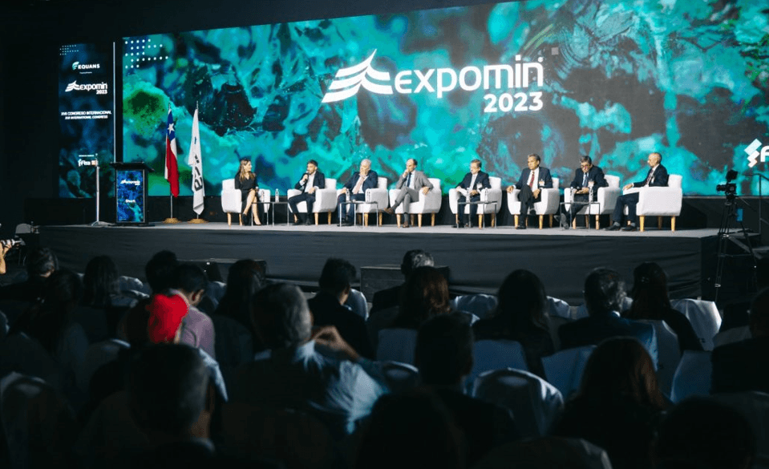

<figcaption>

Fotografía inaugural de la feria con principales representantes público-privados.

</figcaption>

</figure>

Bajo el lema inspirador "**Reimaginando la minería de Latinoamérica**", Expomin 2025 se propuso consolidar a Chile como el núcleo de la minería a nivel global. Para alcanzar esta ambiciosa meta, el evento se articuló en torno a propósitos clave: fomentar el intercambio de conocimientos y experiencias, exhibir los últimos avances tecnológicos, establecer una plataforma para oportunidades globales originadas en Chile, y convocar a representantes de la academia, el gobierno y expertos para definir el futuro de la minería latinoamericana. La aspiración de posicionar a Chile como centro neurálgico de la minería mundial refleja una firme estrategia nacional para potenciar sus recursos y experiencia en el escenario global, buscando ser un líder en innovación, desarrollo tecnológico y mejores prácticas mineras. La reunión de diversos actores clave subraya un enfoque colaborativo para abordar los desafíos y oportunidades del sector, reconociendo la necesidad de colaboración entre la investigación, la regulación y la práctica industrial para forjar un futuro sostenible para la minería.

La **sostenibilidad** se erigió como un principio fundamental en Expomin 2025, permeando las discusiones y las iniciativas presentadas. Un punto álgido fue la sesión dedicada a los **criterios ESG (Ambientales, Sociales y de Gobernanza)**, con la participación del reconocido experto mundial en negocios sostenibles, Andrew Winston. Un posterior panel de reflexión abordó estos criterios con la presencia del Embajador del Reino Unido en Chile y representantes de Codelco, EY Chile y COPEC. La **transición energética y la carbono neutralidad** también ocuparon un lugar central en la agenda, con espacios dedicados al objetivo de alcanzar la carbono neutralidad en la industria para 2040, al potencial del hidrógeno verde como vector de descarbonización y al rol estratégico de Chile como proveedor de minerales esenciales para la transición energética global. En un compromiso tangible con la sostenibilidad, Colbún se asoció con Expomin para medir y neutralizar la huella de carbono del evento, buscando convertirlo en la primera feria minera carbono neutral de Chile. La **economía circular y la gestión eficiente de recursos** fueron otros temas cruciales, debatiéndose estrategias para implementar modelos de economía circular en la minería, optimizar el uso del agua y mejorar la gestión de residuos, además de explorar opciones de financiamiento verde para proyectos sostenibles. El **vínculo con las comunidades locales y la participación equitativa** recibieron atención prioritaria, con paneles que analizaron cómo fomentar una participación más justa y promover el desarrollo compartido. Finalmente, **Finlandia**, el país invitado, compartió su vasta experiencia en la aplicación de la sostenibilidad en el sector minero. La relevancia otorgada a los criterios ESG y la participación de Andrew Winston evidencian la creciente integración de factores ambientales, sociales y de gobernanza en la estrategia de las mineras, marcando una evolución hacia una minería más responsable. La fuerte atención a la carbono neutralidad y al hidrógeno verde resalta el compromiso de la industria por mitigar su impacto climático y contribuir a la transición energética global. Las discusiones sobre economía circular y gestión eficiente de recursos reflejan una creciente conciencia sobre la necesidad de minimizar desechos y optimizar el uso de recursos críticos, mientras que las sesiones dedicadas al vínculo con las comunidades subrayan la importancia de la licencia social para operar y la construcción de relaciones positivas y beneficios inclusivos. La participación de Finlandia como invitado especial brindó una valiosa oportunidad para la transferencia de conocimientos y la colaboración en prácticas mineras sostenibles.

<figure>

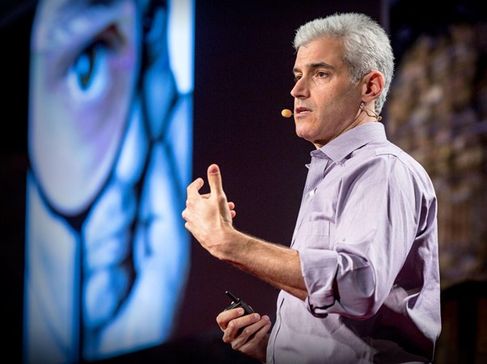

<figcaption>

Andrew Winston, experto mundial en sostenibilidad presentando criterios ESG.

</figcaption>

</figure>

La **innovación tecnológica** se presentó como otro pilar fundamental en Expomin 2025, con la exhibición de numerosas soluciones para optimizar la eficiencia, la seguridad y la sostenibilidad de las operaciones mineras. La participación de Zack Kass, ex director de estrategia de mercado de OpenAI, generó gran interés con su presentación "¿Hacia dónde vamos?" sobre el futuro de la **Inteligencia Artificial (IA) y la Digitalización**, explorando sus aplicaciones en análisis predictivo, automatización y ciberseguridad. Metso exhibió sus soluciones de digitalización y herramientas avanzadas con IA y análisis de datos en tiempo real, mientras que Endress+Hauser presentó nuevas funcionalidades de sus plataformas digitales y sensores con conectividad Ethernet-APL. Tesmec destacó con sus soluciones de "minería inteligente" centradas en automatización, electrificación y digitalización. El **Pabellón de la Innovación** reunió a 49 proveedores nacionales mostrando soluciones disruptivas en economía circular, monitoreo ambiental, digitalización y seguridad, incluyendo la nanoburbuja para tratamiento de aguas de ChucaoTech, la IA para reconocimiento de minerales de View Mineral y los biofiltros para reutilización de aguas grises de Yaku Biofilter. La **automatización y la robótica** fueron temas relevantes, analizándose su impacto en la productividad y seguridad. XCMG exhibió maquinaria pesada con tecnologías de cero emisiones, marcando una tendencia hacia la sostenibilidad en el equipamiento minero. Finalmente, Metso resaltó su tecnología de celdas de flotación Concorde Cell™ y los filtros Larox® FFP, además de su herramienta Sustainable Flowsheet Explorer (SFX). La marcada atención hacia la IA y la digitalización revela el reconocimiento del potencial transformador de estas tecnologías en la industria minera. La IA y la digitalización ofrecen oportunidades para aumentar la eficiencia, mejorar la toma de decisiones, fortalecer la seguridad y optimizar la gestión de recursos. El Pabellón de la Innovación demuestra un fuerte impulso para fomentar la innovación y el emprendimiento local en el sector. La exploración de la automatización y la robótica refleja los esfuerzos por mejorar la productividad, reducir costos operativos y aumentar la seguridad. La diversidad de innovaciones presentadas subraya los constantes avances tecnológicos en todas las etapas del proceso minero.

<figure>

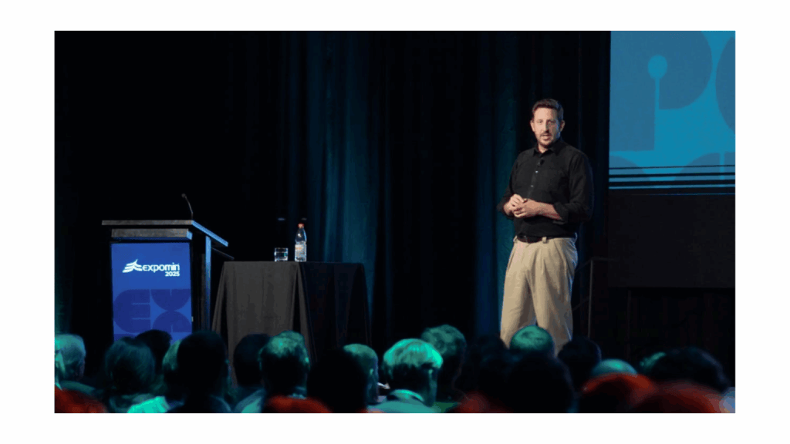

<figcaption>

**Zack Kass durante su presentación sobre Inteligencia Artificial.**

</figcaption>

</figure>

**Finlandia** tuvo un rol protagónico en Expomin 2025 como país invitado de honor, presentando su vasta experiencia y soluciones innovadoras en minería sostenible. La embajadora de Finlandia en Chile, Johanna Kotkajärvi, enfatizó la propuesta de su nación de compartir conocimientos y colaborar para construir un futuro más sostenible para la industria minera global. Diversas empresas finlandesas exhibieron sus tecnologías y prácticas ejemplares en sostenibilidad, transformación digital, educación y compromiso comunitario. Un evento central fue el "**Finland Mining Tech Summit: Innovation and Sustainability**", donde especialistas finlandeses compartieron su conocimiento en reciclaje de revestimientos de molinos y tecnologías para el ahorro de energía y agua. La delegación finlandesa contó con 15 empresas expositoras, subrayando el compromiso del país con la industria minera latinoamericana. La elección de Finlandia como país invitado resalta la importancia de la colaboración internacional para impulsar prácticas mineras sostenibles. La reputación de Finlandia por integrar tecnología y sostenibilidad la convierte en un socio valioso para Chile y otros países latinoamericanos. El "Finland Mining Tech Summit" facilitó un compromiso más profundo con enfoques innovadores en eficiencia energética e hídrica, fundamentales para el desarrollo sostenible de la industria minera.

<figure>

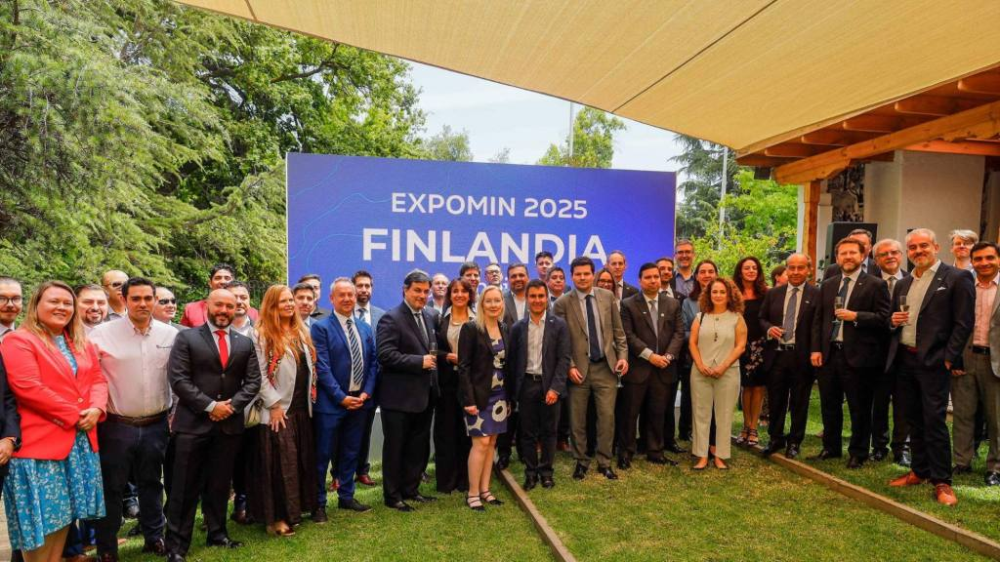

<figcaption>

**Pabellón de Finlandia en Expomin 2025**.

</figcaption>

</figure>

Durante Expomin 2025, diversas figuras de liderazgo compartieron sus valiosas perspectivas sobre el presente y el futuro de la minería sostenible. **Zack Kass**, ex director de OpenAI, reflexionó sobre la revolución de la inteligencia artificial y su impacto en la sociedad y la minería, afirmando que "no es una máquina la que va a determinar nuestro futuro, sino lo que queremos que la máquina haga por nosotros", y advirtiendo sobre la creciente importancia de la inteligencia como bien transable y sus dilemas éticos. **Vikram Mansharamani**, experto en tendencias globales, aportó una visión geopolítica del sector, enfatizando la sobrecarga de información y la necesidad de centrarse en datos relevantes para la toma de decisiones estratégicas. **Mario Marcel**, Ministro de Hacienda de Chile, resaltó la "resiliencia del cobre chileno" en un contexto global incierto, subrayando el rol estratégico del Estado en la minería nacional, buscando un equilibrio entre agilización de permisos y protección ambiental. **Aurora Williams**, Ministra de Minería de Chile, destacó los esfuerzos de la industria en energías limpias y economía circular, afirmando que Expomin es vital para la transferencia de conocimientos y tecnologías. Finalmente, **Patricio Hidalgo**, CEO de Anglo American en Chile y presidente de Expomin 2025, enfatizó el concepto de "Reimaginando la minería para atraer el mejor talento" y la oportunidad única de la minería para proveer los minerales necesarios para la transición energética de manera sostenible y responsable. Las palabras de Zack Kass resaltan el profundo impacto de la IA en la minería, con oportunidades y consideraciones éticas. La perspectiva de Mansharamani subraya la importancia de comprender las tendencias geopolíticas para la toma de decisiones estratégicas. El énfasis del Ministro Marcel en la resiliencia del cobre chileno ofrece una visión positiva para el sector. Las declaraciones de la Ministra Williams y Patricio Hidalgo refuerzan la sostenibilidad y la atracción de talento joven como prioridades clave.

<figure>

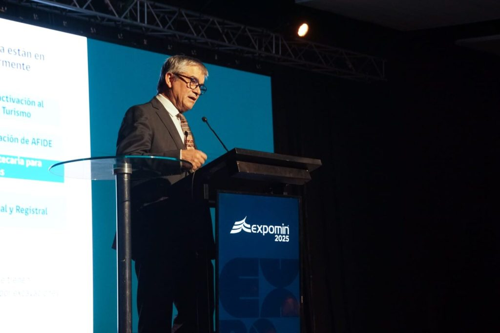

<figcaption>

Ministro Mario Marcel destaca la “resiliencia del cobre chileno” y el rol estratégico del Estado en la minería nacional.

</figcaption>

</figure>

Como novedad significativa, Expomin 2025 abrió sus puertas al público general el sábado 26 de abril, celebrando un "**Día del Ciudadano**" diseñado para acercar la minería a las familias chilenas. Esta iniciativa pionera buscó mostrar los avances y valores de la industria, especialmente a las nuevas generaciones, fomentando una mayor comprensión y aprecio por su rol en el desarrollo del país. Las actividades incluyeron visitas guiadas al Pabellón de la Minería, exhibición de maquinaria a gran escala, simuladores de realidad virtual, cuentacuentos y un espacio musical. El precio de la entrada fue de $5,000 pesos chilenos, con acceso gratuito para niños menores de 12 años. La implementación del "Día del Ciudadano" representa un creciente reconocimiento dentro de la industria sobre la importancia de la participación pública y la construcción de confianza con la comunidad, buscando desmitificar la minería, mostrar sus avances y compromiso con la sostenibilidad, y fomentar una mejor comprensión de sus contribuciones económicas y sociales. Esta iniciativa es crucial para mejorar la imagen de la industria y atraer al talento futuro.

- 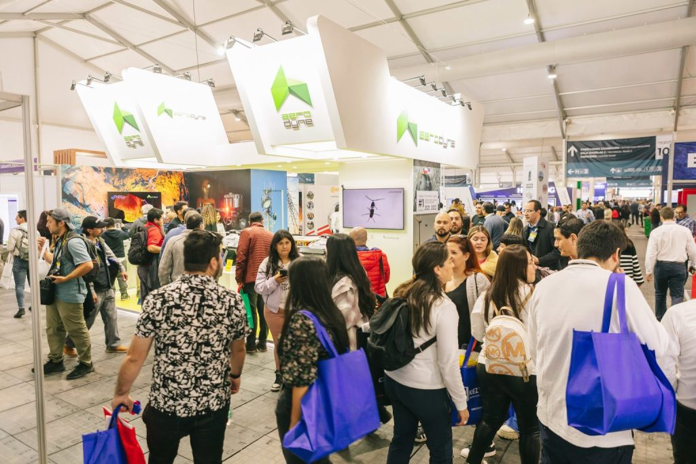
    
- 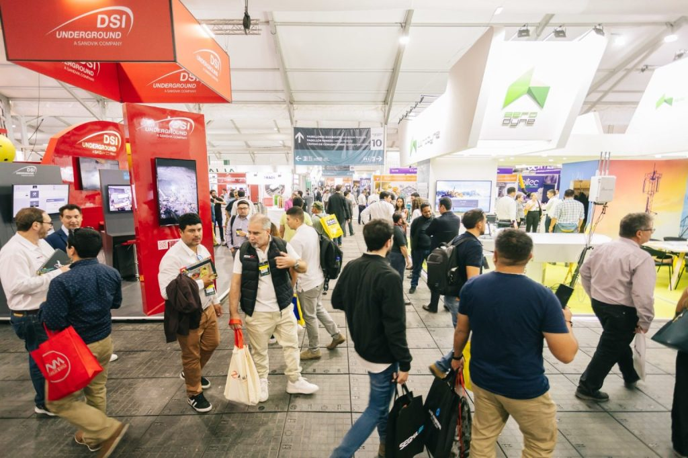
    
- 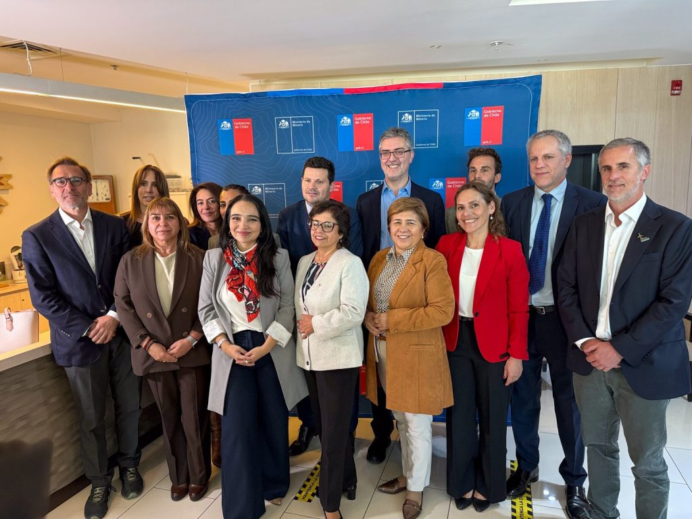
    
- 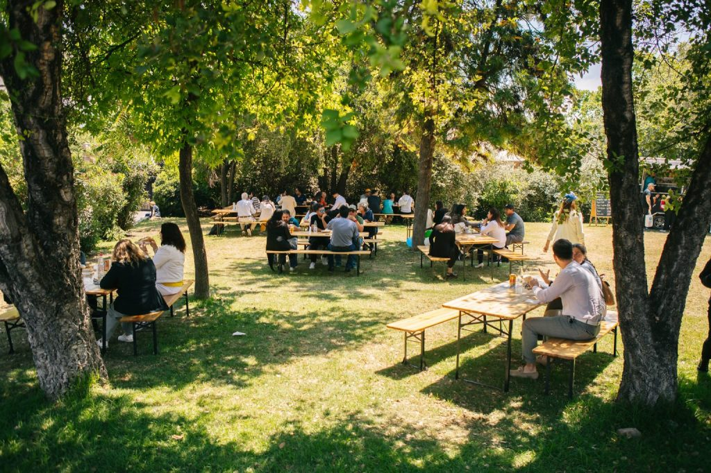
    
- 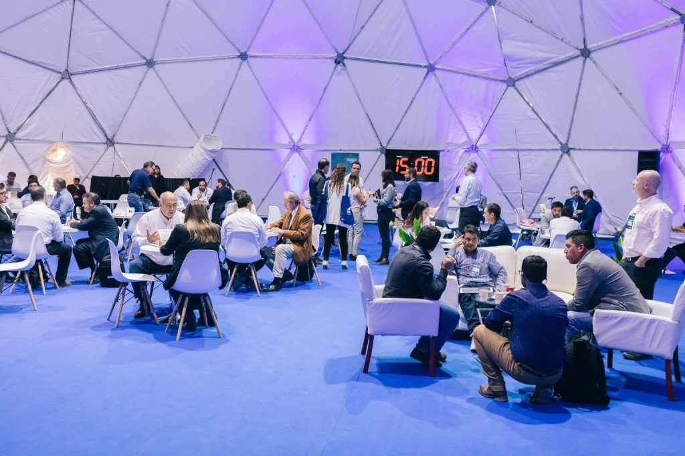
    
- 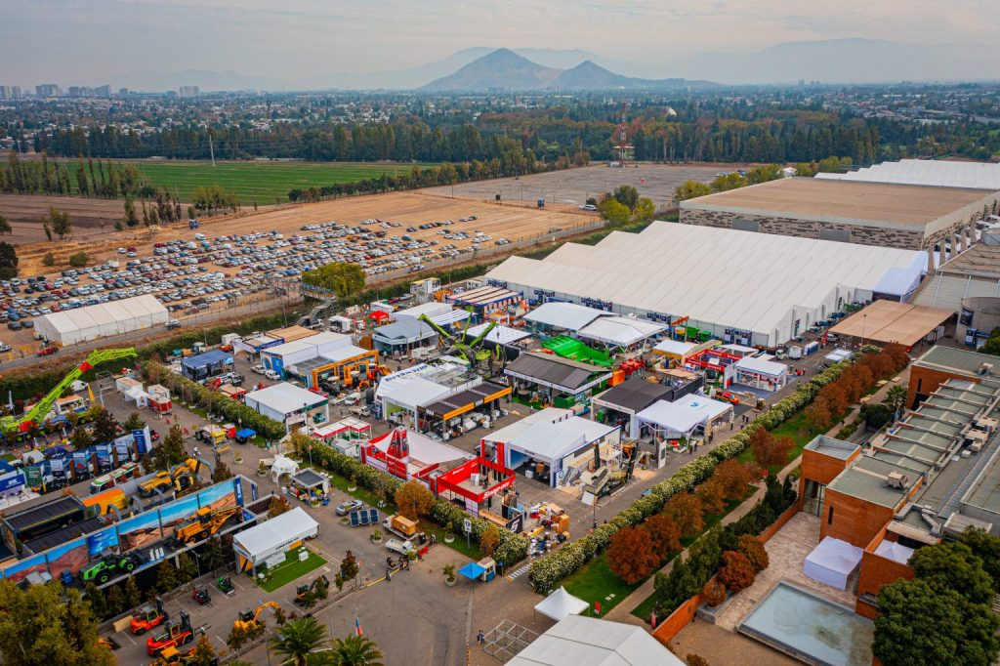
    

* * *

## **Conclusión: Un Impulso Decisivo para la Minería Sostenible en Latinoamérica**

Expomin 2025 se ha consolidado como un evento trascendental para catalizar la transición hacia una minería más sostenible e innovadora en toda Latinoamérica. El marcado énfasis en la sostenibilidad, la notable presencia de innovaciones tecnológicas, la activa participación de líderes y expertos internacionales, junto con la valiosa colaboración de Finlandia, enriquecieron significativamente el diálogo y facilitaron la crucial transferencia de conocimientos y mejores prácticas a nivel global. La innovadora iniciativa del "Día del Ciudadano" representa un paso fundamental para fortalecer el vínculo entre la minería y la comunidad, promoviendo una mayor transparencia y comprensión mutua esencial para el desarrollo sostenible del sector. En definitiva, Expomin 2025 no solo fungió como una plataforma esencial para la generación de negocios y el establecimiento de redes de contacto, sino que también se erigió como un espacio primordial para reimaginar la minería de Latinoamérica en la era de la sostenibilidad, trazando una hoja de ruta clara hacia un futuro más verde y responsable para la industria. La convergencia de líderes, proveedores de tecnología, funcionarios gubernamentales y expertos creó un entorno único para discutir desafíos, compartir soluciones y forjar colaboraciones. El fuerte énfasis en la sostenibilidad a lo largo del evento señala un compromiso colectivo para transformar la industria hacia un camino más responsable ambiental y socialmente. La atención del evento tanto en discusiones estratégicas de alto nivel como en demostraciones tecnológicas prácticas proporciona un enfoque integral para avanzar en la minería sostenible. El éxito de Expomin 2025 subraya la creciente importancia de la sostenibilidad y la innovación como motores para el futuro de la industria minera en América Latina, demostrando un reconocimiento de que la sostenibilidad no es solo un imperativo ético sino también un factor clave para la viabilidad económica y la competitividad a largo plazo. El enfoque en la innovación destaca la voluntad de la industria de adoptar nuevas tecnologías para lograr sus objetivos de sostenibilidad.

* * *

## **Temas Clave de Sostenibilidad Abordados en Expomin 2025**

| **Tema de Sostenibilidad** | **Descripción del Tema** | **Sesiones o Eventos Relevantes en Expomin 2025** | **Principales Conclusiones o Tendencias Identificadas** |
| --- | --- | --- | --- |
| Criterios ESG | Integración de factores ambientales, sociales y de gobernanza en la estrategia minera | Sesión con Andrew Winston, Panel de reflexión con múltiples actores | Creciente reconocimiento de la importancia de estos criterios para la licencia social y el acceso a financiamiento. |
| Carbono Neutralidad | Meta de reducir a cero las emisiones netas de carbono | Sesión sobre la meta para 2040, Discusión sobre hidrógeno verde, Iniciativa de Expomin de ser carbono neutral | Fuerte compromiso de la industria con la descarbonización y exploración de alternativas como el hidrógeno verde. |
| Economía Circular | Minimizar residuos y maximizar el uso de recursos | Discusión sobre estrategias, Presentaciones en el Pabellón de la Innovación | Interés en modelos que permitan la reutilización, el reciclaje y la reducción de la dependencia de recursos vírgenes. |
| Financiamiento Verde | Opciones de financiamiento para proyectos sostenibles | Sesión dedicada al financiamiento verde | Mayor disponibilidad de capital para proyectos con criterios de sostenibilidad bien definidos. |
| Vínculo con Comunidades | Relación entre empresas y comunidades locales | Paneles sobre participación equitativa y desarrollo compartido | Reconocimiento de la importancia de la licencia social y la creación de valor compartido con las comunidades. |
| Gestión del Agua | Uso eficiente y responsable del agua | Discusiones sobre eficiencia, Presentaciones de soluciones innovadoras | Prioridad en tecnologías y prácticas que reduzcan el consumo y permitan la reutilización del agua. |
