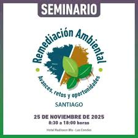
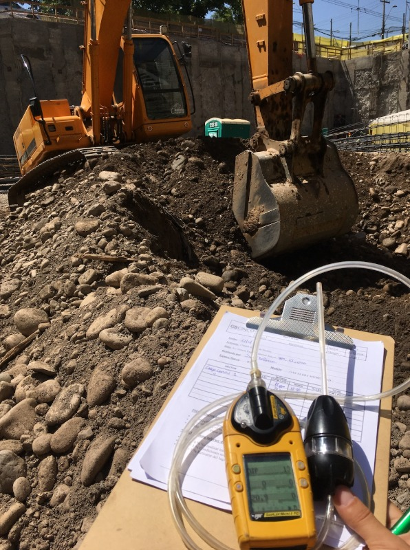
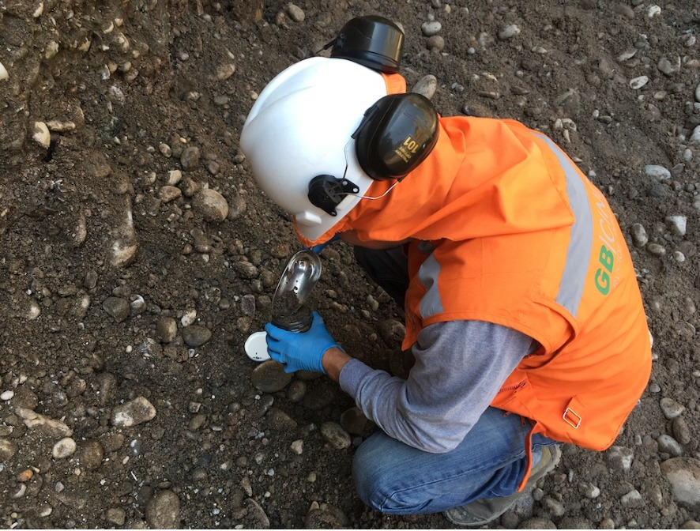
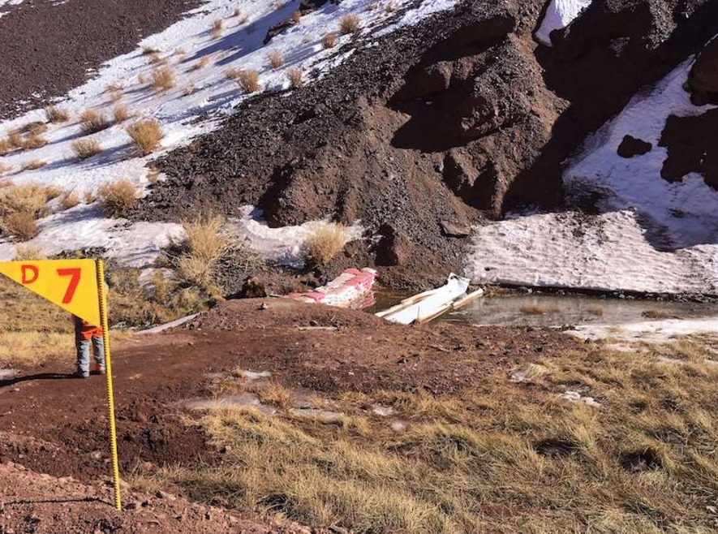

_El encuentro, organizado por_ _InduAmbiente__, abordará el vacío normativo ante la falta de una Ley Marco de Suelos y presentará tecnologías capaces de reducir la descontaminación de décadas a meses. Con el respaldo de gremios mineros y autoridades, expertos analizarán cómo transformar pasivos ambientales en terrenos aptos para el desarrollo urbano e inmobiliario._

En un contexto marcado por la ausencia de una Ley Marco de Suelos, el seminario **_“Remediación ambiental: avances, retos y oportunidades”_** abordará cómo las nuevas tecnologías permiten transformar pasivos industriales en activos para el desarrollo urbano y social.

La recuperación de terrenos contaminados se ha convertido en una urgencia ambiental y social para el país. En este escenario, el próximo martes 25 de noviembre se realizará el encuentro organizado por InduAmbiente, que reunirá a autoridades y especialistas en el Hotel Radisson Blu Las Condes.

El evento busca abrir el debate sobre el marco regulatorio vigente —incluido el anteproyecto de la Norma Primaria de Calidad Ambiental para Suelos— y dar a conocer soluciones técnicas que hoy hacen posible la recuperación de sitios degradados.

“Más allá de la limpieza técnica, la remediación ambiental se perfila como una herramienta estratégica de _justicia territorial_. La falta de una Ley Marco de Suelos ha dejado a sectores como la minería sin una guía integral para gestionar este recurso. Sin embargo, recuperar estos espacios es clave para desarrollar viviendas sociales e infraestructura pública en zonas críticas como Antofagasta, Copiapó o Coronel”, explica **José Manuel Bellalta, gerente general de GB Cinco Ambiental**, una de las entidades participantes.

El desafío país consiste en transformar terrenos inutilizados o pasivos ambientales —como relaves mineros abandonados— en espacios seguros y útiles, promoviendo la equidad urbana y la resiliencia ambiental.

## **Avances tecnológicos en la remediación**

Uno de los ejes centrales del seminario será el análisis de cómo la ciencia ha logrado reducir drásticamente los tiempos de recuperación. Gracias a tecnologías _in situ_ como la Oxidación Catalítica (KatOx) combinada con la Extracción de Vapores (SVE), hoy es posible destruir contaminantes y acortar plazos de saneamiento que antes tomaban décadas, a rangos de entre 6 meses y 4 años.

A ello se suma el auge de la biorremediación avanzada, que emplea bacterias especializadas (como _acinetobacter_), fitorremediación y ozonización para tratar distintos tipos de contaminantes.

En este escenario de discusión técnica y normativa, José Antonio Margotta, gerente de Proyectos de GB Cinco Ambiental, presentará la exposición _“Remediación de Sitios Impactados: Integrando Tecnologías Eficientes y Sostenibles”_. Su intervención se centrará en cómo la ingeniería de avanzada puede garantizar la viabilidad de proyectos críticos mediante soluciones de mínimo impacto.

“Creemos que la remediación de sitios impactados mediante la integración de tecnologías puede generar una mínima intervención en el lugar. Además, a través de un diagnóstico hidrogeológico riguroso, se maximiza la eficiencia, reduce plazos y minimiza el impacto ambiental, transformando pasivos en activos sostenibles”, señala Margotta.

Durante la jornada se expondrán casos de éxito en la gestión de hidrocarburos y el control de plumas en aguas subterráneas mediante sistemas de Bombeo y Tratamiento (Pump & Treat) y tecnologías de aireación (Air Sparging y Bioventing). Estas soluciones buscan suplir los vacíos normativos actuales con trazabilidad técnica, permitiendo que la inversión avance con seguridad y responsabilidad ambiental.

El encuentro cuenta con el respaldo del Ministerio del Medio Ambiente, la Agencia de Sustentabilidad y Cambio Climático de Corfo, la Asociación Chilena de Derecho Ambiental, la Asociación Gremial de Industriales Químicos, la Cámara Franco Chilena para el Comercio y la Industria, el Consejo Minero, la Sociedad de Fomento Fabril (Sofofa) y la Sociedad Nacional de Minería (Sonami).

* * *

## **Coordenadas del evento**

• **Fecha:** Martes 25 de noviembre

• **Hora:** 08:30 horas

• **Lugar:** Hotel Radisson Blu Las Condes, Santiago

_**Más información e inscripciones**_

[https://www.induambiente.com/cita-con-la-remediacion](https://www.induambiente.com/cita-con-la-remediacion)

_[seminario@induambiente.cl](mailto:seminario@induambiente.cl)_

* * *
