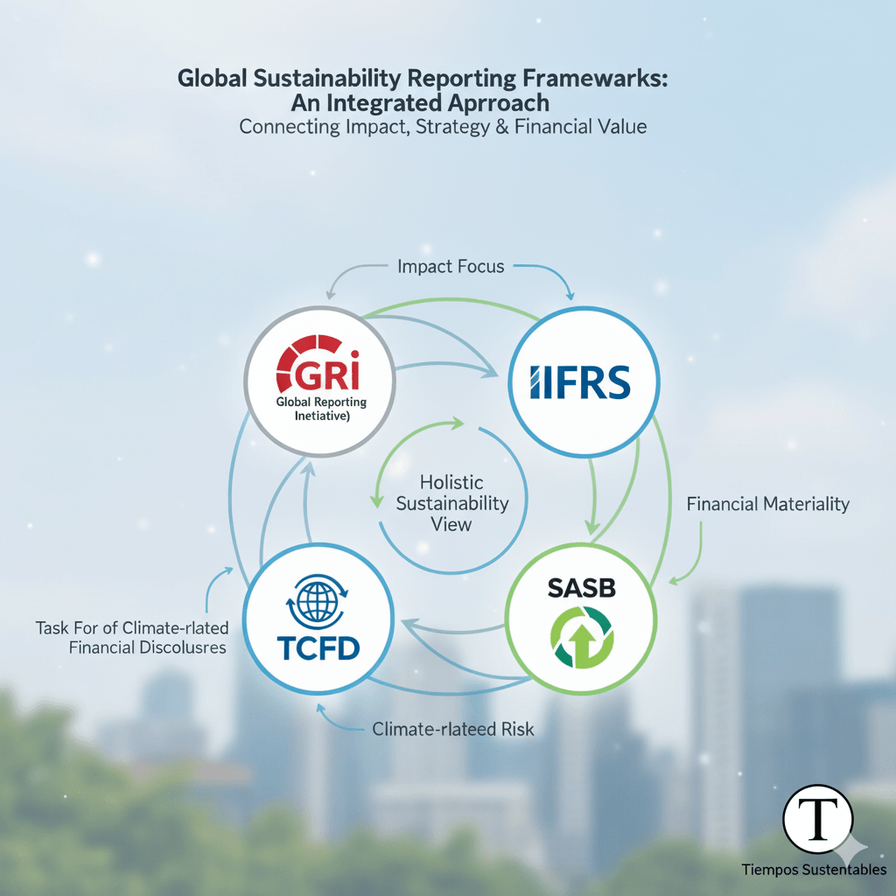
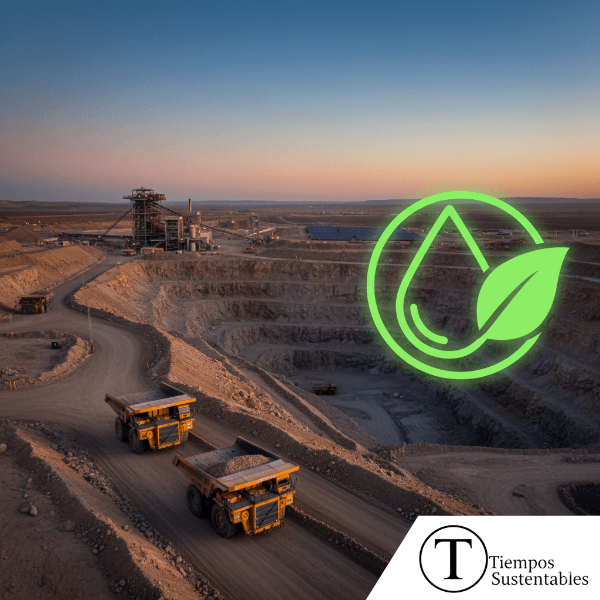

**Lo que comenzó como un ejercicio de reputación corporativa es hoy una pieza clave de la estrategia y la viabilidad empresarial. En un mundo donde los riesgos climáticos y sociales son también riesgos financieros, la transparencia en la gestión ESG ya no es opcional. Analizamos el estado del arte de los reportes de sostenibilidad y la ruta para convertirlos en una poderosa herramienta de gestión.**

* * *

La era del _greenwashing_ superficial está llegando a su fin. La presión de los inversionistas, los consumidores y, cada vez más, de los reguladores, ha transformado el reporte de sostenibilidad en un ejercicio de rigor y transparencia ineludible. Empresas que no logran comunicar de manera creíble su desempeño ambiental, social y de gobierno corporativo (ESG) se arriesgan no solo a dañar su reputación, sino también a perder acceso a capital y competitividad.

La pregunta ya no es _si_ reportar, sino _cómo_ hacerlo de una manera que genere valor real.

* * *

### **El Nuevo Escenario Regulatorio: El Fin del Reporte Voluntario**

El cambio más significativo en el panorama de la sostenibilidad corporativa ha sido el paso de la voluntariedad a la obligatoriedad. Dos marcos regulatorios son el epicentro de este terremoto:

1. **La Directiva sobre Informes de Sostenibilidad Corporativa (CSRD) de la Unión Europea:** Esta ambiciosa normativa, que comenzó a aplicarse progresivamente desde 2024, exige a miles de empresas (incluidas filiales chilenas con operaciones significativas en Europa) reportar bajo un conjunto de estándares detallados. Su principio de **"doble materialidad"** obliga a las compañías a informar no solo cómo los factores de sostenibilidad afectan su negocio, sino también cómo sus operaciones impactan a la sociedad y al medio ambiente. \[[ver directiva aquí](https://eur-lex.europa.eu/legal-content/EN/TXT/?uri=CELEX:32022L2464)\]

3. **La Norma de Carácter General 461 (NCG 461) en Chile:** Emitida por la **[Comisión para el Mercado Financiero (CMF)](https://www.cmfchile.cl/)**, esta norma obliga a las sociedades anónimas abiertas a integrar en sus memorias anuales un reporte de sostenibilidad estructurado. La CMF exige la divulgación de métricas y políticas ESG, empujando a los directorios a involucrarse directamente en la supervisión de estos temas. \[[ver norma aquí](https://www.cmfchile.cl/normativa/ncg_461_2021.pdf)\]

Como se analizó previamente en [Tiempos Sustentables](https://tiempossustentables.cl/2025/06/22/asi-cambia-el-reporte-de-sostenibilidad-en-chile/) sobre la evolución del reporting, _"la estandarización regulatoria es la respuesta a la demanda de los inversionistas por información ESG comparable, confiable y auditable"_.

* * *

### **Los Pilares de un Reporte de Excelencia: Más Allá de los Datos**

Un reporte de clase mundial no es una simple colección de indicadores; es una narrativa estratégica que conecta la sostenibilidad con el modelo de negocio. Los estándares internacionales ofrecen la hoja de ruta para construirlo.

#### **El Lenguaje Universal: GRI Standards**

Los **[estándares de la Global Reporting Initiative (GRI)](https://www.globalreporting.org/)** siguen siendo el marco más utilizado a nivel global. Su fortaleza radica en un enfoque multi-stakeholder, permitiendo a las empresas reportar sobre sus impactos en la economía, el medio ambiente y las personas.

> "Un análisis de materialidad robusto es la piedra angular de un buen reporte. Sin entender cuáles son los temas más relevantes para tu negocio y tus grupos de interés, estás navegando a ciegas", señala un informe reciente de PwC sobre tendencias ESG.

#### **El Foco del Inversionista: IFRS (SASB) y TCFD**

Para el público financiero, dos marcos son cruciales:

- **IFRS S1 y S2 (basados en SASB y TCFD):** La Fundación IFRS ha consolidado los estándares del **[Sustainability Accounting Standards Board (SASB)](https://www.ifrs.org/groups/international-sustainability-standards-board/)** y las recomendaciones del **[Task Force on Climate-related Financial Disclosures (TCFD)](https://www.fsb-tcfd.org/)**. Su objetivo es claro: estandarizar la divulgación de riesgos y oportunidades de sostenibilidad que son financieramente relevantes. Las empresas deben preguntarse: ¿Cómo afecta el cambio climático a mis activos? ¿Cómo la gestión del talento impacta en mi rentabilidad?

Un reporte ejemplar combina la visión de impacto de GRI con la perspectiva de riesgo financiero de IFRS/SASB y TCFD.

* * *

### **La Ruta Hacia un Reporte de Excelencia: Una Guía Práctica**

Para las empresas que buscan mejorar su reporte o iniciarse en este camino, el proceso ideal sigue una secuencia lógica:

1. **Compromiso del Directorio:** La estrategia ESG debe nacer y ser supervisada desde el más alto nivel. El directorio debe definir la ambición y los responsables.

3. **Análisis de Doble Materialidad:** Identificar los temas cruciales. ¿Qué asuntos ESG impactan financieramente a la empresa? (Materialidad financiera). ¿Y cuáles son los impactos más significativos de la empresa en su entorno? (Materialidad de impacto).

5. **Definición de Estrategia y Metas:** Para cada tema material, se debe definir una política, establecer metas claras, medibles y con plazos definidos (ej. "Reducir emisiones de Alcance 1 y 2 en un 30% para 2030, con base en 2022").

7. **Recopilación y Gestión de Datos:** Implementar sistemas robustos para medir el desempeño. La trazabilidad y la calidad del dato son fundamentales para la credibilidad y la futura verificación externa.

9. **Redacción y Comunicación:** El reporte debe ser más que un PDF. Se debe pensar en una comunicación multicanal: un sitio web interactivo, resúmenes ejecutivos para distintos públicos y datos en formatos abiertos. La narrativa debe ser transparente, equilibrada (reportando tanto los éxitos como los desafíos) y conectada con la estrategia general del negocio.

#### **Caso de Estudio: La Minería Chilena como Referente**

Empresas como **CODELCO** y **SQM** han avanzado significativamente. Sus reportes no solo detallan sus emisiones o consumo de agua, sino que explican cómo la gestión de estos recursos es vital para su "licencia para operar" y su viabilidad a largo plazo, vinculando la gestión hídrica y comunitaria directamente con la estrategia de negocio y el riesgo operacional.

* * *

### **El Futuro: Reportes Integrados, Digitales y Auditados**

El destino del reporting es claro: la total **integración con el informe financiero**, la presentación en **formatos digitales** que faciliten el análisis (como el lenguaje XBRL) y la **verificación por parte de un tercero independiente**.

La transparencia radical no es una carga, es una ventaja competitiva. Las empresas que abracen este desafío no solo cumplirán con la regulación, sino que fortalecerán la confianza, atraerán talento e inversión, y construirán un negocio más resiliente y preparado para los desafíos del futuro.

* * *

### Reportes de Sostenibilidad: De la Obligación al Valor Estratégico

En definitiva, la era de la sostenibilidad como un anexo ha terminado. El reporte deja de ser un simple documento para convertirse en el reflejo de la estrategia, la resiliencia y el propósito de una compañía. Las empresas que liderarán la próxima década serán aquellas que manejen este nuevo lenguaje con fluidez, demostrando con datos y acciones concretas cómo generan valor para sus accionistas y para la sociedad.

En última instancia, un reporte transparente es un pacto de confianza. Es la prueba tangible de que un negocio no solo está preparado para el futuro, sino que está activamente construyendo uno mejor.

* * *
