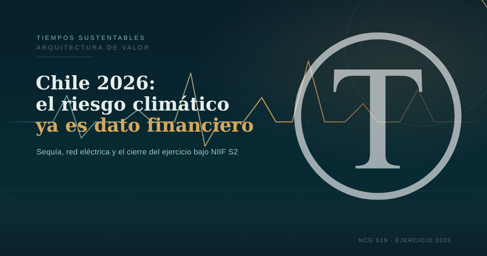

La Norma de Carácter General 519 de la CMF obliga a las empresas chilenas a reportar sus riesgos climáticos bajo los estándares NIIF S1 y S2 a partir del ejercicio 2026. Eventos como la sequía y los incendios forestales de este año evidencian los riesgos físicos que deben declararse.

Frente a este marco regulatorio y las exigencias del mercado, las organizaciones deben evaluar con rigor su exposición ambiental y asegurar una gobernanza de datos transparente. Preparar diagnósticos de riesgo y modelar escenarios climáticos es clave para mantener la resiliencia financiera y el acceso a contratos.

  
  

**Esta semana Chile estuvo a un decreto de distancia del racionamiento eléctrico. No es una hipótesis de riesgo climático: es el ejercicio 2026 mostrando, en vivo, los datos que las empresas deberán reportar bajo NIIF S2.**

El 7 de julio de 2026, el Coordinador Eléctrico Nacional advirtió, en un informe solicitado por la Comisión Nacional de Energía (CNE), que se verifica **déficit de abastecimiento eléctrico para este mes**. La causa: un primer semestre extremadamente seco que redujo al mínimo la generación hidroeléctrica y con ella el margen del sistema para absorber cualquier imprevisto. Un decreto de racionamiento —la herramienta de emergencia que el Ministerio de Energía activaría en caso de profundizarse el déficit— seguía sobre la mesa esta semana, aunque un sistema frontal con lluvias en el sur, esperado entre el 15 y el 19 de julio, podría aliviar la presión. [The Clinic — Qué implica un decreto de racionamiento eléctrico](https://www.theclinic.cl/2026/07/10/que-implica-un-decreto-de-racionamiento-electrico-la-medida-que-el-gobierno-se-podria-ver-obligado-a-tomar-por-la-falta-de-lluvias-que-tensiona-al-sistema-electrico/).

Y el respiro, si llega, será breve. La actualización climática estacional para julio-septiembre de 2026 proyecta un desarrollo rápido hacia un evento de **El Niño fuerte**, con un 81% de probabilidad de que se consolide como "muy fuerte" entre octubre y diciembre. Para Chile, eso implica más lluvia en algunas zonas del centro-sur, pero también mayor riesgo de crecidas, remociones en masa y cortes de infraestructura, justo cuando el sistema eléctrico ya opera con márgenes reducidos. [Reporte Minero — El Niño fuerte y presión sobre la energía](https://www.reporteminero.cl/noticia/noticias/2026/07/el-nino-fuerte-impacto-energia-demanda-hidroelectricidad-precios).

Para los equipos de dirección, este no es un dato de coyuntura: es el año fiscal que están a punto de cerrar, y el mismo que la Comisión para el Mercado Financiero (CMF) exige reportar por primera vez bajo **NIIF S2**.

  
  

## El plazo que ya está corriendo: NCG 519 y el cierre del ejercicio 2026

La Norma de Carácter General N°519 de la CMF estableció que la adopción de los estándares **NIIF S1 y NIIF S2** es obligatoria a contar del ejercicio anual 2026, con memoria integrada presentada en 2027. Aplica a todo emisor de valores de oferta pública inscrito en la CMF que presenta Memoria Anual Integrada: sociedades anónimas abiertas, bancos, aseguradoras, bolsas de valores y administradoras de fondos, entre otras. Quedan exentas de la memoria completa las entidades con activos consolidados promedio bajo UF 1 millón. [CMF — Comunicado NCG 519](https://www.cmfchile.cl/portal/prensa/615/w3-article-86543.html).

En términos prácticos: el ejercicio que hoy está a cinco meses de cerrarse es el primero que exige, bajo NIIF S2, describir riesgos físicos —agua, incendios, sequía— y de transición sobre activos reales, siguiendo los cuatro pilares del TCFD (gobernanza, estrategia, gestión de riesgos, metas e indicadores). El dato de exposición hídrica que una empresa no levantó durante el primer semestre de 2026 —justo el semestre que el sistema eléctrico califica hoy como "extremadamente seco"— simplemente no va a aparecer en su memoria de 2027. Chile no está solo en este calendario: México ya reportó su primer ejercicio bajo NIIF S1/S2 en 2026, y el Reino Unido lleva sus propios UK SRS S1/S2 hacia obligatoriedad en 2027.

  
  

## El antecedente que ya está en el balance: los incendios de enero

La sequía de julio no aparece aislada dentro del ejercicio 2026: es la continuación del mismo año que en enero registró la campaña de incendios forestales más letal de la última década. Entre el 16 y el 21 de enero, incendios en Biobío, Ñuble y La Araucanía quemaron más de 45.000 hectáreas, dejaron 21 personas fallecidas y más de 4.100 viviendas destruidas. El **Centro de Ciencia del Clima y la Resiliencia (CR2)** documentó que el evento liberó 15 megatoneladas de CO₂ en 20 días, producto de un estrés hídrico del combustible forestal en niveles inéditos. [CR2 — Análisis del incendio Biobío-Ñuble](https://www.cr2.cl/incendios-en-chile-vamos-a-requerir-un-acuerdo-social-amplio-para-poder-prevenir-que-esto-ocurra-con-esta-magnitud-el-maipo/).

Leídos en conjunto, enero y julio no son dos noticias distintas: son dos mediciones del mismo riesgo físico dentro del mismo ejercicio contable. Ese es precisamente el tipo de evidencia longitudinal que un reporte NIIF S2 bien construido debe poder mostrar.

  
  

## El mercado ESG en Chile ya no es narrativa: es demanda con contrato

Mientras el riesgo físico se acumula, el financiamiento a la sostenibilidad también avanza con cifras concretas. Corfo confirmó en febrero de 2026 que sus programas Potencia y Escalamiento Intermediario impulsaron, entre 2023 y 2025, **ventas por más de $22.500 millones** en emprendimientos de descarbonización, gestión hídrica y economía circular, a través de 17 iniciativas que beneficiaron a más de 180 proyectos en distintas regiones del país. [Ministerio de Economía — Resultados Corfo 2023-2025](https://www.economia.gob.cl/2026/02/16/corfo-destaca-resultados-de-sus-programas-de-aceleracion-y-escalamiento-de-emprendimientos-con-foco-sostenible.htm).

El dato relevante no es solo el monto, sino quién compra: Coca-Cola Chile, Cencosud y Codelco ya condicionan parte de sus adquisiciones y financiamiento a metas propias de descarbonización, trasladando la exigencia de trazabilidad ESG a sus proveedores. Sumado al calendario de la NCG 519, la lectura es directa: **una empresa sin datos climáticos auditables no solo arriesga una observación regulatoria en 2027 — arriesga quedar fuera de las cadenas de valor que ya exigen esa evidencia hoy**.

  
  

Para transitar desde la urgencia climática hacia la resiliencia financiera, cumplir con la NCG 519 exige replantear la estrategia comercial desde lo que definimos como una **Arquitectura de Valor**. Primero, las organizaciones deben aplicar _Cabeza Fría_ para evaluar con rigor económico su exposición a riesgos físicos (como la escasez hídrica, los incendios y otros eventos climáticos extremos), integrando estos escenarios no solo en la gestión de su portafolio, sino también en sus proyecciones de rentabilidad a corto y largo plazo. Este análisis estratégico debe considerar variables como la fluctuación de costos o la variabilidad en la oferta y demanda de materias primas, que pueden impactar la rentabilidad general. Segundo, requieren un _Corazón Activo_ que conecte el propósito corporativo con propuestas de valor concretas, llevando a cabo iniciativas que no solo mitiguen el impacto ambiental, sino que también promuevan la innovación y la mejora continua en sus procesos. Esto se traduce en convertir la mitigación ambiental en una ventaja competitiva frente a grandes compradores, quienes ya condicionan sus contratos a la trazabilidad ESG, exigiendo a las empresas que demuestren su compromiso con prácticas sostenibles y responsables. Finalmente, el éxito de este cierre de ejercicio dependerá de unas _Manos Firmes_: una gobernanza corporativa disciplinada que levante los datos exigidos bajo NIIF S2, asegurándose de que la información recopilada sea transparente y confiable. Este enfoque garantiza que la sostenibilidad sea evidencia auditable y no solo una narrativa superficial.

## Hoja de ruta: qué hacer con los cinco meses que quedan del ejercicio

Con el cierre del ejercicio 2026 a la vista, las organizaciones obligadas —y las que quieran adelantarse voluntariamente, como ya lo hicieron Falabella y Coca-Cola FEMSA ante la CMF— tienen tres frentes concretos para trabajar antes de diciembre:

1. **Cerrar el diagnóstico de riesgo físico del semestre en curso** — Documentar con metodología verificable la exposición hídrica y energética evidenciada por el déficit eléctrico de julio, y su relación con los activos e instalaciones de la organización, antes de que el dato deje de estar disponible.

3. **Modelar el escenario El Niño del último trimestre** — Anticipar el impacto de crecidas, remociones en masa e interrupciones de infraestructura sobre la cadena de suministro, en línea con lo que NIIF S2 exige como análisis de escenarios climáticos.

5. **Alinear la memoria integrada con NIIF S1/S2 y TCFD** — Aunque el reporte obligatorio se presenta en 2027, la información que lo sustenta se levanta ahora. Un diagnóstico de brechas hecho en el segundo semestre de 2026 es la diferencia entre reportar con evidencia o reportar con reconstrucción a posteriori.

Estas no son decisiones de reputación. Son decisiones de acceso a capital, a mercados y a contratos — y el reloj del ejercicio que las mide ya está corriendo.

  
  

## Preguntas frecuentes

### ¿Por qué Chile enfrenta riesgo de racionamiento eléctrico en julio de 2026?

El Coordinador Eléctrico Nacional advirtió, en un informe del 7 de julio de 2026 solicitado por la CNE, que existe déficit de abastecimiento eléctrico para el mes debido a un primer semestre extremadamente seco que redujo la generación hidroeléctrica. Esto disminuyó el margen del sistema para responder ante imprevistos, como una ola de frío o una falla de central. Un decreto de racionamiento otorgaría facultades de emergencia al Ministerio de Energía, aunque las lluvias esperadas a mediados de julio podrían reducir el riesgo.

### ¿Qué exige la NCG 519 de la CMF y desde cuándo?

La NCG 519 exige que las entidades supervisadas por la CMF que presentan Memoria Anual Integrada reporten bajo los estándares NIIF S1 y NIIF S2 a contar del ejercicio anual 2026, con memoria presentada en 2027. NIIF S2 exige divulgar riesgos climáticos físicos (sequía, incendios) y de transición, siguiendo los pilares de gobernanza, estrategia, gestión de riesgos y metas del TCFD. Las entidades con activos consolidados bajo UF 1 millón quedan exentas de la memoria completa.

### ¿Qué relación hay entre los incendios de enero y la sequía de julio de 2026?

Ambos eventos ocurren dentro del mismo ejercicio fiscal 2026, el primero que las empresas chilenas deben reportar bajo NIIF S2. Los incendios de enero en Biobío y Ñuble, que el CR2 vinculó a un estrés hídrico del combustible en niveles inéditos, y el déficit hidroeléctrico de julio son dos manifestaciones del mismo patrón de sequía y estrés hídrico que un reporte climático bien construido debe poder correlacionar como evidencia longitudinal, no como incidentes aislados.

### ¿Qué evidencia hay de que el mercado ESG en Chile ya mueve capital real?

Corfo confirmó que sus programas de aceleración con foco sostenible generaron más de $22.500 millones en ventas entre 2023 y 2025, con la participación directa de compradores como Coca-Cola Chile, Cencosud y Codelco, que ya exigen criterios de descarbonización a sus proveedores. No es un mercado incipiente: es demanda institucional con contrato y plazo.

### ¿Cómo puede una organización comenzar a medir su exposición al riesgo climático antes del cierre del ejercicio 2026?

El punto de partida es un diagnóstico estructurado que mapee los activos expuestos a riesgo físico (instalaciones, cadena de suministro, fuentes de agua y energía) y de transición (dependencia energética, exposición regulatoria bajo NCG 519), aprovechando la evidencia que ya dejó el primer semestre de 2026.

  
  

* * *

_¿Su organización ya tiene un diagnóstico de exposición al riesgo climático de cara al cierre del ejercicio 2026 bajo NIIF S2? En Tiempos Sustentables podemos acompañar ese proceso._  
**[→ Servicios B2B — tiempossustentables.cl/servicios-b2b](https://tiempossustentables.cl/servicios-b2b/)**

