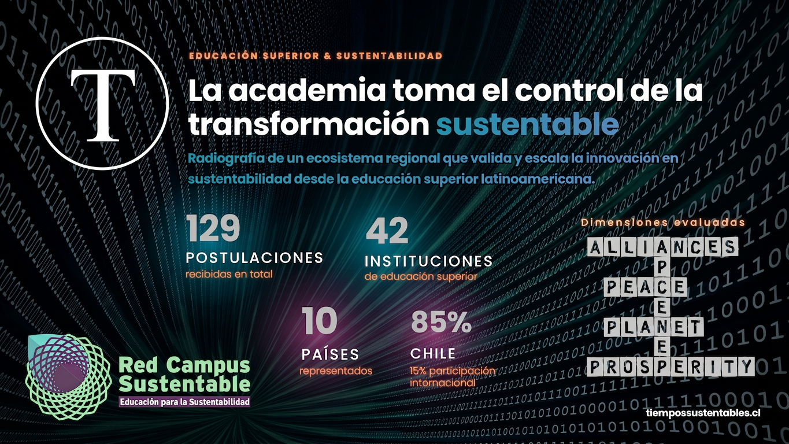

El **RIIS 2026** (Reconocimiento a la Investigación e Innovación en Sustentabilidad) es una iniciativa impulsada por la **Red Campus Sustentable** para visibilizar el impacto de la educación superior frente a la crisis socioambiental. En su tercera edición, premió proyectos destacados entre **129 postulaciones** de **42 instituciones** en **10 países** de Latinoamérica. Los galardones se centraron en las categorías de Investigación, Innovación, Trayectoria Académica y una línea temática especial sobre **Economía Circular de los Plásticos**.

**Datos Clave del RIIS 2026:**

- **Premio a la Trayectoria:** Rolando Chamy Maggi (Centro Núcleo Biotecnología Curauma - PUCV).

- **Organizador:** Red Campus Sustentable (RCS).

- **Alcance:** 10 países y 42 instituciones de educación superior participantes.

- **Volumen:** 129 postulaciones totales de investigación e innovación.

- **Enfoque 2026:** Nueva línea temática en Economía Circular de los Plásticos.

Frente a la urgencia de la crisis socioambiental, las instituciones de educación superior han asumido el rol que la sociedad les exige: ser el motor de una transformación inaplazable.

El Reconocimiento a la Investigación e Innovación en Sustentabilidad (RIIS) nació con un propósito claro: visibilizar el aporte que estas instituciones hacen frente a los grandes desafíos de nuestro tiempo. Impulsado por la Red Campus Sustentable (RCS) en alianza con MetaRed-S, la Red Compromiso con el Desarrollo Sustentable y el Pacto Chileno de los Plásticos, este galardón es un puente que proyecta el impacto académico más allá de los muros institucionales.

## Radiografía de un ecosistema maduro y sin fronteras

La tercera edición del RIIS confirma que este reconocimiento se consolida fuertemente edición tras edición. La comunidad académica busca, con una fuerza sin precedentes, validar y escalar sus proyectos de impacto en toda la región.

### Cifras clave del RIIS 2026

| **Indicador** | **Detalle del Impacto** |
| --- | --- |
| **Participación Global** | Se recibieron un total de 129 postulaciones. |
| **Alcance Institucional** | Participaron 42 instituciones de educación superior. |
| **Impacto Geográfico** | Estuvieron representados 10 países en total. |
| **Internacionalización** | Chile concentró el 85% de las postulaciones, dejando un 15% de participación internacional. |

**Distribución de los esfuerzos académicos:**

- Se presentaron 50 postulaciones en la categoría de Investigación.

- Se registraron 50 postulaciones en la categoría de Innovación.

- Hubo 21 postulaciones al Reconocimiento a la Trayectoria.

- Se recibieron 8 postulaciones en la Línea Temática sobre Economía Circular de los Plásticos.

La presencia internacional incluyó a Venezuela, México, República Dominicana, Perú, Colombia, Brasil, Estados Unidos, Ecuador y Paraguay.

## Excelencia e Innovación: Los rostros detrás de las soluciones

Para abordar la complejidad de la crisis actual, el RIIS focalizó las iniciativas en dimensiones críticas como Alianzas, Paz, Personas, Planeta y Prosperidad. Detrás de cada proyecto premiado hay personas que decidieron poner su conocimiento al servicio de un desafío común.

En el área de **Investigación**, destacaron propuestas de alto impacto:

- **Alianzas:** Edecia Hernández (Universidad Central de Venezuela) fue premiada por su ecosistema de acciones para la sostenibilidad de patrimonios y turismo.

- **Paz:** Tomás Zapata Soto (Universidad del Bío-Bío) analizó el impacto del _greenwashing_ en la credibilidad ante escándalos ambientales en Chile.

- **Personas:** Cristian Merino Rubilar (Pontificia Universidad Católica de Valparaíso) destacó con el proyecto "Terraciencia" para la educación científica rural.

- **Planeta:** Solange Vargas López (Universidad de Atacama) aportó datos clave sobre el impacto del cambio climático en la biodiversidad de Atacama.

- **Prosperidad:** Denet Soler Toledo (Universidad de Antofagasta) triunfó integrando la sustentabilidad al diseño de proyectos de energía.

En el ecosistema de **Innovación (Universidades y Sector Técnico-Profesional)**, los galardonados fueron:

- **Alianzas:** Encarnación Valdés (Instituto Profesional Santo Tomás) ganó con el proyecto "Reciclaje en Acción".

- **Personas (Universidades):** Eduardo Leiva Pinto (Universidad Bernardo O’Higgins) desarrolló "EquityCare", un sistema informático de diagnóstico clínico.

- **Personas (Técnico-Profesional):** Hubo un empate. Ganaron Allan Muñoz Kuhn con "Karün" (Instituto Profesional AIEP) y Maria Teresa Perez Pagan con el "Programa Eco Ernesto Visita" (Fundación Eco Ernesto Visita, República Dominicana).

- **Planeta:** Jaime Morales Saavedra (PUCV) utilizó escorias para fabricar mobiliario urbano, mientras Nicolás Gagliardi Suazo (IP AIEP) impulsó "Sabores Sostenible".

- **Prosperidad:** Jorge Rabanal Arabach (Universidad de Antofagasta) fue reconocido por "Solar Circular", y Pablo Urrutia Rojas (IP Santo Tomás) desarrolló "INSUFLEX T25-T26", un prototipo de material acústico y térmico.

## Biotecnología: La respuesta a la crisis de los plásticos

Las estadísticas son claras y alarmantes: cada año se consumen en Chile 990 mil toneladas de resinas plásticas, pero solo se recicla un 8,5%. A nivel global, 8 millones de toneladas de plástico acaban en el océano anualmente. Ante esto, el RIIS incorporó este año una línea específica junto al [Pacto Chileno de los Plásticos](https://pactodelosplasticos.cl/).

En esta línea, **Rodrigo Andler** (Universidad Católica del Maule) fue premiado en Investigación por sus soluciones biotecnológicas para la biodegradación y biotransformación de polímeros. En Innovación, la venezolana **Ninoska Meaño Correa** triunfó con el proyecto "Ecoprotec" desarrollado en la Universidad de Oriente.

## Liderazgo que genera industria: Rolando Chamy Maggi

El Reconocimiento a la Trayectoria de este año recayó en **Rolando Chamy Maggi**, Director del Centro Núcleo Biotecnología Curauma de la Pontificia Universidad Católica de Valparaíso.

El [NBC de la PUCV](https://nbcpucv.cl/) es un centro de I+D+i que vincula ciencia, industria y sustentabilidad para apoyar a las empresas en el desarrollo de actividades innovadoras y aumentar su competitividad. Esta institución posee un alcance global, manteniendo relaciones internacionales con países como Estados Unidos, Canadá, Francia, Italia, Brasil y México, entre muchos otros.

## La sustentabilidad avanza con nombre propio

Como señala la Red Campus Sustentable, sostener este reconocimiento por tres versiones consecutivas confirma una certeza: la sustentabilidad en la educación superior latinoamericana avanza, y lo hace con nombre propio.

El RIIS no solo premia resultados, sino que pone nombre y rostro a quienes construyen desde la academia soluciones para problemas como el cambio climático y la desigualdad. La ciencia es, ante todo, la principal herramienta para el bienestar común de nuestra región.

* * *

## Glosario:

- **Red Campus Sustentable (RCS):** Es una asociación de instituciones de educación superior y de profesionales, dedicados a promover la sustentabilidad dentro de la comunidad académica. Es la entidad principal que impulsa y organiza el RIIS.

- **IES (Instituciones de Educación Superior):** Sigla que agrupa a universidades, institutos profesionales y centros de formación técnica. En la edición 2026 del RIIS, participaron 42 de estas instituciones.

- **RIIS (Reconocimiento a la Investigación e Innovación en Sustentabilidad):** Es un galardón que tiene como propósito claro visibilizar el aporte que las instituciones de educación superior hacen frente a los grandes desafíos socioambientales de nuestro tiempo.

- **Pacto Chileno de los Plásticos:** Es una iniciativa público-privada que trabaja de manera colaborativa con toda la cadena de valor para lograr una transición hacia la economía circular de los plásticos. Actuó como aliado estratégico en esta edición del RIIS, sumando una línea temática específica.

- **MetaRed-S y Red Compromiso con el Desarrollo Sustentable:** Son redes de trabajo y alianzas estratégicas que colaboraron directamente con la Red Campus Sustentable para la realización de la tercera versión del RIIS.

- **NBC (Núcleo Biotecnología Curauma):** Es un centro de investigación, desarrollo e innovación (I+D+i) perteneciente a la Pontificia Universidad Católica de Valparaíso (PUCV). Su objetivo es vincular ciencia, industria y sustentabilidad para apoyar a las empresas a aumentar su competitividad. Es dirigido por Rolando Chamy Maggi, quien recibió el Reconocimiento a la Trayectoria en el RIIS 2026.

- **Economía Circular de los Plásticos:** Línea temática incorporada este año en el certamen (con 8 postulaciones) para premiar investigaciones e innovaciones enfocadas en mitigar la contaminación por polímeros y transformar el modelo de consumo.

- **Greenwashing:** Práctica engañosa de marketing donde instituciones o empresas aparentan ser más amigables con el medio ambiente de lo que realmente son. Fue el tema central de la investigación premiada de Tomás Zapata Soto en la categoría Paz.

* * *

> Con el éxito de esta tercera edición, la Red Campus Sustentable consolida una certeza: la sustentabilidad en la educación superior avanza con nombre propio. Desde **Tiempos Sustentables**, como aliados estratégicos, celebramos el impacto de los equipos galardonados y reafirmamos nuestra misión de ser el altavoz de las soluciones científicas que prioritariamente ponen la vida en el centro.

**_"Invitamos a la comunidad académica, empresarial y civil a profundizar en estos hallazgos. Revisa el [\[Informe oficial de resultados del RIIS 2026\]](https://www.redcampussustentable.cl/riis-2026-conoce-a-los-ganadores-de-la-tercera-version-del-reconocimiento-a-la-investigacion-e-innovacion-en-sustentabilidad/) para conocer en detalle a todos los equipos galardonados."_**
