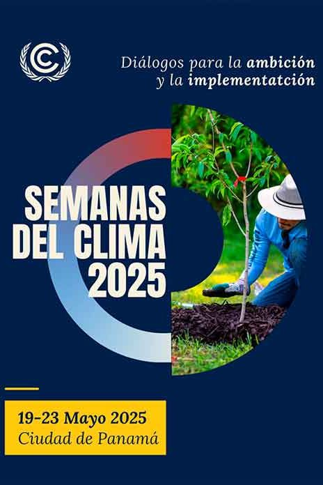
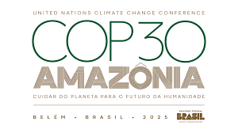

La Semana del Clima de América Latina y el Caribe 2025, celebrada en Ciudad de Panamá del 19 al 23 de mayo, se consolidó como un espacio clave para reforzar la cooperación regional frente a la crisis climática. Chile destacó por su liderazgo en justicia climática, integración de género y transición energética justa, en un contexto marcado por debates sobre financiamiento, participación ciudadana y preparación para la COP30 en Brasil.

## Enfoque regional: de la fragmentación a la integración climática

El evento, organizado por la Convención Marco de las **Naciones Unidas** sobre el Cambio Climático (**CMNUCC**), reunió a gobiernos, sociedad civil y sector privado para avanzar en la implementación de las Contribuciones Determinadas a Nivel Nacional (NDC), los Objetivos de Desarrollo Sostenible (ODS) y la acción climática global. El **Ministro de Ambiente de Panamá, Juan Carlos Navarro**, subrayó la necesidad de pasar de una acción fragmentada a un enfoque verdaderamente integrado, destacando que la Semana del Clima sería el punto de encuentro entre la política y la inversión para crear un impacto en la economía real. 

Entre los temas clave abordados se incluyeron la reducción de contaminantes climáticos de vida corta (SLCP), la transición energética justa y la necesidad de reformar la arquitectura financiera climática global. La Coalición por el Clima y el Aire Limpio (CCAC) destacó que la implementación de medidas para reducir los SLCP podría disminuir el calentamiento en América Latina y el Caribe en 0.9°C para 2050. 

<figure>

<figcaption>

Se estimó la participación de más de 2,000 personas proveniente de más de 35 países, Panamá fue la sede de la Semana del Clima para la Región de América Latina y el Caribe.

</figcaption>

</figure>

## Chile: liderazgo en justicia climática y transición energética

Chile tuvo una participación destacada en la Semana del Clima. La **ministra del Medio Ambiente, Maisa Rojas**, enfatizó la importancia de una transición socioecológica justa, señalando que el país ya ha puesto su cuota de zonas de sacrificio y que ahora se necesita un proceso de transformación y adaptación de los sistemas socioculturales hacia uno que venga con un equilibrio con el ecosistema y que atienda temas de derechos humanos, igualdad de género y trabajo decente. 

Además, Chile planteó la importancia de integrar los co-beneficios de la mitigación de SLCP en los procesos de evaluación y planificación, particularmente los beneficios para la salud y los ahorros económicos asociados. El país también destacó su impuesto verde sobre las emisiones de CO₂ y contaminantes locales como las partículas PM2.5. 

## Financiamiento climático: una demanda urgente

Uno de los consensos más fuertes fue la necesidad de reformar la arquitectura financiera climática global. Los países latinoamericanos hicieron un llamado a la priorización de la región en la asignación de recursos financieros de calidad, altamente concesionales, nuevos, adicionales, predecibles y en cantidad adecuada, de manera que no incrementen la carga de la deuda ni las presiones al limitado espacio fiscal de nuestros países. Se urgió a los países desarrollados a cumplir con sus compromisos de provisión y movilización de recursos, incluyendo la meta de movilizar el mínimo de 100.000 millones de dólares anuales en financiamiento climático. 

Chile, por su parte, ha sido reconocido por su liderazgo en justicia climática con enfoque de género, destacando su Ley Marco de Cambio Climático que prioriza la justicia climática y género, y a través de iniciativas como la Mesa de Género y Cambio Climático. 

## Controversias: exclusión de ambientalistas y tensiones sociales

La Semana del Clima no estuvo exenta de controversias. Ambientalistas panameños denunciaron su exclusión del evento, coincidiendo con protestas generalizadas en Panamá tras la firma de un contrato ley entre el Estado y la empresa Minera Panamá para explotar la mayor mina de cobre a cielo abierto de Centroamérica. Los activistas argumentaron que el contrato afecta la capacidad del país para mitigar y adaptarse al cambio climático y proteger su biodiversidad. 

## Camino a la COP30: desafíos y oportunidades

Con la COP30 programada entre el 10 y 21 de noviembre de 2025 en Brasil, la Semana del Clima de América Latina y el Caribe en Panamá se posicionó como un hito preparatorio clave. Chile, con su compromiso hacia la carbono neutralidad antes del año 2050 y su enfoque en la justicia climática, se perfila como un actor central en las negociaciones futuras. La ministra Maisa Rojas destacó que América Latina juega un rol clave en la transición verde y en el impulso de un desarrollo y crecimiento equitativo para el mundo. 

## Conclusión: una región en movimiento

La Semana del Clima de América Latina y el Caribe 2025 evidenció tanto los avances como los desafíos pendientes en la región. Chile reafirmó su liderazgo en justicia climática y transición energética justa, mientras que la región en su conjunto hizo un llamado urgente a una mayor ambición y cooperación internacional. La preparación para la COP30 será crucial para consolidar estos esfuerzos y avanzar hacia un futuro sostenible y equitativo.
